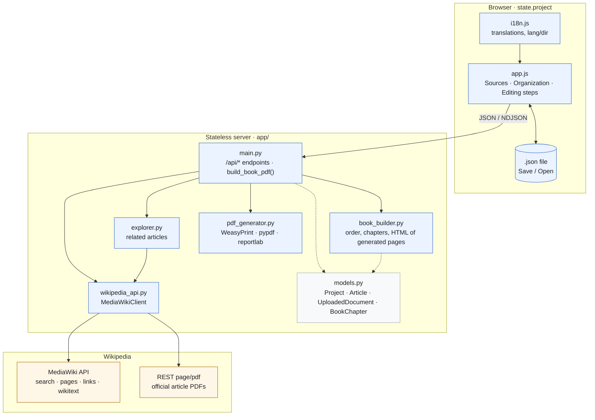
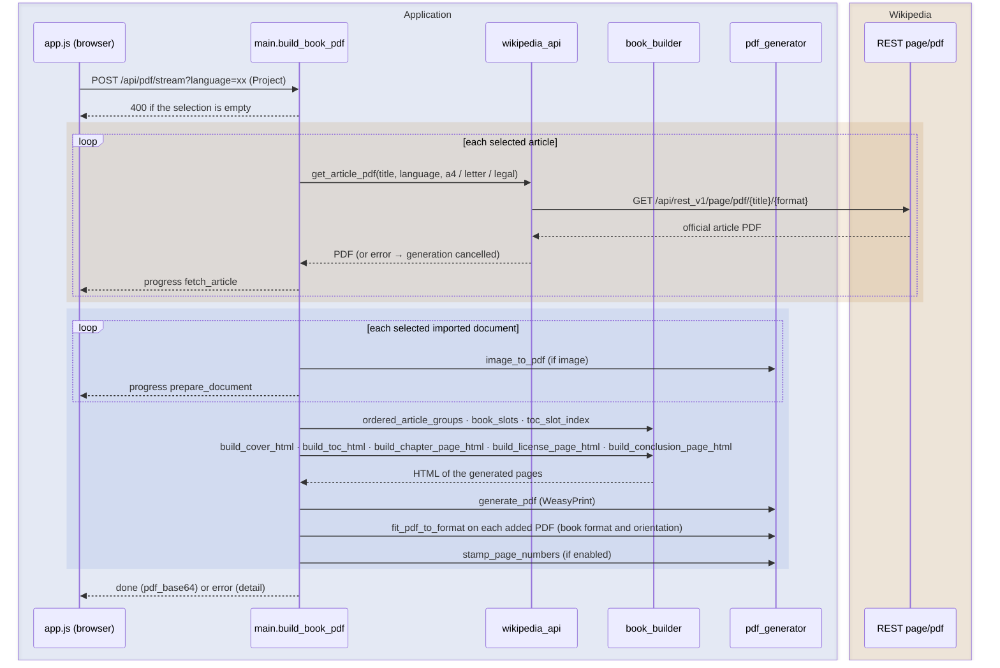

# Wikipedia2Book — Functional and technical specifications

Version: 1.1 — Status: aligned with the current implementation — Format: Markdown (`.md`)

This is the English translation of [SPECIFICATIONS.fr.md](SPECIFICATIONS.fr.md). The French document is the reference: if the two ever differ, the French version prevails. Interface labels are quoted as they appear in the English interface.

## Table of contents

- [1. Overview of Wikipedia2Book](#1-overview-of-wikipedia2book)
	- [1.1 Purpose](#11-purpose)
	- [1.2 Core principles](#12-core-principles)
- [2. The in-memory book and how it is saved](#2-the-in-memory-book-and-how-it-is-saved)
- [3. Adding articles](#3-adding-articles)
	- [3.1 Ways to add articles](#31-ways-to-add-articles)
	- [3.2 Information kept for each article](#32-information-kept-for-each-article)
	- [3.3 Automatically suggested introduction and author](#33-automatically-suggested-introduction-and-author)
- [4. Exploring related articles](#4-exploring-related-articles)
	- [4.1 Principle](#41-principle)
	- [4.2 Exploration depth](#42-exploration-depth)
	- [4.3 Exploration results](#43-exploration-results)
	- [4.4 Starting an exploration](#44-starting-an-exploration)
- [5. Selecting articles](#5-selecting-articles)
- [6. Organizing the book](#6-organizing-the-book)
	- [6.1 Imported documents (images and PDFs)](#61-imported-documents-images-and-pdfs)
- [7. Retrieving Wikipedia content](#7-retrieving-wikipedia-content)
- [8. References, images and licenses](#8-references-images-and-licenses)
- [9. Book format settings](#9-book-format-settings)
	- [9.1 Standard formats](#91-standard-formats)
	- [9.2 Custom format](#92-custom-format)
	- [9.3 Orientation](#93-orientation)
	- [9.4 Margins](#94-margins)
- [10. Book layout](#10-book-layout)
	- [10.1 Format and orientation, applied to every page](#101-format-and-orientation-applied-to-every-page)
	- [10.2 Page numbering](#102-page-numbering)
- [11. PDF generation](#11-pdf-generation)
	- [11.1 Process](#111-process)
	- [11.2 Result](#112-result)
	- [11.3 Error handling](#113-error-handling)
- [12. User interface](#12-user-interface)
	- [12.1 Interface languages](#121-interface-languages)
- [13. Technical architecture](#13-technical-architecture)
	- [13.1 Technologies](#131-technologies)
	- [13.2 Wikipedia API](#132-wikipedia-api)
	- [13.3 HTTP call examples](#133-http-call-examples)
	- [13.4 Docker and running locally](#134-docker-and-running-locally)
	- [13.5 Environments and branches](#135-environments-and-branches)
	- [13.6 Continuous integration (GitHub Actions)](#136-continuous-integration-github-actions)
	- [13.7 Toolforge](#137-toolforge)
	- [13.8 Usage statistics (Toolviews)](#138-usage-statistics-toolviews)
	- [13.9 Data model and save file](#139-data-model-and-save-file)
	- [13.10 Architecture diagrams](#1310-architecture-diagrams)
- [14. Security and robustness](#14-security-and-robustness)
- [15. Compliance with Wikipedia licenses](#15-compliance-with-wikipedia-licenses)
- [16. Acceptance criteria](#16-acceptance-criteria)
- [17. Project structure](#17-project-structure)
- [18. Status and future developments](#18-status-and-future-developments)
- [19. Version history](#19-version-history)

## 1\. Overview of Wikipedia2Book

### 1.1 Purpose

Wikipedia2Book is software for creating a printable PDF book directly from Wikipedia articles: there is no step for creating or managing a "project", and the user starts building the book right away.

As soon as the application opens, an empty book is ready to use. The user adds one or more main articles, explores the articles linked from them, chooses exactly which content to include, organizes the articles into chapters and generates a structured PDF document.

The software runs on every platform thanks to a Python architecture containerized with Docker.

### 1.2 Core principles

* The software is not limited to one topic or category of articles.

* Several main articles can be added to the same book.

* Exploration of Wikipedia links starts from an article chosen by the user (depth and maximum number of articles can be set through the API).

* No discovered article is ever added to the book automatically.

* The user keeps full control over which articles are selected.

* The book format is configurable (dimensions, orientation, margins).

* The resulting PDF is suitable for printing.

## 2\. The in-memory book and how it is saved

The software does not manage a list of projects: a single book is built at a time, entirely in the browser's memory.

* When the application opens, an empty book is created automatically; the user can give it a name and a description.

* All changes (articles, selection, organization, layout) are kept in the browser's memory during the session, and sent to the API only for the operations that need it (search, exploration, PDF generation).

* The user can explicitly download the state of the book as a JSON file, named after the book title (or, when no title is set, after the title of the book's first article).

* The user can import a previously downloaded JSON file to resume a book; the import replaces the current book.

* The server never persists any book or file on its disk: persistence is entirely up to the user, by downloading and later manually importing the JSON file.

The book contains in particular:

* The main articles.

* The discovered articles.

* The selection of articles.

* The structure of the book (order, chapters, presence and position of the table of contents).

* The layout settings.

* The cover information (title, subtitle, author, introduction, conclusion).

The full data model and the format of the JSON file are described in section 13.9.

## 3\. Adding articles

### 3.1 Ways to add articles

A single input field, in the Sources step, is used for every way of adding content: the user does not say what kind of thing they are typing, the software recognizes it by querying Wikipedia (`POST /api/sources/resolve`, which receives `input` and `language`):

* a `https://<language>.wikipedia.org/wiki/…` URL is read with the language of the URL; otherwise, the text is taken as a page title, in the Wikipedia language chosen next to the field. This selector offers FR, EN, DE, ES, IT, PT and NL; when the application opens, it is set to the browser language (main part of the code, for example `pt` for `pt-BR`, `no` for `nb`), added to the list if missing (for example JA). If the browser language is missing or not a valid code, EN is selected. This choice is saved neither in the book nor in the browser;

* the page is looked up on Wikipedia, following redirects: a page in the main namespace (an article) is added as an article; a page in another namespace (`User:…/Books/…`, `Book:…`, etc.) is imported as a book page;

* if no page has exactly that title, the Wikipedia search results are offered below the field, to be added with one click; a URL pointing to a page that does not exist is reported as not found.

Below the field, a permanent label reminds the user what can be typed: the URL of an article, a book page (URL or name) or the name of a Wikipedia page. Status messages (article added, pages imported, no exact page) are shown on a separate line underneath, without replacing that label. While typing text that is not a URL, search results are suggested as you type. The previous endpoints (`POST /api/articles`, `POST /api/books/structure`, `GET /api/search`) remain available.

The user can therefore add articles to the book in any of the following ways:

* URL of a Wikipedia article.

* Article title typed directly.

* Search in Wikipedia: results are suggested as you type, to be added with one click.

* URL of a Wikipedia "book" page listing articles: every article it references is imported and pre-selected, **in the order in which they appear on the book page** (not in alphabetical order — the MediaWiki API sorts links, so the software reads the page's wikitext to recover the real order). Only their title and URL are loaded at this stage; their full PDF is downloaded only at generation time. The structure of the book page is also kept: the first line of the form `=== … ===` becomes the book subtitle (only if the "Subtitle" field of the Editing step is empty), and each line starting with `;` opens a chapter that receives the articles listed below it, up to the next chapter (Organization step, section 6). The book keeps the exact order of the page: the articles placed before the first `;` stay without a chapter but **at the start of the book**, before the first chapter and without a chapter page or a "No chapter" heading (book setting `unassigned_first`, saved in the JSON file); this applies only if the book had no chapter yet before the import, otherwise those articles join the other articles without a chapter, at the end. Links and `''`/`'''` formatting in those lines are reduced to their text; a chapter without articles is ignored, and `== … ==` lines (title recorded by the book creator) are not used. The confirmation message links to the Wikipedia help page about books (`https://fr.wikipedia.org/wiki/Aide:Livres`).

Example of an article URL:

`https://fr.wikipedia.org/wiki/Épaves_de_la_rade_de_Saint-Pierre`

### 3.2 Information kept for each article

For each article, the software keeps:

* The title.

* The Wikipedia URL.

* The language.

* The summary, when it comes from a search (articles added by URL, by title or imported from a book page have no pre-filled summary).

* The Wikipedia page identifier, when known (search results).

The user can delete a main article without affecting the others.

### 3.3 Automatically suggested introduction and author

When the very first main article of the book is added (including the first article of an imported book page, section 3.1), the software automatically suggests, in the Editing step (section 12):

* The introduction of the book, from that article's introductory summary on Wikipedia.

* The author of the book, from the username (or the IP address, for an anonymous contribution) that created the page on Wikipedia.

This suggestion never replaces a field already filled in by the user, and remains fully editable. It is triggered only once, for the first article only — adding more articles afterwards does not trigger it again.

## 4\. Exploring related articles

### 4.1 Principle

The software explores the internal links of the main articles in order to suggest complementary articles, relying on the official MediaWiki API (`action=parse&prop=text`): links are read from the rendered HTML of the article, hence **in their order of appearance in the page** (banners, infobox and captions included), and not in alphabetical order as `prop=links` would return them. Ignored: links to pages that do not exist (red links), links outside the main namespace (`File:`, `Category:`, `Help:`, etc.), internal anchors, the page's link to itself and duplicates.

### 4.2 Exploration depth

The depth can be set between 0 and 3 on the API side (`/api/explore`); the interface always uses depth 1 (section 4.4):

| Depth | Behavior                                          |
| ----- | ------------------------------------------------- |
| 0     | No complementary article                          |
| 1     | Articles directly linked from the main articles   |
| 2     | Articles linked from depth-1 articles             |
| 3     | Articles linked from depth-2 articles             |

The maximum depth is capped at 3 levels to avoid excessive exploration.

### 4.3 Exploration results

For each discovered article, the software shows:

* Its title.

* Its URL.

* An "Add to book" button and a "×" button to dismiss it (section 5).

Above the list, a line recalls which article the suggestions come from ("Links from "…", in page order."). Duplicates are removed automatically (case-insensitive comparison of language and title), and articles already in "Your articles" are not suggested again.

### 4.4 Starting an exploration

* By default, the "Suggestions" section is empty and contains no button: a message invites the user to click "Related articles" on one of their articles.

* The "Related articles" button, present on every card in "Your articles", fills the list with the articles cited by that article, in page order (depth 1, up to 200 links). The button of the article whose links are shown is highlighted.

* Clicking "Related articles" on another article **clears the list** and fills it with the links of that new article: the list always shows the links of a single article at a time.

* No setting is required. The API, for its part, still accepts a depth from 0 to 3 and a maximum from 1 to 200.

* At the end, a message gives the number of suggestions found, then the page scrolls to the list; if the article cites no new article, a message says so.

## 5\. Selecting articles

This feature is essential.

No discovered article may be added to the book automatically.

The software presents the list of discovered articles ("Suggestions") and lets the user choose exactly which ones to keep.

Available features:

* "Add to book" on a suggestion: it leaves the suggestion list and joins "Your articles", checked, with a mention of the article it came from; a message confirms the addition. It then becomes a main article like any other: it can be unchecked, removed, or used as the starting point of a new exploration.

* "×" on a suggestion: it is removed from the list.

* "Add all": adds every visible suggestion (respecting the title filter). This button, the filter and the sort choice only appear when the list contains suggestions.

* Search by title among the suggestions.

* Sorting the suggestions, on the same line as the filter (which shrinks to make room for them, including on smartphones), with two buttons: "Page order" (order of appearance of the links in the article, the initial choice each time the application opens) or "A → Z" (alphabetical order according to the interface language, ignoring case and accents: "Éruption" is filed under E). Sorting combines with the filter; the sentence naming the source article states which order is shown. This choice is not saved in the book's JSON file.

* In "Your articles", a checkbox for each article indicates whether it is included in the book.

The selection is kept with the rest of the book, in memory and in the JSON export. When an older JSON file is opened, the discovered articles that were checked in it are moved to "Your articles", the others stay in the suggestions.

## 6\. Organizing the book

The user organizes the selected articles before generating the PDF.

Features:

* Reorder articles by drag and drop.

* Create chapters and give them a title.

* Move an article from one chapter to another, or out of any chapter, by drag and drop.

* Place the table of contents anywhere in the book by drag and drop: at the start, before any chapter or article (including in the middle of a chapter), or at the end. Its position is recorded relative to the item that follows it (`toc_position`: `start`, `end` or `before:<key>`, where the key is that of an article/document, `chapter:<id>` for a chapter, or `chapter:` for the "No chapter" group); if that item disappears from the book, the table of contents goes back to the start.

* Remove the table of contents from the book ("Remove" button on its row), then put it back ("+ Table of contents" button in the toolbar, which places it back at the start).

* When the book has chapters, the articles that belong to no chapter are shown at the end of the list, under the "No chapter" heading, as in the PDF. Exception: for a book imported from a Wikipedia book page in which articles precede the first chapter (section 3.1), those articles are shown and placed in the PDF at the start, before the first chapter, without a heading or chapter page.

* Add a general introduction and a conclusion.

* Turn page numbering on or off (on by default).

An article can be moved freely within the structure of the book.

### 6.1 Imported documents (images and PDFs)

In the Organization step, the user can also import their own files (image or PDF) to include them in the book as if they were articles:

* Accepted formats: images (`image/*`) and PDF (`application/pdf`); 15 MB maximum per file.

* An imported document appears in the list of items to organize just like an article: it can be reordered, moved into a chapter, and its starting page appears in the table of contents if page numbering is on.

* An imported image is included as a full page, centered and scaled to the book format; an imported PDF is included as is, page by page.

* The document can be deselected (excluded from the book without being deleted) or removed permanently, independently of the other documents and articles.

* The file content is kept base64-encoded in the book state and in the JSON export, so that the PDF can be regenerated or the book resumed without importing the file again.

## 7\. Retrieving Wikipedia content

Adding and exploring do not download the full content of pages. When the PDF is generated, each selected article is retrieved through the official Wikimedia PDF endpoint (`/api/rest_v1/page/pdf/{title}/{format}`), equivalent to Wikipedia's "Download as PDF" feature. Wikipedia only lays out its PDFs in three formats (`a4`, `letter`, `legal`, always portrait): the software requests `letter` for a Letter book, `legal` for a Legal book, and `a4` for every other format (A0 to A6, custom). For Letter and Legal, the article pages are therefore laid out by Wikipedia directly in the right format, with no white margins caused by a change of proportions.

The content of each article (text, structure, images, references) is never rebuilt: it is exactly that of the official Wikipedia PDF. Only its physical layout changes: each page is recomposed (scaled and centered, without distortion) onto the format and orientation chosen for the book — see section 10.1.

## 8\. References, images and licenses

The software does not rebuild article content: each selected article is included as the official PDF generated by Wikipedia. As a result:

* References and citations stay exactly those of the Wikipedia PDF, with their original formatting.

* Images and their captions are those embedded by Wikipedia in its PDF export, with their original layout.

* Credits and licenses for texts and images are those printed by Wikipedia in its own PDF; the software does not extract them or rewrite them separately.

* If Wikipedia cannot produce a PDF for a selected article (page not found, service unavailable, invalid response), the generation of the whole book fails and an explicit error message is shown; no partial book is produced.

* The only exception to the integrity of the official PDF: when page numbering is on (section 10), a page number is overlaid at the bottom of every page, including article pages — without touching the content, credits or license notices printed by Wikipedia.

## 9\. Book format settings

The document format is fully configurable.

### 9.1 Standard formats

Available formats:

| Format | Dimensions    |
| ------ | ------------- |
| A0     | 841 × 1189 mm |
| A1     | 594 × 841 mm  |
| A2     | 420 × 594 mm  |
| A3     | 297 × 420 mm  |
| A4     | 210 × 297 mm  |
| A5     | 148 × 210 mm  |
| A6     | 105 × 148 mm  |
| Letter | 216 × 279 mm  |
| Legal  | 216 × 356 mm  |

A4 is offered by default, without being imposed.

### 9.2 Custom format

The user can enter:

* The width in millimeters.

* The height in millimeters.

### 9.3 Orientation

Two orientations are available:

* Portrait.

* Landscape.

### 9.4 Margins

The user first chooses a predefined set of margins:

| Preset       | Top | Bottom | Inside | Outside | Binding |
| ------------ | --- | ------ | ------ | ------- | ------- |
| Standard     | 18  | 18     | 18     | 16      | 0       |
| Narrow       | 10  | 10     | 12     | 10      | 0       |
| Wide         | 25  | 25     | 25     | 22      | 0       |
| For binding  | 18  | 18     | 20     | 16      | 10      |

Values in millimeters; "Standard" matches the default values. Choosing "Custom", or expanding "Fine-tune margins (mm)", gives access to each margin individually. The preset shown is derived from the book's values: as soon as a margin no longer matches any preset, "Custom" is shown. Presets are not saved as such in the book or in the JSON export, only the five values are.

The margins that can be set individually are:

* The top margin.

* The bottom margin.

* The inside margin.

* The outside margin.

* The binding margin, added to the inside margin.

## 10\. Book layout

The PDF is structured like a real book.

Items generated by the application:

* Cover (book title, subtitle, author, note, generation date).

* Introduction, if one was entered.

* Table of contents, grouped by chapter.

* Chapter title pages, for each chapter containing articles.

* License page (section 15), always present, placed after the last article (and after the table of contents if it is at the end of the book), just before the conclusion.

The table of contents may be absent if the user removed it (section 6).

* Conclusion, if one was entered.

The content of articles and imported documents is not laid out by the application: these are the pages of their original PDF (official Wikipedia PDF, or imported document). Their physical format, however, is always harmonized with the rest of the book — see section 10.1.

The cover and the table of contents are two separate sections in the final PDF: the position chosen for the table of contents in the Organization step (section 6) is the one actually used at generation — the cover always stays the first page, and the table of contents is inserted exactly where chosen: right after the cover, before a chapter (before its title page), before an article, or after the last article (before the license and the conclusion).

Navigation in the final PDF relies on bookmarks (cover, table of contents, one entry per chapter and per article, license, conclusion), not on links in the table of contents.

### 10.1 Format and orientation, applied to every page

Every page of the final PDF follows the format and orientation chosen for the book (section 9), without exception:

* The pages generated by the application (cover, introduction, table of contents, chapter pages, license, conclusion) are produced natively in that format.

* Each article page (official Wikipedia PDF) and each page of an imported document is recomposed onto a page of that same format: its content is scaled and centered, keeping its original proportions (no distortion). If the proportions of the source page differ from those of the book, white margins appear on the sides or at the top/bottom rather than distorting the content.

* The content itself (text, images, references) is never modified or rebuilt — only its scale and position on the page change.

### 10.2 Page numbering

The "Number the pages" option (section 6) is on by default and can be turned off.

When it is on:

* Every page of the book shows a number at the bottom, continuously — including article pages and imported documents, except the cover.

* The table of contents shows, for each chapter and each article, the number of the page where it starts.

* To compute these numbers before assembling the book, the software first generates the cover and, unless it is placed at the end, the table of contents, in order to measure their page count (the numbers of the items placed after the table of contents take it into account); it then regenerates the table of contents with the correct numbers. In rare cases (very dense book), adding the numbers to the table of contents may shift this pagination slightly by one page.

No preview feature is currently offered.

## 11\. PDF generation

### 11.1 Process

The "Generate PDF" button is always visible and active, whichever tab is shown; if no article or document is selected, a message says so when the button is clicked, rather than disabling the button.

Once the PDF is started, the software:

* Checks that at least one article or document is selected; otherwise, generation is refused.

* Downloads the official PDF of each selected article; decodes each selected imported document (section 6.1), converting an image into a PDF page if needed.

* If page numbering is on, computes in advance the starting page of each chapter and each article (section 10.2).

* Generates the cover (with the introduction, if any) and the table of contents (with page numbers if enabled) as two separate sections; the cover receives the root bookmark carrying the book title.

* Inserts the table of contents at the chosen position (section 6), or omits it if it was removed.

* For each chapter (or for all the articles if there is no chapter): generates a chapter title page with its own bookmark, then adds the official PDF of each article of the chapter, with one bookmark per article.

* Recomposes each added page (cover, table of contents, chapters, articles, imported documents) onto the format and orientation chosen for the book (section 10.1), before assembling it into the final document.

* Adds a license page with a "License" bookmark (section 15), after the last chapter/article and after the table of contents if it is placed at the end of the book.

* Adds a conclusion page with a bookmark, if a conclusion was entered — always after the table of contents, even when it is placed at the end of the book.

* If page numbering is on, overlays a page number at the bottom of every page of the assembled document (except the cover).

* Merges everything into a single PDF file and makes it available for download, named after the book title.

Throughout generation, a status window shows the current step as "Step n / total", with its label (in the interface language) and a progress bar. The steps are, in order: downloading each article (one step per article, with its title) or preparing each imported document, computing page numbers (if numbering is on), composing the cover and the table of contents, assembling the pages in the book format, numbering the pages (if enabled), then finalizing the file. The total is known from the start. The window closes at the end, on success as well as on failure.

On the server side, this progress is sent by the `POST /api/pdf/stream` endpoint, which returns an NDJSON stream (one JSON line per event): `{"type": "progress", "step", "total", "code", "title"?}` for each step, then `{"type": "done", "pdf_base64"}` with the base64-encoded PDF, or `{"type": "error", "detail"}` if generation fails along the way. An empty selection is refused before the stream starts (HTTP error 400). The `POST /api/pdf` endpoint, which returns the PDF file directly without progress, remains available for direct use of the API.

Two high-level generation endpoints also return a PDF file directly: `POST /api/books/generate` receives an explicit list of article references (title or URL), the metadata and the main layout settings; `POST /api/books/generate-from-wikipedia-book` receives the URL of a Wikipedia book page and an optional book title. In the latter case, every article listed by Wikipedia is included in its order of appearance and selected for generation, together with the chapters (`;` lines) and, unless `book_subtitle` is provided, the subtitle (`=== … ===` line) of the book page, as with the import in the interface (section 3.1). `POST /api/books/structure` returns this reading without generating a PDF (`articles`, `subtitle`, `chapters` in the book's chapter format, `unassigned_first` true when articles precede the first chapter); `POST /api/books/import` returns only the list of articles. Without `book_title`, the book title (cover, bookmark, PDF file name) is the last part of the book page name: `Utilisateur:X/Livres/Les épaves` gives "Les épaves", `Livre:Animaux` gives "Animaux". The `book_conclusion` parameter (GET and POST) sets the text of the conclusion page; it defaults to `Generated by https://wikipedia2book.toolforge.org/`, and an empty value removes the conclusion page. These endpoints keep no book on the server side.

### 11.2 Result

The resulting PDF is:

* Printable and structured with navigation bookmarks.

* Consistent, on every page, with the format and orientation chosen for the book.

* Faithful to the content of the official Wikipedia PDF for articles, and of each imported document.

* Compatible with common PDF readers.

### 11.3 Error handling

On failure, the software shows an explicit message. Possible errors are:

* No article selected before export.

* Invalid URL, article title or language code.

* Book page or article not found on Wikipedia.

* Wikipedia API unreachable, or official PDF unavailable/invalid for an article: the whole generation fails, without producing a partial book.

* Unexpected failure while assembling the PDF.

## 12\. User interface

The application is a single page, organized in three steps reachable through tabs, with no screen for creating or managing a project. The step tabs are shown directly below the top bar: the book title and the cover note are not shown above the steps, they are entered only in the Editing step (part A, "Book identity").

**Default title:** if the book title field is left empty, the title used (cover, root bookmark, name of the PDF and JSON files) is that of the book's first Wikipedia article, in the order defined in the Organization step (failing a Wikipedia article, the first imported document). This default title is shown greyed out in the empty field, so that the user knows what will be printed; it is computed at generation time and is not saved in the book. A title imported from a Wikipedia book page (section 3.1) or entered by the user always takes precedence.

* 01 — Sources: adding the main articles (shown under the "Your articles" heading) and exploring links (discovered articles, shown under the "Suggestions" heading).

* 02 — Organization: reordering articles, chapters, position or removal of the table of contents.

* 03 — Editing: book identity (title, subtitle, author, cover note, introduction, conclusion) and print format (paper size, orientation, margin preset, page numbering).

At the bottom of the Sources and Organization steps, a "Next step: …" button opens the next step and scrolls back to the top of the page.

The footer shows the logo, the API connection status, a link to the project's Git repository (https://github.com/gmoulard/wikipedia2book, opened in a new tab), then the version number, the commit, the date and the author of the deployment.

A top bar lets the user, at any time, open a saved book ("Open" button, JSON import), save the book on their computer ("Save" button, JSON export) and start PDF generation. It also shows whether the current book has been saved. On smartphones, the "Open" and "Save" buttons show only their icon and the application name is hidden, so that the bar fits the width of the screen.

The interface can be used on desktop, tablet and smartphone, and follows the system's light/dark theme.

Its look follows Wikimedia's Codex design system (colors, buttons, tabs, fields, 2 px corners, sans-serif system fonts and serif headings as on Wikipedia), to fit into the Wikimedia environment. No font or resource is loaded from a third-party service (no Google Fonts).

### 12.1 Interface languages

The interface (labels, buttons, messages) is available in French, English, Spanish, Portuguese, Italian, German, Dutch, Turkish, Chinese, Japanese, Arabic and Persian, through a selector in the top bar. Arabic and Persian are displayed right to left: the whole page then switches to `rtl` writing direction (`dir` attribute of the document), and goes back to `ltr` for the other languages. The chosen language is remembered in the browser (it is not saved in the book or in the JSON export) and detected automatically on the first visit from the browser language, falling back to English when it is not one of the 12 languages.

This interface language is independent of the language of the Wikipedia articles (section 3), which remains a separate per-article setting. It does not apply to error messages returned by the server. It is, however, sent to the server when the PDF is generated (`language` parameter of `/api/pdf` and `/api/pdf/stream`, French by default, any value other than the 12 interface languages is refused): the titles and labels added by the application to the PDF are then written in that language — "Introduction", "Table of contents", the "Chapter" mention on chapter pages, "No chapter", "Conclusion", "License", "Sources and authors", "History and authors", the "Edition of …" mention on the cover, as well as the corresponding bookmarks. The generated pages carry the chosen language (`lang` attribute) and switch to right-to-left writing for Arabic and Persian. The license page is written entirely in that language: translated official name of the CC BY-SA 4.0 license, link to the version of the license deed in that language on creativecommons.org, reuse conditions, notices about media, imported documents and the unofficial nature of the book. Text entered by the user (title, introduction, conclusion, chapter titles) and the content of Wikipedia articles are never translated.

## 13\. Technical architecture

### 13.1 Technologies

| Component            | Technology used |
| -------------------- | --------------- |
| Language             | Python 3.12 |
| Backend              | FastAPI + Uvicorn |
| HTTP client          | httpx (calls to the MediaWiki API and to the PDF endpoint) |
| HTML parsing         | BeautifulSoup4 (search snippets, links of rendered articles) |
| Interface            | HTML, CSS, JavaScript (single page, no framework) |
| Internationalization | Internal JavaScript dictionary (`i18n.js`), FR/EN/ES/PT/IT/DE/NL/TR/ZH/JA/AR/FA, no external dependency |
| Wikipedia API        | MediaWiki API (`action=query`, `action=parse`) + REST endpoint `page/pdf` |
| Book exchange        | JSON browser ↔ API |
| PDF generation       | Official Wikimedia PDF (articles) + WeasyPrint (cover, table of contents, chapters, license, conclusion) + pypdf (merging, bookmarks, page count, recomposition to the book format) + reportlab (page numbers, conversion of an imported image into a PDF page) |
| Containerization     | Docker |

### 13.2 Wikipedia API

All exchanges with Wikipedia go through the `MediaWikiClient` class in `app/wikipedia_api.py`; no other module calls Wikipedia. Two services are used, on the wiki of the article's language (`<language>` = code validated by `^[a-z0-9-]{2,12}$`):

* **MediaWiki API (Action API)**: `https://<language>.wikipedia.org/w/api.php`, with GET, always with `format=json&formatversion=2` and, by default, `action=query`.
* **REST API**: `https://<language>.wikipedia.org/api/rest_v1/page/pdf/<title>/<format>`, for the official PDF of an article (spaces in the title are replaced with `_` and it is URL-encoded).

| Use | Call and parameters | Function | Used by | Section |
| --- | --- | --- | --- | --- |
| Search for articles | `list=search&srsearch=<text>&srlimit=<1–20>&srnamespace=0` | `search` | `GET /api/search`, `POST /api/sources/resolve` (fallback when no exact page exists) | 3.1 |
| Recognize a page (article or book page), following redirects | `prop=info&titles=<title>&redirects=1` (final title and namespace `ns`) | `get_page` | `POST /api/sources/resolve` | 3.1 |
| Read a book page in its real order, with subtitle and chapters | `prop=revisions&titles=<title>&rvprop=content&rvslots=main` (wikitext) | `get_book` | `POST /api/books/structure`, `/api/books/import`, `/api/sources/resolve`, `/api/books/generate-from-wikipedia-book` | 3.1 |
| Links of an article, in page order | `action=parse&page=<title>&prop=text&redirects=1&disabletoc=1` (rendered HTML, read with BeautifulSoup) | `get_links` | `POST /api/explore` (through `explorer.py`) | 4.1 |
| Introduction of an article | `prop=extracts&titles=<title>&exintro=1&explaintext=1` | `get_intro_and_creator` (1st call) | `GET /api/articles/intro` | 3.3 |
| Creator of a page (first revision) | `prop=revisions&titles=<title>&rvlimit=1&rvdir=newer&rvprop=user` | `get_intro_and_creator` (2nd call) | `GET /api/articles/intro`, `/api/books/generate-from-wikipedia-book` (creator of the book page, used as author when `book_author` is missing) | 3.3 |
| Official PDF of an article | REST `page/pdf/<title>/<a4, letter or legal>` | `get_article_pdf` | PDF generation (`/api/pdf`, `/api/pdf/stream`, `/api/books/generate*`) | 7 |

Common rules:

* Dedicated `User-Agent` header: `Wikipedia2Book/0.1 (https://github.com/gmoulard/wikipedia2book; MediaWiki API client)`.
* Timeouts: 20 seconds for the MediaWiki API, 120 seconds for downloading a PDF.
* Errors: a network failure, an HTTP error response, a non-JSON response or an `error` field from the MediaWiki API produce an explicit error, returned by the application's API with code 502 (404 for a page not found, 422 for invalid input). A REST response that does not start with `%PDF-` is refused; during generation, any error on an article cancels the whole book (section 8).
* No data is cached or kept: each operation makes its calls again.

### 13.3 HTTP call examples

The examples below assume that the server runs on `http://localhost:8000`. Replace this address with the deployment's domain to call a remote instance.

#### In a web browser

GET endpoints can be opened directly in the address bar:

* Search for articles: `http://localhost:8000/api/search?query=Albert%20Einstein&language=fr&limit=5`.

* Get the introduction and the creator of an article: `http://localhost:8000/api/articles/intro?title=Albert%20Einstein&language=fr`.

* Generate the PDF of a Wikipedia book page: `http://localhost:8000/api/books/generate-from-wikipedia-book?url=https%3A%2F%2Ffr.wikipedia.org%2Fwiki%2FLivre%3AAnimaux`. The `url` parameter is required; `language` is optional and defaults to `fr`. Also accepted, all optional: `book_title`, `book_subtitle`, `book_author`, `book_conclusion`, `page_format`, `orientation`, `page_numbers`, `table_of_contents`. The PDF is returned as a download.

* Check that the service responds: `http://localhost:8000/health`.

* Show the interactive documentation and also call the POST endpoints: `http://localhost:8000/docs`.

The GET endpoint for generating from a Wikipedia book page can be called directly in the browser. The other PDF generation endpoints use POST; for those, use `curl` or the interactive documentation at `/docs`.

#### With curl

Recognize an input (URL, book page or title) and get the matching article, book or search results (`kind` = `article`, `book` or `search`):

```bash
curl --fail --show-error --request POST 'http://localhost:8000/api/sources/resolve' \
	--header 'Content-Type: application/json' \
	--data '{"input":"Albert Einstein","language":"fr"}'
```

Generate a PDF from an explicit list of article references:

```bash
curl --fail --show-error --request POST 'http://localhost:8000/api/books/generate?language=fr' \
	--header 'Content-Type: application/json' \
	--data '{"book_title":"Animaux","articles":[{"title":"Chat","language":"fr"},{"url":"https://fr.wikipedia.org/wiki/Chien"}]}' \
	--output animaux.pdf
```

Generate a PDF from a Wikipedia book page, replacing the example URL with that of an existing book page:

```bash
curl --fail --show-error --request POST 'http://localhost:8000/api/books/generate-from-wikipedia-book?language=fr' \
	--header 'Content-Type: application/json' \
	--data '{"url":"https://fr.wikipedia.org/wiki/Livre:Animaux","book_title":"Animaux","book_conclusion":"Bonne lecture !"}' \
	--output animaux.pdf
```

The same generation can be called with GET and only the URL of the book page:

```bash
curl --fail --show-error --get 'http://localhost:8000/api/books/generate-from-wikipedia-book' \
	--data-urlencode 'url=https://fr.wikipedia.org/wiki/Livre:Animaux' \
	--output animaux.pdf
```

In both cases, the response is the binary PDF file; `--output` saves it locally. `language` sets the language of the labels generated in the PDF, and the supported languages are those of section 12.1.

### 13.4 Docker and running locally

The software ships with:

* A `Dockerfile` (Python 3.12-slim image with WeasyPrint's system dependencies and the DejaVu and Noto CJK fonts).

* A `requirements.txt` file.

* A `docker-build.sh` script that builds the image while injecting the current git commit, date and author, shown in the application's footer.

Example:

```bash
sh docker-build.sh
docker run --rm -p 8000:8000 wikipedia2book
```

The application is then available at `http://localhost:8000`, with its interactive documentation at `http://localhost:8000/docs`.

The application page (`/`) and its files (`/static/…`) are served with `Cache-Control: no-cache`: the browser revalidates each file on every load (304 response if unchanged), which avoids mixing, after a deployment, a new page with old scripts or translations still in cache.

The server stores no book or PDF on disk; all the state is kept in the browser and exchanged through JSON. Deployment therefore needs neither a database nor a persistent volume, on any platform.

### 13.5 Environments and branches

The application is deployed on three platforms, each linked to a branch of the GitHub repository `gmoulard/wikipedia2book`:

| Platform | URL | Branch followed | Image build | Trigger |
| --- | --- | --- | --- | --- |
| Toolforge (Wikimedia Cloud) | https://wikipedia2book.toolforge.org | `production-toolforge` | Toolforge buildpacks (`Procfile`, `Aptfile`, `.python-version`) | The repository's GitHub Actions workflow (section 13.6) |
| Railway | https://wikipedia2book-production.up.railway.app | `main` | `Dockerfile` | Railway's GitHub integration, set in its interface |
| Northflank | https://prod--wikipedia2book--wkvpbnfj6h4v.code.run | `main` | `Dockerfile` | Northflank's GitHub integration, set in its interface |

Toolforge is the reference instance, offered to the Wikipedia community. Railway and Northflank receive every change pushed to `main` and serve as pre-production.

Release cycle:

1. Develop and push to `main` (or through a pull request to `main`): tests run on GitHub Actions, Railway and Northflank redeploy, Toolforge is not touched.
2. Check the new version on Railway or Northflank.
3. Publish to Toolforge by moving the production branch forward:

```bash
git push origin main:production-toolforge
```

`production-toolforge` receives no commits of its own: it only moves forward to a commit already on `main`. Going back to an earlier version on Toolforge is done by pushing an older `main` commit to it (`git push --force origin <commit>:production-toolforge`).

The branch choice for Railway and Northflank is not part of the repository: it is changed in their interfaces (Railway: service, Settings, Source, Branch; Northflank: build service, Build settings, Branch).

### 13.6 Continuous integration (GitHub Actions)

Three workflows. The main one, `.github/workflows/deploy-toolforge.yml` ("Tests and Toolforge deploy"), has two jobs:

* `test`: on every push to `main` or `production-toolforge`, on every pull request and on manual start (`workflow_dispatch`). Installs Python 3.12 and `requirements.txt`, then runs `python -m unittest discover -s tests -v`.

* `deploy`: only after `test` succeeds, and only for a push (or a manual start) on `production-toolforge`; it is skipped everywhere else. It writes the SSH key from the GitHub secret `TOOLFORGE_SSH_KEY`, pins the ED25519 fingerprint of `login.toolforge.org` in `known_hosts` (no blind trust on first contact), then runs `toolforge-deploy.sh` in the tool account:

```bash
ssh <login>@login.toolforge.org "become wikipedia2book bash -s" < toolforge-deploy.sh
```

Toolforge deployments are serialized (concurrency group `toolforge-deploy`, without cancelling the deployment in progress); other runs are independent.

The `TOOLFORGE_SSH_KEY` secret contains an OpenSSH private key dedicated to deployment, separate from the personal key, whose public part is registered on the Wikimedia account (idm.wikimedia.org). Revoking it is enough to cut off automatic deployment without touching other access.

The second, `.github/workflows/toolviews-stats.yml` ("Toolviews stats"), updates the usage statistics every day (section 13.8).

The third, `.github/workflows/jekyll-gh-pages.yml`, publishes on every push to `main` (and on manual start) the documentation site https://gmoulard.github.io/wikipedia2book/ with GitHub Pages: Jekyll converts the Markdown files at the root of the repository to HTML (`README.md` as the home page, `SPECIFICATIONS.fr.md` and `SPECIFICATIONS.en.md` as pages). This is the address declared as user documentation in `toolinfo.json`. GitHub Pages does not render Mermaid blocks natively: `_includes/head-custom.html`, added by Jekyll to the head of every page (default theme), loads Mermaid 11.4.1 from jsDelivr and draws the ```` ```mermaid ```` blocks (section 13.10).

### 13.7 Toolforge

#### Toolforge-specific files

Toolforge builds the image with buildpacks and ignores the `Dockerfile`. The repository provides:

* `Procfile`: `uvicorn` command on port 8000, as expected by Toolforge.

* `Aptfile`: the same system dependencies and fonts as the `Dockerfile`.

* `.python-version`: Python 3.12.

* `toolforge-fonts.conf`: the fonts from the `Aptfile` (including Noto CJK for Chinese and Japanese) are installed in `/layers/fagiani_apt/apt/usr/share/fonts`, outside the folders read by fontconfig; this file adds them and puts the fontconfig cache in `/tmp` (without it, WeasyPrint does not find Noto CJK and the log shows "Fontconfig error: No writable cache directories").

* `toolforge-deploy.sh`: deployment script, run in the tool account.

* `toolinfo.json`: the tool's record in Toolhub format (toolinfo schema 1.2.2, validated against Toolhub's official schema: name, description, URL, API, repository, bug tracker, AGPL-3.0 license, author and their Wikimedia account `474D6F756C617264`, user documentation https://gmoulard.github.io/wikipedia2book/, interface languages; `keywords` is a comma-separated string there, not a list), to be registered on https://toolhub.wikimedia.org through its raw GitHub URL (`https://raw.githubusercontent.com/gmoulard/wikipedia2book/main/toolinfo.json`). The interface languages it declares must remain those of `SUPPORTED_LANGUAGES`.

#### Deployment script

`toolforge-deploy.sh`:

1. starts the build of the `production-toolforge` branch (`toolforge build start --detach --json --use-latest-versions --ref production-toolforge`) and reads from the response the build identifier and the commit actually built (`resolved_ref`);
2. follows that specific build by its identifier until it ends (15 minutes at most), and prints its logs on failure;
3. creates or updates the environment variables `FONTCONFIG_FILE=/workspace/toolforge-fonts.conf` and `GIT_COMMIT=<built commit>` (the image contains no git repository: the footer reads the commit from this variable);
4. restarts the webservice (`toolforge webservice buildservice restart`);
5. checks, for at most 200 seconds, that `https://wikipedia2book.toolforge.org/api/version` does return that commit, and prints the webservice logs otherwise.

Any failing step stops the script with an error code, which makes the workflow fail.

`--use-latest-versions` is required: with the default buildpack versions, fetching the `Aptfile` packages fails (`libharfbuzz-subset0`) as soon as the tool's apt cache is emptied. Following the build by its identifier, rather than "the latest build", avoids reading the state of a previous build before the new one is registered.

#### Initial setup

To be done once, from `login.toolforge.org`, in the tool account (`become wikipedia2book`):

```bash
toolforge envvars create FONTCONFIG_FILE /workspace/toolforge-fonts.conf
toolforge build start --use-latest-versions --ref production-toolforge https://github.com/gmoulard/wikipedia2book
toolforge webservice buildservice start --mount=none --mem 2Gi --cpu 1
```

`--mount=none`: the application does not use Toolforge's NFS storage. `--mem 2Gi --cpu 1`: WeasyPrint and the assembly of PDFs of several hundred pages exceed the 512 Mi allocated by default.

#### Manual deployment and operations

* Redeploy without a new commit: restart the workflow on the `production-toolforge` branch from GitHub's Actions tab, or run the script by hand:

```bash
ssh <login>@login.toolforge.org "become wikipedia2book bash -s" < toolforge-deploy.sh
```

* Status and logs, in the tool account: `toolforge webservice status`, `toolforge webservice logs -f`, `toolforge build list`, `toolforge build logs <identifier>`, `toolforge envvars list`.

* Port 22 of `login.toolforge.org` may be blocked by some corporate networks; GitHub Actions runners do not have this limitation.

### 13.8 Usage statistics (Toolviews)

The application measures nothing itself (stateless server, no tracker). Traffic figures come from Toolviews (https://toolviews.toolforge.org/api/), which counts the requests received by Toolforge's front proxy for each tool. These tools are auxiliary: they are not part of the deployed application and do not change its version.

#### Script `scripts/toolviews_stats.py`

Local script (Python standard library only) that fills a CSV file with the tool's daily traffic:

```bash
python scripts/toolviews_stats.py [file.csv]
```

* File: `toolviews.csv` by default (ignored by git on `main`), separated by semicolons so that it opens directly in a French-locale Excel, with the header `date;hits;unique_visitors`.
* Sources: `https://toolviews.toolforge.org/api/v1/tool/wikipedia2book/daily/<start>/<end>` for requests (`hits`) and `…/api/v1/unique/tool/wikipedia2book/daily/<start>/<end>` for distinct IP addresses (`unique_visitors`); two calls for the whole missing period.
* Days processed: only those missing from the CSV, from 1 November 2026 to the day before; the current day, incomplete, is never written. A day already present is never recomputed (to correct a value, delete the line and run again).
* Days without visits: Toolviews does not return them; they are written as 0 up to the last day published by Toolviews (or already in the CSV). Later days, not yet published, are not written, so as not to freeze a provisional 0.
* Robustness: an older comma-separated file is read and rewritten with semicolons; a locked file (open in Excel) produces an explicit message; a network error or an invalid Toolviews response stops the script with an error code.
* Tests: `tests/test_toolviews_stats.py` (fake `fetcher`, no network).

#### Daily update (GitHub Actions)

`.github/workflows/toolviews-stats.yml` ("Toolviews stats") runs every day at 06:30 UTC, and on manual start (`workflow_dispatch`). It fetches `toolviews.csv` from the `stats` branch (created on its first run, an orphan branch containing only that file), runs the script, then commits the file to `stats` if it changed, as `github-actions[bot]`. The file can be viewed at https://github.com/gmoulard/wikipedia2book/blob/stats/toolviews.csv.

The CSV is never committed to `main`: a daily push would redeploy Railway and Northflank and rerun the tests. The `stats` branch must not be merged into `main`.

#### Reading the figures

* `hits` counts HTTP requests, not people: one visit loads the page, the static files, `/api/version`, then each search or generation. It does not distinguish the web interface from the API (only the webservice logs, `toolforge webservice logs`, do, and they are erased on each redeployment).
* `unique_visitors` has been 0 for every Toolforge tool since the setup (Toolviews counter inactive); the column is kept for the day it is restored.

### 13.9 Data model and save file

The complete state of the book is a `Project` object (`app/models.py`), the same in the browser (`state.project`), in API requests and in the save file. The name `Project` is historical and kept for compatibility with files already exported. Any out-of-range value is refused by the API (error 422).

#### Save file (JSON)

The download button produces a `<book-title>.json` file (non-alphanumeric characters removed, spaces replaced by hyphens; `livre.json` if the resulting name is empty):

```json
{
  "format": "wikipedia2book-workspace",
  "version": 1,
  "saved_at": "2026-11-13T12:00:00.000Z",
  "projects": [ { "id": "…", "name": "…", "main_articles": [], "…": "…" } ]
}
```

On import, the following are accepted: this format in version 1 (any other version is refused with a message), an array of books, or a single book (object with `id` and `name`). Only the first book is loaded; it replaces the current book, after confirmation if that book has changes that were not downloaded. Imported documents are included in base64, which can make the file large.

#### `Project` (the book)

| Field | Type, default | Constraints / role |
| --- | --- | --- |
| `id` | text, generated UUID | book identifier |
| `name` | text | 1 to 120 characters; internal name of the book |
| `description` | text, `""` | at most 2,000 characters |
| `main_articles` | list of `Article` | articles added by the user ("Your articles") |
| `discovered_articles` | list of `Article` | articles found by link exploration |
| `uploaded_documents` | list of `UploadedDocument` | imported images and PDFs |
| `book_title` | text, `""` | at most 200 characters |
| `book_subtitle` | text, `""` | at most 300 characters |
| `book_author` | text, `""` | at most 200 characters |
| `introduction` | text, `""` | at most 20,000 characters |
| `conclusion` | text, `""` | at most 20,000 characters; empty = no conclusion page |
| `page_format` | `A0`…`A6`, `Letter`, `Legal`, `custom`; `A4` | page format (section 9.1) |
| `custom_width_mm`, `custom_height_mm` | numbers, 148 × 210 | 50 to 1,000 mm; used when `page_format` = `custom` |
| `orientation` | `portrait` or `landscape`; `portrait` | orientation (section 9.3) |
| `margin_top_mm`, `margin_bottom_mm` | numbers, 18 and 18 | 0 to 100 mm |
| `margin_inside_mm`, `margin_outside_mm` | numbers, 18 and 16 | 0 to 100 mm |
| `margin_binding_mm` | number, 0 | 0 to 40 mm, added to the inside margin |
| `article_order` | list of keys | order of articles and documents in the book |
| `chapters` | list of `BookChapter` | chapters, in order |
| `unassigned_first` | boolean, false | puts the "No chapter" group first, without a title or chapter page |
| `toc_position` | text, `start` | `start`, `end` or `before:<key>` (article or document key, `chapter:<id>`, or `chapter:` for the group without a chapter) |
| `table_of_contents` | boolean, true | false = no table of contents |
| `page_numbers` | boolean, true | page numbering |
| `created_at`, `updated_at` | UTC dates | timestamps |

#### `Article`

| Field | Type, default | Role |
| --- | --- | --- |
| `page_id` | integer ≥ 1 or absent | Wikipedia page identifier |
| `title`, `language`, `url` | texts | title, language code, article URL |
| `summary` | text, `""` | summary shown on the card |
| `origin_title` | text or absent | article from which it was discovered |
| `depth` | integer ≥ 0, 0 | exploration depth (0 = added directly) |
| `selected` | boolean, false | included in the book |

Article key: `<language>:<page_id>`, or `<language>:title:<lowercase title>` without `page_id`.

#### `UploadedDocument`

| Field | Type, default | Role |
| --- | --- | --- |
| `id` | text, generated UUID | identifier; key `doc:<id>` |
| `title` | text | 1 to 300 characters |
| `kind` | `image` or `pdf` | kind of document |
| `mime_type` | text | 1 to 100 characters |
| `data_base64` | text | base64-encoded content, at most 30,000,000 characters |
| `selected` | boolean, true | included in the book |

#### `BookChapter`

| Field | Type, default | Role |
| --- | --- | --- |
| `id` | text, generated UUID | identifier; key `chapter:<id>` |
| `title` | text | 1 to 120 characters |
| `article_keys` | list of keys | articles and documents of the chapter, in order |

### 13.10 Architecture diagrams

Mermaid diagrams, rendered directly by GitHub and, on the documentation site, by the `_includes/head-custom.html` script (section 13.6). They must be updated when a module, an endpoint or a generation step changes.

#### Modules and dependencies

Arrows go from the caller to the module it calls. In blue, the application's code; in orange, Wikipedia's services. `wikipedia_api.py` is the only module that talks to Wikipedia; `models.py` (in grey) is shared by every server module.



#### PDF generation (`POST /api/pdf/stream`)

The only call to Wikipedia during generation is the download of each article's official PDF (orange frame). Everything else — book order, generated pages, recomposition to the format, numbering — is done by the application, without network access (blue frame).



## 14\. Security and robustness

The software currently implements:

* Strict validation of the URLs provided (HTTPS scheme, `*.wikipedia.org` domain, title present).

* Validation of language codes (regular expression, 2 to 12 characters).

* Validation of form fields (minimum/maximum lengths, title/URL exclusivity) at the API level.

* Handling of network errors towards Wikipedia, turned into explicit messages in the interface.

* Bounded timeouts on network calls.

* No article HTML content is interpreted or re-injected by the application: only the official Wikipedia PDF (binary) and the text fields validated by the API pass through the server.

External URLs are never executed as code.

Not covered by the current implementation, to be considered for a later version: rate limiting of requests to the Wikipedia API, structured error logging, explicit quotas on the size of downloaded PDFs.

## 15\. Compliance with Wikipedia licenses

The software must comply with the licenses that apply to content retrieved from Wikipedia.

Wikipedia texts are generally published under the Creative Commons Attribution-ShareAlike license (CC BY-SA). Each article keeps, in the official Wikipedia PDF included in the book, the license and attribution notices as generated by Wikipedia itself.

The software:

* Keeps the link to each original article.

* Adds to the book a "License" page, just before the conclusion, stating that Wikipedia texts are under the Creative Commons Attribution-ShareAlike 4.0 International license (CC BY-SA 4.0), with the link to the license, a summary of the reuse conditions, and the list of articles in book order with, for each one, the URL of the article and that of its history (which lists the authors). Imported documents are listed there as not covered by this license. This page also states that the book is not an official Wikipedia publication; it is written entirely in the interface language (section 12.1).

* Does not alter the content, credits or license notices printed by Wikipedia in its own PDF.

* Does not present the generated book as an official Wikipedia publication.

Images and media embedded by Wikipedia in its PDF export keep their own license notices; the software does not extract them separately and does not perform any independent license check.

## 16\. Acceptance criteria

The current version is considered functional if the following points are validated:

* Adding several main articles (URL, title, search, Wikipedia book page) from a single field, the type of input being recognized automatically.

* Exploration of internal links with configurable depth (API).

* Detection of duplicates among discovered articles.

* Display of an article's links in page order or in alphabetical order, filtering by title and adding to the book in one click.

* Manual selection of articles; no automatic addition of discovered articles.

* Reordering articles and creating chapters.

* Import of a Wikipedia book page keeping the real order of the articles, its subtitle and its chapters.

* Import of images or PDFs as documents included in the book, just like articles.

* Placement of the table of contents anywhere in the book, or removal.

* Retrieval of the official PDF of each selected article at export time.

* Choice of paper format, orientation and margins, including the binding margin.

* Generation of a printable PDF in which every page follows the chosen format and orientation, with cover, table of contents, navigation bookmarks and pagination (on by default); the table of contents then gives the page of each chapter and each article.

* The PDF generation button is always visible and active.

* Download of the generated PDF.

* Export and then import of the book through a local JSON file, named after the book title.

* Change of the interface language (12 languages, section 12.1) without reloading the page.

* Automatic, non-destructive suggestion of the book's introduction and author from the first article added.

## 17\. Project structure

```text
Wikipedia2Book/
│
├── app/
│   ├── __init__.py
│   ├── main.py
│   ├── models.py
│   ├── wikipedia_api.py
│   ├── explorer.py
│   ├── book_builder.py
│   ├── pdf_generator.py
│   │
│   └── static/
│       ├── index.html
│       ├── styles.css
│       ├── app.js
│       ├── i18n.js
│       └── Wikipedia2bookLogo.png
│
├── scripts/
│   └── toolviews_stats.py
│
├── tests/
│   ├── test_syntax.py
│   ├── test_pdf_generation.py
│   ├── test_uploaded_documents.py
│   ├── test_wikipedia_api.py
│   ├── test_pdf_stream.py
│   ├── test_resolve_source.py
│   ├── test_toolviews_stats.py
│   └── test_i18n.py
│
├── Dockerfile
├── docker-build.sh
├── Procfile
├── Aptfile
├── .python-version
├── toolforge-fonts.conf
├── toolforge-deploy.sh
├── toolinfo.json
├── .github/workflows/deploy-toolforge.yml
├── .github/workflows/toolviews-stats.yml
├── .github/workflows/jekyll-gh-pages.yml
├── _includes/head-custom.html
├── requirements.txt
├── .gitignore
├── CLAUDE.md
├── LICENSE
├── README.md
├── SPECIFICATIONS.fr.md
└── SPECIFICATIONS.en.md
```

## 18\. Status and future developments

Most of the functional core described in this document is implemented: a single in-memory book, adding and exploring articles, manual selection, organization into chapters, configurable formats and margins, PDF generation with navigation bookmarks.

Possible developments, not implemented to date:

* Filtering the exploration by language or by article category.

* Independent extraction of image credits and licenses, beyond what the official Wikipedia PDF includes.

* Error logging and rate limiting of API requests.

* Broader automated test coverage (today: Python syntax, page numbering/table of contents, imported documents, Wikipedia API, translations, Toolviews statistics script, and the flow of `/api/pdf` and `/api/pdf/stream` through `tests/test_pdf_stream.py` — with Wikipedia and WeasyPrint simulated: the real rendering of pages by WeasyPrint and the interface are not covered).

* Preview of the book before generation.

* Importing content from other encyclopedias.

* Advanced customization of the cover and of typographic styles.

* Generation of large books (split into volumes, for example).

Any development must preserve the core principles of the software, in particular the user's full control over the selection of articles and the absence of any notion of project.

## 19\. Version history

Application version number (`app/main.py`, shown in the application's footer — see section 12). Incremented on the user's decision before each commit (patch, minor or major), following the rule defined in `CLAUDE.md`.

| Version | Date       | Author    | Changes |
| ------- | ---------- | --------- | ------------------------ |
| 0.1.0   | 2026-11-07 | GMoulard  | Initial version: single in-memory book, adding and exploring articles, manual selection, organization into chapters, configurable formats and margins, PDF generation with navigation bookmarks. |
| 0.2.0   | 2026-11-09 | GMoulard  | Dead code cleanup (removal of `article_parser.py`, of unused `Article` fields, of the "project" creation flow). Added an automated syntax test (`tests/test_syntax.py`) and the versioning policy. |
| 0.2.1   | 2026-11-09 | GMoulard  | Fix: the "Add" button did nothing when the input field was empty (silent HTML validation) — an explicit error message is shown instead. |
| 0.3.0   | 2026-11-09 | GMoulard  | The application version number is now shown in the footer, in addition to the git commit. |
| 0.4.0   | 2026-11-09 | GMoulard  | Continuous numbering of every page of the generated PDF (including article pages, through a reportlab/pypdf overlay) and display of the page number of each chapter/article in the table of contents. Added `tests/test_pdf_generation.py`. |
| 0.5.0   | 2026-11-09 | GMoulard  | Import of a Wikipedia book page: the real order of the articles is kept (reading the wikitext) instead of the alphabetical order returned by the API. Wider book title field (fix for a layout bug that showed only about 26 characters). New feature: import of images or PDFs as documents included in the book (section 6.1), kept in base64 in the book state and the JSON export. |
| 0.6.0   | 2026-11-09 | GMoulard  | The "Generate PDF" button is never disabled anymore. Every page of the generated PDF (including articles and imported documents) is now recomposed onto the format and orientation chosen for the book (section 10.1) — which also makes page numbering, on by default, more reliable. The JSON save file is named after the book title. The import message for a Wikipedia book points to the matching Wikipedia help page. |
| 0.7.0   | 2026-11-09 | GMoulard  | Multilingual interface: French, English, Chinese, Italian, German, through a selector in the top bar (`app/static/i18n.js`, section 12.1). Language detected automatically and remembered in the browser. Added `tests/test_i18n.py` (parity of keys and `{...}` parameters across the 5 languages). |
| 0.8.0   | 2026-11-09 | GMoulard  | When the very first main article is added, the software automatically suggests (without overwriting an existing entry) the book's introduction from the article's introductory summary, and the author from the creator of the Wikipedia page (section 3.3). New endpoint `/api/articles/intro`. |
| 0.9.0   | 2026-11-09 | GMoulard  | Fix: the position of the table of contents (section 6) was never applied in the generated PDF, it always ended up at the start — the cover and the table of contents are now two separate sections, assembled at the chosen position. Fix for an unresolved Git merge conflict left in the stylesheet, which made the "Generate PDF" button (and notifications) unreadable without mouse hover in some configurations. |
| 0.10.0  | 2026-11-10 | GMoulard  | Status window during PDF generation: current step number, total number of steps, step label (translated into every interface language) and progress bar (section 11.1). New endpoint `/api/pdf/stream` (NDJSON progress stream then base64 PDF), used by the interface; `/api/pdf` remains available. Added `tests/test_pdf_stream.py`. |
| 0.11.0  | 2026-11-10 | GMoulard  | Six new interface languages: Spanish, Portuguese, Dutch, Turkish, Japanese and Persian (11 languages in total, section 12.1). Persian switches the page to right-to-left writing. The language selector shows each language's name in that language. |
| 0.12.0  | 2026-11-10 | GMoulard  | Arabic added as an interface language (12 languages in total), displayed right to left like Persian. |
| 0.13.0  | 2026-11-10 | GMoulard  | New "License" page in the generated PDF, between the last article and the conclusion: CC BY-SA 4.0 license, reuse conditions, and list of source articles with links to the article and its history (section 15). |
| 0.14.0  | 2026-11-10 | GMoulard  | The titles and labels added by the application to the PDF (introduction, table of contents, chapter, no chapter, conclusion, license, sources, edition date, bookmarks) are written in the language chosen for the interface at generation time, with right-to-left writing for Arabic and Persian (section 12.1). Noto CJK fonts added to the Docker image for Chinese and Japanese. |
| 0.15.0  | 2026-11-10 | GMoulard  | The explanatory text of the license page (official license name, link to the localized deed, reuse conditions, notices) is also translated into the interface language (sections 12.1 and 15). |
| 0.16.0  | 2026-11-10 | GMoulard  | Added APIs for directly generating a PDF book from an explicit list of articles or from a Wikipedia book page, keeping the order of the latter's articles. |
| 0.17.0  | 2026-11-10 | GMoulard  | Added a GET endpoint that generates a PDF from the URL of a Wikipedia book page, callable directly in a browser. |
| 0.19.0  | 2026-11-11 | GMoulard  | More intuitive interface: book title editable directly at the top of the page (no more "project" mention nor duplicate title field in the Editing step); labelled "Open" and "Save" buttons in the top bar; "Next step" button at the bottom of the Sources and Organization steps; margin presets (Standard, Narrow, Wide, For binding, Custom) with collapsed millimeter-level settings; "Number the pages" checkbox aligned with its label; "Your articles" and "Suggestions" labels instead of "Main articles" and "Discovered articles", in the 12 languages; the top bar no longer overflows on smartphones. |
| 0.20.0  | 2026-11-11 | GMoulard  | New ergonomics for link exploration (section 4.4): the "Explore links" panel (depth, maximum number of articles) is replaced, in the "Suggestions" section, by a "Find articles related to your articles" button disabled until an article is added, a three-level choice of the number of suggestions, the depth in collapsed advanced options, and a "Related articles" button on each article to explore from it alone. New explorations are added to existing suggestions. Fix: the "Add" button stayed in the old language after an addition followed by a language change. |
| 0.20.1  | 2026-11-11 | GMoulard  | The footer no longer shows "unknown" when the git commit is not known at deployment (the Docker image's default `unknown` value is ignored): only the version and the available information are shown. |
| 0.21.0  | 2026-11-11 | GMoulard  | Simpler related articles: no setting before exploring anymore (depth 1, 30 suggestions per exploration, the following ones by running it again). Each suggestion has an "Add to book" button that visibly moves it into "Your articles" and a "×" button to dismiss it, instead of checkboxes; "Add all" replaces the bulk selection buttons; the depth filter disappears. Checked suggestions from an older JSON file are moved to "Your articles" on opening (sections 4 and 5). |
| 0.22.0  | 2026-11-11 | GMoulard  | Even simpler suggestions: the section is empty and has no button by default; "Related articles" on an article fills the list with the articles it cites, in order of appearance in the page (reading the rendered HTML through `action=parse`, instead of `prop=links` sorted alphabetically), and clicking another article replaces the list. The global exploration button and the origin filter are gone (sections 4 and 5). |
| 0.23.0  | 2026-11-11 | GMoulard  | Free table of contents in the Organization step: it can be dragged anywhere (before any chapter or article, or at the end), not just toggled between start and end; it can be removed and put back. `toc_position` now accepts `before:<key>` in addition to `start`/`end` (existing JSON files remain valid). Page numbers take its position into account. Fix: the organization list showed articles without a chapter before the chapters, whereas the PDF puts them after, under "No chapter" (section 6). |
| 0.24.0  | 2026-11-11 | GMoulard  | The book title and the cover note are no longer shown above the Sources and Organization steps: they are entered in the Editing step, part A "Book identity". If the title is left empty, the PDF (cover, bookmark, file name) and the JSON file take the title of the book's first article, shown greyed out in the field (section 12). |
| 0.25.0  | 2026-11-11 | GMoulard  | Interface restyled following Wikimedia's Codex design system (progressive blue #36c, Wikipedia greys, 2 px corners, serif headings), dark theme aligned with Wikipedia's night mode; Google Fonts removed (system fonts). |
| 0.25.1  | 2026-11-11 | GMoulard  | Deployment on Toolforge: added a `Procfile`, an `Aptfile` and a `.python-version` for the Build Service (buildpacks), documented in section 13.7. |
| 0.25.2  | 2026-11-12 | GMoulard  | Fix: downloading the PDF through the API (`/api/pdf`, `/api/books/generate`, etc.) failed with a 500 error when the book title contained non-Latin characters (Japanese, Chinese, Arabic…); the file name is now sent UTF-8 encoded (RFC 5987). Toolforge: added `toolforge-fonts.conf` so that the fonts installed by the `Aptfile` (Noto CJK) are found by WeasyPrint (section 13.7). |
| 1.0.0   | 2026-11-12 | GMoulard  | First stable version, online at wikipedia2book.toolforge.org. Automatic deployment to Toolforge on every push to `main`: GitHub Actions workflow (tests then SSH deployment) and `toolforge-deploy.sh` script (sections 13.6 and 13.7). |
| 1.1.0   | 2026-11-12 | GMoulard  | Generation from a Wikipedia book page (GET and POST `/api/books/generate-from-wikipedia-book`): new `book_conclusion` parameter, defaulting to "Generated by https://wikipedia2book.toolforge.org/", empty to remove the conclusion; without `book_title`, the book title keeps only the last part of the book page name ("Les épaves…" instead of "Utilisateur:…/Livres/Les épaves…"). |
| 1.2.0   | 2026-11-12 | GMoulard  | Toolforge no longer deploys on every push to `main` but from the `production-toolforge` branch (`git push origin main:production-toolforge`); `main` and pull requests only run the tests. Railway and Northflank still follow `main` (section 13.5). |
| 1.2.1   | 2026-11-12 | GMoulard  | Documentation: section 13 now describes the whole deployment system (13.4 running locally, 13.5 environments and branches, 13.6 continuous integration, 13.7 Toolforge). |
| 1.3.0   | 2026-11-12 | GMoulard  | Import and generation from a Wikipedia book page: the subtitle (`=== … ===` line) and the chapters (`;` lines) of the page are kept, in the interface as in `/api/books/generate-from-wikipedia-book`. New endpoint `POST /api/books/structure` (articles, subtitle, chapters) used by the interface; `POST /api/books/import` unchanged. The order of the book page is kept: articles placed before the first chapter stay at the start of the book, without a chapter page (new `unassigned_first` setting, section 3.1). |
| 1.4.0   | 2026-11-12 | GMoulard  | The official PDF of each article is requested from Wikipedia in the book format when it offers it: `letter` for a Letter book, `legal` for a Legal book, `a4` otherwise (previously always A4, then rescaled). |
| 1.5.0   | 2026-11-12 | GMoulard  | Suggestions: two buttons next to the filter to sort the list in page order (initial choice) or alphabetically, translated into the 12 languages (section 5). |
| 1.5.1   | 2026-11-12 | GMoulard  | Fix: the suggestion sort buttons showed their technical name (`discovered.sortPage`…) when the browser kept the old translation file in cache; the page and its files are now served with `Cache-Control: no-cache` (section 13.4). The filter and the sort buttons stay on the same line, including on smartphones. |
| 1.5.2   | 2026-11-12 | GMoulard  | Footer: link to the project's Git repository (github.com/gmoulard/wikipedia2book), placed before the version number. |
| 1.6.0   | 2026-11-13 | GMoulard  | Sources step: a single field for an article URL, a book page or a title; the "Wikipedia book / Wikipedia URL / Search" tabs are removed. New endpoint `POST /api/sources/resolve` that recognizes the type of page on Wikipedia (namespace, redirects followed) and returns the article, the book or search results (section 3.1); existing endpoints are kept. Added `tests/test_resolve_source.py`. |
| 1.6.1   | 2026-11-13 | GMoulard  | Sources step: permanent label below the single field, explaining that one can enter an article URL, a book page (URL or name) or a Wikipedia page name; status messages are shown on a separate line. |
| 1.6.2   | 2026-11-13 | GMoulard  | Added `toolinfo.json` (Toolhub record of the Toolforge tool, section 13.7). |
| 1.6.3   | 2026-11-13 | GMoulard  | `toolinfo.json` completed (author's Wikimedia account, user documentation, feedback link) and made compliant with the Toolhub schema (`keywords` as a string, invalid `$schema` removed). |
| 1.6.4   | 2026-11-13 | GMoulard  | One-line `NE PAS …` ("DO NOT …") comments above the known pitfalls of the code (order of Wikipedia links, Python/JS alignment of the organization and the table of contents, pypdf warning, export buttons, fixed colors, languages) for agents that modify the code; no change in behavior. |
| 1.6.5   | 2026-11-13 | GMoulard  | Sources step: the Wikipedia language selector is set on opening to the browser language, added to the list if missing (section 3.1). |
| 1.6.6   | 2026-11-13 | GMoulard  | Fallback to English, instead of French, when the browser language is not supported (interface) or not a valid code (Wikipedia language selector) (sections 3.1 and 12.1). Logo at the top of the README and of the documentation site. |

End of document — Wikipedia2Book, specifications version 1.1.
