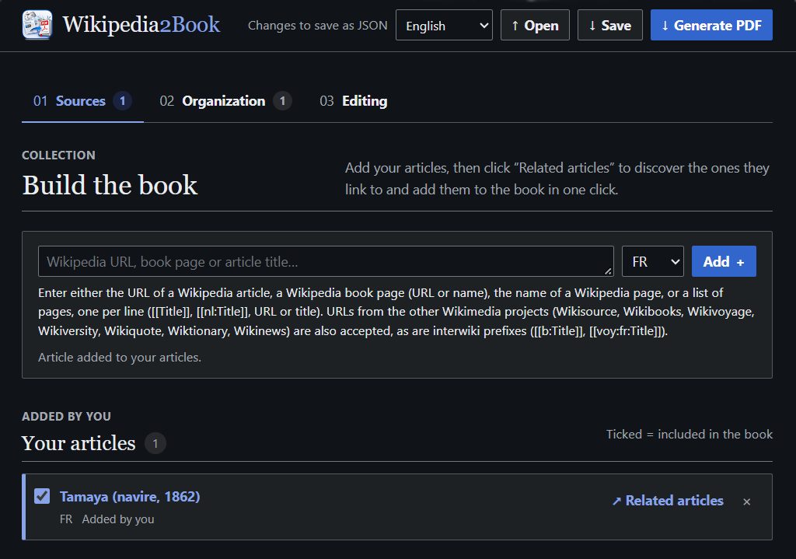
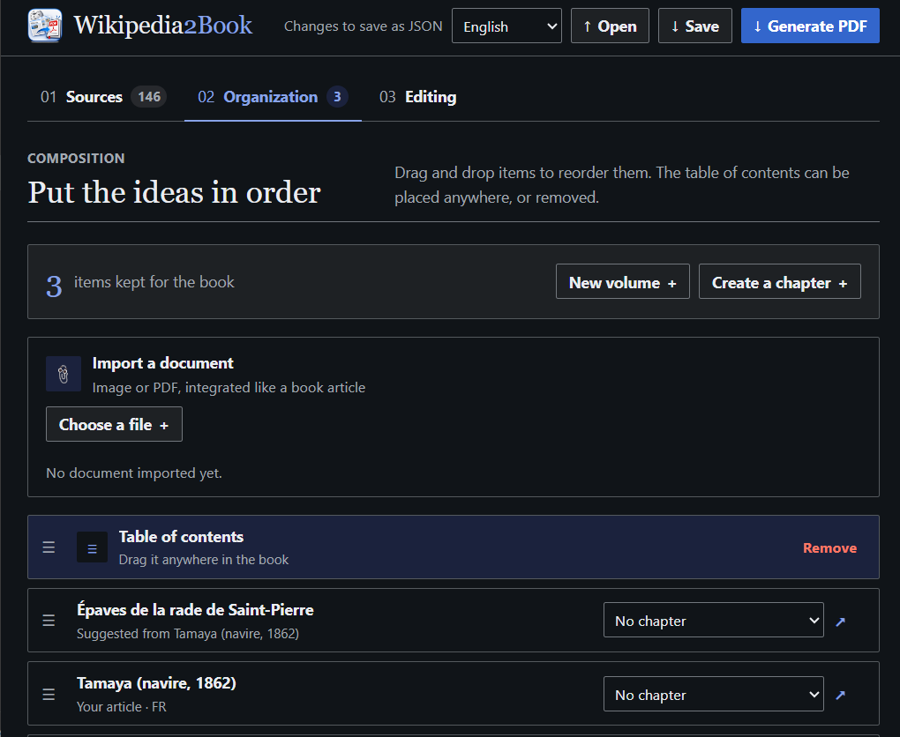
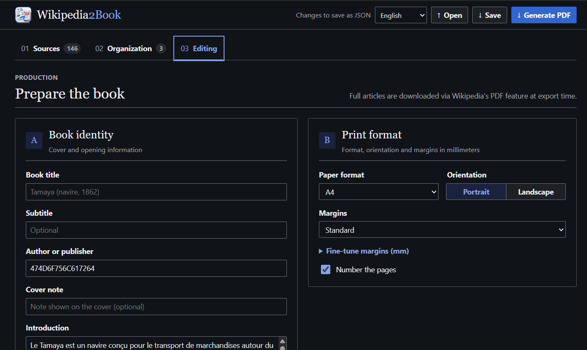

# Wikipedia2book

Copie du billet [Diff n° 223381](https://diff.wikimedia.org/?p=223381) telle qu'enregistrée le 18/11/2026 (en attente de relecture), images dans [images/](images/). Le texte de la seconde partie vient de [story.en.md](story.en.md).

---

## News: [Wikipedia2Book](https://wikipedia2book.toolforge.org/), a new web application that allows you to compile a book in a printable PDF format, was launched in November 2026.

Users can select a Wikipedia book or specific articles, explore related links, organize content into chapters and volumes, and configure the layout before exporting the final PDF file.

Available for: Wikipedia, Wikisource, Wikibooks, Wikivoyage, Wikiversity, Wikiquote, Wiktionary, and Wikinews.

## Step 1 - Select sources

## Step 2 - Manage organization

Organize the articles into volumes and chapters

## Step 3 - configure layout

Configure Title, introduction, TOC, format, ... before exporting the final PDF file.

## Finally

Save yours PDF And yours project.

To see an example of a generated PDF: [dynamic generation](https://wikipedia2book.toolforge.org/api/pdf/from-json?url=https%3A%2F%2Fgmoulard.github.io%2Fwikipedia2book%2Fstatic%2FWrecks-of-Saint-Pierre-harbor.json)  
To modify it via the web interface: [JSON download](https://wikipedia2book.toolforge.org/?json=https://gmoulard.github.io/wikipedia2book/static/Wrecks-of-Saint-Pierre-harbor.json)

refere [documentation](https://gmoulard.github.io/wikipedia2book/), [github project](https://github.com/gmoulard/wikipedia2book) and [wikipedia2book on toolforge.org](https://wikipedia2book.toolforge.org/)

## Printing Wikipedia again: the story of Wikipedia2Book

*Disclosure: I am the developer of Wikipedia2Book. This post tells why I built it, what it does, and how it was made.*

## Why I built it

For years, Wikipedia had a feature that many readers loved: you could gather articles into a "book" with Special:Book, and download it as a single PDF, or order a printed copy. In 2017 the PDF rendering of books was switched off. The saved books are still there, thousands of them, and Special:Book still receives a lot of visits (see Phabricator task T224922), but the button that turned them into a PDF no longer works. The printable versions of Wikibooks and the works of Wikisource have the same problem: the text is ready to be read on paper, but there is no simple way to get one clean, printable volume.

My own starting point was a set of articles I had started on the French Wikipedia: the wrecks of the harbour of Saint-Pierre, in Martinique, the ships sunk during the eruption of Mount Pelée in 1902. I had gathered them in a book page, [Les épaves de la rade de Saint-Pierre suite à l'éruption de la montagne Pelée en 1902](https://fr.wikipedia.org/wiki/Utilisateur:474D6F756C617264/Livres/Les_%C3%A9paves_de_la_rade_de_Saint-Pierre_suite_a_l'%C3%A9ruption_de_la_montagne_Pel%C3%A9e_en_1902), and I simply wanted to have them together, in a single PDF.

So I built a small tool to give that button back: [Wikipedia2Book](https://wikipedia2book.toolforge.org/).

The original idea was very modest, a sort of `cat pdf2 >> pdf1`: take the PDF files that Wikipedia already generates for each article, and put them end to end in a single PDF of many pages. That's all. But with modern development tools, adding one more feature was so easy that I added lots of them: a cover, a table of contents, chapters, other wikis, twelve languages, volumes… Oops! Maybe it's too much!!!

## What it does

You paste what you want to read, and you get a PDF.

- **Wikipedia's official PDFs, unchanged**: each article is the PDF generated by Wikipedia's own tool (the one behind the "Download as PDF" link), used as it is; Wikipedia2Book touches neither the text, nor the images, nor the references.
- **Sources**: the address of an article, a saved Wikipedia book (Special:Book, "Book:" pages), a Wikibooks book or its printable version, a Wikisource work, a list of pages (one per line: wiki links, URLs or titles), or a plain search. Pages can come from eight Wikimedia projects: Wikipedia, Wikisource, Wikibooks, Wikivoyage, Wikiversity, Wikiquote, Wiktionary and Wikinews, in any language, and you can mix languages in one book.
- **Organisation**: the order of a saved book is kept, with its chapters and subtitle. You can move articles and chapters, add chapters, find related articles from the links of a page, and add your own images, PDF files or any web page.
- **Editing**: title, subtitle, author, introduction and conclusion; a cover and a last page with a background image or colour; page format (A4, Letter, Legal and others), orientation and margins; table of contents at the start or the end, with clickable links; a number on every page.
- **The PDF**: a cover, a table of contents, each article, and a license page that names every source article with a link to its history, so the book respects the CC BY-SA license. Bookmarks let you jump from article to article.
- **A real printed book**: this is probably the most exciting part. The PDF is made to be printed (page formats, margins for binding, cover and last page), so you can send it to any print-on-demand service and buy a real printed, bound book, just as Special:Book used to offer.
- **Volumes**: large books are split automatically (300 articles per volume at most), each volume with its own cover, table of contents and numbering.
- **Languages**: the interface is translated into 12 languages (English, French, German, Spanish, Italian, Portuguese, Dutch, Turkish, Chinese, Japanese, Persian and Arabic, the last two right to left), and the pages added to the PDF are written in the chosen language.
- **Links**: everything the interface does is also available as a simple web address: a link such as `https://wikipedia2book.toolforge.org/api/pdf/from-source?source=<address of a book>` downloads the PDF directly, so a wiki page can offer its own "Download as PDF" link.

## How it works, and what it does not do

The content of the articles is never rebuilt. For each page, Wikipedia2Book asks Wikimedia for its official PDF, the one you get from the "Download as PDF" link of the article, and only adds what a book needs around it: cover, table of contents, chapter pages, page numbers and license. Text, images and references are exactly those of the wiki. Each page is only scaled and centred on the format chosen for the book.

The server keeps nothing. There is no account and no database: the book lives in your browser, and you save it yourself as a small JSON file that you can reopen, share, or publish so that others can rebuild the same book. The tool follows the Wikimedia User-Agent and API rules; it is free software (AGPL-3.0), hosted on Toolforge.

## What about mediawiki2latex?

While spreading the word about Wikipedia2Book, I discovered [mediawiki2latex](https://www.mediawiki.org/wiki/Mediawiki2latex), which I did not know. It is another really interesting tool, mentioned on many help pages of the wikis and used for years, especially for the printable versions of Wikibooks. The two tools share some features: starting from a page or a book of a wiki and turning it into a print-ready PDF. But their approach and their goals are different. mediawiki2latex converts the wiki content into LaTeX and rebuilds the whole layout, with LaTeX's fine typography, and also offers other formats. Wikipedia2Book rebuilds nothing: it assembles the official PDFs that Wikipedia already generates, as they are, and focuses on the book around them (cover, chapters, table of contents, license). They are two different answers to the same need, and everyone can choose the one that suits their book.

## How it was made

Wikipedia2Book is a very young project. The first line was written on 7 November 2026: I started from a written specification, first drafted with ChatGPT, and then built the application with Claude Code, an AI coding assistant, describing what I wanted and testing every step myself. The project is openly "vibe coded": the code is written and reviewed by AI agents, while I decide what the tool must do, check the results on real books, and keep a detailed specification and changelog in French and English.

- **7 November 2026**: first version, a single book in memory, chapters, PDF with bookmarks.
- **9 to 11 November**: import of saved Wikipedia books in their real order (the API returns links in alphabetical order, so the tool reads the wikitext), continuous page numbers, license page, the first interface languages, then twelve.
- **12 November**: version 1.0, online on Toolforge.
- **13 to 18 November**: one field for every kind of source, lists of pages, the other Wikimedia projects, Wikibooks and Wikisource contents pages, volumes, background images, web pages, and a lot of work so that big books do not make the server run out of memory.

In twelve days the tool went through more than 370 changes and 13 minor versions. Between 12 and 17 November it received about 12,000 requests on Toolforge.

That speed is the real story. Working with large language models inside a harness made for software development, an application in which the AI reads the code, edits it, runs the tests and checks the result in a browser, gave me a velocity I would never have imagined reaching alone: a feature I describe in the morning is usually written, tested, documented and online the same day. Speed does not mean shortcuts. Everything is in the open, in a [public repository](https://github.com/gmoulard/wikipedia2book/): every change is a readable commit, about thirty automated test files run before each deployment, security checks run on every change to the main branch, and the functional and technical specifications are kept in step with the code, so anyone can review what the tool does and how.

For me, vibe coding is not the end of the developer's job: it is another way of doing my work. I spend less time writing code and more time deciding what the tool must do, checking that it does it well and keeping the whole thing consistent: I do more software engineering than coding. With these tools, I really feel augmented. Of course, you have to learn how to use these new tools, but that has been my daily life as a computer scientist from the very beginning, back when HTML only existed in Tim Berners-Lee's lab at CERN in Geneva.

## What's next, and how you can help

The tool has limits: the fonts and layout of each article are those of the official Wikimedia PDF, where some scripts are not always displayed perfectly; a book is limited to 300 articles per volume.

You can help by trying it with your own saved books, reporting problems or ideas on [GitHub](https://github.com/gmoulard/wikipedia2book), improving a translation of the interface or of the help page, or simply adding a "Download as PDF" link on a book page of your wiki.
