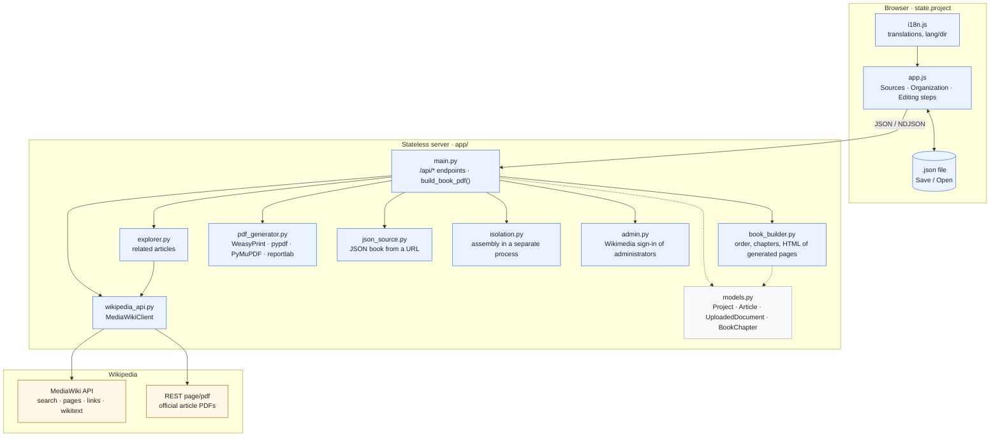
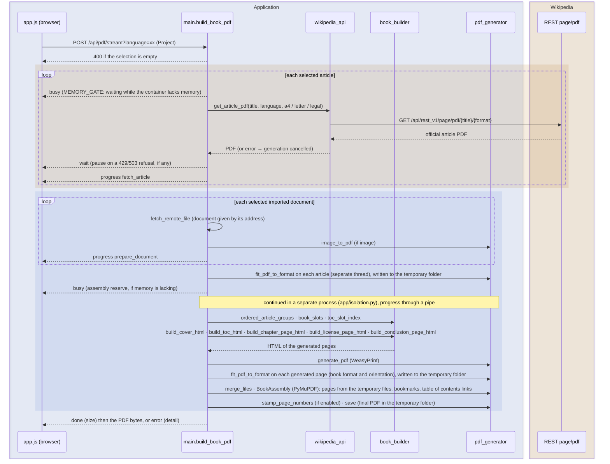

# Wikipedia2Book — Functional and technical specifications


<table border="0" ><tr><td>

</td><td>
This is the English translation of [SPECIFICATIONS.fr.md](https://gmoulard.github.io/wikipedia2book/SPECIFICATIONS.fr.html). The French document is the reference: if the two ever differ, the French version prevails. Interface labels are quoted as they appear in the English interface.
</td></tr></table>


## Table of contents

- [1. Overview of Wikipedia2Book](#1-overview-of-wikipedia2book)
	- [1.1 Purpose](#11-purpose)
	- [1.2 Core principles](#12-core-principles)
- [2. The in-memory book and how it is saved](#2-the-in-memory-book-and-how-it-is-saved)
- [3. Adding articles](#3-adding-articles)
	- [3.1 Ways to add articles](#31-ways-to-add-articles)
	- [3.2 Information kept for each article](#32-information-kept-for-each-article)
	- [3.3 Automatically suggested introduction and author](#33-automatically-suggested-introduction-and-author)
- [4. Exploring related articles](#4-exploring-related-articles)
	- [4.1 Principle](#41-principle)
	- [4.2 Exploration depth](#42-exploration-depth)
	- [4.3 Exploration results](#43-exploration-results)
	- [4.4 Starting an exploration](#44-starting-an-exploration)
- [5. Selecting articles](#5-selecting-articles)
- [6. Organizing the book](#6-organizing-the-book)
	- [6.1 Imported documents (images and PDFs)](#61-imported-documents-images-and-pdfs)
- [7. Retrieving Wikipedia content](#7-retrieving-wikipedia-content)
- [8. References, images and licenses](#8-references-images-and-licenses)
- [9. Book format settings](#9-book-format-settings)
	- [9.1 Standard formats](#91-standard-formats)
	- [9.2 Custom format](#92-custom-format)
	- [9.3 Orientation](#93-orientation)
	- [9.4 Margins](#94-margins)
- [10. Book layout](#10-book-layout)
	- [10.1 Format and orientation, applied to every page](#101-format-and-orientation-applied-to-every-page)
	- [10.2 Page numbering](#102-page-numbering)
- [11. PDF generation](#11-pdf-generation)
	- [11.1 Process](#111-process)
	- [11.2 Result](#112-result)
	- [11.3 Error handling](#113-error-handling)
- [12. User interface](#12-user-interface)
	- [12.1 Interface languages](#121-interface-languages)
	- [12.2 Administration page](#122-administration-page)
- [13. Technical architecture](#13-technical-architecture)
	- [13.1 Technologies](#131-technologies)
	- [13.2 Wikipedia API](#132-wikipedia-api)
	- [13.3 HTTP call examples](#133-http-call-examples)
	- [13.4 Docker and running locally](#134-docker-and-running-locally)
	- [13.5 Environments and branches](#135-environments-and-branches)
	- [13.6 Continuous integration (GitHub Actions)](#136-continuous-integration-github-actions)
	- [13.7 Toolforge](#137-toolforge)
	- [13.8 Usage statistics (Toolviews)](#138-usage-statistics-toolviews)
	- [13.9 Data model and save file](#139-data-model-and-save-file)
	- [13.10 Architecture diagrams](#1310-architecture-diagrams)
	- [13.11 Benchmark](#1311-benchmark)
	- [13.12 Limit test](#1312-limit-test)
	- [13.13 Container optimisation strategy](#1313-container-optimisation-strategy)
- [14. Security and robustness](#14-security-and-robustness)
- [15. Compliance with Wikipedia licenses](#15-compliance-with-wikipedia-licenses)
- [16. Acceptance criteria](#16-acceptance-criteria)
- [17. Repository structure](#17-repository-structure)
- [18. Status and future developments](#18-status-and-future-developments)
- [19. Version history](#19-version-history)

## 1\. Overview of Wikipedia2Book

### 1.1 Purpose

Wikipedia2Book is software for creating a printable PDF book directly from Wikipedia articles. The user starts building the book right away.

As soon as the application opens, an empty book is ready to use. The user adds one or more main articles, explores the articles linked from them, chooses exactly which content to include, organizes the articles into chapters and generates a structured PDF document.

The software runs on every platform thanks to a Python architecture containerized with Docker.

### 1.2 Core principles

* The software is not limited to one topic or category of articles.

* Several main articles can be added to the same book.

* Exploration of Wikipedia links starts from an article chosen by the user (depth and maximum number of articles can be set through the API).

* No discovered article is ever added to the book automatically.

* The user keeps full control over which articles are selected.

* The book format is configurable (dimensions, orientation, margins).

* The resulting PDF is suitable for printing.

## 2\. The in-memory book and how it is saved

The software handles a single book at a time, built entirely in the browser's memory.

* When the application opens, an empty book is created automatically; the user can give it a name and a description.

* All changes (articles, selection, organization, layout) are kept in the browser's memory during the session, and sent to the API only for the operations that need it (search, exploration, PDF generation).

* The user can explicitly download the state of the book as a JSON file, named after the book title (or, when no title is set, after the title of the book's first article).

* The user can import a previously downloaded JSON file to resume a book; the import replaces the current book.

* A book can also be opened from the address of a JSON file published online, by passing it in the page address: `https://wikipedia2book.toolforge.org/?json=<file-url>` (example: [https://wikipedia2book.toolforge.org/?json=https://gmoulard.github.io/wikipedia2book/static/Wrecks-of-Saint-Pierre-harbor.json](https://wikipedia2book.toolforge.org/?json=https://gmoulard.github.io/wikipedia2book/static/Wrecks-of-Saint-Pierre-harbor.json), which opens the sample book *Wrecks of Saint-Pierre harbor*). The browser reads the file (`fetchWorkspaceText` in `app.js`), like an import: the site hosting it must allow it (CORS), as GitHub Pages and raw.githubusercontent.com do; otherwise, or if the file is not a valid book, an "Import JSON impossible: …" message is shown and the page stays on an empty book. The server never sees this address.

* A book can also be built from the page address, with one or more `source=` parameters (in order, each read as a line of the field: URL, title, `b:Title`, `fr:Title`, book page), and `wiki=<language>` for the language of titles without a prefix (by default the one chosen next to the field): for example `https://wikipedia2book.toolforge.org/?source=https://fr.wikibooks.org/wiki/Cosmologie`. Each source is added as if it had been typed in "Build the book" (`addSourcesFromAddress` in `app.js`), including the question for a Wikibooks or Wikisource contents page and the search when no exact page matches; with `json=` as well, the JSON book is opened first, then the sources are added to it.

* The server never persists any book or file on its disk: persistence is entirely up to the user, by downloading and later manually importing the JSON file. Only temporary files exist for the duration of a PDF generation (section 11.1), deleted as soon as it ends, fails or is abandoned.

The book contains in particular:

* The main articles.

* The discovered articles.

* The selection of articles.

* The structure of the book (order, chapters, presence and position of the table of contents).

* The layout settings.

* The cover information (title, subtitle, author, introduction, conclusion).

The full data model and the format of the JSON file are described in section 13.9.

## 3\. Adding articles

### 3.1 Ways to add articles

A single input field, in the Sources step, is used for every way of adding content: the user does not say what kind of thing they are typing, the software recognizes it by querying Wikipedia (`POST /api/sources/resolve`, which receives `input`, `language` and `site`):

* a `https://<language>.wikipedia.org/wiki/…` URL is read with the language of the URL; so is a URL of another Wikimedia project of the form `https://<language>.<project>.org/wiki/…`, on that project (see below); otherwise, the text is taken as a page title, in the Wikipedia language chosen next to the field. This selector offers FR, EN, DE, ES, IT, PT and NL; when the application opens, it is set to the browser language (main part of the code, for example `pt` for `pt-BR`, `no` for `nb`), added to the list if missing (for example JA). If the browser language is missing or not a valid code, EN is selected. This choice is saved neither in the book nor in the browser;

* the page is looked up on Wikipedia, following redirects: a page in the main namespace (an article) is added as an article; a page in another namespace (`User:…/Books/…`, `Book:…`, etc.) is imported as a book page;

* if no page has exactly that title, the Wikipedia search results are offered below the field, to be added with one click; a URL pointing to a page that does not exist is reported as not found.

* **Other Wikimedia projects**: a page in the main namespace, or in a project-specific namespace, of Wikisource (`wikisource`), Wikibooks (`wikibooks`), Wikivoyage (`wikivoyage`), Wikiversity (`wikiversity`), Wikiquote (`wikiquote`), Wiktionary (`wiktionary`) or Wikinews (`wikinews`) is added as an article, with the official PDF of the project (same service as Wikipedia, section 13.2), for example `https://zh.wikisource.org/wiki/論語/學而第一`, `https://fr.wikibooks.org/wiki/Programmation_Python` or `https://fr.wikivoyage.org/wiki/Lyon`. It is given by its URL or by a title preceded by a project interwiki prefix (see the list below): the page is then looked up on that project and, if there is no exact page, that project's search results are offered. Book pages (`Book:`) remain specific to Wikipedia; on Wikibooks, a book is recognized by its contents page: a main namespace page that contains at least 2 links to its own subpages (`Book/Chapter`, red links excluded) is offered as a book (`kind` = `subpages`, `MediaWikiClient.get_subpage_book`, which reads the HTML rendered by `action=parse` to keep the order of the contents page, 500 subpages at most). A window then asks "“Programmation Python” is the table of contents of a Wikibooks book (56 pages). What do you want to add?": "The whole book" (the subpages in the order of the contents page, the book title taken from it), "The whole book and its table of contents" (the contents page first, before the first chapter), "Only this page" (as before) or "Cancel" (nothing is added, as with Escape). The sections of the contents page become book chapters at the first heading level that gives at least two of them containing subpages (for example the `h3` "Intro", "Basics"… under a single `h2` "Contents" in *Python Programming*); subpages placed before the first section stay without chapter, and a contents page with a single section gives a book without chapters. "Print version" subpages (Version imprimable, Print version, Druckversion, Versione stampabile, Versión para imprimir, Versão para impressão, Afdrukbare versie…, `FULL_TEXT_PAGES`), which contain the whole book, are ignored; the other side pages (guest book…) are removed with "×". The same goes on Wikisource for a work split into subpages (`Work/Chapter`, for example 史記: 130 scrolls in 5 chapters 本紀, 表, 書, 世家, 列傳; Les Misérables: 365 chapters in 5 parts): pages containing the whole work ("Texte entier", "全覽", "全文"…, same `FULL_TEXT_PAGES` list) are ignored, and a page whose subpages are already in the book is only an intermediate contents page (for example "Les Misérables/Tome 1/Livre 1"): it is left out on Wikisource, kept on Wikibooks, where a chapter often has its own text besides its subpages. In a list of several pages, the same question is asked for each contents page, and chapters are not kept, as for a Wikipedia book page. Project-specific namespaces are those MediaWiki numbers from 100 upwards, excluding talk pages (odd numbers): for example the author page `https://fr.wikisource.org/wiki/Auteur:François_Rabelais` (namespace 102 in French, 106 in Spanish), `Page:…` and `Index:…` on Wikisource, or `Appendix:…` on Wiktionary; it is added as it is, with its official PDF (for an author page: biography and list of works, without the works themselves). A page in a standard namespace (`Wikibooks:…`, `Help:…`, `Category:…`, etc.) or a talk page is rejected. Each page is added as is: for a work or a book split into subpages (Wikisource, Wikibooks), the main page often contains only the table of contents, and each subpage must be added (the list of their URLs can be pasted, one per line). The article card shows the name of the project, in the interface language (for example "Wikibooks"), next to the language. Projects without a `<language>.<project>.org` address (Commons, Meta-Wiki, MediaWiki.org, Wikispecies, Wikidata) are not accepted.

The field also accepts a **list of pages, one per line** (pasted, or typed with Shift+Enter; Enter alone starts the addition). Each line is recognized and then looked up on Wikipedia one after the other, with a message "Adding the list: n / total — title":

* bullets and numbers at the start of a line (`1.`, `2)`, `#`, `*`, `-`, `•`) are ignored, as are empty lines;
* wiki link `[[Title]]`, `[[:fr:Title]]` or `[[nl:Title|text]]`: the title, in the language given by the prefix if any;
* Markdown link `[text](https://…)`: the URL, parentheses included (`…/Suchet%20(navire)`);
* language prefix `nl:Title` (2 or 3 lowercase letters, optionally followed by a variant, for example `zh-yue`): the page with that title on that Wikipedia, which allows multilingual lists;
* project interwiki prefix, alone or combined with a language prefix in any order: `w:` Wikipedia, `s:` Wikisource, `b:` Wikibooks, `voy:` Wikivoyage, `v:` Wikiversity, `q:` Wikiquote, `wikt:` Wiktionary, `n:` Wikinews (for example `b:Programmation Python`, `[[voy:en:Lyon]]`, `fr:wikt:chat`): the page with that title on that project, in the language of the prefix or, failing that, the one chosen next to the field;
* URL of Wikipedia or of another accepted project: read with its language; plain title: on Wikipedia, in the language chosen next to the field.

Each page found is added as an article (or, for a book page, all its articles); a page already in the book is skipped. Lines without an exact page, or in error, stay in the field to be corrected and are listed below it. A final message gives the number of pages added, already present and not found. Search-as-you-type is turned off as soon as the field contains several lines.

Below the field, a permanent label reminds the user what can be typed: the URL of an article, a book page (URL or name) or the name of a Wikipedia page. Status messages (article added, pages imported, no exact page) are shown on a separate line underneath, without replacing that label. While typing text that is not a URL, search results are suggested as you type, on the project and in the language of the prefixes if any (`b:fr:Program…` searches the French Wikibooks). The previous endpoints (`POST /api/articles`, `POST /api/books/structure`, `GET /api/search`) remain available. The label also mentions that the content of a "Book:" page can be pasted (see below).

The user can therefore add articles to the book in any of the following ways:

* URL of a Wikipedia article.

* Article title typed directly.

* Search in Wikipedia: results are suggested as you type, to be added with one click.

* URL of a Wikipedia "book" page listing articles: every article it references is imported and pre-selected, **in the order in which they appear on the book page** (not in alphabetical order — the MediaWiki API sorts links, so the software reads the page's wikitext to recover the real order). Only their title and URL are loaded at this stage; their full PDF is downloaded only at generation time. The structure of the book page is also kept: the first line of the form `=== … ===` becomes the book subtitle (only if the "Subtitle" field of the Editing step is empty), and each line starting with `;` opens a chapter that receives the articles listed below it, up to the next chapter (Organization step, section 6). The book keeps the exact order of the page: the articles placed before the first `;` stay without a chapter but **at the start of the book**, before the first chapter and without a chapter page or a "No chapter" heading (book setting `unassigned_first`, saved in the JSON file); this applies only if the book had no chapter yet before the import, otherwise those articles join the other articles without a chapter, at the end. Links and `''`/`'''` formatting in those lines are reduced to their text; a chapter without articles is ignored, and `== … ==` lines (title recorded by the book creator) are not used. The confirmation message links to the Wikipedia help page about books (`https://fr.wikipedia.org/wiki/Aide:Livres`).
  Syntax of a book page, as described in the Wikipedia help ([Aide:Livres/Aide avancée](https://fr.wikipedia.org/wiki/Aide:Livres/Aide_avanc%C3%A9e)), and how the software handles it (`wikipedia_api.get_book`):
  * Title — `== Title ==`: ignored; the book title is entered in the Editing step.
  * Subtitle — `=== Subtitle ===`: the first line of this form becomes the book subtitle (see above).
  * Chapter — `;Chapter name`: opens a chapter.
  * Article — `:[[Article]]`: the article is added to the current chapter. In practice, every `[[…]]` link on a line that is neither a heading nor a chapter is taken, even without a leading `:`; an anchor (`#section`) is removed; links whose title contains `:` (other namespaces, interlanguage links, files) and duplicates are ignored; at most 200 articles are read.
  * Renamed article — `:[[Frégate (bateau)|Frégate]]`: the target article (`Frégate (bateau)`) is added; the label after `|` is ignored, and the book shows the article title.
  * Specific revision — `:[{{fullurl:Article name|oldid=revision number}} Article title]`: not supported. It is not a `[[…]]` link, so the article is not imported; an article's PDF is always that of its current revision.

* Content of a book page pasted as is into the field, over several lines: as soon as a line starts with `;` or `:[[`, or is a `== … ==` or `=== … ===` heading, the whole text is sent in one block to `POST /api/books/from-wikitext` (`{"wikitext": "…", "language": "fr"}`, 200,000 characters at most) instead of being read line by line. It is read by the same function as the wikitext of a book page (`wikipedia_api.parse_book_wikitext`, same rules, 200 articles at most): order, `;` chapters, `===` subtitle, and the title as well: the first `== … ==` line becomes the book title (`book_wikitext_title`). The articles are taken from Wikipedia, in the language chosen next to the field, without checking that they exist (as for a book page, a missing article only fails at generation). A text without any `[[…]]` link to an article is refused (HTTP 422). This makes it possible to put together a book in the "Book:" format without saving it on Wikipedia.

* Hand-written Wikibooks printable version (syntax described by [Wikilivres/Créer la version imprimable d'un livre](https://fr.wikibooks.org/wiki/Wikilivres/Cr%C3%A9er_la_version_imprimable_d%27un_livre)), pasted as is or given by its address: as soon as the text contains a `{{:Page}}` transclusion, it is read as a printable version (`wikipedia_api.parse_printable_wikitext`, same endpoint `POST /api/books/from-wikitext`, 500 pages at most). Each `{{:Book/Chapter}}` transclusion becomes a **Wikibooks** page, in the language chosen next to the field, in the order of the text; each level-1 heading `= … =` opens a chapter (tags such as `<center>` and formatting removed); the other templates (`{{Notice de version imprimable}}`, `{{Nouvelle page imprimée}}`, `{{#ifeq:…}}`…), duplicates, transclusions from another namespace and the cover and licence pages (`…/Couverture`, `Licence de documentation libre GNU`…, `PRINTABLE_SKIPPED_PAGES`), which the application produces itself, are ignored; the `titre=` (or `title=`) parameter of the first template that has one (`{{Couverture de version imprimable|titre=…}}`, `{{Page de titre|titre=…}}`) becomes the book title (`printable_wikitext_title`). The address of a Wikibooks "…/Version imprimable" page (names in `FULL_TEXT_PAGES`) is no longer added as a single page: the server reads its wikitext (`MediaWikiClient.get_wikitext`); if it contains transclusions, the book is taken from it in the same way (title from `titre=`, otherwise from the table of contents); otherwise (printable version made by the `{{imprimable}}` module, which reads the table of contents), the parent table of contents is offered, with the "The whole book" / "The whole book and its table of contents" / "Only this page" window described above.

Example of an article URL:

`https://fr.wikipedia.org/wiki/Épaves_de_la_rade_de_Saint-Pierre`

### 3.2 Information kept for each article

For each article, the software keeps:

* The title.

* The Wikipedia URL.

* The language.

* The summary, when it comes from a search (articles added by URL, by title or imported from a book page have no pre-filled summary).

* The Wikipedia page identifier, when known (search results).

The user can delete a main article without affecting the others.

### 3.3 Automatically suggested introduction and author

When the very first main article of the book is added (including the first article of an imported book page, section 3.1), the software automatically suggests, in the Editing step (section 12):

* The introduction of the book, from that article's introductory summary on Wikipedia.

* The author of the book, from the username (or the IP address, for an anonymous contribution) that created the page on Wikipedia.

This suggestion never replaces a field already filled in by the user, and remains fully editable. It is triggered only once, for the first article only — adding more articles afterwards does not trigger it again.

## 4\. Exploring related articles

### 4.1 Principle

The software explores the internal links of the main articles in order to suggest complementary articles, relying on the official MediaWiki API (`action=parse&prop=text`): links are read from the rendered HTML of the article, hence **in their order of appearance in the page** (banners, infobox and captions included), and not in alphabetical order as `prop=links` would return them. Ignored: links to pages that do not exist (red links), links outside the main namespace (`File:`, `Category:`, `Help:`, etc.), internal anchors, the page's link to itself and duplicates.

### 4.2 Exploration depth

The depth can be set between 0 and 3 on the API side (`/api/explore`); the interface always uses depth 1 (section 4.4):

| Depth | Behavior                                          |
| ----- | ------------------------------------------------- |
| 0     | No complementary article                          |
| 1     | Articles directly linked from the main articles   |
| 2     | Articles linked from depth-1 articles             |
| 3     | Articles linked from depth-2 articles             |

The maximum depth is capped at 3 levels to avoid excessive exploration.

### 4.3 Exploration results

For each discovered article, the software shows:

* Its title.

* Its URL.

* An "Add to book" button and a "×" button to dismiss it (section 5).

Above the list, a line recalls which article the suggestions come from ("Links from "…", in page order."). Duplicates are removed automatically (case-insensitive comparison of language and title), and articles already in "Your articles" are not suggested again.

### 4.4 Starting an exploration

* By default, the "Suggestions" section is empty and contains no button: a message invites the user to click "Related articles" on one of their articles.

* The "Related articles" button, present on every card in "Your articles", fills the list with the articles cited by that article, in page order (depth 1, up to 200 links). The button of the article whose links are shown is highlighted.

* Clicking "Related articles" on another article **clears the list** and fills it with the links of that new article: the list always shows the links of a single article at a time.

* No setting is required. The API, for its part, still accepts a depth from 0 to 3 and a maximum from 1 to 200.

* At the end, a message gives the number of suggestions found, then the page scrolls to the list; if the article cites no new article, a message says so.

## 5\. Selecting articles

This feature is essential.

No discovered article may be added to the book automatically.

The software presents the list of discovered articles ("Suggestions") and lets the user choose exactly which ones to keep.

Available features:

* "Add to book" on a suggestion: it leaves the suggestion list and joins "Your articles", checked, with a mention of the article it came from; a message confirms the addition. It then becomes a main article like any other: it can be unchecked, removed, or used as the starting point of a new exploration.

* "×" on a suggestion: it is removed from the list.

* "Add all": adds every visible suggestion (respecting the title filter). This button, the filter and the sort choice only appear when the list contains suggestions.

* Search by title among the suggestions.

* Sorting the suggestions, on the same line as the filter (which shrinks to make room for them, including on smartphones), with two buttons: "Page order" (order of appearance of the links in the article, the initial choice each time the application opens) or "A → Z" (alphabetical order according to the interface language, ignoring case and accents: "Éruption" is filed under E). Sorting combines with the filter; the sentence naming the source article states which order is shown. This choice is not saved in the book's JSON file.

* In "Your articles", a checkbox for each article indicates whether it is included in the book.

The selection is kept with the rest of the book, in memory and in the JSON export. Suggestions, however, are not saved in the JSON export (`discovered_articles` is always empty there since 1.9.6): they come back by running "Related articles" again. When an older JSON file is opened, the discovered articles that were checked in it are moved to "Your articles", the others stay in the suggestions.

## 6\. Organizing the book

The user organizes the selected articles before generating the PDF.

Features:

* Reorder articles by drag and drop.

* Create chapters and give them a title. The first chapter created goes after the articles already there, which stay at the top of the book without a heading (`unassigned_first`), without "No chapter" appearing; articles are then dragged into it.

* Move an article from one chapter to another, or out of any chapter, by drag and drop: membership of a chapter comes from the article's place under the chapter row (there is no chapter selection menu). An article dropped on a chapter row goes to the top of that chapter; dropped on "No chapter", it leaves every chapter; dropped on another article, it takes its place (`applyOrgSequence` in `app.js`, which updates `chapters`, `article_order` and `unassigned_first`).

* Move a chapter by drag and drop, by grabbing any part of its row outside its title (the title field is no wider than the title, since Chrome does not start a drag from an input field). The list reads as a sequence: only the chapter row moves, and each article belongs to the chapter placed above it; the articles placed before the first chapter are at the top of the book, without a heading (`unassigned_first`). When the book has a "No chapter" group at the end of the list, a chapter cannot go below that row.

* Each article or imported document row fits on one line (title, then origin in smaller type) and has a "×" button that removes it from the book (a removed article also disappears from "Your articles", an imported document is deleted) and a "↗" button that opens the article on Wikipedia or the imported document in a new tab. Chapters, the table of contents and volume breaks have the same "×".

* The table of contents is not in the Organization list: it is chosen in the Editing step, next to "Number the pages", among three choices — "None" (`table_of_contents` false), "At the start", right after the cover (`toc_position` `start`), or "At the end", after the last article, before the license and the conclusion (`toc_position` `end`). The server still accepts `before:<key>` (article/document key, `chapter:<id>`, or `chapter:` for the "No chapter" group) for a direct API call; a JSON file that places the table of contents in the middle of the book puts it back at the start when opened.


* A book of a single article or document has no table of contents, whatever the choice in the Editing step: the PDF has none (`book_builder.toc_slot_index`). It comes back as soon as the book has two elements; a volume of a single article has none either.

* When the book has chapters, the articles that belong to no chapter are shown at the end of the list, under the "No chapter" heading, as in the PDF. Exception: when the first chapter was created after them, when they were dragged before the first chapter, or for a book imported from a Wikipedia book page in which articles precede the first chapter (section 3.1), those articles are shown and placed in the PDF at the start, before the first chapter, without a heading or chapter page.

* Split the book into several volumes at will, even under the server limit: the "New volume +" button in the toolbar adds a break in the middle of the last volume; the "Start of a volume" line is moved by drag and drop like the table of contents, and removed with its "×" (the volume then joins the previous one). Each break is stored relative to the element that follows it (`volume_breaks`, a list of `before:<key>`, same keys as `toc_position`, kept in the JSON export and ignored by the server); a break whose element disappears, that would target the first element of the book or a chapter without articles is ignored. Each volume is generated as a separate PDF (section 11.1).

* Add a general introduction and a conclusion.

* Choose in the Editing step a background image for the cover and another one for the last page, each imported from a file or from its address (section 11.1).

* Turn page numbering on or off (on by default).

An article can be moved freely within the structure of the book.

### 6.1 Imported documents (images and PDFs)

In the Organization step, the user can also import their own files (image or PDF), with the "Choose a file +" button of the toolbar, next to "New volume +", or by their address (address field followed by "Use the address", or the Enter key), to include them in the book as if they were articles:

* Accepted formats: images (`image/*`) and PDF (`application/pdf`); 15 MB maximum per file.

* By address: the address must start with `https://` (otherwise "The address must start with https://."). A Wikimedia file page goes through the `imageinfo` API, as for background images (section 11.1): a PDF gives the address of the original file, an image its 2,000 px thumbnail; for any other address, the document is a PDF if the address ends with `.pdf`, otherwise an image, which the browser tries to display before accepting it ("Document not reachable at this address (…)." on failure). Only the address is kept in the book and in the JSON export (`url`, without `data_base64`): the server downloads the document at each generation, during the "Preparing the imported document" step, with the same checks as background images (PNG, JPEG, GIF, WebP or PDF according to the `Content-Type` header, which also decides whether it is a PDF), and the generation stops with the address at fault if it is unreachable. "↗" then opens the address itself.

* An imported document appears in the list of items to organize just like an article: it can be reordered and moved into a chapter by drag and drop, counts in a volume, is removed with "×" and opened with "↗" (through a `blob:` address, since Chrome refuses to open a `data:` address in a new tab), and its starting page appears in the table of contents if page numbering is on.

* An imported image is included as a full page, centered and scaled to the book format; an imported PDF is included as is, page by page.

* The document is removed from the book with its "×" button, independently of the other documents and articles; there is no separate list of imported documents nor any box to exclude them without deleting them. A document deselected in a JSON file older than 1.9.6 comes back into the book when the file is opened.

* The file content is kept base64-encoded in the book state and in the JSON export, so that the PDF can be regenerated or the book resumed without importing the file again.

## 7\. Retrieving Wikipedia content

Adding and exploring do not download the full content of pages. When the PDF is generated, each selected article is retrieved through the official Wikimedia PDF endpoint (`/api/rest_v1/page/pdf/{title}/{format}`), equivalent to Wikipedia's "Download as PDF" feature. Wikipedia only lays out its PDFs in three formats (`a4`, `letter`, `legal`, always portrait): the software requests `letter` for a Letter book, `legal` for a Legal book, and `a4` for every other format (A0 to A6, custom). For Letter and Legal, the article pages are therefore laid out by Wikipedia directly in the right format, with no white margins caused by a change of proportions.

The content of each article (text, structure, images, references) is never rebuilt: it is exactly that of the official Wikipedia PDF. Only its physical layout changes: each page is recomposed (scaled and centered, without distortion) onto the format and orientation chosen for the book — see section 10.1.

## 8\. References, images and licenses

The software does not rebuild article content: each selected article is included as the official PDF generated by Wikipedia. As a result:

* References and citations stay exactly those of the Wikipedia PDF, with their original formatting.

* Images and their captions are those embedded by Wikipedia in its PDF export, with their original layout.

* Credits and licenses for texts and images are those printed by Wikipedia in its own PDF; the software does not extract them or rewrite them separately.

* When Wikimedia temporarily refuses a request because it receives too many (HTTP 429) or is overloaded (HTTP 503), the software waits and retries, up to 4 times: the delay given by Wikimedia (`Retry-After` header, capped at 20 s), or otherwise 2, 4, 8 then 16 s. The wait is shared by all the ongoing downloads of the same book (they resume together instead of each hitting Wikimedia again) and does not block the server, which keeps answering other requests. During PDF generation, each new pause is shown in the status window, under the current step's label, as a countdown ("Wikipedia is limiting requests right now: retrying in 5 s…") that disappears when the pause ends; the step and the progress bar do not move. This applies to every request to Wikipedia (PDF and MediaWiki API).
* If Wikipedia cannot produce a PDF for a selected article (page not found, service unavailable, invalid response, or still refused after these 4 retries, with the message "Wikipédia limite le nombre de requêtes en ce moment…"), the generation of the whole book fails and an explicit error message is shown; no partial book is produced.

* The only exception to the integrity of the official PDF: when page numbering is on (section 10), a page number is overlaid at the bottom of every page, including article pages — without touching the content, credits or license notices printed by Wikipedia.

## 9\. Book format settings

The document format is fully configurable.

### 9.1 Standard formats

Available formats:

| Format | Dimensions    |
| ------ | ------------- |
| A0     | 841 × 1189 mm |
| A1     | 594 × 841 mm  |
| A2     | 420 × 594 mm  |
| A3     | 297 × 420 mm  |
| A4     | 210 × 297 mm  |
| A5     | 148 × 210 mm  |
| A6     | 105 × 148 mm  |
| Letter | 216 × 279 mm  |
| Legal  | 216 × 356 mm  |

A4 is offered by default, without being imposed.

### 9.2 Custom format

The user can enter:

* The width in millimeters.

* The height in millimeters.

### 9.3 Orientation

Two orientations are available:

* Portrait.

* Landscape.

### 9.4 Margins

The user first chooses a predefined set of margins:

| Preset       | Top | Bottom | Inside | Outside | Binding |
| ------------ | --- | ------ | ------ | ------- | ------- |
| Standard     | 18  | 18     | 18     | 16      | 0       |
| Narrow       | 10  | 10     | 12     | 10      | 0       |
| Wide         | 25  | 25     | 25     | 22      | 0       |
| For binding  | 18  | 18     | 20     | 16      | 10      |

Values in millimeters; "Standard" matches the default values. Choosing "Custom", or expanding "Fine-tune margins (mm)", gives access to each margin individually. The preset shown is derived from the book's values: as soon as a margin no longer matches any preset, "Custom" is shown. Presets are not saved as such in the book or in the JSON export, only the five values are.

The margins that can be set individually are:

* The top margin.

* The bottom margin.

* The inside margin.

* The outside margin.

* The binding margin, added to the inside margin.

## 10\. Book layout

The PDF is structured like a real book.

Items generated by the application:

* Cover (book title, subtitle, author, note; the edition date is at the end of the book, under the logo).

* Introduction, if one was entered.

* Table of contents, grouped by chapter: under an underlined heading, each chapter is a bold line (title on the left, page number aligned on the right), followed by the indented list of its articles and documents, with their page numbers aligned in the same column. Each line, page number included, is a clickable internal link to the first page of the chapter or article.

* Chapter title pages, for each chapter containing articles.

The table of contents may be absent if the user removed it (section 6).

* Conclusion, if one was entered.

* License page (section 15), always present, after the conclusion (or after the last article, and after the table of contents if it is at the end of the book), ending with the Wikipedia2Book logo, the edition date and links.

* Last page background image, alone on a page, if one was chosen.

The content of articles and imported documents is not laid out by the application: these are the pages of their original PDF (official Wikipedia PDF, or imported document). Their physical format, however, is always harmonized with the rest of the book — see section 10.1.

The cover and the table of contents are two separate sections in the final PDF: the position chosen for the table of contents in the Editing step (section 6) is the one actually used at generation — the cover always stays the first page, and the table of contents is inserted exactly where chosen: right after the cover, before a chapter (before its title page), before an article, or after the last article (before the license and the conclusion).

Navigation in the final PDF relies on bookmarks (cover, table of contents, one entry per chapter and per article, license, conclusion) and on the links of the table of contents. These links are produced as follows: WeasyPrint generates each line as a link to a placeholder address (`https://wikipedia2book.invalid/toc/<key>`, an article or document key, or `chapter:<n>`); after assembly, these links are read back (`pdf_generator.internal_links`), removed, then replaced by internal links to the item's actual page in the book (`BookAssembly.link_toc`), even when page numbering is turned off.

### 10.1 Format and orientation, applied to every page

Every page of the final PDF follows the format and orientation chosen for the book (section 9), without exception:

* The pages generated by the application (cover, introduction, table of contents, chapter pages, license, conclusion) are produced natively in that format.

* Each article page (official Wikipedia PDF) and each page of an imported document is recomposed onto a page of that same format: its content is scaled and centered, keeping its original proportions (no distortion). If the proportions of the source page differ from those of the book, white margins appear on the sides or at the top/bottom rather than distorting the content. A page that already has the book format to within 1 point (0.35 mm), without rotation, is not recomposed: its size is only set exactly to the book format, without rewriting its content. This is the case for Wikipedia PDFs in A4, Letter and Legal books, which are requested directly in that format (section 7): their assembly is then about seven times faster.

* The content itself (text, images, references) is never modified or rebuilt — only its scale and position on the page change.

### 10.2 Page numbering

The "Number the pages" option (section 6) is on by default and can be turned off.

When it is on:

* Every page of the book shows a number at the bottom, continuously — including article pages and imported documents, except the cover.

* The table of contents shows, for each chapter and each article, the number of the page where it starts.

* To compute these numbers before assembling the book, the software generates the cover (which does not depend on the numbers and is used as is in the book, without being generated a second time) and a first version of the table of contents unless it is placed at the end, in order to measure their page count (the numbers of the items placed after the table of contents take it into account); it then regenerates the table of contents with the correct numbers. In rare cases (very dense book), adding the numbers to the table of contents may shift this pagination slightly by one page.

No preview feature is currently offered.

## 11\. PDF generation

### 11.1 Process

The "Generate PDF" button is always visible and active, whichever tab is shown; if no article or document is selected, a message says so when the button is clicked, rather than disabling the button.

Once the PDF is started, the software:

* Checks that at least one article or document is selected; otherwise, generation is refused.

* Downloads the official PDF of each selected article; decodes each selected imported document (section 6.1), converting an image into a PDF page if needed.

* If page numbering is on, computes in advance the starting page of each chapter and each article (section 10.2).

* Generates the cover (with the introduction, if any) and the table of contents (with page numbers if enabled) as two separate sections; the cover receives the root bookmark carrying the book title.

* Inserts the table of contents at the chosen position (section 6), or omits it if it was removed.

* For each chapter (or for all the articles if there is no chapter): generates a chapter title page with its own bookmark, then adds the official PDF of each article of the chapter, with one bookmark per article.

* Recomposes each added page (cover, table of contents, chapters, articles, imported documents) onto the format and orientation chosen for the book (section 10.1), before assembling it into the final document. Each article's or document's PDF is recomposed in the background as soon as it is downloaded or prepared, while the next one downloads, so that its pages are usually ready by the time of assembly.

* Adds a license page with a "License" bookmark (section 15), after the conclusion, or after the last chapter/article and the table of contents placed at the end of the book when there is no conclusion.

* Ends the license page, right after its text, with the Wikipedia2Book logo (`app/static/Wikipedia2bookLogoPrint.png`, embedded in the PDF, at most 100 mm wide, itself clickable to https://wikipedia2book.toolforge.org/), the edition date ("Edition of DD/MM/YYYY", no longer on the cover) and two clickable links, https://wikipedia2book.toolforge.org/ and https://github.com/gmoulard/wikipedia2book; a book in volumes has them at the end of each volume.

* **Background images** (Editing step, fields "Cover background image" and "Last page background image"): each image is imported from a file (PNG, JPEG, GIF, WebP or SVG, 15 MB at most) or from its address; the address of a Wikimedia file page (`https://commons.wikimedia.org/wiki/File:…`, or a file page on a `<language>.<project>.org` project) goes through that wiki's `imageinfo` API, called by the browser (`origin=*`) to get a 2,000 px wide thumbnail on `upload.wikimedia.org`; `utm_*` tracking parameters removed; any other address must start with `https://` (otherwise "The address must start with https://.") and is only accepted if the browser manages to display the image, without needing a CORS permission (otherwise a message suggests downloading the image and importing the file). An image imported from a file is kept in the book in base64; an image given by its address only keeps the address, in the book as in the JSON export, and the server downloads it at each generation (progress step `fetch_image`, "Downloading the image “…”", before the articles): `main.fetch_remote_file`, then `json_source.download`, with the checks of `GET /api/pdf/from-json` (HTTPS, public addresses only, checked again at each redirect, 3 at most, 30 s at most) and 15 MB at most, PNG, JPEG, GIF, WebP or SVG type according to the `Content-Type` header. The downloaded image is only kept in memory during the generation; if it is unreachable or of another type, the generation stops with a message giving the address (`error` event, HTTP 502 on `/api/pdf`). `BookImage` model (`cover_image`, `back_image`): `title`, then either `url`, or `mime_type` and `data_base64` (base64 checked by the server), never both. The preview is shown from the address or the content, with a "Remove" button. Each image fills its whole page, margins included, without distortion: anything beyond the page width or height is cropped from the center (`background-size: cover`; `background-attachment: fixed`, without which WeasyPrint sizes the background to the area inside the margins). Under each field, when the image is not suitable, the interface shows the recommended size in pixels, computed at 300 dpi from the book format and orientation (2,480 × 3,508 px for A4 portrait, `recommendedBackgroundSize` in `app.js`) and updated when they change, with the warning that explains it: image too small (under 150 dpi once the page is filled: "Image too small (… px): it will look blurry in print.") or whose orientation differs from the page ("The image does not have the page's orientation: a large part will be cropped."); nothing is shown for a suitable image, without an image, or for an SVG image. Before rendering, the server brings each background image larger than the page down to the page size at 300 dpi, cropped from the center as when displayed (`book_builder.fit_background`, Pillow, in the assembly process, journal stage `fit_backgrounds`): JPEG at quality 90, or PNG if the image has transparency; an image already small enough, an SVG or unreadable image is kept as is. A 5,616 × 3,744 px photo (5.2 MB) thus becomes a 2,480 × 3,508 px JPEG (1.6 MB) in A4: on Toolforge, the cover rendering by WeasyPrint goes from 2.0 s to 0.7 s; the peak memory of the assembly from 328 to 283 MB (the shrinking decodes the whole image but only resizes the visible part, `resize(box=…)`); the PDF gains almost nothing, since WeasyPrint already recompressed the photo. The cover image lies under the title, subtitle, author and cover note, whose color depends on the image (`book_builder.cover_text_style`, Pillow): the server measures the luminance of the part of the image visible behind the text (area inside the margins, top 65% of the usable height); black text if 95% of that area is light enough for a 4.5:1 contrast, white if 95% is dark enough, otherwise (high-contrast image, SVG or unreadable image) black text on a semi-transparent white band. The introduction pages have no image. With a last page image, one more page is added after the license, without margins or text, entirely covered by the image (`book_builder.build_back_cover_html`, journal stage `render_back_cover`); the logo, date and links stay on the license. Each volume of a book in volumes repeats both images. Tests: `tests/test_backgrounds.py`.

* Adds a conclusion page with a bookmark, if a conclusion was entered — after the table of contents, even when it is placed at the end of the book, and before the license.

* If page numbering is on, overlays a page number at the bottom of every page of the assembled document (except the cover).

* Merges everything into a single PDF file and makes it available for download, named after the book title.

* **Assembly on temporary disk**: each recomposed PDF (article, imported document, generated page) is written to a temporary folder of its own for the generation, instead of staying in memory. The book is assembled by PyMuPDF (MuPDF library) in two steps: merging the files in batches of 20, each batch added to the merged file as an incremental update and then released from memory, deleting the part files right away, then reopening that file to add bookmarks, table of contents links and page numbers, and writing the final PDF, also in this folder, then sent to the user in chunks (`/api/pdf/stream` as well as `/api/pdf`, which announces its size). The folder is deleted as soon as sending ends, the generation fails or the user abandons it. Each download keeps its slot until its PDF is recomposed and written: at most 2 or 4 raw PDFs (section 13.2) are in memory at the same time, even on a server with limited CPU. Server memory therefore hardly grows with the size of the book any more: on a test book of 100 articles and 197 MB, the peak goes from 1,100 MB to 158 MB, from 2,130 MB to 200 MB for 200 articles and 393 MB, and to 262 MB for 300 articles and 590 MB (local measurements, section 13.12). Streams are copied as they are, without decompression or recompression: the final PDF has the same size as before.

* **Numbering without rewriting the pages**: each page number is added in two small streams placed around the page's existing content, which is neither read again nor rewritten (MuPDF's built-in Helvetica font). The former overlay of a page of numbers rewrote the content of every page without compressing it: a 100-article book weighed 173 MB instead of 96 (local measurement, 16/11/2026).

* **Limit of 300 articles per book, on every host**: beyond that, generation is refused at once (HTTP 413, `detail` = `{"code": "too_many_articles", "count", "limit", "message"}`), on `/api/pdf`, `/api/pdf/stream` and the direct generation endpoints. It is a deliberate limit, to spare the Wikimedia PDF service (each book downloads all its articles from it) and the container memory, which the limit test almost fills around 600 articles (section 13.12). The value (300 on Toolforge in 1.8.7 and 1.8.8, 2,000 in 1.8.9 and 1.9.0, 300 everywhere since 1.9.1) stays below the measured memory limit of Toolforge, between 800 and 1,000 articles. The interface offers no choice: beyond the limit, it splits the book into volumes by itself (see below); the alert window with the translated message ("This book has {count} articles, but generation is limited to {limit} articles per book…") only remains for a volume the server would still refuse. Two environment variables, set in the `Dockerfile` (`ENV`) or passed to the container (`docker run -e`), configure a deployment: `WIKIPEDIA2BOOK_ARTICLE_LIMIT` (maximum number of articles per book, `0` = no limit; `300` in the `Dockerfile`, and 300 as well when it is not set, on Toolforge as elsewhere) and `WIKIPEDIA2BOOK_DOWNLOADS` (simultaneous downloads per book: 1 to 2 outside Toolforge, Wikimedia robot policy, 1 to 4 on Toolforge; `2` in the `Dockerfile`). An invalid value prevents the server from starting, with an explicit message (`main.deployment_settings`). The article limit is set from the container memory: about 250 MB for the server and the assembly process, plus 2 to 2.5 MB per article at the peak, with a wide margin for several users (README, "Deploying your own container"; measurements in section 13.12).

* **Memory checked before each stage** (`app/resource_gate.py`, `MEMORY_GATE` in `main.py`): before downloading an article, a document or a background image, before refitting an article and before assembling the book, the generation estimates the memory the stage needs from the size of the files: download 10 MB per file (its size is not known yet, so the reserve depends on the number of files downloaded at the same time), refitting 5 MB + 25 times the size of the received PDF, assembly 100 MB + 2.5 times the size of the refitted articles + 35 times that of the background images (factors measured on 2026-11-17, section 13.12). The stage only starts if the memory used by the container (cgroup), plus the reserves of the running stages, plus its estimate, stays under a share of the container limit: `WIKIPEDIA2BOOK_MEMORY_RATIO`, 0.95 by default (`0` = no check; any value outside 0 to 1 prevents startup). Otherwise it waits, with no time limit, for its turn in order of arrival (a big stage is not overtaken by small ones), and the progress window shows "Server busy: your book resumes as soon as there is enough memory (waiting: 14 s)…" (stream event `{"type": "busy", "seconds"}`, sent again every 10 s, key `progress.busy`). A stage always starts when no other has a reserve, so that a book larger than the margin is still made, alone; with no known memory limit (local machine), nothing waits. Closing the window abandons the wait. Each wait of at least one second is recorded in the generation journal (`memory_wait` stage), and `/api/health/details` gives the state of the check (`memory_gate`).

* **Disk space checked before each download and before the assembly**: same mechanism (`DISK_GATE`), on the disk of the temporary folder (`shutil.disk_usage`): an article or document download only starts if the used space of the disk, plus the running reserves, plus 30 MB (size of the refitted file, unknown before the download, `DOWNLOAD_DISK_BYTES`) stays under `WIKIPEDIA2BOOK_DISK_RATIO` of its size, 0.95 by default (`0` = no check). The reserve lasts until the refitted file is written, which then counts in the used space; the wait shows the same "Server busy" and is recorded in the journal (`memory_wait`, `reason` = `disk`). On Toolforge, this disk is shared with other tools (146 GB, about 49 GB used on 2026-11-17); disk space has never run short yet. Before the assembly, the same check reserves 50 MB + 2 times the size of the refitted articles (`assembly_disk_reserve`: the merged file is written while the parts still exist, then the final book next to the merged file), kept until the end of the assembly (`reason` = `assembly_disk` in the journal).

* **Server memory given back and contained** (since the simultaneous generation tests of section 13.12): (1) glibc limits its memory arenas (`MALLOC_ARENA_MAX=2` in the `Dockerfile` and the `Procfile`) and gives freed memory back to the system after each article and at the end of each generation (`resource_gate.release_memory`, `malloc_trim`); (2) each generation is admitted at the entry, before loading anything, against a separate budget of `WIKIPEDIA2BOOK_GENERATIONS_RATIO` of the container limit (0.5 by default): it reserves 25 MB + 3 times the size of the base64 data of the received book (imported documents, background images) + 15 MB per background image given by its address (`generation_reserve`), kept until it ends; the following ones wait at the very start, with the same "Server busy" (`reason` = `generation` in the journal); this budget is separate from the stage check, which it would otherwise block forever; (3) background images, downloaded or imported, are written to the generation's temporary folder and removed from the book passed to the assembly, which reads them back (`background_files`); (4) refitting each article or document happens in a worker process (`isolation.run_in_worker`, 2 processes, a new one for each task, which gives all its memory back when it ends), no longer in the server process; a stopped worker process (out of memory) stops the generation with an explicit message. Downloads stay in the server process, where the Wikimedia policy limit of 2 simultaneous downloads is shared by all books.
* **Volumes**: the breaks placed in the Organization step (section 6) delimit the volumes first; the automatic split below then applies to each volume still above the limit. With breaks and no excess, "Generate PDF" likewise generates one volume per request and announces "This book is generated in {count} volumes, downloaded one after the other."; the hint under the counter only appears if the automatic split adds volumes. `/api/version` also returns `article_limit` (the server limit, `null` without a limit), read when the page loads. When the book has more Wikimedia articles than this limit (imported documents do not count), the Organization step announces it under the counter ("Above {limit} articles, the book will be generated in {count} volumes, each with its own page numbering."), and "Generate PDF" generates the volumes one after the other, each through a separate `/api/pdf/stream` request, without asking anything. The split follows the order of the Organization step and cuts between two chapters; a chapter is cut only if it exceeds the limit on its own, and its title is then repeated at the start of the next volume. Each volume is a complete book: cover titled "{title} — Volume {n}/{total}", table of contents, chapter pages, page numbering starting again at 1, licence page; the introduction is only in the first volume, the conclusion only in the last. The files are named `<book-name>-1.pdf`, `<book-name>-2.pdf`, etc.; the browser may ask for permission to download several files. The progress card shows "Volume {n} of {total}" above the current step, and the retry after a crash resumes the current volume, not the whole book. If the limit could not be read (`/api/version` unreachable), the server's first `too_many_articles` refusal provides the limit and generation restarts in volumes. The API does not change: it still generates one book per request, and a caller that wants volumes sends one `Project` per volume.

* **Assembly in a separate process**: once all the articles are downloaded and recomposed, the rest of the generation (WeasyPrint renders of the cover, table of contents, chapter pages, license and conclusion, then merging, bookmarks, links, numbering and writing the final PDF) runs in a separate process, started for this generation (`app/isolation.py`, `forkserver` method: the modules are loaded once and for all in the process that starts the others). This process sends progress to the server through a pipe, writes the final PDF to the temporary folder, then exits: the assembly memory, several hundred MB for a large book (section 13.12), is given back to the system at the end of each generation instead of staying with the server. If it runs out of memory and is stopped, the generation fails with an explicit message ("L'assemblage du livre s'est arrêté (code …), probablement faute de mémoire : essayez avec moins d'articles.", server messages are in French); the server itself is stopped only if the platform stops the whole container. If the user abandons the generation, the process is stopped at once. Each assembly stage is recorded, with memory, in the generation journal (section 13.3).

* **Lighter generated pages**: the table of contents of a large book is rendered in blocks of 100 entries (`book_builder.GENERATED_BLOCK_ENTRIES`), each in a separate WeasyPrint render, so that render memory does not grow with the book; each block starts on a new page, and the heading appears only in the first. The table of contents no longer uses a flexible box (the page number is floated), and all generated pages set the DejaVu Serif and DejaVu Sans fonts. The license page no longer contains the list of articles: it fits on one page whatever the size of the book.

Throughout generation, a status window shows the current step as "Step n / total", with its label (in the interface language) and a progress bar. The steps are, in order: downloading each article (one step per article, with its title; up to 4 articles are downloaded from Wikipedia at the same time on Toolforge, 2 on the other hosts (section 13.2), and each step is shown when its download starts — the order of the articles in the book does not depend on it; if a download fails, the others are abandoned and the error of the first failing article, in book order, is shown) or preparing each imported document, computing page numbers (if numbering is on), composing the cover and the table of contents, assembling the pages in the book format, numbering the pages (if enabled), then finalizing the file. The total is known from the start. Each message is sent when its step begins: article recomposition runs in a separate thread (`asyncio.to_thread`) and assembly in a separate process, which leaves the server free to send progress and to answer other users during a generation. The window closes at the end, on success as well as on failure.

On the server side, this progress is sent by the `POST /api/pdf/stream` endpoint, which returns an NDJSON stream (one JSON line per event): `{"type": "progress", "step", "total", "code", "title"?}` for each step, `{"type": "wait", "seconds"}` at the start of each pause imposed by Wikimedia (section 8; duration rounded up to the second, not counted as a step), then `{"type": "done", "size"}` immediately followed by the `size` bytes of the PDF, in binary and without encoding (sent in 256 KB chunks), or `{"type": "error", "detail"}` if generation fails along the way. The browser reads the JSON lines up to the `done` message, then gathers the PDF bytes; if it receives fewer than `size`, it shows "the connection to the server was interrupted before the end". **Retry after a crash**: when generation is cut off by a server crash — connection lost or stream interrupted before the end, server unreachable, or a 502, 503 or 504 response from the proxy during a restart ("no healthy upstream" on Toolforge) —, the browser waits until the server answers `GET /health` again (checked every 3 s, for at most 2 min), then starts the generation again from the beginning, with a message in the status window ("The server was interrupted: attempt 1, generation starts again from scratch…"). It does so twice automatically; after that, it asks the user before each new attempt, and stops on the error if they decline. An error returned by the server itself (`error` event: article not found, Wikipedia refusal, invalid request…) is never retried: it is shown at once. An empty selection is refused before the stream starts (HTTP error 400). The `POST /api/pdf` endpoint, which returns the PDF file directly without progress, remains available for direct use of the API.

Two high-level generation endpoints also return a PDF file directly: `POST /api/books/generate` receives an explicit list of article references (title or URL), the metadata and the main layout settings; `POST /api/books/generate-from-wikipedia-book` receives the URL of a Wikipedia book page and an optional book title. In the latter case, every article listed by Wikipedia is included in its order of appearance and selected for generation, together with the chapters (`;` lines) and, unless `book_subtitle` is provided, the subtitle (`=== … ===` line) of the book page, as with the import in the interface (section 3.1). `POST /api/books/structure` returns this reading without generating a PDF (`articles`, `subtitle`, `chapters` in the book's chapter format, `unassigned_first` true when articles precede the first chapter); `POST /api/books/import` returns only the list of articles. Without `book_title`, the book title (cover, bookmark, PDF file name) is the last part of the book page name: `Utilisateur:X/Livres/Les épaves` gives "Les épaves", `Livre:Animaux` gives "Animaux". The `book_conclusion` parameter (GET and POST) sets the text of the conclusion page; it is empty by default (no conclusion page), as in the web interface. These endpoints keep no book on the server side.

### 11.2 Result

The resulting PDF is:

* Printable and structured with navigation bookmarks.

* Consistent, on every page, with the format and orientation chosen for the book.

* Faithful to the content of the official Wikipedia PDF for articles, and of each imported document.

* Compatible with common PDF readers.

### 11.3 Error handling

On failure, the software shows an explicit message. Possible errors are:

* No article selected before export.

* Invalid URL, article title or language code.

* Book page or article not found on Wikipedia.

* Wikipedia API unreachable, or official PDF unavailable/invalid for an article: the whole generation fails, without producing a partial book.

* Unexpected failure while assembling the PDF.

## 12\. User interface

The application is a single page, organized in three steps reachable through tabs. The step tabs are shown directly below the top bar: the book title and the cover note are not shown above the steps, they are entered only in the Editing step (part A, "Book identity").

**Default title:** if the book title field is left empty, the title used (cover, root bookmark, name of the PDF and JSON files) is that of the book's first Wikipedia article, in the order defined in the Organization step (failing a Wikipedia article, the first imported document). This default title is shown greyed out in the empty field, so that the user knows what will be printed; it is computed at generation time and is not saved in the book. A title imported from a Wikipedia book page (section 3.1) or entered by the user always takes precedence.

* 01 — Sources: adding the main articles (shown under the "Your articles" heading) and exploring links (discovered articles, shown under the "Suggestions" heading).

* 02 — Organization: reordering articles, imported documents, chapters and volumes.

* 03 — Editing: book identity (title, subtitle, author, cover note, introduction, conclusion, background images of the cover and of the last page), table of contents (none, at the start, at the end) and print format (paper size, orientation, margin preset, page numbering).

At the bottom of the Sources and Organization steps, a "Next step: …" button opens the next step and scrolls back to the top of the page.

The logo in the top bar grows to 5 cm square when the mouse hovers over it, then returns to its size.

The footer shows the logo, the API connection status, a link to the project's Git repository (https://github.com/gmoulard/wikipedia2book, opened in a new tab), then the version number, the commit, the date and the author of the deployment.

A top bar lets the user, at any time, open a saved book ("Open" button, JSON import), save the book on their computer ("Save" button, JSON export) and start PDF generation. It also shows whether the current book has been saved. On smartphones, the "Open" and "Save" buttons show only their icon and the application name is hidden, so that the bar fits the width of the screen.

The interface can be used on desktop, tablet and smartphone, and follows the system's light/dark theme.

Its look follows Wikimedia's Codex design system (colors, buttons, tabs, fields, 2 px corners, sans-serif system fonts and serif headings as on Wikipedia), to fit into the Wikimedia environment. No font or resource is loaded from a third-party service (no Google Fonts).

### 12.1 Interface languages

The interface (labels, buttons, messages) is available in French, English, Spanish, Portuguese, Italian, German, Dutch, Turkish, Chinese, Japanese, Arabic and Persian, through a selector in the top bar. Arabic and Persian are displayed right to left: the whole page then switches to `rtl` writing direction (`dir` attribute of the document), and goes back to `ltr` for the other languages. The chosen language is remembered in the browser (it is not saved in the book or in the JSON export) and detected automatically on the first visit from the browser language, falling back to English when it is not one of the 12 languages.

This interface language is independent of the language of the Wikipedia articles (section 3), which remains a separate per-article setting. It does not apply to error messages returned by the server. It is, however, sent to the server when the PDF is generated (`language` parameter of `/api/pdf` and `/api/pdf/stream`, French by default, any value other than the 12 interface languages is refused): the titles and labels added by the application to the PDF are then written in that language — "Introduction", "Table of contents", the "Chapter" mention on chapter pages, "No chapter", "Conclusion", "License", the "Edition of …" mention under the logo at the end of the book, as well as the corresponding bookmarks. The generated pages carry the chosen language (`lang` attribute) and switch to right-to-left writing for Arabic and Persian. The license page is written entirely in that language: translated official name of the CC BY-SA 4.0 license, link to the version of the license deed in that language on creativecommons.org, reuse conditions, notices about media, imported documents and the unofficial nature of the book. Text entered by the user (title, introduction, conclusion, chapter titles) and the content of Wikipedia articles are never translated.

### 12.2 Administration page

Service monitoring page reserved for administrators, at `/admin` (for example https://wikipedia2book.toolforge.org/admin). No page of the interface links to it, and it is not indexed by search engines (`noindex`).

* **Sign-in with the Wikimedia account** (Meta-Wiki OAuth 2.0, "identification only" application: it can neither read nor change anything on the user's behalf):
  1. the "Sign in with Wikimedia" button leads to `/admin/login`, which redirects to `https://meta.wikimedia.org/w/rest.php/oauth2/authorize` with a random state, kept 10 minutes in a signed cookie (`w2b_oauth_state`);
  2. Wikimedia redirects to `/admin/callback`, which checks the state, exchanges the code for a token (`oauth2/access_token`), then reads the username (`oauth2/resource/profile`);
  3. if that name is in the list of administrators, a signed session cookie is set (`w2b_admin`: HttpOnly, Secure over HTTPS, SameSite=Lax, limited to the `/admin` path, 2 hours). Otherwise the page shows "This Wikimedia account is not a Wikipedia2Book administrator.", with no session.
  * The Wikimedia token is not kept. The server stays stateless: the session lives entirely in the cookie, signed by a key drawn when the server starts. A restart therefore invalidates sessions, and you have to sign in again.
  * Each call checks that the name is still in the list. `/admin/logout` erases the cookie.
* **Administrators**: `WIKIPEDIA2BOOK_ADMINS` variable, Wikimedia usernames written in UTF-8 hexadecimal and separated by commas. To get the value for a name: `python -c "print('Example'.encode().hex())"`. Without the variable, two default accounts; an invalid value prevents startup. Names are compared as on MediaWiki (first letter in upper case, `_` read as a space).
* **Configuration**:
  * `WIKIPEDIA2BOOK_OAUTH_CLIENT_ID` and `WIKIPEDIA2BOOK_OAUTH_CLIENT_SECRET`: OAuth 2.0 application registered on [Special:OAuthConsumerRegistration](https://meta.wikimedia.org/wiki/Special:OAuthConsumerRegistration/propose/oauth2), as "User identity verification only", approved automatically;
  * `WIKIPEDIA2BOOK_OAUTH_CALLBACK`: the callback address registered in the application, `https://wikipedia2book.toolforge.org/admin/callback` for Toolforge (set in the `Procfile`).
  * One application is needed per host, since the callback address differs. Without these three values, the page says that sign-in is not configured.
* **Indicators**, refreshed every 30 s:
  * **System and container**: host, platform, system, Python version, running time, processors and container limit (`cpu.max`), load over 1, 5 and 15 minutes, server processor time, threads, open files, processes and their limit (`pids.current`, `pids.max`), out-of-memory kills (`oom_kill` from `memory.events`), refitting processes, library versions (FastAPI, Starlette, Uvicorn, Pydantic, httpx, WeasyPrint, pypdf, PyMuPDF, Pillow, reportlab); a missing value (outside Linux, without cgroup) shows "—".
  * **Server**: version and commit, start time, generations in progress, container memory and its limit, process memory, free temporary space, stages waiting (memory, disk, entry). This is the data of `/api/health/details`.
  * **Usage**: requests over 24 and 48 hours, generations per status, articles and documents of the latest generations.
  * **Performance**, over successful generations: median, 90th percentile and longest duration, median per article, median PDF size, memory peak of a generation, total "Server busy" wait.
  * **Limits and alerts**: server settings and limit crossings.
  * **Latest generations** (log, start, status, duration, articles, size, wait, memory peak, version) and **requests per hour**. The number of each generation opens its detail page (`/admin/generation?id=<n>`): summary (status, start, duration, size, version, language, articles, documents, chapters, format, numbering, table of contents, error), **downloads** (type, downloaded address, size, download time, refitting time, pages, moment), **stages** (moment, stage, process, memory, details) and a "Download the journal (JSON)" button that saves the journal of that generation (`/admin/api/generations/{id}`).
  * All this data is in memory only, with no IP address: 48 hours of requests and up to the last 1,000 generations, lost at restart.
* **API**: `GET /admin/api/session` gives `configured` (sign-in configured) and `user` (signed-in administrator, or `null`); `GET /admin/api/summary` gives every indicator (`user`, `version`, `server`, `settings`, `usage`, `performance`, `recent`), never cached, with the administrator session only (otherwise HTTP 401, `detail.code` = `admin_login_required`). Neither is counted in the requests per hour. `GET /admin/api/generations/{id}` gives the journal of one generation, with the same session. These routes are not in the public API description (`/docs`, `/openapi.json`). `/api/health/details` and `/api/health/generations` are reserved for monitoring with a token (section 13.3).
* **Protection**:
  * security headers on `/admin`, `/admin/*` and `/api/health/*`: `Content-Security-Policy` (no outside source, no display inside another site's frame), `X-Frame-Options: DENY`, `X-Content-Type-Options: nosniff`, `Referrer-Policy: no-referrer`;
  * `/admin/login` and `/admin/callback`, which require no identification, are limited in calls per minute; beyond that, "Too many sign-in attempts: try again in a minute." and an alert;
  * the page and its API only read: no action changes the server.
* Texts in the 12 interface languages (`admin.*` keys). Tests: `tests/test_admin.py`.

## 13\. Technical architecture

### 13.1 Technologies

| Component            | Technology used |
| -------------------- | --------------- |
| Language             | Python 3.12 |
| Backend              | FastAPI + Uvicorn |
| HTTP client          | httpx (calls to the MediaWiki API and to the PDF endpoint) |
| HTML parsing         | BeautifulSoup4 (search snippets, links of rendered articles) |
| Interface            | HTML, CSS, JavaScript (single page, no framework) |
| Internationalization | Internal JavaScript dictionary (`i18n.js`), FR/EN/ES/PT/IT/DE/NL/TR/ZH/JA/AR/FA, no external dependency |
| Wikipedia API        | MediaWiki API (`action=query`, `action=parse`) + REST endpoint `page/pdf` |
| Book exchange        | JSON browser ↔ API |
| PDF generation       | Official Wikimedia PDF (articles) + WeasyPrint (cover, table of contents, chapters, license, conclusion) + pypdf (page count, recomposition to the book format, reading the placeholder links of the table of contents) + PyMuPDF (assembly on temporary disk, bookmarks, internal links, page numbers, writing the final PDF) + reportlab (width of page numbers, conversion of an imported image into a PDF page) + Pillow (cover text color from the background image) |
| Containerization     | Docker |

### 13.2 Wikipedia API

All exchanges with Wikipedia go through the `MediaWikiClient` class in `app/wikipedia_api.py`; no other module calls Wikipedia. Two services are used, on the wiki of the article's language (`<language>` = code validated by `^[a-z0-9-]{2,12}$`):

For a page of another Wikimedia project (section 3.1), the same calls are made on `https://<language>.<project>.org` instead of `https://<language>.wikipedia.org` (page recognition, search, suggested introduction and author, links for exploration, PDF); only book pages stay on Wikipedia. The accepted projects are the `SITES` list in `app/wikipedia_api.py`, derived from the `Site` type in `app/models.py`. The Wikimedia robot policy (section 3) is the same for every project: the PDF download limits are shared by all of them.

* **MediaWiki API (Action API)**: `https://<language>.wikipedia.org/w/api.php`, with GET, always with `format=json&formatversion=2` and, by default, `action=query`.
* **REST API**: `https://<language>.wikipedia.org/api/rest_v1/page/pdf/<title>/<format>`, for the official PDF of an article (spaces in the title are replaced with `_` and it is URL-encoded).

| Use | Call and parameters | Function | Used by | Section |
| --- | --- | --- | --- | --- |
| Search for articles | `list=search&srsearch=<text>&srlimit=<1–20>&srnamespace=0` | `search` | `GET /api/search`, `POST /api/sources/resolve` (fallback when no exact page exists) | 3.1 |
| Recognize a page (article or book page), following redirects | `prop=info&titles=<title>&redirects=1` (final title and namespace `ns`) | `get_page` | `POST /api/sources/resolve` | 3.1 |
| Read a book page in its real order, with subtitle and chapters | `prop=revisions&titles=<title>&rvprop=content&rvslots=main` (wikitext) | `get_book` | `POST /api/books/structure`, `/api/books/import`, `/api/sources/resolve`, `/api/books/generate-from-wikipedia-book` (pasted content, read by `parse_book_wikitext` without any MediaWiki call: `POST /api/books/from-wikitext`) | 3.1 |
| Read the contents page of a Wikibooks book or a Wikisource work in order, sections included | `action=parse&page=<title>&prop=text` (rendered HTML, links to the `<title>/…` subpages) | `get_subpage_book` | `POST /api/sources/resolve` | 3.1 |
| Links of an article, in page order | `action=parse&page=<title>&prop=text&redirects=1&disabletoc=1` (rendered HTML, read with BeautifulSoup) | `get_links` | `POST /api/explore` (through `explorer.py`) | 4.1 |
| Introduction of an article | `prop=extracts&titles=<title>&exintro=1&explaintext=1` | `get_intro_and_creator` (1st call) | `GET /api/articles/intro` | 3.3 |
| Creator of a page (first revision) | `prop=revisions&titles=<title>&rvlimit=1&rvdir=newer&rvprop=user` | `get_intro_and_creator` (2nd call) | `GET /api/articles/intro`, `/api/books/generate-from-wikipedia-book` (creator of the book page, used as author when `book_author` is missing) | 3.3 |
| Official PDF of an article | REST `page/pdf/<title>/<a4, letter or legal>` | `get_article_pdf` | PDF generation (`/api/pdf`, `/api/pdf/stream`, `/api/books/generate*`) | 7 |

Common rules:

* `User-Agent` header following the Wikimedia Foundation User-Agent policy (tool name and version, contact, library and its version): `Wikipedia2Book/<version> (https://wikipedia2book.toolforge.org/; https://github.com/gmoulard/wikipedia2book) httpx/<version>`, the version being the one in `app/version.py`.
* Compliance with the Wikimedia robot policy (*Robot policy*) for the official PDFs, outside Toolforge: the PDF service falls under the REST API rules (unauthenticated, at most 3 simultaneous requests and fewer than 5 per second), met with **at most 2 simultaneous downloads for the whole server**, whatever the number of books generated at the same time, and **at most 25 Mbps** of download measured over sliding 10 s windows (31.25 MB per window): the PDF is read in chunks and reading waits when the window is full. The count applies per server process (a single uvicorn instance per platform): each deployment outside Toolforge (Northflank) has its own cap. **On Toolforge, these limits are lifted**: the policy exempts tools hosted on Wikimedia Cloud Services; up to 4 simultaneous downloads per book, with no speed cap. Toolforge is recognised by the `WIKIPEDIA2BOOK_PLATFORM=toolforge` environment variable, which only the `Procfile` sets.
* Timeouts: 20 seconds for the MediaWiki API, 120 seconds for downloading a PDF.
* Errors: a network failure, an HTTP error response, a non-JSON response or an `error` field from the MediaWiki API produce an explicit error, returned by the application's API with code 502 (404 for a page not found, 422 for invalid input). A REST response that does not start with `%PDF-` is refused; during generation, any error on an article cancels the whole book (section 8).
* No data is cached or kept: each operation makes its calls again.

### 13.3 HTTP call examples

The examples below assume that the server runs on `http://localhost:8000`. Replace this address with the deployment's domain to call a remote instance.

#### In a web browser

GET endpoints can be opened directly in the address bar:

* Search for articles: `http://localhost:8000/api/search?query=Albert%20Einstein&language=fr&limit=5`.

* Search another Wikimedia project: `http://localhost:8000/api/search?query=Lyon&language=fr&site=wikivoyage`.

* Get the introduction and the creator of an article: `http://localhost:8000/api/articles/intro?title=Albert%20Einstein&language=fr`.

* Hits per hour since the server started (section 13.8): `http://localhost:8000/api/stats/hourly`.

* Container state, to follow live during a limit test (section 13.12): `http://localhost:8000/api/health/details`, for example in production `https://wikipedia2book.toolforge.org/api/health/details`. Reserved for monitoring: `Authorization: Bearer <token>` header, the token being set by `WIKIPEDIA2BOOK_MONITOR_TOKEN` (at least 32 characters, for example `python -c "import secrets; print(secrets.token_urlsafe(32))"`; without it, the endpoint always answers HTTP 401, `detail.code` = `monitor_token_required`), for example `curl -H "Authorization: Bearer $WIKIPEDIA2BOOK_MONITOR_TOKEN" <address>`. JSON response, with no personal data at all, never cached, not counted in the hits per hour: `version`, `started` (server start: if it changes, the server has restarted), `now`, `generations_in_progress` (PDF generations in progress), `memory_gate`, `disk_gate` and `generation_gate` (memory and disk space checks and admission of generations: `ratio`, `reserved_bytes`, `active_stages`, `waiting_stages`), `memory` (the container's `used_bytes`, `limit_bytes`, `peak_bytes` and `used_percent`, read from the cgroup files `memory.current`, `memory.max`, `memory.peak` — or `memory.usage_in_bytes`, `memory.limit_in_bytes`, `memory.max_usage_in_bytes` with cgroup v1 —, then the process's `process_rss_bytes` and `process_peak_rss_bytes`, read from `/proc/self/status`; `null` when the information does not exist, for example outside Linux or without a limit) and `temporary` (`free_bytes` and `total_bytes` of the temporary folder's disk, `generation_files_bytes` used by the folders of the generations in progress). Just before a crash, it shows whether memory or temporary space is reaching its limit. Tests: `tests/test_health_details.py`.

* Generation journal, to diagnose a slow or failed generation afterwards: `http://localhost:8000/api/health/generations`, for example `https://wikipedia2book.toolforge.org/api/health/generations`. Same monitoring token. JSON response, never cached, not counted in the hits per hour: `version`, `started`, `now` and `generations`, up to the last 1,000 generations since the server started (`GENERATION_LOG_KEEP`), fewer when together they exceed 40,000 stages (`GENERATION_LOG_STAGES`, about 30 MB of memory, a stage taking about 760 bytes; a 10-article book has about thirty stages, a 300-article book about 330), the oldest being removed first, newest first. Each generation gives `id`, `started`, `version`, `language`, the number of `articles`, `documents` and `chapters`, `page_format`, `orientation`, `page_numbers`, `table_of_contents`, `status` (`running`, `done`, `error`, or `aborted` if the client gives up), `duration_s`, `size_bytes` (success) or `error` (error type only, or the stop message of the assembly process), and `stages`, the list of stages reached: `at_s` (seconds since the start), `stage`, `process` (`server` or `assembly`), `container_bytes` (container memory), `rss_bytes` and `peak_rss_bytes` (memory of the process that reached the stage) and, for the assembly process, `server_rss_bytes`. Stages: `start`, `fetch_image` (background image given by its address: `image` = `cover_image` or `back_image`, download `duration_s`, `size_bytes`), `fetch_document` (imported document given by its address: `duration_s`, `size_bytes`, `pdf`), `downloads_done` (with `article_pages`), `memory_wait` (a stage waited for memory: `reason` = `generation`, `disk`, `download`, `fit`, `fetch_image`, `assembly_disk` or `assembly`, `waited_s`, `reserved_bytes`), then in the assembly process `assembly_start`, `fit_backgrounds` (shrinking of background images: `duration_s`, `bytes_before`, `bytes_after`), `cover_html` (cover HTML, including the analysis of the background image for the text color: `duration_s`, `background`), `render_cover`, `render_toc_count` (numbering), `render_toc`, `render_chapters`, `render_conclusion`, `render_license`, `render_back_cover` (last page background image), `merge_parts` (merging the parts), `merge_reopen` (reopening the merged book), `outline_and_links`, `stamp_page_numbers` (numbering) and `save`. No title, address or anything identifying the user is recorded. The journal lives in memory and is lost when the server restarts: each stage is therefore also written to standard output as one JSON line, and stays readable in the platform logs (`toolforge webservice logs` on Toolforge), even when the platform stops the whole container for lack of memory. Each downloaded article or document has its `download` stage (`kind` = `article` or `document`, `download_s`, `fit_s`, `size_bytes`, `pages`), and each background image its `fetch_image` stage; the downloaded address (`url`: article PDF, full address of a file given by the user) is only kept in the in-memory journal, read with the monitoring token or by the admin page, never copied to standard output (user's choice). A single generation: `GET /api/health/generations/{id}` (`id` from the journal), response `{"version", "started", "generation"}`, or HTTP 404 when it is no longer in the journal; not counted in the hits per hour, like the whole journal. Tests: `tests/test_generation_log.py`, `tests/test_admin.py`.

* Generate the PDF of a Wikipedia book page: `http://localhost:8000/api/books/generate-from-wikipedia-book?url=https%3A%2F%2Ffr.wikipedia.org%2Fwiki%2FLivre%3AAnimaux`. The `url` parameter is required; `language` is optional and defaults to `fr`. Also accepted, all optional: `book_title`, `book_subtitle`, `book_author`, `book_conclusion`, `page_format`, `orientation`, `page_numbers`, `table_of_contents`. The PDF is returned as a download.

* Generate the PDF of a book saved as JSON and published online: `http://localhost:8000/api/pdf/from-json?url=https%3A%2F%2Fgmoulard.github.io%2Fwikipedia2book%2Fstatic%2FWrecks-of-Saint-Pierre-harbor.json`, with optional `language` (`fr` by default, same values as `/api/pdf`). The server downloads the file (`app/json_source.py`, `fetch_project`): HTTPS only, a host that must resolve to public addresses (refusing `127.0.0.1`, `10.x`, `192.168.x`, link-local addresses…, checked again at each redirect, 3 redirects at most), 60 MB at most, 30 s at most; the file can be an interface export (`wikipedia2book-workspace`, first book), a list of books (the first one) or a single book. It is only kept in memory during the generation, like a book sent to `POST /api/pdf`, and the generation follows the same rules (selection, article limit, PDF as a download). Errors: 422 (refused address, invalid JSON or book, missing `url`), 413 (file too large), 502 (download impossible, HTTP other than 200, too many redirects). Tests: `tests/test_json_source.py`.

* Directly generate the PDF of a book built from one or more sources: `http://localhost:8000/api/pdf/from-source?source=https%3A%2F%2Ffr.wikibooks.org%2Fwiki%2FCosmologie`, for example `https://wikipedia2book.toolforge.org/api/pdf/from-source?source=b:Cosmologie`. Parameters: `source` (repeatable, 50 at most, same reading as the Sources field, `main.parse_source_line`, to be kept aligned with `parseSourceLine` in `app.js`), `language` (language of the titles added to the PDF, `fr` by default), `wiki` (language of titles without a prefix, by default `language`) and `summary=1` to also add the contents page of a Wikibooks book or a Wikisource work, which otherwise gives its subpages without the contents page, without asking. A Wikipedia book page gives its articles and chapters; several sources follow each other in order, without duplicates, articles without chapter first when the book has chapters; the book title is that of the single book page or contents page, otherwise the first article. Errors: 404 (no exact page for a source, named in the message), 422 (missing parameter or invalid source), 502 (Wikipedia unreachable). Tests: `tests/test_resolve_source.py`.

* Check that the service responds: `http://localhost:8000/health`.

* Show the interactive documentation and also call the POST endpoints: `http://localhost:8000/docs`.

The GET endpoint for generating from a Wikipedia book page can be called directly in the browser. The other PDF generation endpoints use POST; for those, use `curl` or the interactive documentation at `/docs`.

#### With curl

Recognize an input (URL, book page or title) and get the matching article, book or search results (`kind` = `article`, `book`, `subpages` — a Wikibooks or Wikisource contents page, with `article` for the page alone and `book` for its subpages — or `search`):

```bash
curl --fail --show-error --request POST 'http://localhost:8000/api/sources/resolve' \
	--header 'Content-Type: application/json' \
	--data '{"input":"Albert Einstein","language":"fr"}'
```

Read the pasted content of a "Book:" page (title, subtitle, chapters, articles), without any call to Wikipedia:

```bash
curl --fail --show-error --request POST 'http://localhost:8000/api/books/from-wikitext' \
	--header 'Content-Type: application/json' \
	--data '{"wikitext":"== Ports bretons ==\n=== Guide des ports ===\n:[[Brest]]\n;Finistère\n:[[Concarneau]]","language":"fr"}'
```

Generate a PDF from an explicit list of article references:

```bash
curl --fail --show-error --request POST 'http://localhost:8000/api/books/generate?language=fr' \
	--header 'Content-Type: application/json' \
	--data '{"book_title":"Animaux","articles":[{"title":"Chat","language":"fr"},{"url":"https://fr.wikipedia.org/wiki/Chien"}]}' \
	--output animaux.pdf
```

Generate a PDF from a Wikipedia book page, replacing the example URL with that of an existing book page:

```bash
curl --fail --show-error --request POST 'http://localhost:8000/api/books/generate-from-wikipedia-book?language=fr' \
	--header 'Content-Type: application/json' \
	--data '{"url":"https://fr.wikipedia.org/wiki/Livre:Animaux","book_title":"Animaux","book_conclusion":"Bonne lecture !"}' \
	--output animaux.pdf
```

The same generation can be called with GET and only the URL of the book page:

```bash
curl --fail --show-error --get 'http://localhost:8000/api/books/generate-from-wikipedia-book' \
	--data-urlencode 'url=https://fr.wikipedia.org/wiki/Livre:Animaux' \
	--output animaux.pdf
```

In both cases, the response is the binary PDF file; `--output` saves it locally. `language` sets the language of the labels generated in the PDF, and the supported languages are those of section 12.1.

### 13.4 Docker and running locally

The software ships with:

* A `Dockerfile` (Python 3.12-slim image with WeasyPrint's system dependencies and the DejaVu, Noto CJK and Hanazono fonts — HanaMinB, for rare Chinese characters of the CJK extensions B and later, in the pages generated by the application).

* A `requirements.txt` file with pinned versions (`==`) for the direct dependencies, including `pydantic` (imported by `app/models.py`): every build installs exactly the versions the tests pass with.

* A `scripts/docker-build.sh` script that builds the image while injecting the current git commit, date and author, shown in the application's footer.

Example:

```bash
sh scripts/docker-build.sh
docker run --rm -p 8000:8000 wikipedia2book
```

The application is then available at `http://localhost:8000`, with its interactive documentation at `http://localhost:8000/docs`.

The application page (`/`) and its files (`/static/…`) are served with `Cache-Control: no-cache`: the browser revalidates each file on every load (304 response if unchanged), which avoids mixing, after a deployment, a new page with old scripts or translations still in cache. Files under `/static/` carry a fingerprint (`ETag`) computed from their content, and no modification date (`Last-Modified`) (`main.ContentStaticFiles`): on Toolforge, every built file is dated 1980; with Starlette's fingerprint (date and size) and that date, a browser revalidating by date got 304 on every version and kept an old `i18n.js` (labels shown as keys, for example `admin.limits`). Tests: `tests/test_static_cache.py`.

The server stores no book or PDF on disk; all the state is kept in the browser and exchanged through JSON. Deployment therefore needs neither a database nor a persistent volume, on any platform. Only a temporary folder (the system temporary directory) is used during each PDF generation, and it is deleted at the end (section 11.1): the platform must offer temporary space of about twice the size of the largest book generated.

### 13.5 Environments and branches

The application is deployed on two platforms, each linked to a branch of the GitHub repository `gmoulard/wikipedia2book`:

| Platform | URL | Branch followed | Image build | Trigger |
| --- | --- | --- | --- | --- |
| Toolforge (Wikimedia Cloud) | https://wikipedia2book.toolforge.org | `production-toolforge` | Toolforge buildpacks (`Procfile`, `Aptfile`, `.python-version`) | The repository's GitHub Actions workflow (section 13.6) |
| Northflank | https://prod--wikipedia2book--wkvpbnfj6h4v.code.run | `main` | `Dockerfile` | Northflank's GitHub integration, set in its interface |

Toolforge is the reference instance, offered to the Wikipedia community. Northflank receives every change pushed to `main` and serves as pre-production.

Release cycle:

1. Develop and push to `main` (or through a pull request to `main`): tests run on GitHub Actions, Northflank redeploys, Toolforge is not touched.
2. Check the new version on Northflank.
3. Publish to Toolforge by moving the production branch forward:

```bash
git push origin main:production-toolforge
```

`production-toolforge` receives no commits of its own: it only moves forward to a commit already on `main`. Going back to an earlier version on Toolforge is done by pushing an older `main` commit to it (`git push --force origin <commit>:production-toolforge`).

Each version of the application is marked in Git by an **annotated tag** `vX.Y.Z` (for example `v1.6.6`), placed on the commit that sets `app/version.py` to that version, then pushed to GitHub:

```bash
git tag -a v1.6.6 -m "Wikipedia2Book 1.6.6"
git push origin v1.6.6
```

Tags make it possible to get the code of a version (`git checkout v1.4.0`), compare two versions (`git diff v1.5.2 v1.6.6`) or republish an earlier version on Toolforge (`git push --force origin v1.6.5^{}:production-toolforge`). Pushing a tag triggers no deployment and no workflow: only branch pushes do. Versions 0.16.0, 0.17.0 and 1.6.0 of the history (section 19) were never written in `app/main.py` and therefore have no tag; conversely, `v0.18.0` exists in the code (the high-level API, described in the history under 0.16.0 and 0.17.0).

The branch choice for Northflank is not part of the repository: it is changed in its interface (build service, Build settings, Branch).

### 13.6 Continuous integration (GitHub Actions)

Five workflows. The main one, `.github/workflows/deploy-toolforge.yml` ("Tests and Toolforge deploy"), has two jobs:

* `test`: on every push to `main` or `production-toolforge`, on every pull request and on manual start (`workflow_dispatch`). Installs Python 3.12 and `requirements.txt`, then runs `python -m unittest discover -s tests -v`.

* `deploy`: only after `test` succeeds, and only for a push (or a manual start) on `production-toolforge`; it is skipped everywhere else. It writes the SSH key from the GitHub secret `TOOLFORGE_SSH_KEY`, pins the ED25519 fingerprint of `login.toolforge.org` in `known_hosts` (no blind trust on first contact), then runs `scripts/toolforge-deploy.sh` in the tool account:

```bash
ssh <login>@login.toolforge.org "become wikipedia2book bash -s" < scripts/toolforge-deploy.sh
```

Just before this restart, which erases the webservice logs, the "Hourly statistics before restart" step collects the hits per hour (section 13.8, "Hits per hour") and commits them to `main`. It is `continue-on-error`: a failed collection shows as a warning in GitHub Actions but never blocks the deployment. For this, the job has the `contents: write` permission.

Toolforge deployments are serialized (concurrency group `toolforge-deploy`, without cancelling the deployment in progress); other runs are independent.

The `TOOLFORGE_SSH_KEY` secret contains an OpenSSH private key dedicated to deployment, separate from the personal key, whose public part is registered on the Wikimedia account (idm.wikimedia.org). Revoking it is enough to cut off automatic deployment without touching other access.

The second, `.github/workflows/toolviews-stats.yml` ("Toolviews stats"), updates the usage statistics every day (section 13.8).

The third, `.github/workflows/jekyll-gh-pages.yml`, publishes on every push to `main` (and on manual start) the documentation site https://gmoulard.github.io/wikipedia2book/ with GitHub Pages: The site is built from the `docs/` folder: Jekyll converts its Markdown files to HTML (`SPECIFICATIONS.fr.md`, `SPECIFICATIONS.en.md`, `stats.md`). The home page `docs/index.md` is copied from `README.md` at each build (not committed), with its links adapted: `docs/…` becomes relative to the site, and `LICENSE`, `CODE_OF_CONDUCT.md`, `CITATION.cff` and `codemeta.json`, which stay at the root of the repository, point to GitHub. This is the address declared as user documentation in `toolinfo.json`. GitHub Pages does not render Mermaid blocks natively: `docs/_includes/head-custom.html`, added by Jekyll to the head of every page (default theme), loads Mermaid 11.17.2 from jsDelivr and draws the ```` ```mermaid ```` blocks (section 13.10). The site is also rebuilt (`workflow_run` trigger) after each run of "Toolviews stats" that was not cancelled, even a partial failure since statistics may have been committed, and after each run of "Tests and Toolforge deploy" on `production-toolforge` (pre-deployment hourly collection), and every build adds the usage statistics page https://gmoulard.github.io/wikipedia2book/stats.html (section 13.8).

The fourth, `.github/workflows/tag-check.yml` ("Tag check"), runs on every push of a `v*` tag: it fails if the tag number does not match the version written in `app/version.py` (`VERSION = "x.y.z"`, since 1.7.4; `app/main.py` before). Such a failure is never fixed by moving the tag, but by a new version.

The fifth, `.github/workflows/benchmark.yml` ("Benchmark"), runs the benchmark on demand (section 13.11).

The sixth, `.github/workflows/security.yml` ("Security"), runs on every push to `main`, on every pull request, every Monday and on demand: known vulnerabilities in the `requirements.txt` dependencies (pip-audit), static analysis of the Python in `app/` and `scripts/` (bandit, medium severity and above), security tests (`tests/test_security.py`) and packages of the Docker image (Trivy, fixable critical and high vulnerabilities, action pinned to a commit). CodeQL (Python and JavaScript) is not part of it: it runs in GitHub's default setup ("CodeQL" workflow, results in the Security tab), which refuses a second CodeQL analysis in a workflow. It deploys nothing and does not block "Tests and Toolforge deploy". The security tests check:

* downloads by address (`json_source.download`): HTTPS only; internal addresses refused, including an internal IPv4 hidden in an IPv6 address (`::ffff:`, NAT64, 6to4, Teredo) and multicast addresses (`is_public_address`); disguised hosts; redirects checked again and bounded; connection to the checked address; size bounded without `Content-Length`;
* generated pages: no text of the book (titles, introduction, conclusion, chapters, articles, documents) becomes HTML, only `data:`, application or repository addresses appear, table of contents links stay inside their attribute;
* background images: type and base64 content checked, HTTPS address only;
* images read by Pillow (backgrounds, imported documents) limited to the formats it decodes itself (`models.SAFE_IMAGE_FORMATS`: PNG, JPEG, GIF, WebP, BMP, TIFF): an image announced as PNG but containing EPS is never handed to Ghostscript; WeasyPrint 70.0 at least (`requirements.txt`), which no longer hands EPS to Ghostscript and applies the address filter everywhere;
* WeasyPrint rendering limited to `data:` addresses (`pdf_generator.RENDER_PROTOCOLS`): an SVG image cannot make the server read one of its files or an internal address;
* pasted wikitext: parsed in linear time, even for a hostile 200,000-character text (a quadratic regular expression blocked the server for minutes);
* `language` parameter refused unless it is a language code;
* page: any address coming from a JSON book goes through `safeUrl` (HTTPS only) before being put in a link.

### 13.7 Toolforge

#### Toolforge-specific files

Toolforge builds the image with buildpacks and ignores the `Dockerfile`. The repository provides:

* `Procfile`: `uvicorn` command on port 8000, as expected by Toolforge, preceded by `env WIKIPEDIA2BOOK_PLATFORM=toolforge` (lifts the download limits, section 13.2).

* `Aptfile`: the same system dependencies and fonts as the `Dockerfile`.

* `.python-version`: Python 3.12.

* `toolforge-fonts.conf`: the fonts from the `Aptfile` (including Noto CJK for Chinese and Japanese, and Hanazono for their rare characters) are installed in `/layers/fagiani_apt/apt/usr/share/fonts`, outside the folders read by fontconfig; this file adds them and puts the fontconfig cache in `/tmp` (without it, WeasyPrint does not find Noto CJK and the log shows "Fontconfig error: No writable cache directories").

* `scripts/toolforge-deploy.sh`: deployment script, run in the tool account.

* `toolinfo.json`: the tool's record in Toolhub format (toolinfo schema 1.2.2, validated against Toolhub's official schema: name, description, URL, API, repository, bug tracker, AGPL-3.0 license, author and their Wikimedia account `474D6F756C617264`, user documentation https://gmoulard.github.io/wikipedia2book/, interface languages; `keywords` is a comma-separated string there, not a list), to be registered on https://toolhub.wikimedia.org through its raw GitHub URL (`https://raw.githubusercontent.com/gmoulard/wikipedia2book/main/toolinfo.json`). The interface languages it declares must remain those of `SUPPORTED_LANGUAGES`.

#### Deployment script

`scripts/toolforge-deploy.sh`:

1. starts the build of the `production-toolforge` branch (`toolforge build start --detach --json --use-latest-versions --ref production-toolforge`) and reads from the response the build identifier and the commit actually built (`resolved_ref`);
2. follows that specific build by its identifier until it ends (15 minutes at most), and prints its logs on failure;
3. creates or updates the environment variables `FONTCONFIG_FILE=/workspace/toolforge-fonts.conf` and `GIT_COMMIT=<built commit>` (the image contains no git repository: the footer reads the commit from this variable), then `WIKIPEDIA2BOOK_MONITOR_TOKEN`, `WIKIPEDIA2BOOK_OAUTH_CLIENT_ID` and `WIKIPEDIA2BOOK_OAUTH_CLIENT_SECRET` from the GitHub secrets of the same name (section 12.2), only when the secret exists: a variable missing from the secrets keeps its value on Toolforge. These three values travel in the script read on the standard input of `ssh` and are passed to `toolforge envvars create` on its standard input, never as an argument: on the shared bastion, a command argument is visible to other users. To change a value: `gh secret set WIKIPEDIA2BOOK_MONITOR_TOKEN` (the command asks for the value), then a new deployment;
4. restarts the webservice (`toolforge webservice buildservice restart`);
5. checks, for at most 200 seconds, that `https://wikipedia2book.toolforge.org/api/version` does return that commit, and prints the webservice logs otherwise.

Any failing step stops the script with an error code, which makes the workflow fail.

`--use-latest-versions` is required: with the default buildpack versions, fetching the `Aptfile` packages fails (`libharfbuzz-subset0`) as soon as the tool's apt cache is emptied. Following the build by its identifier, rather than "the latest build", avoids reading the state of a previous build before the new one is registered.

#### Initial setup

To be done once, from `login.toolforge.org`, in the tool account (`become wikipedia2book`):

```bash
toolforge envvars create FONTCONFIG_FILE /workspace/toolforge-fonts.conf
toolforge build start --use-latest-versions --ref production-toolforge https://github.com/gmoulard/wikipedia2book
toolforge webservice buildservice start --mount=none --mem 2Gi --cpu 1
```

`--mount=none`: the application does not use Toolforge's NFS storage. `--mem 2Gi --cpu 1`: WeasyPrint and the assembly of PDFs of several hundred pages exceed the 512 Mi allocated by default.

#### Manual deployment and operations

* Redeploy without a new commit: restart the workflow on the `production-toolforge` branch from GitHub's Actions tab, or run the script by hand:

```bash
ssh <login>@login.toolforge.org "become wikipedia2book bash -s" < scripts/toolforge-deploy.sh
```

* Status and logs, in the tool account: `toolforge webservice status`, `toolforge webservice logs -f`, `toolforge build list`, `toolforge build logs <identifier>`, `toolforge envvars list`.

* Port 22 of `login.toolforge.org` may be blocked by some corporate networks; GitHub Actions runners do not have this limitation.

### 13.8 Usage statistics (Toolviews)

No tracker, nothing is written to disk, and nobody is identified. Traffic per day comes from Toolviews (https://toolviews.toolforge.org/api/), which counts the requests received by Toolforge's front proxy for each tool; traffic per hour, from the webservice logs and an in-memory counter of the application ("Hits per hour" below). The collection scripts are auxiliary: they are not part of the deployed application and do not change its version; the in-memory counter is part of it.

#### Script `scripts/toolviews_stats.py`

Local script (Python standard library only) that fills a CSV file with the tool's daily traffic:

```bash
python scripts/toolviews_stats.py [file.csv]
```

* File: `docs/toolviews.csv` by default, separated by semicolons so that it opens directly in a French-locale Excel, with the header `date;hits`. An older file that still contains the `unique_visitors` column is rewritten without it.
* Sources: `https://toolviews.toolforge.org/api/v1/tool/wikipedia2book/daily/<start>/<end>` for requests (`hits`); a single call for the whole missing period. The Toolviews count of distinct visitors (`…/api/v1/unique/…`) is not collected: it is 0 for every Toolforge tool (inactive counter), a wrong value.
* Days processed: only those missing from the CSV, from 1 November 2026 to the day before; the current day, incomplete, is never written. A day already present is never recomputed (to correct a value, delete the line and run again).
* Days without visits: Toolviews does not return them; they are written as 0 up to the last day published by Toolviews (or already in the CSV). Later days, not yet published, are not written, so as not to freeze a provisional 0.
* Robustness: an older comma-separated file is read and rewritten with semicolons; a locked file (open in Excel) produces an explicit message; a network error or an invalid Toolviews response stops the script with an error code, without writing anything. Invalid means: unreadable JSON, no `results` dictionary, a key that is not a date, or a day whose value is not a dictionary, lacks the `wikipedia2book` key while not empty, or whose count is not a non-negative integer. An empty day (`{}`) counts as 0.
* Tests: `tests/test_toolviews_stats.py` (fake `fetcher`, no network).

#### Daily update (GitHub Actions)

`.github/workflows/toolviews-stats.yml` ("Toolviews stats") runs every day at 00:34 UTC (01:34 in Paris in winter, 02:34 in summer; GitHub does not schedule to the second), and on manual start (`workflow_dispatch`). The time is deliberately off the round minutes, where GitHub concentrates scheduled runs and delays them most. It is not guaranteed: GitHub can delay a scheduled run by several hours, or skip it, which the script catches up on the next run since it fills in every missing day. It runs the script on the `docs/toolviews.csv` of `main`, regenerates `docs/stats.md` with `scripts/toolviews_chart.py`, then commits both files to `main` if they changed, as `github-actions[bot]` (after a `git pull --rebase` so as not to fail if `main` moved during the run). The files can be viewed at https://github.com/gmoulard/wikipedia2book/blob/main/docs/toolviews.csv and https://github.com/gmoulard/wikipedia2book/blob/main/docs/stats.md (GitHub also draws the Mermaid charts there).

Accepted consequence: this daily commit to `main` makes Northflank redeploy once a day. It does not rerun the other GitHub Actions workflows (a push made with the `GITHUB_TOKEN` token triggers none): the GitHub Pages site is rebuilt by the `workflow_run` trigger. Toolforge is not affected (`production-toolforge` branch).

#### Charts on GitHub Pages

Published page: https://gmoulard.github.io/wikipedia2book/stats.html (usage statistics of the Toolforge instance, updated daily).

`docs/stats.md` (published as `stats.html`) is written by `scripts/toolviews_chart.py docs/toolviews.csv docs/stats.md`, during the daily update and again before each Jekyll build (`.github/workflows/jekyll-gh-pages.yml`), so that a change to the script shows without waiting for the next day: total hits and period covered, then two Mermaid bar charts (`xychart-beta`, drawn by `_includes/head-custom.html`) — hits per day over the last 31 days (axis: day of the month, period in the title, chart 1000 px wide), and hits per month since the start. The number of hits is shown above each bar (`showDataLabel`, `showDataLabelOutsideBar`); the vertical axis goes up to 115% of the maximum to leave room for the highest label. Mermaid sizes these labels from the bar width in an unusable way (-1 px as soon as a bar is 0, huge for a single bar): `head-custom.html` recomputes the size after rendering, from the bar width and the length of the largest number, between 6 and 12 px. A missing or empty CSV stops the site build with an error message. Tests: `tests/test_toolviews_chart.py`.

#### Hits per hour (Toolforge logs)

Toolviews only counts per day. For hours, the source is the webservice log on Toolforge: uvicorn writes one line per request there, without a time, but `kubectl logs --timestamps` adds one. This log is erased on each webservice restart, so it is collected every day by "Toolviews stats", and just before each production deployment by "Tests and Toolforge deploy".

* `scripts/toolforge-hourly.sh`, run in the tool account (`ssh … "become wikipedia2book bash -s" < scripts/toolforge-hourly.sh`, same SSH key as the deployment): for each running pod whose name starts with `wikipedia2book-`, counts the HTTP request lines of the log per UTC hour and prints only `pod;hour;hits`, between the `BEGIN-HOURLY` and `END-HOURLY` markers. The IP addresses in the log never leave Toolforge. No pod found: error code.
* `scripts/toolforge_hourly.py <csv> <capture>`: checks the capture (markers present, every line in the expected format, otherwise an error without writing anything) and merges it into `docs/toolforge_hourly.csv` (`hour;pod;hits`). For the same pod and hour it keeps the maximum: a newer capture of the same pod contains the previous one, and a log rotation does not lower a count. Different pods (before and after a restart) are added up. Lines older than 7 days are removed.
* `scripts/update-stats.sh daily|deploy` runs, on the GitHub Actions runner: Toolviews (`daily` only), the hourly collection, the regeneration of `docs/stats.md`, then the commit and push to `main` (with `git fetch` + `git rebase`, three attempts). A failed step does not prevent the following ones, but the script ends with an error so that the failure is visible.
* Chart: `scripts/toolviews_chart.py … --hourly docs/toolforge_hourly.csv` adds at the top of `stats.md` a bar chart of the last 36 collected hours (sum of the pods per hour, UTC hours, 1000 px wide), which starts at the oldest available hour if the collection covers less than 36 hours. An hour whose log was lost before being collected (webservice restarted by Toolforge between two collections) counts as 0. Without an hourly file or without lines, the section is omitted.
* Live hours: the application counts its own requests per UTC hour, in memory (`count_hourly_hits` middleware in `app/main.py`): a plain number per hour, with no IP address, path or other detail, for the last 48 hours only, reset on each restart (same scope as the log). The public endpoint `GET /api/stats/hourly` returns `{"started": <server start>, "now": <current hour>, "hours": {"YYYY-MM-DDTHH": hits, …}}`, with `Access-Control-Allow-Origin: *` (readable from GitHub Pages) and `Cache-Control: no-store`. Its own calls are counted neither by the counter nor by the log collection, so that opening the statistics page does not inflate the figures.
* Page: `docs/stats.md` contains, in a hidden `#hourly-data` element, the collected totals per hour. When `stats.html` opens, `docs/_includes/head-custom.html` first draws every chart as collected, then queries `https://wikipedia2book.toolforge.org/api/stats/hourly` (5 s at most): for each hour it keeps the maximum of the collection and the counter, redraws only the hourly chart (36 hours up to the current, incomplete hour) and says so under the chart. If the application does not answer, the collected chart stays, with a message saying so. The site therefore does not need to be rebuilt to show the latest hours.
* Tests: `tests/test_toolforge_hourly.py` (parsing and merging of the capture, chart, and `toolforge-hourly.sh` run with a fake `kubectl`) and `tests/test_hourly_stats.py` (counter and endpoint, through `TestClient`).

#### Reading the figures

* `hits` counts HTTP requests, not people: one visit loads the page, the static files, `/api/version`, then each search or generation. It does not distinguish the web interface from the API (only the webservice logs, `toolforge webservice logs`, do, and they are erased on each redeployment).
* Hits per hour (webservice logs) and per day (Toolviews) are not measured at the same place: Toolviews counts at the Toolforge entry proxy, the log counts the requests that reached the application. The totals can therefore differ slightly.

### 13.9 Data model and save file

The complete state of the book is a `Project` object (`app/models.py`), the same in the browser (`state.project`), in API requests and in the save file. The name `Project` is historical and kept for compatibility with files already exported. Any out-of-range value is refused by the API (error 422).

#### Save file (JSON)

The download button produces a `<book-title>.json` file (non-alphanumeric characters removed, spaces replaced by hyphens; `livre.json` if the resulting name is empty):

```json
{
  "format": "wikipedia2book-workspace",
  "version": 1,
  "saved_at": "2026-11-13T12:00:00.000Z",
  "projects": [ { "id": "…", "name": "…", "main_articles": [], "…": "…" } ]
}
```

On import, the following are accepted: this format in version 1 (any other version is refused with a message), an array of books, or a single book (object with `id` and `name`). Only the first book is loaded; it replaces the current book, after confirmation if that book has changes that were not downloaded. Imported documents are included in base64, which can make the file large.

#### `Project` (the book)

| Field | Type, default | Constraints / role |
| --- | --- | --- |
| `id` | text, generated UUID | book identifier |
| `name` | text | 1 to 120 characters; internal name of the book |
| `description` | text, `""` | at most 2,000 characters |
| `main_articles` | list of `Article` | articles added by the user ("Your articles") |
| `discovered_articles` | list of `Article` | articles found by link exploration |
| `uploaded_documents` | list of `UploadedDocument` | imported images and PDFs |
| `book_title` | text, `""` | at most 200 characters |
| `book_subtitle` | text, `""` | at most 300 characters |
| `book_author` | text, `""` | at most 200 characters |
| `introduction` | text, `""` | at most 20,000 characters |
| `conclusion` | text, `""` | at most 20,000 characters; empty = no conclusion page |
| `page_format` | `A0`…`A6`, `Letter`, `Legal`, `custom`; `A4` | page format (section 9.1) |
| `custom_width_mm`, `custom_height_mm` | numbers, 148 × 210 | 50 to 1,000 mm; used when `page_format` = `custom` |
| `orientation` | `portrait` or `landscape`; `portrait` | orientation (section 9.3) |
| `margin_top_mm`, `margin_bottom_mm` | numbers, 18 and 18 | 0 to 100 mm |
| `margin_inside_mm`, `margin_outside_mm` | numbers, 18 and 16 | 0 to 100 mm |
| `margin_binding_mm` | number, 0 | 0 to 40 mm, added to the inside margin |
| `article_order` | list of keys | order of articles and documents in the book |
| `chapters` | list of `BookChapter` | chapters, in order |
| `unassigned_first` | boolean, false | puts the "No chapter" group first, without a title or chapter page |
| `toc_position` | text, `start` | `start`, `end` or `before:<key>` (article or document key, `chapter:<id>`, or `chapter:` for the group without a chapter) |
| `table_of_contents` | boolean, true | false = no table of contents |
| `page_numbers` | boolean, true | page numbering |
| `created_at`, `updated_at` | UTC dates | timestamps |

#### `Article`

| Field | Type, default | Role |
| --- | --- | --- |
| `page_id` | integer ≥ 1 or absent | Wikipedia page identifier |
| `title`, `language`, `url` | texts | title, language code, article URL |
| `site` | `wikipedia`, `wikisource`, `wikibooks`, `wikivoyage`, `wikiversity`, `wikiquote`, `wiktionary` or `wikinews`, `wikipedia` | Wikimedia project of the page (missing from older JSON files, which remain readable) |
| `summary` | text, `""` | summary shown on the card |
| `origin_title` | text or absent | article from which it was discovered |
| `depth` | integer ≥ 0, 0 | exploration depth (0 = added directly) |
| `selected` | boolean, false | included in the book |

Article key: `<language>:<page_id>`, or `<language>:title:<lowercase title>` without `page_id`; for a page of a project other than Wikipedia, the same key prefixed with the project name and `:` (for example `wikisource:`, `wikibooks:`).

#### `UploadedDocument`

| Field | Type, default | Role |
| --- | --- | --- |
| `id` | text, generated UUID | identifier; key `doc:<id>` |
| `title` | text | 1 to 300 characters |
| `kind` | `image` or `pdf` | kind of document |
| `mime_type` | text, empty | at most 100 characters; required with `data_base64` |
| `data_base64` | text or `null` | base64-encoded content, at most 30,000,000 characters |
| `url` | text or `null` | `https://` address of the document, downloaded by the server at each generation; exactly one of `url` and `data_base64` |
| `selected` | boolean, true | included in the book |

#### `BookChapter`

| Field | Type, default | Role |
| --- | --- | --- |
| `id` | text, generated UUID | identifier; key `chapter:<id>` |
| `title` | text | 1 to 120 characters |
| `article_keys` | list of keys | articles and documents of the chapter, in order |

### 13.10 Architecture diagrams

Mermaid diagrams, rendered directly by GitHub and, on the documentation site, by the `docs/_includes/head-custom.html` script (section 13.6). They must be updated when a module, an endpoint or a generation step changes.

#### Modules and dependencies

Arrows go from the caller to the module it calls. In blue, the application's code; in orange, Wikipedia's services. `wikipedia_api.py` is the only module that talks to Wikipedia; `models.py` (in grey) is shared by every server module.



#### PDF generation (`POST /api/pdf/stream`)

The only call to Wikipedia during generation is the download of each article's official PDF (orange frame). Everything else — book order, generated pages, recomposition to the format, numbering — is done by the application, without network access (blue frame).



### 13.11 Benchmark

Benchmark to run before any production deployment of a version (`deploy-production` skill). It measures, through the API, the generation time of real PDF books and compares it with a saved reference.

* **Scenarios** (`scripts/benchmark/scenarios.json`), in French, each article downloaded from Wikipedia by the application as for a real book:
  * minimum validation (`min`, 3 generations per scenario): `50-pages`, 10 short articles, about 50 PDF pages (Baguette, Croissant, Fougasse, Clafoutis, Brie, Bouillabaisse, Ratatouille, Tarte Tatin, Camembert, Pétanque); `200-pages`, 10 long articles, about 200 pages (Mont Blanc, Saint-Tropez, Château de Chambord, Loire, Lavande, Galette des rois, Mistral, Cassoulet, Pain d'épices, Baguette); `livre-reference-images`, the reference book `app/static/testPerformanceReference.json` (frozen copy of the sample book *Wrecks of Saint-Pierre harbor*, not to be changed without saving a new reference; `json_file` field of the scenario, path from the repository root, the book as is with any `options` on top): 10 articles in 2 chapters, about 107 pages, a cover image and a last page image given by their address (downloaded again by the server at each generation) and an imported document; it is the scenario that measures the cost of images;
  * maximum validation (`max`, 2 generations per scenario): the two above, plus `1-article` (fixed cost of a generation), `50-pages-sans-numerotation` (no page numbers or table of contents), `200-pages-chapitres` (5 chapters, table of contents at the end), `200-pages-a5-paysage` (every page refitted to another format) and `20-articles` (about 250 pages); `livre-reference-images` is run at both levels.
* **Measurement** (`scripts/benchmark.py`, standard library and `pypdf`): each book is generated through `POST /api/pdf/stream`; the progress stream splits the total time into three phases: *Wikipedia* (until the first event that is not a download — `fetch_image`, `fetch_article` or `prepare_document`; it includes the refitting of the articles already received, done in parallel with the following downloads, hence a longer time when every page must be refitted), *application* (from there to the `done` event: application pages, assembly, numbering, writing) and *transfer* (sending the PDF). The received PDF is checked (announced size, `%PDF-` header) and its pages counted. For each scenario the median of the generations is kept. A failed Wikipedia download is retried once after 60 s.
* **Reference**: `scripts/benchmark/reference.json` (date, environment, measurements per scenario), saved with `--save-reference`. Each run shows, per scenario, the divergence of the *application time per page* and of the total time from the reference.
* **Verdict**, on the *application time per page* (Wikipedia time depends on the network and on Wikimedia's load; it is shown but does not count): `ok` up to +50%, `à surveiller` (to watch) up to +100%, `régression` beyond, `échec` (failure) if the generation does not complete. A regression or a failure makes the script exit with an error. A page count that changes by more than 5% is reported: the articles' content changed, times are less comparable.
* **Running it**: "Benchmark" workflow (`.github/workflows/benchmark.yml`), started manually from the Actions tab with the level (`min` or `max`), the number of generations per scenario (`repeat`, `0` for the level's: 3 for `min`, 2 for `max`; the script's `--repeat` option) and, on `main` only, the option to save the reference (commit of `scripts/benchmark/reference.json` to `main`, message "benchmark: référence <level> <date> sur <n> générations"). The measured scenarios replace their reference, the others keep theirs; a successful save does not make the script exit with an error for a regression against the old reference, which is abandoned (otherwise the step that commits the reference would be skipped). It builds the production Docker image, starts it on the GitHub runner, runs the benchmark against `http://localhost:8000` and publishes the report in the run summary (and as the `benchmark-report` artifact). Measurements are only comparable between runs in the same environment: the reference is measured by this workflow. By hand: `python scripts/benchmark.py --base-url <url> --level min|max` (divergences only indicative on another machine).
* **Tests**: `tests/test_benchmark.py` (fake local server imitating `/api/pdf/stream`).

#### Measured results

Two series of measurements, in tables whose common columns are aligned (date, version, target, then pages and the *Wikipedia*, *Application*, *Transfer*, *Total* phases defined above). The *target* is the measured host or the workflow. Only measurements of the same target compare with each other: a target other than the workflow (Toolforge, Northflank, measured from a client computer) is not in the reference environment, its deviations are only indicative and its transfer includes the network up to the client. Measurements of the maximum size of a book are separate, in `docs/testLimitetoolforge.md` (section 13.12).

* **Measurements by version**: generation of the same real book, *Épaves de la rade de Saint-Pierre* (11 articles: 104 pages and 13.7 MB up to 1.9.4, 101 pages and 9.8 MB from 1.9.5 on, without the "Sources and authors" list), through `POST /api/pdf/stream` from a client machine, first generation after the version went live. A repeated generation is faster, because Wikimedia keeps article PDFs in its cache: only the *Wikipedia* phase depends on it. *Tests*: number of automated tests, all passing at release.

  | Date | Version | Target | Simultaneous downloads | Pages | Wikipedia | Application | Transfer | Total | Tests |
  |---|---|---|---|---|---|---|---|---|---|
  | 2026-11-15 | 1.7.5 | Toolforge | 4 | 104 | 10.9 s | 2.3 s | 2.8 s | 16.0 s | 117 |
  | 2026-11-16 | 1.9.5 | Toolforge | 4 | 101 | 12.9 s | 1.0 s | 2.4 s | 16.3 s ¹ | 186 |

  ¹ Measured four hours after going live (12:24 UTC), not at the first generation: other books had already been generated, some article PDFs may have been in Wikimedia's cache.

* **Benchmark results**: every run of the benchmark is recorded here (median of the generations of each scenario); the summary of each run follows the table. The table is produced by `scripts/benchmark_table.py` from [benchmark-results.csv](benchmark-results.csv): add to the CSV one row per scenario of the run (verdict `ok`, `watch`, `regression`, `failure` or `new`), then run `python scripts/benchmark_table.py`, which rewrites the table of both specifications between its markers.

  <!-- benchmark-table:start -->

  | Version | Date | Target | Level | 50 p. | 200 p. | 1 art. | 50 p. no numbers | 200 p. chapters | 200 p. A5 landscape | 20 art. | Sample book | Reference book |
  |---|---|---|---|---|---|---|---|---|---|---|---|---|
  | 1.8.2 | 2026-11-15 | Toolforge | max | ✅ | ✅ | ⚠️ (+57%) | ✅ | ✅ | ✅ | ✅ |  |  |
  | 1.8.6 | 2026-11-16 | Toolforge | max | ✅ | ✅ | ⚠️ (+93%) | ✅ | ✅ | ✅ | ✅ |  |  |
  | 1.9.5 | 2026-11-16 | Toolforge | max | ✅ | ✅ | ❌ (+230%) | ✅ | ✅ | ✅ | ✅ |  |  |
  | 1.9.5 | 2026-11-16 | workflow | max | ✅ | ✅ | ❌ (+141%) | ✅ | ✅ | ✅ | ✅ |  |  |
  | 1.9.6 | 2026-11-16 | workflow | min | ✅ | ✅ |  |  |  |  |  |  |  |
  | 1.9.7+ | 2026-11-16 | workflow | min | ✅ | ✅ |  |  |  |  |  |  |  |
  | 1.9.7+ | 2026-11-16 | Toolforge | trial (1 generation) |  |  |  |  |  |  |  | <span class="bench-new">new</span> |  |
  | 1.9.7+ | 2026-11-16 | workflow | min | ✅ | ✅ |  |  |  |  |  |  | <span class="bench-new">new</span> |
  | 1.9.7+ | 2026-11-16 | workflow | min | ✅ | ✅ |  |  |  |  |  |  | <span class="bench-new">new</span> |
  | 1.11.0 | 2026-11-16 | workflow | max | ✅ | ✅ | ❌ (+132%) | ✅ | ✅ | ✅ | ✅ |  | <span class="bench-new">new</span> |
  | 1.11.0+ | 2026-11-16 | workflow | max ×9 | ✅ | ✅ | ❌ (+284%) | ✅ | ✅ | ✅ | ✅ |  | <span class="bench-new">new</span> |
  | 1.12.0 | 2026-11-17 | workflow | max | ✅ | ✅ | ✅ | ✅ | ✅ | ✅ | ✅ |  | ❌ failed |
  | 1.12.0+ | 2026-11-17 | workflow | min | ✅ | ✅ |  |  |  |  |  |  | ✅ |
  | 1.12.2 | 2026-11-17 | workflow | max | ✅ | ✅ | ✅ | ✅ | ✅ | ✅ | ✅ |  | ✅ |
  | 1.12.3 | 2026-11-17 | workflow | min | ✅ | ✅ |  |  |  |  |  |  | ✅ |
  | 1.12.3+ | 2026-11-17 | workflow | min | ✅ | ✅ |  |  |  |  |  |  | ✅ |

  One row per run, one column per scenario. ✅ ok; <span class="bench-new">new</span>: first run of the scenario, no reference yet; ⚠️ to watch and ❌ regression, with in brackets the gap of the *application per page* time to the reference; ❌ failed: the generation did not complete; empty cell: scenario not run. Every measurement (pages, *Wikipedia*, *Application*, *Transfer*, *Total* phases, gap) is in [benchmark-results.csv](benchmark-results.csv), one row per scenario and per run.
  <!-- benchmark-table:end -->

  * Run of 2026-11-15 on Toolforge (4 simultaneous downloads): no failure or regression. The only "to watch" (`1-article`) concerns 0.22 s for 5 pages, a gap of a few hundredths of a second, within measurement noise. The Wikipedia phase of `200-pages-a5-paysage` (47 s) includes recomposing every page to A5 landscape, done during the downloads.
  * Run of 2026-11-16 on Toolforge, version 1.8.6 (assembly by PyMuPDF in a separate process): no failure or regression compared with the reference. The only "to watch" (`1-article`) is again a matter of a few hundredths of a second. Compared with 1.8.2 on the same target, the *Application* phase takes about twice as long (0.78 s instead of 0.4 s for `50-pages`, 2.13 s instead of 0.94 s for `200-pages`): starting the assembly process, the stage journal and numbering by MuPDF; this is the price of an assembly that holds up to 800 articles instead of 150 (docs/testLimitetoolforge.md). The longer transfers depend on the network to the client computer.
  * Run of 2026-11-16 on Toolforge, version 1.9.5 (limit of 300 articles per book, no more "Sources and authors" list in the licence page): no failure. One "regression" on `1-article`: 0.37 s of application for 4 pages instead of 5 (shorter licence page), a gap of a few tenths of a second in the fixed cost of a generation (starting the assembly process), which the per-page calculation magnifies; every other scenario has an *application per page* time below the reference and close to 1.8.6 (2.02 s instead of 2.13 s for `200-pages`). Transfers are shorter than in 1.8.6 (2.96 s instead of 6.12 s for `200-pages`), thanks to the client machine's network and lighter PDFs. The script exits with an error because of this "regression": not to be taken as a release blocker.
  * Run of 2026-11-16 in the "Benchmark" workflow, version 1.9.5 (reference environment, meaningful deviations): no failure. *Application per page* time 24 to 90% below the reference for every scenario except `1-article`: 0.27 s for 4 pages instead of 5, a "regression" verdict about a tenth of a second of fixed cost (starting the assembly process, absent from the 2026-11-15 reference); the script exits with an error for this reason only. The *Wikipedia* times, longer than on Toolforge, come from the 2 simultaneous downloads imposed outside Toolforge.
  * Run of 2026-11-16 in the workflow, version 1.9.6 and the following changes without a version (commit `cb35484`: table of contents chosen in the Editing step, logo and date after the license, book from a JSON URL), before going live on Toolforge: `ok` on both scenarios, *application per page* time 22 and 41% below the reference; the PDFs were generated by the real WeasyPrint of the Docker image, with the new end of book. The *Wikipedia* time of `200-pages` (16.2 s) depends on Wikimedia's cache.
  * Run of 2026-11-16 in the workflow, version 1.9.7 and later changes without a version (commit `c1b2f7a`: background images and documents given by their address, downloaded again at each generation, durations of this processing in the journal), before going to production on Toolforge: `ok` on both scenarios, *application per page* time 22 and 40% below the reference, the same as the previous run (0.58 s and 1.32 s): the new image processing costs nothing for books without a background image or a document given by address, like those of the scenarios. The *Wikipedia* time depends on the Wikimedia cache.
  * Trial of 2026-11-16 of the new `livre-exemple-images` scenario against Toolforge (1.9.7 and later changes, commit `1d32c06`), a single generation from a client machine: 107 pages, 3.17 s of application; no reference yet (verdict "new", no effect on the script exit). The generation journal of a generation of the same book on Toolforge details the cost of images: cover download (5.2 MB) in 0.24 s and last page image in 0.09 s, cover preparation (text color analysis included) in 0.17 s, but cover rendering by WeasyPrint in 2.0 s with a peak memory of the assembly process going from 120 to 328 MB: the 5,616 × 3,744 px image is decoded in full there.
  * Run of 2026-11-16 in the workflow, commit `0ab2d1c` (1.9.7 and later changes without a version: background images shrunk to the page size before rendering, new `livre-reference-images` scenario), before going to production on Toolforge: `ok` on `50-pages` and `200-pages`, *application per page* time 30 and 48% below the reference; `livre-reference-images` (107 pages, 1.14 s of application) has no reference yet. After going to production, a generation of the sample book on Toolforge (generation journal) compares before and after shrinking: cover rendering by WeasyPrint from 2.0 s to 0.7 s, but image shrinking (`fit_backgrounds`) in 0.9 s with a peak memory of the assembly process at 341 MB, instead of 328 MB without shrinking; the PDF only gains 0.3 MB (11.1 MB instead of 11.4), since WeasyPrint already recompressed the photo (1.90 MB in the PDF before, 1.63 MB after). Hence the switch to `resize(box=…)`, which only resizes the visible part: 70 MB less peak and 0.14 s less measured on a local machine.
  * Run of 2026-11-16 in the workflow, commit `5f0942c` (background image shrinking limited to the visible part, `resize(box=…)`), before going to production on Toolforge: `ok` on `50-pages` and `200-pages` (24 and 42% below the reference), 1.19 s of application for `livre-reference-images` (1.14 s in the previous run, within measurement noise); longer *Wikipedia* times, due to the Wikimedia cache. After going to production, the sample book generated on Toolforge: cover shrinking in 0.6 s (0.9 s before), cover rendering in 0.7 s (2.0 s without shrinking), peak memory of the assembly process at 283 MB (341 MB with the first shrinking, 328 MB without shrinking).
  * Run of 2026-11-16 in the workflow, version 1.11.0 (commit `f68c802`), maximum level before going to production on Toolforge: `ok` on six scenarios, *application per page* time 22 to 90% below the reference; `livre-reference-images` at 1.19 s of application, as in the two previous runs. `1-article` marked "regression" (0.26 s for 4 pages, +132%): the same fixed cost of a tenth of a second as in 1.9.5 (0.27 s), startup of the assembly process missing from the 2026-11-15 reference; the script exits with an error for this reason only, and going to production was decided despite this verdict.
  * Run of 2026-11-16 in the workflow, commit `001d2d3` (1.11.0 and later changes), maximum level with 9 generations per scenario (`repeat=9`) and `save_reference`: **new reference** (`scripts/benchmark/reference.json`, commit `26f62e9`), which replaces the 2026-11-15 one for the eight scenarios and gives `livre-reference-images` its first reference (107 pages, 1.99 s of application). The divergences in this table are therefore those of this run against the old reference; `1-article` stays at "regression" there (0.43 s for 4 pages), the fixed cost of the assembly process, now included in the reference: later runs will no longer report it. Application times longer than in the previous runs of the same day (2.02 s instead of 1.3 s for `200-pages`): slower GitHub runner, hence the value of a median over 9 generations.
  * Run of 2026-11-17 in the workflow, version 1.12.0 (commit `36abb8f`, memory and disk space checked before each stage), maximum level before going to production: `ok` on the seven article scenarios, *application per page* time 35 to 37% below the 9-generation reference of 2026-11-16 (the check costs nothing when memory suffices). `livre-reference-images` failed: `upload.wikimedia.org` answered HTTP 503 to the download of the cover photo (Tamaya.jpg) from the GitHub runner, a refusal of the Wikimedia image service and not of the application; downloading images and documents by address does not retry on 429/503, unlike article downloads. Going to production was decided despite this failure.
  * Run of 2026-11-17 in the workflow, commit `70241f9` (1.12.0 and later changes without a version: protection against abuse), minimal level before going into production on Toolforge: `ok` on all three scenarios, *application per page* time 38 to 41% below the reference of 2026-11-16, `livre-reference-images` succeeding again (1.17 s of application, failed in 1.12.0 on a Wikimedia HTTP 503 refusal). The *Wikipedia* time of `200-pages` (17.3 s) depends on the Wikimedia cache. After going into production, one generation of the reference book on Toolforge, the first after the restart: 18.5 s.
  * Run of 2026-11-17 in the workflow, version 1.12.2 (commit `e8b91fa`: WeasyPrint 70.0 instead of 69.0, rendering limited to `data:` addresses, safe image formats, hardened administration), maximal level before going into production: `ok` on all eight scenarios, *application per page* time equal to the reference of 2026-11-16 within 2%; the PDFs were rendered by the real WeasyPrint 70.0 of the Docker image, without error, with the same number of pages as in 1.12.0. After going into production on Toolforge (commit `90f593e`), one generation of the reference book, the first after the restart: 21.8 s.
  * Run of 2026-11-17 in the workflow, version 1.12.3 (commit `59aff45`: fingerprint of static files computed from their content), minimal level before going into production: `ok` on all three scenarios, *application per page* time 45 to 47% below the reference; the change does not touch book generation.
  * Run of 2026-11-17 in the workflow, commit `a4a7336` (1.12.3 and later changes without a version: time and address of each download in the journal, generation detail page, system information), minimal level before going into production: `ok` on all three scenarios, *application per page* time 3% below the reference, on a GitHub runner slower than in the previous run (0.88 s instead of 0.5 s for `50-pages`). After going into production, the reference book generated on Toolforge in 31.5 s on the server side: the journal gives for each article 2.2 to 5.8 s of download and 0.05 to 2.9 s of refitting.

### 13.12 Limit test

Test to run by hand to find the largest book a deployment can generate. Unlike the benchmark, it pushes the server until it fails: a server that runs out of memory is stopped and restarted by its platform, which interrupts other users' generations in progress and resets the hourly counter (section 13.8). Run it on Toolforge only, which is exempt from the Wikimedia limits (section 13.2), and outside busy hours.

* **Script**: `scripts/limit_check.py --base-url <url> [--steps 25,50,100,200,400,800] [--source-page France] [--language fr]`, or by bisection: `--search <start> [--precision 50] [--max 2000]` doubles the number of articles from `<start>` up to the first failure, then halves the interval between the last success and the first failure down to the requested precision; after each failure, it waits until the server answers again (`/api/version`, at most 10 minutes); the steps tested on the way down reuse articles already requested from Wikimedia, which serves them from its cache; it ends with "Limite entre N articles (réussi) et M articles (échec)". `--save-pdf <folder>` saves each PDF received (`limite-<N>-articles.pdf`), for example in `./tmp`, which git ignores; without this option, the PDF is checked, counted and then discarded. It takes the pages linked from a Wikipedia page (by default, the French article *France*; existing pages only, red links excluded, in alphabetical order), generates bigger and bigger books with the first N, measures each generation like the benchmark (same phases, PDF checked and pages counted), and stops at the first failure. Each step reuses the articles of the previous one, already cached by Wikimedia.
* **Simultaneous generations**: `scripts/limit_check.py --base-url <url> --parallel 10,20,50 [--book app/static/testPerformanceReference.json]` requests N generations of the same book at the same time, by default the reference book *Wrecks of Saint-Pierre harbor* (10 articles, 107 pages, background images by address), step after step, and stops at the first step where a generation fails; the script never abandons a generation, however long it waits "Server busy" (no response timeout), after waiting for the server to answer again. Table: books in parallel, passed, failed, total duration of the step, median generation, slowest, errors met. It measures what a server bears when several people generate at the same time (memory of the assembly processes, shared `DOWNLOAD_CONCURRENCY`, queueing); same precautions as the limit test: on Toolforge only, outside usage hours, since a failure can restart production.
* **Tests**: `tests/test_limit_check.py` (fake generator, no network); `--parallel` mode tested with a fake generator counting simultaneous generations.
* **Results on Toolforge, from version 1.8.3 on** (A4 format, page numbers and table of contents, pages linked from the article *France*, from a client machine; details of each run: [testLimitetoolforge.md](testLimitetoolforge.md), in French):

  | Version | Date       | Articles | Pages  | PDF size   | Total     | Result |
  |---------|------------|----------|--------|------------|-----------|--------|
  | 1.8.3   | 2026-11-15 | 100      | 1,637  | 181.8 MB   | 154.0 s   | passed |
  | 1.8.3   | 2026-11-15 | 150      | 2,586  | 280.0 MB   | 163.5 s   | passed |
  | 1.8.3   | 2026-11-15 | 200      | —      | —          | 217.2 s   | failed, server restart |
  | 1.8.5   | 2026-11-15 | 100      | —      | 182.2 MB   | 176.1 s ¹ | passed |
  | 1.8.5   | 2026-11-15 | 150      | —      | 280.4 MB   | 168.7 s ¹ | passed (test stopped afterwards) |
  | 1.8.6   | 2026-11-16 | 400      | 7,305  | 420.6 MB   | 1,422.7 s | passed |
  | 1.8.6   | 2026-11-16 | 600      | 10,629 | 603.6 MB   | 2,411.6 s | passed |
  | 1.8.6   | 2026-11-16 | 800      | 14,092 | 778.6 MB   | 3,468.8 s | passed |
  | 1.8.6   | 2026-11-16 | 1,000    | —      | —          | 1,403.8 s | failed, error message without restart |
  | 1.8.9   | 2026-11-16 | 900      | 15,641 | 855.8 MB   | 3,608.6 s | passed |
  | 1.8.9   | 2026-11-16 | 1,000    | 17,518 | 949.2 MB   | 4,153.3 s | passed |
  | 1.8.9   | 2026-11-16 | 1,500    | —      | —          | 3,481.0 s | failed, server restart |
  | 1.9.5   | 2026-11-16 | 1,500 in 6 volumes of 250 | 28,072 | 1,467.0 MB | 2,592.3 s | passed (6 volumes) |

  ¹ Server-side duration; pages not counted.

  * **1.8.3**: limit of 150 articles; at 200 articles, the whole container is stopped during assembly.
  * **1.8.5**: 150 articles passed; the generation journal shows that the memory peak comes from merging (1,538 MB at 150 articles).
  * **1.8.6**: limit of 800 articles, with no restart; at 1,000 articles, failure with an error message (the same part deleted twice). Page numbering becomes the most memory-hungry step (1,295 MB at 800 articles).
  * **1.8.9**: limit between 1,000 articles (passed) and 1,500 (failed); at 1,500 articles, the server restarts while numbering the 28,178 pages (about 0.086 MB per page).
  * **1.9.5**: the deliberate limit of 300 articles per book refuses a 1,500-article book; the same 1,500 articles in 6 volumes of 250 pass in 44 minutes, with the container at 58% at most.
  * **1.11.0, simultaneous generations** (2026-11-16, 23:17 UTC, `--parallel 10,20,50`, reference book *Wrecks of Saint-Pierre harbor*, 107 pages, memory read every 5 s from `/api/health/details`): **10 books at the same time passed** (68.5 s in all, 60.2 s per generation instead of about 8 s alone; container peak 1,724 MB, of which 610 MB stayed with the server process afterwards); **at 20, 11 passed and 9 were cut off** ("stream interrupted before the end of the generation"): the container reaches its 2 GiB limit (peak 2,147 MB, server process at 1,303 MB) and Toolforge restarts it at 23:20:42; the 50 step is not run. During both steps, `/api/health/details` stays several times 8 s without answering (a single CPU). Memory rises mostly in the server process, which downloads and refits the articles of all generations at once (up to 4 downloads per generation on Toolforge, no limit on the number of simultaneous generations), on top of the assembly processes.
  * **1.11.0, 15 simultaneous generations** (2026-11-17, 00:15 UTC, `--parallel 15`, same book, same readings): **15 passed**, with no restart (110.7 s in all, 99.4 s per generation as a median); container peak 1,650 MB out of 2,048, server process up to 743 MB and still 667 MB afterwards; `/api/health/details` twice without an answer within 8 s. The Toolforge limit for this book is therefore between 15 (passed) and 20 (restart) simultaneous generations, with about 400 MB of headroom at 15.
  * **1.12.0, memory checked before each stage** (2026-11-17, 01:16 UTC, `--parallel 20,50,100`, same book and same readings): **20 books passed** (119.8 s, 85.5 s per generation; 11 out of 20 with a restart without the check) and **50 books passed** (575.7 s, 465.8 s per generation), with no restart, with up to 197 stages waiting "Server busy"; **at 100, 2 passed and 98 were cut off**: the container reaches its limit (peak 2,147 MB) and Toolforge restarts it at 01:28:33, 56 s after the start. The readings show why: the container memory stays around 1.9 to 2.1 GB during the whole 50 step while the reserves are often zero, because the server process keeps the memory it already used (up to 2,046 MB RSS, the allocator does not give it back to the system); the check then lets one stage through at a time (a lone stage always passes), hence the duration. At 100, it is the data each generation keeps in memory outside the checked stages (received book, downloaded background images and their base64 copy) that overflows the server before any check. The check does not cover the memory kept by the server process.
  * **Memory given back and contained** (2026-11-17, 01:52 UTC, commit `0a27d22`: `MALLOC_ARENA_MAX`, `malloc_trim`, admission at the entry, background images on disk, refitting in worker processes; `--parallel 50,100,500`, same book and same readings): **no restart**, even at 500 (the server keeps its start time from beginning to end). **50 books passed** in 314.6 s (575.7 s before these changes) and **100 passed** in 620.3 s (2 out of 100 before, with a restart); **at 500, 250 passed and 250 were refused** with an HTTP 503 "Service Unavailable" answer that does not come from the application (it never returns 503 for a generation): with up to 240 generations at the same time on the server, the following requests are refused before reaching it, by the Toolforge platform. During the whole test, at most 17 generations admitted at once (the others wait at the entry, up to 223), at most 36 stages running, container at 1,450 MB at most (peak 1,639 MB out of 2,048) and server process at 1,084 MB at most, back to about 480 MB between steps. A single book right after going to production: 8.2 s, of which 3.6 s of downloads and refitting, server process around 200 MB.

### 13.13 Container optimisation strategy

The approach taken to get the most out of a limited container without ever making it restart. Target: Toolforge, 2 GiB of memory (cgroup limit), 1 CPU, no persistent disk. Five steps, each one measured before moving on to the next. Software common to all steps: Python 3.12, FastAPI 0.162.6, Uvicorn 0.54.0, httpx 0.28.1, WeasyPrint 69.0, pypdf 6.21.4 and reportlab 4.5.1 (versions pinned in `requirements.txt` since 1.6.7); libraries specific to a step are named in that step.

| Step | Versions | Libraries | Result on Toolforge |
|---|---|---|---|
| 1. Unit tests and optimisation of the generation tools | 1.6.9 to 1.8.6 | pikepdf 10.18.1 (qpdf) from 1.7.7 to 1.8.5, then PyMuPDF 2.1 | 100, then 800 articles per book |
| 2. Maximum limits identified | 1.7.5 to 1.8.9 | same | 1,000 articles succeeded, 1,500 failed |
| 3. Soft limits, below the maximums | 1.8.7 to 1.9.5 | same | 300 articles per book, volumes beyond that: 1,500 articles in 6 volumes |
| 4. Load tests | 1.11.0 | plus Pillow 13.0.0 | 15 simultaneous books succeeded, restart at 20 |
| 5. Limiting system demands | 1.12.0, then commit `0a27d22` (same version) | glibc (`malloc_trim`) | 100 simultaneous books succeeded, 500 without a restart |

#### Step 1: unit tests and optimisation of the generation tools (1.6.9 to 1.8.6)

Each tool in the generation chain was first measured on its own, locally, on a test book, under automated tests (`tests/test_pdf_generation.py`, `tests/test_pdf_stream.py`, `tests/test_isolation.py`, no network), then optimised:

* **Non-blocking asyncio loop (1.6.9)**: WeasyPrint rendering, page refitting (pypdf), numbering and writing go through `asyncio.to_thread`. The Uvicorn server has a single event loop: a blocking computation in it freezes every request and delays the progress messages.
* **No needless refitting (1.6.10)**: in pypdf, `transfer_rotation_to_content()` rewrites the page's whole content stream. A page already at the book's format (within 1 point, `FORMAT_TOLERANCE_PT`) and without rotation only gets its size adjusted, with the check made before that rewrite: about 8 times faster for A4, Letter and Legal books.
* **Parallel downloads (1.7.1)**: several article PDFs downloaded at once, each one refitted in the background while the next ones download. The Wikimedia robot policy later brings this down to 2 for the whole server outside Toolforge (1.7.4; Toolforge is exempt, 1.7.5).
* **Disk rather than memory (1.7.7)**: each refitted PDF is written to a temporary folder of its own for the generation (`tempfile.TemporaryDirectory`) instead of staying in memory, and the book is assembled by qpdf (pikepdf 10.18.1). Peak memory for 100 articles: from 1,100 to 360 MB.
* **Merging without an in-memory copy (1.7.9, 1.7.10)**: merging with `qpdf --pages` rather than by copying the pages in pikepdf, which loaded their content: 158 MB for 100 articles, 262 MB for 300. The part files are deleted as soon as they are merged, which brings the disk space down from three to two times the size of the book.
* **Separate assembly process (1.8.3)**: the glibc allocator does not give back to the system the memory freed by a long-lived process. The assembly therefore runs in a short-lived process (`isolation.run_isolated`, `forkserver` method), which gives all its memory back when it ends. `fork` is ruled out, because a server thread may hold a WeasyPrint, Pango or MuPDF lock at the moment of the copy, and the child would hang.
* **Lighter WeasyPrint rendering and a stage journal (1.8.5)**:
  * the table of contents and the license page are rendered in blocks of 100 entries, without a flex box;
  * the DejaVu fonts are enforced;
  * the generation journal (`GET /api/health/generations`) gives the memory at each stage, which shows which stage costs the most.
* **PyMuPDF 2.1 instead of qpdf (1.8.6)**:
  * qpdf keeps in memory every object of every page, about 10 times the size of the book (938 MB for 100 articles, against 130 MB, measured locally). PyMuPDF merges in batches of 20 (`insert_pdf`), writes each batch as an incremental update of the merged file, then closes the document.
  * Page numbers are added with `insert_text` (Helvetica font built into MuPDF), without reading or rewriting the content. A page overlay (`add_overlay`) almost doubled the size of the PDF.
  * The assembly peak goes from 957 to 236 MB for 100 articles.

#### Step 2: maximum limits identified (1.7.5 to 1.8.9)

The limit test (`scripts/limit_check.py`, section 13.12) generates ever larger books on Toolforge, in steps and then by bisection (`--search`), until the first failure. During the test, the container memory is read from `GET /api/health/details`, which reads `memory.current` and `memory.max` from cgroup v2 (or `memory.usage_in_bytes` in cgroup v1), and the memory of each stage from the generation journal.

Failure mechanism: when the container exceeds its cgroup limit, the kernel kills the process (OOM), then Toolforge restarts the container, which cuts off every generation in progress.

Limits found (details: [testLimitetoolforge.md](testLimitetoolforge.md)):

| Version | Limit | Most expensive stage |
|---|---|---|
| 1.7.5 | 100 articles | — |
| 1.8.3 | 150 articles | qpdf merge |
| 1.8.6 | 800 articles | page numbering (1,295 MB at 800 articles) |
| 1.8.9 | between 1,000 (succeeded) and 1,500 (failed) | numbering, about 0.086 MB per page (28,178 pages) |

#### Step 3: soft limits so the maximums are never reached (1.8.7 to 1.9.5)

Once the maximum is known, deliberate limits well below it keep a single book from reaching it:

* **Articles per book limit**: 300, refused with HTTP 413 `too_many_articles` before any download. It first applied to Toolforge only (1.8.7), then everywhere (1.9.1). It can be set with `WIKIPEDIA2BOOK_ARTICLE_LIMIT` (1.8.8), chosen from the container memory (README).
* **Volumes**: beyond the limit, the interface splits the book into volumes, automatically (1.9.0) or by hand (1.9.2). Each volume is a separate generation, so memory is bounded by the size of one volume, not by the size of the book. Checked in 1.9.5: 1,500 articles in 6 volumes of 250, container at 58% at most.
* **Safety net (1.8.4)**: after a server crash, the browser waits until it answers again, then restarts the generation.

#### Step 4: load tests with multiple requests (1.11.0)

The `--parallel` mode of `scripts/limit_check.py` requests N generations of the reference book at the same time (*Épaves de la rade de Saint-Pierre*, 10 articles, 107 pages, background images given by address), with the memory read every 5 s:

| Simultaneous books | Result | Container peak | Server process |
|---|---|---|---|
| 10 | succeeded | 1,724 MB | 610 MB kept afterwards |
| 15 | succeeded | 1,650 MB | 743 MB, 667 MB kept afterwards |
| 20 | 11 succeeded, restart | 2,147 MB | 1,303 MB |

What the test showed:

* **The per-book limit does not protect against a sum of books.** Nothing limited the number of simultaneous generations.
* **Memory grows mostly in the server process**, which downloads and refits the articles of all generations at once, and not only in the assembly processes.
* **That memory does not come back down.** By default, glibc opens one memory pool (arena) per thread, up to 8 per core, and keeps freed pages in those pools instead of giving them back to the system.
* **The single CPU saturates**: `/api/health/details` sometimes goes 8 s without answering.

#### Step 5: limiting system demands so the container is never overwhelmed (1.12.0, then commit `0a27d22`)

**Memory and disk check before each stage (1.12.0).** `ResourceGate` (`app/resource_gate.py`) makes each heavy stage wait, with no time limit and in arrival order, as long as used memory + current reservations + the stage's estimate would exceed 95% of the limit (`WIKIPEDIA2BOOK_MEMORY_RATIO`, `WIKIPEDIA2BOOK_DISK_RATIO`). A stage on its own always passes, and the wait is shown as "Server busy". The estimates come from the measurements of steps 1 and 2:

| Stage | Memory reserved | Disk reserved |
|---|---|---|
| Downloading an article | 10 MB | 30 MB |
| Refitting an article | 5 MB + 25 times the size of the PDF | — |
| Assembly | 100 MB + 2.5 times the size of the articles + 35 times that of the background images | 50 MB + 2 times the size of the articles |

Result:

* 20 and 50 simultaneous books succeeded.
* At 100, the server restarts. The check does count the memory already kept by the server, but that memory does not come back down, and the data kept outside the checked stages (received book, background images in base64) overflows before any check.

**Memory given back and contained (commit `0a27d22`, version 1.12.0 unchanged)**:

1. **`MALLOC_ARENA_MAX=2`** (`Dockerfile`, `Procfile`) limits glibc arenas. `malloc_trim(0)` (glibc, called through `ctypes`, `resource_gate.release_memory`), after each article and at the end of each generation, gives freed memory back to the system.
2. **Admission at the entry** (`GENERATION_GATE`, `WIKIPEDIA2BOOK_GENERATIONS_RATIO`, 0.5 by default): before loading anything, each generation reserves 25 MB + 3 times its base64 data + 15 MB per image given by address, kept until it ends. The budget is separate from the stage budget: a reservation kept until the end in the same budget would make the generation's own stages wait forever (deadlock).
3. **Background images on disk**: written to the temporary folder and read back by the assembly, instead of travelling in base64 inside the book.
4. **Refitting in worker processes** (`isolation.run_in_worker`, `ProcessPoolExecutor` of 2 processes, `max_tasks_per_child=1`, `forkserver`): a new process for each article, which gives all its memory back when it ends. Downloads stay in the server, where the Wikimedia limit of 2 downloads is shared by all books.

Result on Toolforge, without a single restart:

| Simultaneous books | Result | Total time |
|---|---|---|
| 50 | succeeded | 314.6 s, instead of 575.7 s |
| 100 | succeeded | 620.3 s |
| 500 | 250 succeeded, 250 refused | — |

Measurements during the whole test:

* at most 17 generations admitted at once, the others waiting at the entry;
* container at 1,639 MB at its highest, out of 2,048;
* server process at 1,084 MB at most, back down to about 480 MB between steps;
* a single book is generated in 8.2 s, and the benchmark shows no difference when memory is sufficient (section 13.11, 1.12.0).

The 250 refusals at 500 are HTTP 503 responses from the Toolforge platform, sent before the request reaches the application, beyond about 240 simultaneous connections. The remaining limit is therefore no longer the container memory.

#### Principles adopted

* Measure before optimising: tool by tool locally, then on the target, with the memory of each stage in the journal.
* Prefer temporary disk to memory, and short-lived processes that give their memory back when they end rather than a long-lived process that keeps it.
* Set soft limits below the measured maximums, and split rather than refuse (volumes).
* Make work wait rather than fail: admit at the entry, then check each stage from the real size of the files, never blocking a stage on its own.
* Rerun the benchmark (section 13.11) and the load tests (section 13.12) after every change to these mechanisms.

## 14\. Security and robustness

The software currently implements:

* Strict validation of the URLs provided (HTTPS scheme, `<language>.<project>.org` domain of an accepted project, title present).

* Validation of language codes (regular expression, 2 to 12 characters).

* Validation of form fields (minimum/maximum lengths, title/URL exclusivity) at the API level.

* Handling of network errors towards Wikipedia, turned into explicit messages in the interface.

* Bounded timeouts on network calls.

* A shared, asynchronous wait before retrying when Wikimedia answers HTTP 429 or 503 (at most 4 retries, section 7), on top of, outside Toolforge, the limits of the Wikimedia robot policy (2 simultaneous PDF downloads for the whole server, 25 Mbps over 10 s, section 13.2).

* No article HTML content is interpreted or re-injected by the application: only the official Wikipedia PDF (binary) and the text fields validated by the API pass through the server.

External URLs are never executed as code.

Not covered by the current implementation, to be considered for a later version: preventive rate limiting of requests to the Wikipedia API (today only a 429/503 refusal makes it wait), structured error logging, explicit quotas on the size of downloaded PDFs.

## 15\. Compliance with Wikipedia licenses

The software must comply with the licenses that apply to content retrieved from Wikipedia.

Wikipedia texts are generally published under the Creative Commons Attribution-ShareAlike license (CC BY-SA). Each article keeps, in the official Wikipedia PDF included in the book, the license and attribution notices as generated by Wikipedia itself.

The software:

* Keeps the link to each original article.

* Adds to the book a "License" page, just after the conclusion, stating that the texts of Wikipedia and of the other projects under the same license (Wikibooks, Wikivoyage, Wikiversity, Wikiquote, Wiktionary) are under the Creative Commons Attribution-ShareAlike 4.0 International license (CC BY-SA 4.0), naming the projects present in the book, with the link to the license, a summary of the reuse conditions, and a sentence stating that the authors of each article are credited by the link to its source at the end of the article ("Ce document provient de…" in the Wikipedia PDF: a permanent link to the reproduced version, whose history lists the authors). It no longer repeats the list of articles with their address and that of their history ("Sources and authors", up to 1.9.4), redundant with this link. Imported documents are listed there as not covered by this license. If the book contains Wikisource texts, the page states that they are mostly in the public domain, the others (translations, recent editions) being under the license shown on their Wikisource page, usually CC BY-SA 4.0; if it contains Wikinews articles, that they are under the Creative Commons Attribution license (CC BY), in the version shown on their page; the CC BY-SA statement is shown only if the book contains at least one page of a project under that license. This page also states that the book is not an official publication of the projects it takes pages from (Wikipedia by default) or of the Wikimedia Foundation; the project names are those of the interface language (`site_*` in `PDF_LABELS`, for example "Wikilivres" in French, "Wikibooks" in English); it is written entirely in the interface language (section 12.1).

* Does not alter the content, credits or license notices printed by Wikipedia in its own PDF.

* Does not present the generated book as an official Wikipedia publication.

Images and media embedded by Wikipedia in its PDF export keep their own license notices; the software does not extract them separately and does not perform any independent license check.

## 16\. Acceptance criteria

The current version is considered functional if the following points are validated:

* Adding several main articles (URL, title, search, Wikipedia book page) from a single field, the type of input being recognized automatically.

* Exploration of internal links with configurable depth (API).

* Detection of duplicates among discovered articles.

* Display of an article's links in page order or in alphabetical order, filtering by title and adding to the book in one click.

* Manual selection of articles; no automatic addition of discovered articles.

* Reordering articles and creating chapters.

* Import of a Wikipedia book page keeping the real order of the articles, its subtitle and its chapters.

* Import of images or PDFs as documents included in the book, just like articles.

* Placement of the table of contents anywhere in the book, or removal.

* Retrieval of the official PDF of each selected article at export time.

* Choice of paper format, orientation and margins, including the binding margin.

* Generation of a printable PDF in which every page follows the chosen format and orientation, with cover, table of contents, navigation bookmarks and pagination (on by default); the table of contents then gives the page of each chapter and each article.

* The PDF generation button is always visible and active.

* Download of the generated PDF.

* Export and then import of the book through a local JSON file, named after the book title.

* Change of the interface language (12 languages, section 12.1) without reloading the page.

* Automatic, non-destructive suggestion of the book's introduction and author from the first article added.

## 17\. Repository structure

```text
Wikipedia2Book/
│
├── app/
│   ├── __init__.py
│   ├── version.py
│   ├── main.py
│   ├── models.py
│   ├── wikipedia_api.py
│   ├── admin.py
│   ├── explorer.py
│   ├── json_source.py
│   ├── book_builder.py
│   ├── pdf_generator.py
│   ├── isolation.py
│   ├── resource_gate.py
│   │
│   └── static/
│       ├── index.html
│       ├── styles.css
│       ├── app.js
│       ├── i18n.js
│       ├── admin.html, admin.js, admin.css
│       ├── Wikipedia2bookLogo.png
│       └── testPerformanceReference.json   (reference book of the benchmark)
│
├── scripts/
│   ├── docker-build.sh
│   ├── toolforge-deploy.sh
│   ├── toolforge-hourly.sh
│   ├── toolforge_hourly.py
│   ├── update-stats.sh
│   ├── toolviews_stats.py
│   ├── toolviews_chart.py
│   ├── benchmark.py
│   ├── benchmark_table.py      (benchmark results table, section 13.11)
│   ├── limit_check.py
│   └── perf/                  (scenarios.json, reference.json)
│
├── tests/
│   ├── test_syntax.py
│   ├── test_pdf_generation.py
│   ├── test_uploaded_documents.py
│   ├── test_backgrounds.py
│   ├── test_wikipedia_api.py
│   ├── test_pdf_stream.py
│   ├── test_resolve_source.py
│   ├── test_json_source.py
│   ├── test_toolviews_stats.py
│   ├── test_toolforge_hourly.py
│   ├── test_hourly_stats.py
│   ├── test_health_details.py
│   ├── test_generation_log.py
│   ├── test_isolation.py
│   ├── test_admin.py
│   ├── test_resource_gate.py
│   ├── test_rate_limit.py
│   ├── test_media_policy.py
│   ├── test_toolviews_chart.py
│   ├── test_benchmark.py
│   ├── test_benchmark_table.py
│   ├── test_limit_check.py
│   ├── test_security.py
│   └── test_i18n.py
│
├── Dockerfile
├── Procfile
├── Aptfile
├── .python-version
├── toolforge-fonts.conf
├── toolinfo.json
├── CITATION.cff
├── codemeta.json
├── .github/workflows/deploy-toolforge.yml
├── .github/workflows/toolviews-stats.yml
├── .github/workflows/jekyll-gh-pages.yml
├── .github/workflows/tag-check.yml
├── .github/workflows/benchmark.yml
├── .github/workflows/security.yml
├── requirements.txt
├── .gitignore
├── CLAUDE.md
├── .claude/skills/              (git submodule gmoulard/claude_skills, generic procedures for Claude Code: code-style, spec-sync, debug-frontend, release, deploy-production; their values for this repository are in CLAUDE.md)
├── CODE_OF_CONDUCT.md
├── LICENSE
├── README.md
└── docs/                         (GitHub Pages site source)
    ├── SPECIFICATIONS.fr.md
    ├── SPECIFICATIONS.en.md
    ├── benchmark-results.csv     (benchmark results, section 13.11)
    ├── toolviews.csv             (generated daily)
    ├── toolforge_hourly.csv      (generated daily and before each deployment)
    ├── stats.md                  (generated daily and before each deployment)
    ├── comparison-mediawiki2latex.md  (comparison with mediawiki2latex)
    ├── comparison-ws-export.md  (comparison with WS Export)
    ├── tests-manuels.md  (possible uses and manual tests, browser and API, in French)
    ├── testLimitetoolforge.md  (limit test results on Toolforge, by version, in French)
    └── _includes/head-custom.html
```

Every code file (`.py`, `.js`, `.css`, `index.html`, shell scripts, `Dockerfile`, GitHub Actions workflows) starts with an AGPL-3.0 license header (project, repository, copyright, license version 3). `CITATION.cff` and `codemeta.json` describe the release archived on Software Heritage (v1.6.4, SWHID `swh:1:dir:9c7c016d9603a4b0201ad64535767a353031bd91`); `CODE_OF_CONDUCT.md` points to the MediaWiki Code of Conduct.

## 18\. Status and future developments

Most of the functional core described in this document is implemented: a single in-memory book, adding and exploring articles, manual selection, organization into chapters, configurable formats and margins, PDF generation with navigation bookmarks.

Possible developments, not implemented to date:

* Filtering the exploration by language or by article category.

* Error logging and rate limiting of API requests.

* Broader automated test coverage (today: Python syntax, page numbering/table of contents, imported documents, Wikipedia API, translations, Toolviews statistics script, and the flow of `/api/pdf` and `/api/pdf/stream` through `tests/test_pdf_stream.py` — with Wikipedia and WeasyPrint simulated: the real rendering of pages by WeasyPrint and the interface are not covered).

* Rare Chinese characters (僻字) in the official Wikisource PDF: checked in November 2026, some characters of the CJK extensions B and later leave a blank there (LiberationSerif font without the glyph, for example 𡼢 U+21F22 in "大南寔錄/大南寔錄前編/卷10" on zh.wikisource.org), only those Wikisource provides as images are shown; the application does not change this PDF: to be reported to Wikimedia (Phabricator, PDF service). Request made by PacmanD on the technical Village pump of the Chinese Wikipedia (November 2026), whose other part — importing a whole work from its contents page — is done (section 3.1).

Any development must preserve the core principles of the software, in particular the user's full control over the selection of articles and the handling of a single book at a time.

## 19\. Version history

Application version number (`app/version.py`, used by `app/main.py` and by the User-Agent sent to Wikimedia, shown in the application's footer — see section 12). Incremented on the user's decision before each commit (patch, minor or major), following the rule defined in `CLAUDE.md`. Each version matches the Git tag `vX.Y.Z` (section 13.5).

| Version | Date       | Author    | Changes |
| ------- | ---------- | --------- | ------------------------ |
| 0.1.0   | 2026-11-07 | GMoulard  | Initial version: single in-memory book, adding and exploring articles, manual selection, organization into chapters, configurable formats and margins, PDF generation with navigation bookmarks. |
| 0.2.0   | 2026-11-09 | GMoulard  | Dead code cleanup (removal of `article_parser.py`, of unused `Article` fields, of the "project" creation flow). Added an automated syntax test (`tests/test_syntax.py`) and the versioning policy. |
| 0.2.1   | 2026-11-09 | GMoulard  | Fix: the "Add" button did nothing when the input field was empty (silent HTML validation) — an explicit error message is shown instead. |
| 0.3.0   | 2026-11-09 | GMoulard  | The application version number is now shown in the footer, in addition to the git commit. |
| 0.4.0   | 2026-11-09 | GMoulard  | Continuous numbering of every page of the generated PDF (including article pages, through a reportlab/pypdf overlay) and display of the page number of each chapter/article in the table of contents. Added `tests/test_pdf_generation.py`. |
| 0.5.0   | 2026-11-09 | GMoulard  | Import of a Wikipedia book page: the real order of the articles is kept (reading the wikitext) instead of the alphabetical order returned by the API. Wider book title field (fix for a layout bug that showed only about 26 characters). New feature: import of images or PDFs as documents included in the book (section 6.1), kept in base64 in the book state and the JSON export. |
| 0.6.0   | 2026-11-09 | GMoulard  | The "Generate PDF" button is never disabled anymore. Every page of the generated PDF (including articles and imported documents) is now recomposed onto the format and orientation chosen for the book (section 10.1) — which also makes page numbering, on by default, more reliable. The JSON save file is named after the book title. The import message for a Wikipedia book points to the matching Wikipedia help page. |
| 0.7.0   | 2026-11-09 | GMoulard  | Multilingual interface: French, English, Chinese, Italian, German, through a selector in the top bar (`app/static/i18n.js`, section 12.1). Language detected automatically and remembered in the browser. Added `tests/test_i18n.py` (parity of keys and `{...}` parameters across the 5 languages). |
| 0.8.0   | 2026-11-09 | GMoulard  | When the very first main article is added, the software automatically suggests (without overwriting an existing entry) the book's introduction from the article's introductory summary, and the author from the creator of the Wikipedia page (section 3.3). New endpoint `/api/articles/intro`. |
| 0.9.0   | 2026-11-09 | GMoulard  | Fix: the position of the table of contents (section 6) was never applied in the generated PDF, it always ended up at the start — the cover and the table of contents are now two separate sections, assembled at the chosen position. Fix for an unresolved Git merge conflict left in the stylesheet, which made the "Generate PDF" button (and notifications) unreadable without mouse hover in some configurations. |
| 0.10.0  | 2026-11-10 | GMoulard  | Status window during PDF generation: current step number, total number of steps, step label (translated into every interface language) and progress bar (section 11.1). New endpoint `/api/pdf/stream` (NDJSON progress stream then base64 PDF), used by the interface; `/api/pdf` remains available. Added `tests/test_pdf_stream.py`. |
| 0.11.0  | 2026-11-10 | GMoulard  | Six new interface languages: Spanish, Portuguese, Dutch, Turkish, Japanese and Persian (11 languages in total, section 12.1). Persian switches the page to right-to-left writing. The language selector shows each language's name in that language. |
| 0.12.0  | 2026-11-10 | GMoulard  | Arabic added as an interface language (12 languages in total), displayed right to left like Persian. |
| 0.13.0  | 2026-11-10 | GMoulard  | New "License" page in the generated PDF, between the last article and the conclusion: CC BY-SA 4.0 license, reuse conditions, and list of source articles with links to the article and its history (section 15). |
| 0.14.0  | 2026-11-10 | GMoulard  | The titles and labels added by the application to the PDF (introduction, table of contents, chapter, no chapter, conclusion, license, sources, edition date, bookmarks) are written in the language chosen for the interface at generation time, with right-to-left writing for Arabic and Persian (section 12.1). Noto CJK fonts added to the Docker image for Chinese and Japanese. |
| 0.15.0  | 2026-11-10 | GMoulard  | The explanatory text of the license page (official license name, link to the localized deed, reuse conditions, notices) is also translated into the interface language (sections 12.1 and 15). |
| 0.16.0  | 2026-11-10 | GMoulard  | Added APIs for directly generating a PDF book from an explicit list of articles or from a Wikipedia book page, keeping the order of the latter's articles. |
| 0.17.0  | 2026-11-10 | GMoulard  | Added a GET endpoint that generates a PDF from the URL of a Wikipedia book page, callable directly in a browser. |
| 0.19.0  | 2026-11-11 | GMoulard  | More intuitive interface: book title editable directly at the top of the page (no more "project" mention nor duplicate title field in the Editing step); labelled "Open" and "Save" buttons in the top bar; "Next step" button at the bottom of the Sources and Organization steps; margin presets (Standard, Narrow, Wide, For binding, Custom) with collapsed millimeter-level settings; "Number the pages" checkbox aligned with its label; "Your articles" and "Suggestions" labels instead of "Main articles" and "Discovered articles", in the 12 languages; the top bar no longer overflows on smartphones. |
| 0.20.0  | 2026-11-11 | GMoulard  | New ergonomics for link exploration (section 4.4): the "Explore links" panel (depth, maximum number of articles) is replaced, in the "Suggestions" section, by a "Find articles related to your articles" button disabled until an article is added, a three-level choice of the number of suggestions, the depth in collapsed advanced options, and a "Related articles" button on each article to explore from it alone. New explorations are added to existing suggestions. Fix: the "Add" button stayed in the old language after an addition followed by a language change. |
| 0.20.1  | 2026-11-11 | GMoulard  | The footer no longer shows "unknown" when the git commit is not known at deployment (the Docker image's default `unknown` value is ignored): only the version and the available information are shown. |
| 0.21.0  | 2026-11-11 | GMoulard  | Simpler related articles: no setting before exploring anymore (depth 1, 30 suggestions per exploration, the following ones by running it again). Each suggestion has an "Add to book" button that visibly moves it into "Your articles" and a "×" button to dismiss it, instead of checkboxes; "Add all" replaces the bulk selection buttons; the depth filter disappears. Checked suggestions from an older JSON file are moved to "Your articles" on opening (sections 4 and 5). |
| 0.22.0  | 2026-11-11 | GMoulard  | Even simpler suggestions: the section is empty and has no button by default; "Related articles" on an article fills the list with the articles it cites, in order of appearance in the page (reading the rendered HTML through `action=parse`, instead of `prop=links` sorted alphabetically), and clicking another article replaces the list. The global exploration button and the origin filter are gone (sections 4 and 5). |
| 0.23.0  | 2026-11-11 | GMoulard  | Free table of contents in the Organization step: it can be dragged anywhere (before any chapter or article, or at the end), not just toggled between start and end; it can be removed and put back. `toc_position` now accepts `before:<key>` in addition to `start`/`end` (existing JSON files remain valid). Page numbers take its position into account. Fix: the organization list showed articles without a chapter before the chapters, whereas the PDF puts them after, under "No chapter" (section 6). |
| 0.24.0  | 2026-11-11 | GMoulard  | The book title and the cover note are no longer shown above the Sources and Organization steps: they are entered in the Editing step, part A "Book identity". If the title is left empty, the PDF (cover, bookmark, file name) and the JSON file take the title of the book's first article, shown greyed out in the field (section 12). |
| 0.25.0  | 2026-11-11 | GMoulard  | Interface restyled following Wikimedia's Codex design system (progressive blue #36c, Wikipedia greys, 2 px corners, serif headings), dark theme aligned with Wikipedia's night mode; Google Fonts removed (system fonts). |
| 0.25.1  | 2026-11-11 | GMoulard  | Deployment on Toolforge: added a `Procfile`, an `Aptfile` and a `.python-version` for the Build Service (buildpacks), documented in section 13.7. |
| 0.25.2  | 2026-11-12 | GMoulard  | Fix: downloading the PDF through the API (`/api/pdf`, `/api/books/generate`, etc.) failed with a 500 error when the book title contained non-Latin characters (Japanese, Chinese, Arabic…); the file name is now sent UTF-8 encoded (RFC 5987). Toolforge: added `toolforge-fonts.conf` so that the fonts installed by the `Aptfile` (Noto CJK) are found by WeasyPrint (section 13.7). |
| 1.0.0   | 2026-11-12 | GMoulard  | First stable version, online at wikipedia2book.toolforge.org. Automatic deployment to Toolforge on every push to `main`: GitHub Actions workflow (tests then SSH deployment) and `toolforge-deploy.sh` script (sections 13.6 and 13.7). |
| 1.1.0   | 2026-11-12 | GMoulard  | Generation from a Wikipedia book page (GET and POST `/api/books/generate-from-wikipedia-book`): new `book_conclusion` parameter, defaulting to "Generated by https://wikipedia2book.toolforge.org/", empty to remove the conclusion; without `book_title`, the book title keeps only the last part of the book page name ("Les épaves…" instead of "Utilisateur:…/Livres/Les épaves…"). |
| 1.2.0   | 2026-11-12 | GMoulard  | Toolforge no longer deploys on every push to `main` but from the `production-toolforge` branch (`git push origin main:production-toolforge`); `main` and pull requests only run the tests. Railway and Northflank still follow `main` (section 13.5). |
| 1.2.1   | 2026-11-12 | GMoulard  | Documentation: section 13 now describes the whole deployment system (13.4 running locally, 13.5 environments and branches, 13.6 continuous integration, 13.7 Toolforge). |
| 1.3.0   | 2026-11-12 | GMoulard  | Import and generation from a Wikipedia book page: the subtitle (`=== … ===` line) and the chapters (`;` lines) of the page are kept, in the interface as in `/api/books/generate-from-wikipedia-book`. New endpoint `POST /api/books/structure` (articles, subtitle, chapters) used by the interface; `POST /api/books/import` unchanged. The order of the book page is kept: articles placed before the first chapter stay at the start of the book, without a chapter page (new `unassigned_first` setting, section 3.1). |
| 1.4.0   | 2026-11-12 | GMoulard  | The official PDF of each article is requested from Wikipedia in the book format when it offers it: `letter` for a Letter book, `legal` for a Legal book, `a4` otherwise (previously always A4, then rescaled). |
| 1.5.0   | 2026-11-12 | GMoulard  | Suggestions: two buttons next to the filter to sort the list in page order (initial choice) or alphabetically, translated into the 12 languages (section 5). |
| 1.5.1   | 2026-11-12 | GMoulard  | Fix: the suggestion sort buttons showed their technical name (`discovered.sortPage`…) when the browser kept the old translation file in cache; the page and its files are now served with `Cache-Control: no-cache` (section 13.4). The filter and the sort buttons stay on the same line, including on smartphones. |
| 1.5.2   | 2026-11-12 | GMoulard  | Footer: link to the project's Git repository (github.com/gmoulard/wikipedia2book), placed before the version number. |
| 1.6.0   | 2026-11-13 | GMoulard  | Sources step: a single field for an article URL, a book page or a title; the "Wikipedia book / Wikipedia URL / Search" tabs are removed. New endpoint `POST /api/sources/resolve` that recognizes the type of page on Wikipedia (namespace, redirects followed) and returns the article, the book or search results (section 3.1); existing endpoints are kept. Added `tests/test_resolve_source.py`. |
| 1.6.1   | 2026-11-13 | GMoulard  | Sources step: permanent label below the single field, explaining that one can enter an article URL, a book page (URL or name) or a Wikipedia page name; status messages are shown on a separate line. |
| 1.6.2   | 2026-11-13 | GMoulard  | Added `toolinfo.json` (Toolhub record of the Toolforge tool, section 13.7). |
| 1.6.3   | 2026-11-13 | GMoulard  | `toolinfo.json` completed (author's Wikimedia account, user documentation, feedback link) and made compliant with the Toolhub schema (`keywords` as a string, invalid `$schema` removed). |
| 1.6.4   | 2026-11-13 | GMoulard  | One-line `NE PAS …` ("DO NOT …") comments above the known pitfalls of the code (order of Wikipedia links, Python/JS alignment of the organization and the table of contents, pypdf warning, export buttons, fixed colors, languages) for agents that modify the code; no change in behavior. |
| 1.6.5   | 2026-11-13 | GMoulard  | Sources step: the Wikipedia language selector is set on opening to the browser language, added to the list if missing (section 3.1). |
| 1.6.6   | 2026-11-13 | GMoulard  | Fallback to English, instead of French, when the browser language is not supported (interface) or not a valid code (Wikipedia language selector) (sections 3.1 and 12.1). Logo at the top of the README and of the documentation site. |
| 1.6.7   | 2026-11-14 | GMoulard  | Python dependency versions pinned in `requirements.txt` (`==`), `pydantic` listed explicitly (section 13.4). Code of conduct, citation metadata (`CITATION.cff`, `codemeta.json`) and AGPL-3.0 licence headers in code files (contribution by ftosoni, section 17). |
| 1.6.8   | 2026-11-14 | GMoulard  | PDF table of contents: chapters as bold blocks with their articles indented below and page numbers aligned on the right (instead of three columns), and each line becomes a clickable internal link to the chapter's or article's page (section 10). |
| 1.6.9   | 2026-11-14 | GMoulard  | PDF generation: WeasyPrint renders, page recomposition, numbering and file writing run in a separate thread; progress messages arrive when each step begins (the "cover and table of contents" step no longer accumulates the time of neighbouring steps) and the server stays responsive during a generation. The cover is no longer generated twice (sections 10.2 and 11.1). |
| 1.6.10  | 2026-11-14 | GMoulard  | Faster PDF assembly: a page already at the book format (within 1 point, no rotation) is no longer recomposed, only its size is adjusted — about 8 times faster for A4, Letter and Legal books; articles are recomposed in the background while the next ones download (sections 10.1 and 11.1). |
| 1.7.0   | 2026-11-14 | GMoulard  | Sources step: the field accepts a list of pages, one per line (wiki links `[[…]]` with language prefix, Markdown links, URLs, titles, bullets and numbers ignored), looked up and added one by one; lines not found stay in the field; multilingual books possible (section 3.1). Texts translated into the 12 languages. |
| 1.7.1   | 2026-11-14 | GMoulard  | Faster PDF generation: up to 4 articles downloaded from Wikipedia at a time (book order and step numbering kept), page count of each PDF computed as soon as it arrives; `/api/pdf/stream` sends the PDF as raw bytes after the `done` line (`size`) instead of `pdf_base64` (section 11.1). |
| 1.7.2   | 2026-11-15 | GMoulard  | Statistics: the application counts its requests per hour in memory (48 h, no IP or path, reset on restart) and exposes them on `GET /api/stats/hourly` (open CORS); the statistics page completes the hits-per-hour chart live, without rebuilding the site. |
| 1.7.3   | 2026-11-15 | GMoulard  | More reliable generation when Wikimedia rate-limits requests: on an HTTP 429 or 503 refusal, a wait (delay given by Wikimedia, capped at 20 s, or 2, 4, 8 then 16 s) shared by all the book's downloads, then a retry, up to 4 times; beyond that, an explicit error message. |
| 1.7.4   | 2026-11-15 | GMoulard  | Compliance with the Wikimedia robot policy: at most 2 simultaneous PDF downloads for the whole server (instead of 4 per book) and download speed capped at 25 Mbps over 10 s; User-Agent following the Wikimedia Foundation policy (version and contacts). Generating large books can be a little slower. |
| 1.7.5   | 2026-11-15 | GMoulard  | Faster generation on Toolforge: the download limits of the Wikimedia robot policy, from which Toolforge is exempt, are lifted there (4 PDFs at a time per book, no speed cap), and kept on Railway and Northflank (2 at a time, 25 Mbps); Toolforge recognised by `WIKIPEDIA2BOOK_PLATFORM=toolforge` in the `Procfile` (section 13.2). Documentation: syntax of book pages (section 3.1). |
| 1.7.6   | 2026-11-15 | GMoulard  | Generation window: during a pause caused by an HTTP 429 or 503 refusal from Wikimedia, a countdown shows the delay before the next attempt (`wait` event of the `/api/pdf/stream` stream, texts translated into the 12 languages). Performance workshop: verdict thresholds at +50% (to watch) and +100% (regression). |
| 1.7.7   | 2026-11-15 | GMoulard  | Generating large books without running out of memory: each recomposed PDF is written to a temporary folder of its own for the generation, deleted at the end, and the book is assembled by qpdf (`pikepdf`), which leaves the page contents in these files; peak memory divided by about 3 (local measurement: 1,100 → 360 MB for 100 articles, 2,130 → 630 MB for 200); `/api/pdf` returns the file as a stream with its size (sections 2, 11.1, 13.5, 13.12). |
| 1.7.8   | 2026-11-15 | GMoulard  | Wikisource text pages accepted by URL (`https://<language>.wikisource.org/wiki/…`), included with the official Wikisource PDF; `site` field on articles (older JSON files still readable); license page adapted to Wikisource texts (sections 3.1, 13.2, 13.9, 14, 15, 18). |
| 1.7.9   | 2026-11-15 | GMoulard  | Large books: temporary files merged by qpdf (`--pages`) instead of copying pages with pikepdf, which loaded their content into memory, and download slot kept until recomposition is finished; peak memory measured locally: 158 MB for 100 articles, 262 MB for 300 (instead of 360 and 912 MB in 1.7.7). Limit test: red links excluded (sections 11.1, 13.12). |
| 1.7.10  | 2026-11-15 | GMoulard  | Large books: temporary part files deleted as soon as they are merged, temporary space goes from three to two times the size of the book (most likely cause of the failure at 300 articles on Toolforge in 1.7.9) (sections 11.1, 13.12). |
| 1.8.0   | 2026-11-15 | GMoulard  | Other Wikimedia projects: pages from Wikibooks, Wikivoyage, Wikiversity, Wikiquote, Wiktionary and Wikinews accepted by URL or interwiki prefix (`b:`, `voy:`, `v:`, `q:`, `wikt:`, `n:`), included with the project's official PDF; search, introduction and exploration on the project's site; license page naming each project, 12 languages (sections 3.1, 13.2, 15). |
| 1.8.1   | 2026-11-15 | GMoulard  | Outside Wikipedia, pages in project-specific namespaces (even numbers from 100) are accepted as articles, including Wikisource author pages (`Auteur:…`, `Author:…`, `Autor:…`); standard and talk namespaces are still rejected (section 3.1). |
| 1.8.2   | 2026-11-15 | GMoulard  | Monitoring: `GET /api/health/details` gives live the container's memory and its limit (cgroup), the process memory, the free space of the temporary folder and the number of generations in progress, with no personal data, open CORS, not counted in the hits per hour (section 13.3). |
| 1.8.3   | 2026-11-15 | GMoulard  | Large books: once the articles are downloaded, assembly (WeasyPrint renders, merging, bookmarks, numbering, writing) runs in a separate process that gives all its memory back to the system when it exits, instead of leaving several hundred MB with the server after each generation; if it runs out of memory, the generation fails with an explicit message (sections 11.1, 13.10). |
| 1.8.4   | 2026-11-15 | GMoulard  | Retry after a server crash during generation (connection or stream cut, server unreachable, 502/503/504 response): the browser waits for the server to answer again, then restarts the generation from the beginning, twice automatically, then only if the user asks; an error returned by the server is never retried. Texts in the 12 languages (section 11.1). |
| 1.8.5   | 2026-11-15 | GMoulard  | Large books: table of contents and license page rendered in blocks of 100 entries, table of contents without a flexible box, license URLs broken at planned places instead of `overflow-wrap: anywhere`, DejaVu fonts set, to reduce WeasyPrint memory. Diagnosis: `GET /api/health/generations`, in-memory journal of the last 50 generations (stages, memory, status, no title or identifying data), copied to standard output (sections 11.1, 13.3). |
| 1.8.6   | 2026-11-16 | GMoulard  | Large books: assembly by PyMuPDF instead of qpdf/pikepdf (merging in batches of 20 as incremental updates, bookmarks, links, numbers, writing), peak assembly memory divided by about five (236 MB instead of 957 for 100 articles, measured locally); page numbers added without rewriting page content, numbered books almost half the size (89 MB instead of 173 for 100 articles). Journal: `merge_parts` and `merge_reopen` stages (sections 11.1, 13.3, 13.10). |
| 1.8.7   | 2026-11-16 | GMoulard  | Deliberate limit of 300 articles per book on Toolforge, to spare the Wikimedia PDF service: beyond that, generation is refused (HTTP 413 `too_many_articles`) with a translated message in the interface; no limit on other hosts. Limit test: bisection search (`--search`), waiting for the server to restart after a failure (sections 11.1, 13.12). |
| 1.8.8   | 2026-11-16 | GMoulard  | Deployment: article limit per book and number of simultaneous downloads set by environment variables (`WIKIPEDIA2BOOK_ARTICLE_LIMIT`, `0` = no limit; `WIKIPEDIA2BOOK_DOWNLOADS`, 1 to 2 outside Toolforge), set in the `Dockerfile`; an invalid value is refused at startup. README: setting the limit from the container memory (section 11.1). |
| 1.8.9   | 2026-11-16 | GMoulard  | Fix: a book containing two titles with the same article key ("France Info" and "France info") failed just after merging, the same part being deleted twice. Article limit per book on Toolforge raised from 300 to 2,000 (section 11.1). |
| 1.9.0   | 2026-11-16 | GMoulard  | Volumes: beyond the server's article limit, the interface splits the book into volumes automatically (cut between chapters), generated and downloaded one after the other, each with its "Volume n/total" cover, its table of contents and its own page numbering; `/api/version` exposes `article_limit` (section 11.1). |
| 1.9.1   | 2026-11-16 | GMoulard  | Deliberate limit of 300 articles per book on every host (previously 2,000, on Toolforge only); beyond it, the interface generates the book in volumes (section 11.1). |
| 1.9.2   | 2026-11-16 | GMoulard  | Volumes at the user's choice: in the Organization step, the "New volume +" button adds a break, movable by drag and drop and removable; each volume is generated as a separate PDF, even under the server limit, and the automatic split still applies to any volume above it (sections 6, 11.1). |
| 1.9.3   | 2026-11-16 | GMoulard  | Last page of every PDF: Wikipedia2Book logo and clickable links to https://wikipedia2book.toolforge.org/ and https://github.com/gmoulard/wikipedia2book. Generation from a Wikipedia book page: no default conclusion any more (empty `book_conclusion`) (sections 11.1, 13.3). |
| 1.9.4   | 2026-11-16 | GMoulard  | A book of a single article or document no longer has a table of contents (neither on screen nor in the PDF), even when it has not been removed; last-page logo twice as large and clickable to https://wikipedia2book.toolforge.org/ (sections 6, 11.1). |
| 1.9.5   | 2026-11-16 | GMoulard  | License page: no more "Sources and authors" list (address and history of each article), redundant with the link to the reproduced version at the end of each article; a translated sentence states that the authors are credited by this link. The license page fits on one page whatever the size of the book (sections 11.1, 12.1, 15). |
| 1.9.6   | 2026-11-16 | GMoulard  | Background images of your choice in the Editing step, for the cover and for a last page carrying the logo and links, imported from a file or an address (Wikimedia Commons file page accepted). Organization step: each item on one line, chapters and articles moved by drag and drop without a chapter selection menu, "×" (remove) and "↗" (open, imported documents included) buttons on each article and document, "Choose a file +" in the toolbar instead of the "Import a document" box, duplicate icon removed from the table of contents; suggestions are no longer saved in the JSON file (sections 5, 6, 6.1, 11.1). |
| 1.9.7   | 2026-11-16 | GMoulard  | Cover and last page background images now fill the whole page, margins included, without distortion (cropped from the center); cover text color chosen from the image (black, white, or a light band if neither is readable); recommended size in pixels under each image, with a warning when the image is too small or wrongly oriented. Table of contents chosen in the Editing step (none, at the start, at the end), conclusion before the license, logo and edition date after the license. Book opened from the address of a JSON file (`?json=<url>`), direct PDF through `GET /api/pdf/from-json?url=<url>` (sections 5, 11.1, 13.3). |
| 1.10.0  | 2026-11-16 | GMoulard  | Wikibooks book imported from its contents page: a window offers the whole book (subpages in order, sections as chapters, print version ignored), the book and its contents page, or the page alone. Background images and imported documents given by their address: only the address is saved in the JSON file, the server downloads the file at each generation (also for `GET /api/pdf/from-json`) and stops with the address at fault if it is unreachable; address field in the Organization step. Background images shrunk to the page size at 300 dpi before rendering (cover rendered in 0.7 s instead of 2 s), recommended size shown only when the image is not suitable (sections 3.1, 6.1, 11.1). |
| 1.11.0  | 2026-11-16 | GMoulard  | Wikisource work imported from its contents page, like a Wikibooks book: same choice window, sections as chapters, whole-text pages ("Texte entier", "全覽"…) and intermediate contents pages left out. Rare Chinese characters of the CJK extensions B and later (僻字) shown in the pages generated by the application (Hanazono font); those in the official Wikisource PDF depend on Wikimedia (sections 3.1, 13.4, 13.7, 18). |
| 1.12.0  | 2026-11-17 | GMoulard  | Memory and disk space checked before each generation stage (download, refitting, assembly) from the file sizes: the stage waits, with no time limit and in order of arrival, showing "Server busy", instead of making the server restart (`WIKIPEDIA2BOOK_MEMORY_RATIO`, `WIKIPEDIA2BOOK_DISK_RATIO`, 0.95 by default). Content of a book page or of a Wikibooks print version pasted as is into the Sources field (`POST /api/books/from-wikitext`, `POST /api/pdf/from-wikitext`), split into volumes computed by the server (`POST /api/books/volumes`), `POST /api/pdf/from-json` (sections 3.1, 11.1, 13.3). |
| 1.12.1  | 2026-11-17 | GMoulard  | Administration page `/admin`, reserved for administrators signed in with their Wikimedia account (OAuth 2.0, identification only): server state, usage, performance, limits and alerts, link to the journal of each generation (`GET /api/health/generations/{id}`). Server memory given back to the system and generations admitted at the entry, with no restart up to 100 simultaneous books on Toolforge; protection against abusive use, the interface retrying by itself when the server asks to wait (sections 11.1, 12.2, 13.3, 13.12). |
| 1.12.2  | 2026-11-17 | GMoulard  | Security: WeasyPrint 70.0, rendering limited to data: addresses, images limited to formats decoded by Pillow (no more EPS to Ghostscript), pasted wikitext parsed in linear time, IPv6 addresses hiding an internal IPv4 refused, javascript: links neutralised; Security workflow (pip-audit, bandit, CodeQL, Trivy). Administration: routes under `/admin/api/`, session cookie limited to `/admin` and cut to 2 hours, security headers, sign-ins limited; `/api/health/details` and `/api/health/generations` reserved for monitoring with a token (`WIKIPEDIA2BOOK_MONITOR_TOKEN`) and removed from the public API description (sections 12.2, 13.3, 13.6). |
| 1.12.3  | 2026-11-17 | GMoulard  | Fix: after an update, some browsers kept an old translation file and showed labels as keys (for example `admin.limits`); files under `/static/` now have a fingerprint computed from their content, with no modification date, every Toolforge file being dated 1980 (section 13.4). |

End of document
