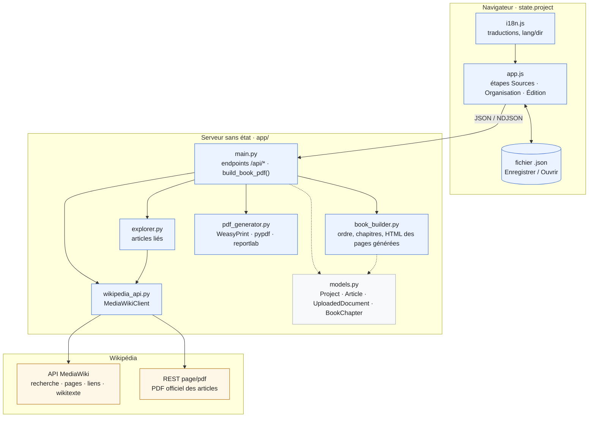
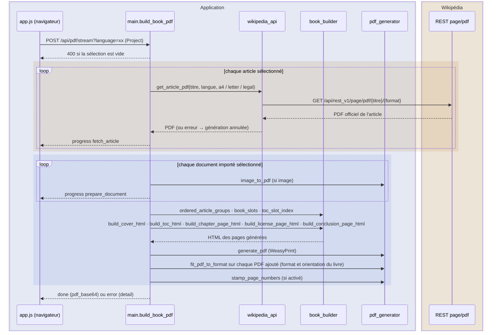

# Wikipedia2Book — Spécifications fonctionnelles et techniques


Traduction anglaise : [SPECIFICATIONS.en.md](SPECIFICATIONS.en.md). Ce document en français fait référence.

## Table des matières

- [1. Présentation de Wikipedia2Book](#1-pr%C3%A9sentation-de-wikipedia2book)
	- [1.1 Objectif](#11-objectif)
	- [1.2 Principes fondamentaux](#12-principes-fondamentaux)
- [2. Le livre en mémoire et sa sauvegarde](#2-le-livre-en-m%C3%A9moire-et-sa-sauvegarde)
- [3. Ajout des articles](#3-ajout-des-articles)
	- [3.1 Méthodes d'ajout](#31-m%C3%A9thodes-dajout)
	- [3.2 Informations conservées par article](#32-informations-conserv%C3%A9es-par-article)
	- [3.3 Introduction et auteur proposés automatiquement](#33-introduction-et-auteur-propos%C3%A9s-automatiquement)
- [4. Exploration des articles liés](#4-exploration-des-articles-li%C3%A9s)
	- [4.1 Principe](#41-principe)
	- [4.2 Profondeur d'exploration](#42-profondeur-dexploration)
	- [4.3 Résultats de l'exploration](#43-r%C3%A9sultats-de-lexploration)
	- [4.4 Lancer l'exploration](#44-lancer-lexploration)
- [5. Sélection des articles](#5-s%C3%A9lection-des-articles)
- [6. Organisation du livre](#6-organisation-du-livre)
	- [6.1 Documents importés (images et PDF)](#61-documents-import%C3%A9s-images-et-pdf)
- [7. Récupération du contenu Wikipédia](#7-r%C3%A9cup%C3%A9ration-du-contenu-wikip%C3%A9dia)
- [8. Références, images et licences](#8-r%C3%A9f%C3%A9rences-images-et-licences)
- [9. Paramétrage du format du livre](#9-param%C3%A9trage-du-format-du-livre)
	- [9.1 Formats standards](#91-formats-standards)
	- [9.2 Format personnalisé](#92-format-personnalis%C3%A9)
	- [9.3 Orientation](#93-orientation)
	- [9.4 Marges](#94-marges)
- [10. Mise en page du livre](#10-mise-en-page-du-livre)
	- [10.1 Format et orientation, appliqués à toutes les pages](#101-format-et-orientation-appliqu%C3%A9s-%C3%A0-toutes-les-pages)
	- [10.2 Numérotation des pages](#102-num%C3%A9rotation-des-pages)
- [11. Génération du PDF](#11-g%C3%A9n%C3%A9ration-du-pdf)
	- [11.1 Déroulement](#111-d%C3%A9roulement)
	- [11.2 Résultat](#112-r%C3%A9sultat)
	- [11.3 Gestion des erreurs](#113-gestion-des-erreurs)
- [12. Interface utilisateur](#12-interface-utilisateur)
	- [12.1 Langues de l'interface](#121-langues-de-linterface)
- [13. Architecture technique](#13-architecture-technique)
	- [13.1 Technologies](#131-technologies)
	- [13.2 API Wikipédia](#132-api-wikip%C3%A9dia)
	- [13.3 Exemples d'appels HTTP](#133-exemples-dappels-http)
	- [13.4 Docker et exécution locale](#134-docker-et-ex%C3%A9cution-locale)
	- [13.5 Environnements et branches](#135-environnements-et-branches)
	- [13.6 Intégration continue (GitHub Actions)](#136-int%C3%A9gration-continue-github-actions)
	- [13.7 Toolforge](#137-toolforge)
	- [13.8 Statistiques d'utilisation (Toolviews)](#138-statistiques-dutilisation-toolviews)
	- [13.9 Modèle de données et fichier de sauvegarde](#139-mod%C3%A8le-de-donn%C3%A9es-et-fichier-de-sauvegarde)
	- [13.10 Schémas de l'architecture](#1310-sch%C3%A9mas-de-larchitecture)
- [14. Sécurité et robustesse](#14-s%C3%A9curit%C3%A9-et-robustesse)
- [15. Respect des licences Wikipédia](#15-respect-des-licences-wikip%C3%A9dia)
- [16. Critères d'acceptation](#16-crit%C3%A8res-dacceptation)
- [17. Structure du dépôt](#17-structure-du-dépôt)
- [18. État d'avancement et évolutions futures](#18-%C3%A9tat-davancement-et-%C3%A9volutions-futures)
- [19. Historique des versions](#19-historique-des-versions)

## 1\. Présentation de Wikipedia2Book

### 1.1 Objectif

Wikipedia2Book est un logiciel qui permet de créer directement un livre au format PDF imprimable à partir d'articles Wikipédia. L'utilisateur commence immédiatement à construire son livre.

Dès l'ouverture de l'application, un livre vide est prêt à l'emploi. L'utilisateur ajoute un ou plusieurs articles principaux, explore les articles qui leur sont liés, choisit précisément les contenus à intégrer, organise les articles en chapitres et génère un document PDF structuré.

Le logiciel fonctionne sur toutes les plateformes grâce à une architecture Python conteneurisée avec Docker.

### 1.2 Principes fondamentaux

* Le logiciel n'est pas limité à un thème ou à une catégorie d'articles.

* Plusieurs articles principaux peuvent être ajoutés à un même livre.

* L'exploration des liens Wikipédia part d'un article choisi par l'utilisateur (profondeur et nombre maximal d'articles réglables par l'API).

* Aucun article découvert n'est ajouté automatiquement au livre.

* L'utilisateur garde le contrôle total sur la sélection des articles.

* Le format du livre est configurable (dimensions, orientation, marges).

* Le PDF produit est adapté à l'impression.

## 2\. Le livre en mémoire et sa sauvegarde

Le logiciel gère un seul livre à la fois, construit entièrement en mémoire dans le navigateur.

* À l'ouverture de l'application, un livre vide est créé automatiquement; l'utilisateur peut lui donner un nom et une description.

* Toutes les modifications (articles, sélection, organisation, mise en page) sont conservées en mémoire dans le navigateur pendant la session, et envoyées à l'API uniquement pour les opérations qui le nécessitent (recherche, exploration, génération du PDF).

* L'utilisateur peut télécharger explicitement l'état du livre sous forme de fichier JSON, nommé d'après le titre du livre (ou, si aucun titre n'est renseigné, le titre du premier article du livre).

* L'utilisateur peut importer un fichier JSON précédemment téléchargé pour reprendre un livre; l'import remplace le livre en cours.

* Le serveur ne persiste aucun livre ni fichier sur son disque : la persistance est entièrement à la charge de l'utilisateur, via le téléchargement puis l'import manuel du fichier JSON.

Le livre contient notamment :

* Les articles principaux.

* Les articles découverts.

* La sélection des articles.

* La structure du livre (ordre, chapitres, présence et position de la table des matières).

* Les paramètres de mise en page.

* Les informations de couverture (titre, sous-titre, auteur, introduction, conclusion).

Le modèle de données complet et le format du fichier JSON sont décrits en section 13.9.

## 3\. Ajout des articles

### 3.1 Méthodes d'ajout

Un seul champ de saisie, dans l'étape Sources, sert à tous les moyens d'ajout : l'utilisateur n'indique pas le type de ce qu'il saisit, le logiciel le reconnaît en interrogeant Wikipédia (`POST /api/sources/resolve`, qui reçoit `input` et `language`) :

* une URL `https://<langue>.wikipedia.org/wiki/…` est lue avec la langue de l'URL; sinon, le texte saisi est pris comme un titre de page, dans la langue de Wikipédia choisie à côté du champ. Ce sélecteur propose FR, EN, DE, ES, IT, PT et NL; à l'ouverture de l'application, il est positionné sur la langue du navigateur (partie principale du code, par exemple `pt` pour `pt-BR`, `no` pour `nb`), ajoutée à la liste si elle n'y figure pas (par exemple JA). Si la langue du navigateur est absente ou n'est pas un code valide, EN est sélectionné. Ce choix n'est enregistré ni dans le livre ni dans le navigateur;

* la page est recherchée sur Wikipédia, redirections suivies : une page de l'espace principal (un article) est ajoutée comme article; une page d'un autre espace de noms (`Utilisateur:…/Livres/…`, `Livre:…`, etc.) est importée comme page de livre;

* si aucune page ne porte exactement ce titre, les résultats de la recherche Wikipédia sont proposés sous le champ, à ajouter d'un clic; une URL vers une page inexistante est signalée comme introuvable.

Sous le champ, un libellé permanent rappelle ce qu'on peut y saisir : l'URL d'un article, une page de livre (URL ou nom) ou le nom d'une page Wikipédia. Les messages d'état (article ajouté, pages importées, aucune page exacte) s'affichent sur une ligne distincte en dessous, sans remplacer ce libellé. Pendant la saisie d'un texte qui n'est pas une URL, des résultats de recherche sont proposés au fil de la frappe. Les endpoints précédents (`POST /api/articles`, `POST /api/books/structure`, `GET /api/search`) restent disponibles.

L'utilisateur ajoute ainsi des articles à son livre par l'un des moyens suivants :

* URL d'un article Wikipédia.

* Titre d'article saisi directement.

* Recherche dans Wikipédia : des résultats sont proposés au fil de la saisie, à ajouter d'un clic.

* URL d'une page de « livre » Wikipédia listant des articles : tous les articles qu'elle référence sont importés et pré-sélectionnés, **dans l'ordre où ils apparaissent sur la page de livre** (et non par ordre alphabétique — l'API MediaWiki trie les liens, le logiciel relit donc le wikitexte de la page pour retrouver l'ordre réel). Seuls leur titre et leur URL sont chargés à ce stade; leur PDF complet n'est téléchargé qu'au moment de la génération. La structure de la page de livre est aussi reprise : la première ligne de la forme `=== … ===` devient le sous-titre du livre (seulement si le champ « Sous-titre » de l'étape Édition est vide), et chaque ligne commençant par `;` ouvre un chapitre qui reçoit les articles listés en dessous, jusqu'au chapitre suivant (étape Organisation, section 6). Le livre garde l'ordre exact de la page : les articles placés avant le premier `;` restent sans chapitre mais **en tête du livre**, avant le premier chapitre et sans page de chapitre ni intitulé « Sans chapitre » (réglage `unassigned_first` du livre, enregistré dans le fichier JSON); cela ne vaut que si le livre n'avait encore aucun chapitre avant l'import, sinon ces articles rejoignent les autres articles sans chapitre, à la fin. Les liens et la mise en forme `''`/`'''` de ces lignes sont réduits à leur texte; un chapitre sans article est ignoré, et les lignes `== … ==` (titre enregistré par le créateur de livres) ne sont pas utilisées. Le message de confirmation renvoie vers la page d'aide Wikipédia sur les livres (`https://fr.wikipedia.org/wiki/Aide:Livres`).

Exemple d'URL d'article :

`https://fr.wikipedia.org/wiki/Épaves_de_la_rade_de_Saint-Pierre`

### 3.2 Informations conservées par article

Pour chaque article, le logiciel conserve :

* Le titre.

* L'URL Wikipédia.

* La langue.

* Le résumé, lorsqu'il provient d'une recherche (les articles ajoutés par URL, par titre ou importés depuis une page de livre n'ont pas de résumé pré-rempli).

* L'identifiant de page Wikipédia, lorsqu'il est connu (résultats de recherche).

L'utilisateur peut supprimer un article principal sans affecter les autres.

### 3.3 Introduction et auteur proposés automatiquement

Quand le tout premier article principal du livre est ajouté (y compris le premier article d'une page de livre importée, section 3.1), le logiciel propose automatiquement, dans l'étape Édition (section 12) :

* L'introduction du livre, à partir du résumé introductif de cet article sur Wikipédia.

* L'auteur du livre, à partir du pseudonyme (ou de l'IP, pour une contribution anonyme) ayant créé la page sur Wikipédia.

Cette proposition ne remplace jamais un champ déjà renseigné par l'utilisateur, et reste entièrement modifiable. Elle ne se déclenche qu'une fois, pour le premier article seulement — ajouter d'autres articles ensuite ne la redéclenche pas.

## 4\. Exploration des articles liés

### 4.1 Principe

Le logiciel explore les liens internes présents dans les articles principaux afin de proposer des articles complémentaires, en s'appuyant sur l'API officielle MediaWiki (`action=parse&prop=text`) : les liens sont lus dans le rendu HTML de l'article, donc **dans leur ordre d'apparition dans la page** (bandeaux, infobox et légendes compris), et non par ordre alphabétique comme le renverrait `prop=links`. Sont ignorés : les liens vers des pages inexistantes (liens rouges), les liens hors espace principal (`Fichier:`, `Catégorie:`, `Aide:`, etc.), les ancres internes, le lien de la page vers elle-même et les doublons.

### 4.2 Profondeur d'exploration

La profondeur est paramétrable, entre 0 et 3, côté API (`/api/explore`); l'interface utilise toujours la profondeur 1 (section 4.4) :

| Profondeur | Comportement                                      |
| ---------- | ------------------------------------------------- |
| 0          | Aucun article complémentaire                      |
| 1          | Articles directement liés aux articles principaux |
| 2          | Articles liés aux articles de profondeur 1        |
| 3          | Articles liés aux articles de profondeur 2        |

La profondeur maximale est bornée à 3 niveaux afin d'éviter une exploration excessive.

### 4.3 Résultats de l'exploration

Pour chaque article découvert, le logiciel affiche :

* Son titre.

* Son URL.

* Un bouton « Ajouter au livre » et un bouton « × » pour l'écarter (section 5).

Au-dessus de la liste, une ligne rappelle de quel article viennent les suggestions (« Liens de « … », dans l'ordre de la page »). Les doublons sont éliminés automatiquement (comparaison insensible à la casse sur la langue et le titre), et les articles déjà présents dans « Vos articles » ne sont pas reproposés.

### 4.4 Lancer l'exploration

* Par défaut, la section « Suggestions » est vide et ne contient aucun bouton : un message invite à cliquer sur « Articles liés » sur l'un de ses articles.

* Le bouton « Articles liés », présent sur chaque carte de « Vos articles », remplit la liste avec les articles cités par cet article, dans l'ordre de la page (profondeur 1, jusqu'à 200 liens). Le bouton de l'article dont les liens sont affichés est mis en évidence.

* Un clic sur « Articles liés » d'un autre article **vide la liste** et la remplit avec les liens de ce nouvel article : la liste montre toujours les liens d'un seul article à la fois.

* Aucun réglage n'est demandé. L'API, elle, accepte toujours une profondeur de 0 à 3 et un maximum de 1 à 200.

* À la fin, un message indique le nombre de suggestions trouvées, puis la page défile jusqu'à la liste; si l'article ne cite aucun nouvel article, un message le précise.

## 5\. Sélection des articles

Cette fonctionnalité est essentielle.

Aucun article découvert ne doit être intégré automatiquement au livre.

Le logiciel présente la liste des articles découverts (« Suggestions ») et laisse l'utilisateur choisir exactement ceux qu'il souhaite conserver.

Fonctionnalités disponibles :

* « Ajouter au livre » sur une suggestion : elle quitte la liste des suggestions et rejoint « Vos articles », cochée, avec la mention de l'article d'origine; un message confirme l'ajout. Elle devient alors un article principal comme les autres : elle peut être décochée, retirée, ou servir de point de départ à une nouvelle exploration.

* « × » sur une suggestion : elle est retirée de la liste.

* « Tout ajouter » : ajoute toutes les suggestions visibles (en respectant le filtre par titre). Ce bouton, le filtre et le choix du tri n'apparaissent que lorsque la liste contient des suggestions.

* Recherche par titre parmi les suggestions.

* Tri des suggestions, sur la même ligne que le filtre (qui se raccourcit pour leur laisser la place, y compris sur smartphone), par deux boutons : « Ordre de la page » (ordre d'apparition des liens dans l'article, choix initial à chaque ouverture de l'application) ou « A → Z » (ordre alphabétique selon la langue de l'interface, sans tenir compte des majuscules ni des accents : « Éruption » est rangé à la lettre E). Le tri se combine avec le filtre; la phrase indiquant l'article d'origine précise l'ordre affiché. Ce choix n'est pas enregistré dans le fichier JSON du livre.

* Dans « Vos articles », une case à cocher par article indique s'il est inclus dans le livre.

La sélection est conservée avec le reste du livre, en mémoire et dans l'export JSON. À l'ouverture d'un fichier JSON plus ancien, les articles découverts qui y étaient cochés sont rangés dans « Vos articles », les autres restent dans les suggestions.

## 6\. Organisation du livre

L'utilisateur organise les articles sélectionnés avant la génération du PDF.

Fonctionnalités :

* Réordonner les articles par glisser-déposer.

* Créer des chapitres et leur donner un titre.

* Déplacer un article d'un chapitre à un autre, ou hors de tout chapitre, par glisser-déposer.

* Placer la table des matières n'importe où dans le livre par glisser-déposer : au début, avant n'importe quel chapitre ou article (y compris au milieu d'un chapitre), ou à la fin. Sa position est enregistrée par rapport à l'élément qui la suit (`toc_position` : `start`, `end` ou `before:<clé>`, où la clé est celle d'un article/document, `chapter:<id>` pour un chapitre, ou `chapter:` pour le groupe « Sans chapitre »); si cet élément disparaît du livre, la table des matières revient au début.

* Retirer la table des matières du livre (bouton « Retirer » sur sa ligne), puis la remettre (bouton « + Table des matières » dans la barre d'outils, qui la replace au début).

* Quand le livre a des chapitres, les articles qui n'appartiennent à aucun chapitre sont affichés à la fin de la liste, sous l'intitulé « Sans chapitre », comme dans le PDF. Exception : pour un livre importé d'une page de livre Wikipédia dont des articles précèdent le premier chapitre (section 3.1), ces articles sont affichés et placés dans le PDF en tête, avant le premier chapitre, sans intitulé ni page de chapitre.

* Ajouter une introduction générale et une conclusion.

* Activer ou non la numérotation des pages (activée par défaut).

Un article peut être déplacé librement dans la structure du livre.

### 6.1 Documents importés (images et PDF)

Dans l'étape Organisation, l'utilisateur peut aussi importer ses propres fichiers (image ou PDF) pour les intégrer au livre comme s'il s'agissait d'articles :

* Formats acceptés : images (`image/*`) et PDF (`application/pdf`); 15 Mo maximum par fichier.

* Un document importé apparaît dans la liste des éléments à organiser au même titre qu'un article : il peut être réordonné, déplacé dans un chapitre, et sa page de départ apparaît dans la table des matières si la numérotation est activée.

* Une image importée est intégrée comme une page entière, centrée et mise à l'échelle au format du livre; un PDF importé est intégré tel quel, page par page.

* Le document peut être désélectionné (exclu du livre sans être supprimé) ou retiré définitivement, indépendamment des autres documents et articles.

* Le contenu du fichier est conservé encodé en base64 dans l'état du livre et dans l'export JSON, afin de pouvoir régénérer le PDF ou reprendre le livre sans avoir à ré-importer le fichier.

## 7\. Récupération du contenu Wikipédia

L'ajout et l'exploration ne téléchargent pas le contenu complet des pages. Au moment de générer le PDF, chaque article sélectionné est récupéré via l'endpoint PDF officiel de Wikimedia (`/api/rest_v1/page/pdf/{titre}/{format}`), équivalent à la fonction « Télécharger comme PDF » de Wikipédia. Wikipédia ne compose ses PDF qu'en trois formats (`a4`, `letter`, `legal`, toujours en portrait) : le logiciel demande `letter` pour un livre au format Letter, `legal` pour un livre au format Legal, et `a4` pour tous les autres formats (A0 à A6, personnalisé). Pour Letter et Legal, les pages des articles sont donc composées par Wikipédia directement au bon format, sans marges blanches dues à un changement de proportions.

Le contenu de chaque article (texte, structure, images, références) n'est jamais reconstruit : c'est exactement celui du PDF officiel Wikipédia. Seule sa mise en page physique change : chaque page est recomposée (mise à l'échelle et centrée, sans déformation) sur le format et l'orientation choisis pour le livre — voir section 10.1.

## 8\. Références, images et licences

Le logiciel ne reconstruit pas le contenu des articles : chaque article sélectionné est intégré sous la forme du PDF officiel généré par Wikipédia. En conséquence :

* Les références et citations restent exactement celles du PDF Wikipédia, avec leur mise en forme d'origine.

* Les images et leurs légendes sont celles intégrées par Wikipédia à l'export PDF, avec leur mise en page d'origine.

* Les crédits et licences des textes et des images sont ceux imprimés par Wikipédia dans son propre PDF; le logiciel ne les extrait pas et ne les réécrit pas séparément.

* Si Wikipédia ne peut pas produire de PDF pour un article sélectionné (page introuvable, service indisponible, réponse invalide), la génération du livre échoue dans son ensemble et un message d'erreur explicite est affiché; aucun livre partiel n'est produit.

* Seule exception à l'intégrité du PDF officiel : lorsque la numérotation des pages est activée (section 10), un numéro de page est superposé en bas de chaque page, y compris les pages d'articles — sans toucher au contenu, aux crédits ni aux licences imprimés par Wikipédia.

## 9\. Paramétrage du format du livre

Le format du document est entièrement configurable.

### 9.1 Formats standards

Formats proposés :

| Format | Dimensions    |
| ------ | ------------- |
| A0     | 841 × 1189 mm |
| A1     | 594 × 841 mm  |
| A2     | 420 × 594 mm  |
| A3     | 297 × 420 mm  |
| A4     | 210 × 297 mm  |
| A5     | 148 × 210 mm  |
| A6     | 105 × 148 mm  |
| Letter | 216 × 279 mm  |
| Legal  | 216 × 356 mm  |

Le format A4 est proposé par défaut, sans être imposé.

### 9.2 Format personnalisé

L'utilisateur peut saisir :

* La largeur en millimètres.

* La hauteur en millimètres.

### 9.3 Orientation

Deux orientations sont disponibles :

* Portrait.

* Paysage.

### 9.4 Marges

L'utilisateur choisit d'abord un jeu de marges prédéfini :

| Préréglage    | Haut | Bas | Intérieure | Extérieure | Reliure |
| ------------- | ---- | --- | ---------- | ---------- | ------- |
| Standard      | 18   | 18  | 18         | 16         | 0       |
| Étroites      | 10   | 10  | 12         | 10         | 0       |
| Larges        | 25   | 25  | 25         | 22         | 0       |
| Pour reliure  | 18   | 18  | 20         | 16         | 10      |

Valeurs en millimètres; « Standard » correspond aux valeurs par défaut. Le choix « Personnalisées », ou le dépliage de « Régler les marges au millimètre », donne accès au réglage individuel de chaque marge. Le préréglage affiché est déduit des valeurs du livre : dès qu'une marge ne correspond plus à aucun préréglage, « Personnalisées » est affiché. Les préréglages ne sont pas enregistrés en tant que tels dans le livre ni dans l'export JSON, seules les cinq valeurs le sont.

Les marges réglables individuellement sont :

* La marge supérieure.

* La marge inférieure.

* La marge intérieure.

* La marge extérieure.

* La marge de reliure, en complément de la marge intérieure.

## 10\. Mise en page du livre

Le PDF est structuré comme un véritable livre.

Éléments générés par l'application :

* Couverture (titre du livre, sous-titre, auteur, note, date de génération).

* Introduction, si elle a été saisie.

* Table des matières, groupée par chapitre : sous un titre souligné, chaque chapitre est une ligne en gras (titre à gauche, numéro de page aligné à droite), suivie en retrait de la liste de ses articles et documents, avec leur numéro de page aligné dans la même colonne. Chaque ligne, numéro de page compris, est un lien interne cliquable vers la première page du chapitre ou de l'article.

* Pages de titre de chapitre, pour chaque chapitre contenant des articles.

* Page de licence (section 15), toujours présente, placée après le dernier article (et après la table des matières si elle est en fin de livre), juste avant la conclusion.

La table des matières peut être absente si l'utilisateur l'a retirée (section 6).

* Conclusion, si elle a été saisie.

Le contenu des articles et des documents importés n'est pas mis en page par l'application : ce sont les pages de leur PDF d'origine (officiel Wikipédia, ou document importé). Leur format physique, lui, est systématiquement harmonisé avec le reste du livre — voir section 10.1.

La couverture et la table des matières sont deux sections distinctes dans le PDF final : la position choisie pour la table des matières dans l'étape Organisation (section 6) est celle effectivement utilisée à la génération — la couverture reste toujours la première page, et la table des matières s'insère exactement à l'endroit choisi : juste après la couverture, avant un chapitre (avant sa page de titre), avant un article, ou après le dernier article (avant la licence et la conclusion).

La navigation dans le PDF final s'appuie sur des signets (couverture, table des matières, une entrée par chapitre et par article, licence, conclusion) et sur les liens de la table des matières. Ces liens sont produits ainsi : WeasyPrint génère chaque ligne comme un lien vers une adresse provisoire (`https://wikipedia2book.invalid/toc/<clé>`, clé d'article ou de document, ou `chapter:<n>`); après l'assemblage, ces liens sont relus (`pdf_generator.internal_links`), retirés, puis remplacés par des liens internes vers la page réelle de l'élément dans le livre (`pdf_generator.add_internal_links`), y compris quand la numérotation des pages est désactivée.

### 10.1 Format et orientation, appliqués à toutes les pages

Toutes les pages du PDF final respectent le format et l'orientation choisis pour le livre (section 9), sans exception :

* Les pages générées par l'application (couverture, introduction, table des matières, pages de chapitre, licence, conclusion) sont nativement produites à ce format.

* Chaque page d'article (PDF officiel Wikipédia) et chaque page de document importé est recomposée sur une page de ce même format : son contenu est mis à l'échelle et centré, en conservant ses proportions d'origine (pas de déformation). Si les proportions de la page source diffèrent de celles du livre, des marges blanches apparaissent sur les côtés ou en haut/bas plutôt que de déformer le contenu.

* Le contenu lui-même (texte, images, références) n'est jamais modifié ni reconstruit — seule sa mise à l'échelle et sa position sur la page changent.

### 10.2 Numérotation des pages

L'option « Numéroter les pages » (section 6) est activée par défaut et peut être désactivée.

Quand elle est activée :

* Toutes les pages du livre affichent un numéro en bas de page, de façon continue — y compris les pages d'articles et de documents importés, à l'exception de la couverture.

* La table des matières affiche, pour chaque chapitre et chaque article, le numéro de la page où il commence.

* Pour calculer ces numéros avant d'assembler le livre, le logiciel génère une première fois la couverture et, si elle n'est pas placée à la fin, la table des matières, afin d'en mesurer la pagination (les numéros des éléments placés après la table des matières en tiennent compte); il régénère ensuite la table des matières avec les numéros corrects. Dans de rares cas (livre très dense), l'ajout des numéros dans la table des matières peut légèrement décaler cette pagination d'une page.

Aucune fonctionnalité de prévisualisation n'est proposée actuellement.

## 11\. Génération du PDF

### 11.1 Déroulement

Le bouton « Générer le PDF » est toujours visible et actif, quel que soit l'onglet affiché; si aucun article ni document n'est sélectionné, un message l'indique au moment du clic plutôt que de désactiver le bouton.

Une fois le PDF lancé, le logiciel :

* Vérifie qu'au moins un article ou document est sélectionné; sinon, la génération est refusée.

* Télécharge le PDF officiel de chaque article sélectionné; décode chaque document importé sélectionné (section 6.1), en convertissant une image en page PDF si besoin.

* Si la numérotation des pages est activée, calcule à l'avance la page de départ de chaque chapitre et de chaque article (section 10.2).

* Génère la couverture (avec l'introduction éventuelle) et la table des matières (avec les numéros de page si activés) comme deux sections distinctes; la couverture reçoit le signet racine portant le titre du livre.

* Insère la table des matières à la position choisie (section 6), ou l'omet si elle a été retirée.

* Pour chaque chapitre (ou pour l'ensemble des articles s'il n'y a pas de chapitre) : génère une page de titre de chapitre avec son propre signet, puis ajoute le PDF officiel de chaque article du chapitre, avec un signet par article.

* Recompose chaque page ajoutée (couverture, table des matières, chapitres, articles, documents importés) sur le format et l'orientation choisis pour le livre (section 10.1), avant de l'assembler au document final.

* Ajoute une page de licence avec signet « Licence » (section 15), après le dernier chapitre/article et la table des matières éventuellement placée en fin de livre.

* Ajoute une page de conclusion avec signet, si une conclusion a été saisie — toujours après la table des matières, même quand elle est positionnée en fin de livre.

* Si la numérotation des pages est activée, superpose un numéro de page en bas de chaque page du document assemblé (sauf la couverture).

* Fusionne l'ensemble en un seul fichier PDF et le rend accessible au téléchargement, nommé d'après le titre du livre.

Pendant toute la génération, une fenêtre de statut indique l'étape en cours sous la forme « Étape n / total », avec son libellé (dans la langue de l'interface) et une barre de progression. Les étapes sont, dans l'ordre : le téléchargement de chaque article (une étape par article, avec son titre) ou la préparation de chaque document importé, le calcul des numéros de page (si la numérotation est activée), la composition de la couverture et de la table des matières, l'assemblage des pages au format du livre, la numérotation des pages (si activée), puis la finalisation du fichier. Le total est connu dès le départ. La fenêtre se ferme à la fin, en cas de succès comme d'échec.

Côté serveur, cette progression est transmise par l'endpoint `POST /api/pdf/stream`, qui renvoie un flux NDJSON (une ligne JSON par événement) : `{"type": "progress", "step", "total", "code", "title"?}` pour chaque étape, puis `{"type": "done", "pdf_base64"}` avec le PDF encodé en base64, ou `{"type": "error", "detail"}` en cas d'échec en cours de génération. Une sélection vide est refusée avant le début du flux (erreur HTTP 400). L'endpoint `POST /api/pdf`, qui renvoie directement le fichier PDF sans progression, reste disponible pour un usage direct de l'API.

Deux endpoints de génération de haut niveau renvoient également directement un fichier PDF : `POST /api/books/generate` reçoit une liste explicite de références d'articles (titre ou URL), les métadonnées et les principaux réglages de mise en page; `POST /api/books/generate-from-wikipedia-book` reçoit l'URL d'une page de livre Wikipédia et un titre de livre facultatif. Dans ce dernier cas, tous les articles listés par Wikipédia sont inclus dans leur ordre d'apparition et sélectionnés pour la génération, avec les chapitres (lignes `;`) et, sauf si `book_subtitle` est fourni, le sous-titre (ligne `=== … ===`) de la page de livre, comme pour l'import dans l'interface (section 3.1). `POST /api/books/structure` renvoie cette lecture sans générer de PDF (`articles`, `subtitle`, `chapters` au format des chapitres du livre, `unassigned_first` vrai quand des articles précèdent le premier chapitre); `POST /api/books/import` renvoie seulement la liste des articles. Sans `book_title`, le titre du livre (couverture, signet, nom du fichier PDF) est la dernière partie du nom de la page de livre : `Utilisateur:X/Livres/Les épaves` donne « Les épaves », `Livre:Animaux` donne « Animaux ». Le paramètre `book_conclusion` (GET et POST) fixe le texte de la page de conclusion; il vaut par défaut `Generated by https://wikipedia2book.toolforge.org/`, et une valeur vide supprime la page de conclusion. Ces endpoints ne conservent aucun livre côté serveur.

### 11.2 Résultat

Le PDF produit est :

* Imprimable et structuré par des signets de navigation.

* Conforme, sur toutes ses pages, au format et à l'orientation choisis pour le livre.

* Fidèle au contenu du PDF officiel Wikipédia pour les articles, et de chaque document importé.

* Compatible avec les lecteurs PDF courants.

### 11.3 Gestion des erreurs

En cas d'échec, le logiciel affiche un message explicite. Les erreurs possibles sont :

* Aucun article sélectionné avant l'export.

* URL, titre d'article ou code de langue invalide.

* Page de livre ou article introuvable sur Wikipédia.

* Impossible de joindre l'API Wikipédia, ou PDF officiel indisponible/invalide pour un article : la génération échoue dans son ensemble, sans produire de livre partiel.

* Échec inattendu pendant l'assemblage du PDF.

## 12\. Interface utilisateur

L'application est une page unique, organisée en trois étapes accessibles par des onglets. Les onglets des étapes sont affichés directement sous la barre supérieure : le titre du livre et la note de couverture ne sont pas affichés au-dessus des étapes, ils se saisissent uniquement dans l'étape Édition (partie A, « Identité du livre »).

**Titre par défaut :** si le champ « Titre du livre » est laissé vide, le titre utilisé (couverture, signet racine, nom des fichiers PDF et JSON) est celui du premier article Wikipédia du livre, dans l'ordre défini à l'étape Organisation (à défaut d'article Wikipédia, le premier document importé). Ce titre par défaut est affiché en grisé dans le champ vide, pour que l'utilisateur sache ce qui sera imprimé; il est calculé au moment de la génération et n'est pas enregistré dans le livre. Un titre importé d'une page de livre Wikipédia (section 3.1) ou saisi par l'utilisateur est toujours prioritaire.

* 01 — Sources : ajout des articles principaux (affichés sous le titre « Vos articles ») et exploration des liens (articles découverts, affichés sous le titre « Suggestions »).

* 02 — Organisation : réorganisation des articles, chapitres, position ou retrait de la table des matières.

* 03 — Édition : identité du livre (titre, sous-titre, auteur, note de couverture, introduction, conclusion) et format d'impression (format papier, orientation, préréglage de marges, numérotation des pages).

En bas des étapes Sources et Organisation, un bouton « Étape suivante : … » ouvre l'étape suivante et remonte en haut de la page.

Le pied de page affiche le logo, l'état de connexion à l'API, un lien vers le dépôt Git du projet (https://github.com/gmoulard/wikipedia2book, ouvert dans un nouvel onglet) puis le numéro de version, le commit, la date et l'auteur du déploiement.

Une barre supérieure permet à tout moment d'ouvrir un livre enregistré (bouton « Ouvrir », import JSON), d'enregistrer le livre sur son ordinateur (bouton « Enregistrer », export JSON) et de lancer la génération du PDF. Elle indique aussi si le livre en cours a été enregistré. Sur smartphone, les boutons « Ouvrir » et « Enregistrer » ne montrent que leur icône et le nom de l'application est masqué, pour que la barre tienne dans la largeur de l'écran.

L'interface est utilisable sur ordinateur, tablette et smartphone, et respecte le thème clair/sombre du système.

Son apparence reprend le système de design Codex de Wikimedia (couleurs, boutons, onglets, champs, coins à 2 px, polices système sans-serif et titres en serif comme sur Wikipédia), pour s'intégrer à l'environnement Wikimedia. Aucune police ni ressource n'est chargée depuis un service tiers (pas de Google Fonts).

### 12.1 Langues de l'interface

L'interface (libellés, boutons, messages) est disponible en français, anglais, espagnol, portugais, italien, allemand, néerlandais, turc, chinois, japonais, arabe et persan, via un sélecteur dans la barre supérieure. L'arabe et le persan s'affichent de droite à gauche : toute la page passe alors en sens d'écriture `rtl` (attribut `dir` du document), et revient en `ltr` pour les autres langues. La langue choisie est mémorisée dans le navigateur (elle n'est pas enregistrée dans le livre ni dans l'export JSON) et détectée automatiquement à la première visite à partir de la langue du navigateur, avec repli sur l'anglais quand celle-ci ne fait pas partie des 12 langues.

Cette langue d'interface est indépendante de la langue des articles Wikipédia (section 3), qui reste un réglage séparé par article. Elle ne s'applique pas aux messages d'erreur renvoyés par le serveur. En revanche, elle est transmise au serveur au moment de la génération du PDF (paramètre `language` de `/api/pdf` et `/api/pdf/stream`, français par défaut, toute autre valeur que les 12 langues de l'interface est refusée) : les titres et libellés ajoutés par l'application dans le PDF sont alors rédigés dans cette langue — « Introduction », « Table des matières », mention « Chapitre » des pages de chapitre, « Sans chapitre », « Conclusion », « Licence », « Sources et auteurs », « Historique et auteurs », la mention « Édition du … » de la couverture, ainsi que les signets correspondants. Les pages générées portent la langue choisie (attribut `lang`) et passent en écriture de droite à gauche pour l'arabe et le persan. La page de licence est entièrement rédigée dans cette langue : nom officiel traduit de la licence CC BY-SA 4.0, lien vers la version de l'acte de licence dans cette langue sur creativecommons.org, conditions de réutilisation, mentions sur les médias, les documents importés et le caractère non officiel du livre. Le texte saisi par l'utilisateur (titre, introduction, conclusion, titres de chapitre) et le contenu des articles Wikipédia ne sont jamais traduits.

## 13\. Architecture technique

### 13.1 Technologies

| Composant        | Technologie utilisée    |
| ----------------- | ------------------------------------------------------------ |
| Langage           | Python 3.12                                                   |
| Backend           | FastAPI + Uvicorn                                             |
| Client HTTP       | httpx (appels à l'API MediaWiki et à l'endpoint PDF)          |
| Analyse HTML      | BeautifulSoup4 (extraits de recherche, liens des articles rendus) |
| Interface         | HTML, CSS, JavaScript (page unique, sans framework)           |
| Internationalisation | Dictionnaire JavaScript interne (`i18n.js`), FR/EN/ES/PT/IT/DE/NL/TR/ZH/JA/AR/FA, sans dépendance externe |
| API Wikipédia     | API MediaWiki (`action=query`, `action=parse`) + endpoint REST `page/pdf` |
| Échange du livre  | JSON navigateur ↔ API                                         |
| Génération PDF    | PDF officiel Wikimedia (articles) + WeasyPrint (couverture, table des matières, chapitres, licence, conclusion) + pypdf (fusion, signets, lecture du nombre de pages, recomposition au format du livre) + reportlab (numéros de page, conversion d'une image importée en page PDF) |
| Conteneurisation  | Docker                                                        |

### 13.2 API Wikipédia

Tous les échanges avec Wikipédia passent par la classe `MediaWikiClient` de `app/wikipedia_api.py`; aucun autre module n'appelle Wikipédia. Deux services sont utilisés, sur le wiki de la langue de l'article (`<langue>` = code validé par `^[a-z0-9-]{2,12}$`) :

* **API MediaWiki (Action API)** : `https://<langue>.wikipedia.org/w/api.php`, en GET, toujours avec `format=json&formatversion=2` et, par défaut, `action=query`.
* **API REST** : `https://<langue>.wikipedia.org/api/rest_v1/page/pdf/<titre>/<format>`, pour le PDF officiel d'un article (le titre a ses espaces remplacés par `_` et est encodé dans l'URL).

| Usage | Appel et paramètres | Fonction | Utilisé par | Section |
| --- | --- | --- | --- | --- |
| Rechercher des articles | `list=search&srsearch=<texte>&srlimit=<1–20>&srnamespace=0` | `search` | `GET /api/search`, `POST /api/sources/resolve` (repli quand aucune page exacte) | 3.1 |
| Reconnaître une page (article ou page de livre), redirections suivies | `prop=info&titles=<titre>&redirects=1` (titre final et espace de noms `ns`) | `get_page` | `POST /api/sources/resolve` | 3.1 |
| Lire une page de livre dans l'ordre réel, avec sous-titre et chapitres | `prop=revisions&titles=<titre>&rvprop=content&rvslots=main` (wikitexte) | `get_book` | `POST /api/books/structure`, `/api/books/import`, `/api/sources/resolve`, `/api/books/generate-from-wikipedia-book` | 3.1 |
| Liens d'un article, dans l'ordre de la page | `action=parse&page=<titre>&prop=text&redirects=1&disabletoc=1` (HTML rendu, lu avec BeautifulSoup) | `get_links` | `POST /api/explore` (via `explorer.py`) | 4.1 |
| Introduction d'un article | `prop=extracts&titles=<titre>&exintro=1&explaintext=1` | `get_intro_and_creator` (1er appel) | `GET /api/articles/intro` | 3.3 |
| Créateur d'une page (première révision) | `prop=revisions&titles=<titre>&rvlimit=1&rvdir=newer&rvprop=user` | `get_intro_and_creator` (2e appel) | `GET /api/articles/intro`, `/api/books/generate-from-wikipedia-book` (créateur de la page de livre, pris comme auteur quand `book_author` est absent) | 3.3 |
| PDF officiel d'un article | REST `page/pdf/<titre>/<a4, letter ou legal>` | `get_article_pdf` | génération du PDF (`/api/pdf`, `/api/pdf/stream`, `/api/books/generate*`) | 7 |

Règles communes :

* En-tête `User-Agent` dédié : `Wikipedia2Book/0.1 (https://github.com/gmoulard/wikipedia2book; MediaWiki API client)`.
* Délais d'attente : 20 secondes pour l'API MediaWiki, 120 secondes pour le téléchargement d'un PDF.
* Erreurs : un échec réseau, une réponse HTTP en erreur, une réponse non JSON ou un champ `error` de l'API MediaWiki produisent une erreur explicite, renvoyée par l'API de l'application avec le code 502 (404 pour une page introuvable, 422 pour une entrée invalide). Une réponse REST qui ne commence pas par `%PDF-` est refusée; pendant la génération, la moindre erreur sur un article annule tout le livre (section 8).
* Aucune donnée n'est mise en cache ni conservée : chaque opération refait ses appels.

### 13.3 Exemples d'appels HTTP

Les exemples ci-dessous supposent que le serveur fonctionne sur `http://localhost:8000`. Remplacer cette adresse par le domaine du déploiement pour appeler une instance distante.

#### Dans un navigateur web

Les endpoints GET peuvent être ouverts directement dans la barre d'adresse :

* Rechercher des articles : `http://localhost:8000/api/search?query=Albert%20Einstein&language=fr&limit=5`.

* Obtenir l'introduction et le créateur d'un article : `http://localhost:8000/api/articles/intro?title=Albert%20Einstein&language=fr`.

* Générer le PDF d'une page de livre Wikipédia : `http://localhost:8000/api/books/generate-from-wikipedia-book?url=https%3A%2F%2Ffr.wikipedia.org%2Fwiki%2FLivre%3AAnimaux`. Le paramètre `url` est obligatoire; `language` est facultatif et vaut `fr` par défaut. Sont aussi acceptés, facultatifs : `book_title`, `book_subtitle`, `book_author`, `book_conclusion`, `page_format`, `orientation`, `page_numbers`, `table_of_contents`. Le PDF est renvoyé en téléchargement.

* Vérifier que le service répond : `http://localhost:8000/health`.

* Afficher la documentation interactive et appeler également les endpoints POST : `http://localhost:8000/docs`.

L'endpoint GET de génération depuis une page de livre Wikipédia peut être appelé directement dans le navigateur. Les autres endpoints de génération de PDF utilisent POST; pour ceux-ci, utiliser `curl` ou la documentation interactive `/docs`.

#### Avec curl

Reconnaître une saisie (URL, page de livre ou titre) et obtenir l'article, le livre ou les résultats de recherche correspondants (`kind` = `article`, `book` ou `search`) :

```bash
curl --fail --show-error --request POST 'http://localhost:8000/api/sources/resolve' \
	--header 'Content-Type: application/json' \
	--data '{"input":"Albert Einstein","language":"fr"}'
```

Générer un PDF à partir d'une liste explicite de références d'articles :

```bash
curl --fail --show-error --request POST 'http://localhost:8000/api/books/generate?language=fr' \
	--header 'Content-Type: application/json' \
	--data '{"book_title":"Animaux","articles":[{"title":"Chat","language":"fr"},{"url":"https://fr.wikipedia.org/wiki/Chien"}]}' \
	--output animaux.pdf
```

Générer un PDF à partir d'une page de livre Wikipédia, en remplaçant l'URL d'exemple par celle d'une page de livre existante :

```bash
curl --fail --show-error --request POST 'http://localhost:8000/api/books/generate-from-wikipedia-book?language=fr' \
	--header 'Content-Type: application/json' \
	--data '{"url":"https://fr.wikipedia.org/wiki/Livre:Animaux","book_title":"Animaux","book_conclusion":"Bonne lecture !"}' \
	--output animaux.pdf
```

La même génération peut être appelée avec GET et uniquement l'URL de la page de livre :

```bash
curl --fail --show-error --get 'http://localhost:8000/api/books/generate-from-wikipedia-book' \
	--data-urlencode 'url=https://fr.wikipedia.org/wiki/Livre:Animaux' \
	--output animaux.pdf
```

Dans les deux cas, la réponse est le fichier PDF binaire; `--output` le sauvegarde localement. `language` règle la langue des libellés générés dans le PDF et les langues prises en charge sont celles de la section 12.1.

### 13.4 Docker et exécution locale

Le logiciel est livré avec :

* Un `Dockerfile` (image Python 3.12-slim avec les dépendances système de WeasyPrint et les polices DejaVu et Noto CJK).

* Un fichier `requirements.txt` aux versions figées (`==`) pour les dépendances directes, dont `pydantic` (importé par `app/models.py`) : chaque build installe exactement les versions avec lesquelles les tests passent.

* Un script `scripts/docker-build.sh` qui construit l'image en y injectant le commit, la date et l'auteur git courants, affichés en pied de page de l'application.

Exemple :

```bash
sh scripts/docker-build.sh
docker run --rm -p 8000:8000 wikipedia2book
```

L'application est alors accessible sur `http://localhost:8000`, avec sa documentation interactive sur `http://localhost:8000/docs`.

La page de l'application (`/`) et ses fichiers (`/static/…`) sont servis avec `Cache-Control: no-cache` : le navigateur revérifie chaque fichier à chaque chargement (réponse 304 s'il n'a pas changé), ce qui évite de mélanger, après un déploiement, une nouvelle page avec d'anciens scripts ou traductions restés en cache.

Le serveur ne stocke aucun livre ni PDF sur disque; tout l'état est conservé dans le navigateur et échangé via JSON. Le déploiement ne demande donc ni base de données ni volume persistant, sur aucune plateforme.

### 13.5 Environnements et branches

L'application est déployée sur trois plateformes, chacune reliée à une branche du dépôt GitHub `gmoulard/wikipedia2book` :

| Plateforme | URL | Branche suivie | Construction de l'image | Déclenchement |
| --- | --- | --- | --- | --- |
| Toolforge (Wikimedia Cloud) | https://wikipedia2book.toolforge.org | `production-toolforge` | Buildpacks Toolforge (`Procfile`, `Aptfile`, `.python-version`) | Workflow GitHub Actions du dépôt (section 13.6) |
| Railway | https://wikipedia2book-production.up.railway.app | `main` | `Dockerfile` | Intégration GitHub de Railway, réglée dans son interface |
| Northflank | https://prod--wikipedia2book--wkvpbnfj6h4v.code.run | `main` | `Dockerfile` | Intégration GitHub de Northflank, réglée dans son interface |

Toolforge est l'instance de référence, proposée à la communauté Wikipédia. Railway et Northflank reçoivent chaque changement poussé sur `main` et servent de préproduction.

Cycle de publication :

1. Développer et pousser sur `main` (ou par pull request vers `main`) : les tests tournent sur GitHub Actions, Railway et Northflank se redéploient, Toolforge n'est pas touché.
2. Vérifier la nouvelle version sur Railway ou Northflank.
3. Publier sur Toolforge en avançant la branche de production :

```bash
git push origin main:production-toolforge
```

`production-toolforge` ne reçoit pas de commits propres : elle ne fait qu'avancer vers un commit déjà présent sur `main`. Revenir à une version antérieure sur Toolforge se fait en y poussant un commit plus ancien de `main` (`git push --force origin <commit>:production-toolforge`).

Chaque version de l'application est repérée dans Git par un **tag annoté** `vX.Y.Z` (par exemple `v1.6.6`), posé sur le commit qui fait passer `app/main.py` à cette version, puis poussé sur GitHub :

```bash
git tag -a v1.6.6 -m "Wikipedia2Book 1.6.6"
git push origin v1.6.6
```

Les tags servent à retrouver le code d'une version (`git checkout v1.4.0`), à comparer deux versions (`git diff v1.5.2 v1.6.6`) ou à republier une version antérieure sur Toolforge (`git push --force origin v1.6.5^{}:production-toolforge`). Pousser un tag ne déclenche aucun déploiement ni aucun workflow : seuls les pushs de branches le font. Les versions 0.16.0, 0.17.0 et 1.6.0 de l'historique (section 19) n'ont jamais été écrites dans `app/main.py` et n'ont donc pas de tag; à l'inverse, `v0.18.0` existe dans le code (l'API de haut niveau, décrite dans l'historique sous 0.16.0 et 0.17.0).

Le choix de branche de Railway et Northflank ne fait pas partie du dépôt : il se modifie dans leurs interfaces (Railway : service, Settings, Source, Branch; Northflank : service de build, Build settings, Branch).

### 13.6 Intégration continue (GitHub Actions)

Trois workflows. Le principal, `.github/workflows/deploy-toolforge.yml` (« Tests and Toolforge deploy »), a deux jobs :

* `test` : à chaque push sur `main` ou `production-toolforge`, à chaque pull request et sur lancement manuel (`workflow_dispatch`). Installe Python 3.12 et `requirements.txt`, puis lance `python -m unittest discover -s tests -v`.

* `deploy` : uniquement après la réussite de `test`, et uniquement pour un push (ou un lancement manuel) sur `production-toolforge`; il est ignoré (« skipped ») partout ailleurs. Il écrit la clé SSH du secret GitHub `TOOLFORGE_SSH_KEY`, fige l'empreinte ED25519 de `login.toolforge.org` dans `known_hosts` (pas de confiance aveugle au premier contact), puis exécute `scripts/toolforge-deploy.sh` dans le compte de l'outil :

```bash
ssh <login>@login.toolforge.org "become wikipedia2book bash -s" < scripts/toolforge-deploy.sh
```

Les déploiements Toolforge sont sérialisés (groupe de concurrence `toolforge-deploy`, sans annulation du déploiement en cours); les autres exécutions sont indépendantes.

Le secret `TOOLFORGE_SSH_KEY` contient une clé privée OpenSSH dédiée au déploiement, distincte de la clé personnelle, dont la partie publique est enregistrée sur le compte Wikimedia (idm.wikimedia.org). La révoquer suffit à couper le déploiement automatique sans toucher aux autres accès.

Le second, `.github/workflows/toolviews-stats.yml` (« Toolviews stats »), met à jour chaque jour les statistiques d'utilisation (section 13.8).

Le troisième, `.github/workflows/jekyll-gh-pages.yml`, publie à chaque push sur `main` (et sur lancement manuel) le site de documentation https://gmoulard.github.io/wikipedia2book/ avec GitHub Pages : Le site est construit à partir du dossier `docs/` : Jekyll y convertit en HTML les fichiers Markdown (`SPECIFICATIONS.fr.md`, `SPECIFICATIONS.en.md`, `stats.md`). La page d'accueil `docs/index.md` est recopiée depuis `README.md` à chaque construction (non committée), avec ses liens adaptés : `docs/…` devient relatif au site, et `LICENSE`, `CODE_OF_CONDUCT.md`, `CITATION.cff` et `codemeta.json`, restés à la racine du dépôt, pointent vers GitHub. C'est l'adresse déclarée comme documentation utilisateur dans `toolinfo.json`. GitHub Pages n'affiche pas les blocs Mermaid nativement : `docs/_includes/head-custom.html`, ajouté par Jekyll dans l'en-tête de chaque page (thème par défaut), charge Mermaid 11.17.2 depuis jsDelivr et dessine les blocs ```` ```mermaid ```` (section 13.10). Le site est aussi reconstruit après chaque exécution réussie de « Toolviews stats » (déclencheur `workflow_run`), et chaque construction ajoute la page de statistiques d'utilisation https://gmoulard.github.io/wikipedia2book/stats.html (section 13.8).

### 13.7 Toolforge

#### Fichiers propres à Toolforge

Toolforge construit l'image avec des buildpacks et ignore le `Dockerfile`. Le dépôt fournit :

* `Procfile` : commande `uvicorn` sur le port 8000 attendu par Toolforge.

* `Aptfile` : mêmes dépendances système et polices que le `Dockerfile`.

* `.python-version` : Python 3.12.

* `toolforge-fonts.conf` : les polices de l'`Aptfile` (dont Noto CJK pour le chinois et le japonais) sont installées dans `/layers/fagiani_apt/apt/usr/share/fonts`, hors des dossiers lus par fontconfig; ce fichier les y ajoute et place le cache fontconfig dans `/tmp` (sans lui, WeasyPrint ne trouve pas Noto CJK et le journal affiche « Fontconfig error: No writable cache directories »).

* `scripts/toolforge-deploy.sh` : script de déploiement, exécuté dans le compte de l'outil.

* `toolinfo.json` : fiche de l'outil au format Toolhub (schéma toolinfo 1.2.2, validé contre le schéma officiel de Toolhub : nom, description, URL, API, dépôt, suivi des bugs, licence AGPL-3.0, auteur et son compte Wikimédia `474D6F756C617264`, documentation utilisateur https://gmoulard.github.io/wikipedia2book/, langues d'interface; `keywords` y est une chaîne séparée par des virgules, pas une liste), à enregistrer sur https://toolhub.wikimedia.org via son URL brute GitHub (`https://raw.githubusercontent.com/gmoulard/wikipedia2book/main/toolinfo.json`). Les langues d'interface qu'elle déclare doivent rester celles de `SUPPORTED_LANGUAGES`.

#### Script de déploiement

`scripts/toolforge-deploy.sh` :

1. lance le build de la branche `production-toolforge` (`toolforge build start --detach --json --use-latest-versions --ref production-toolforge`) et relève dans la réponse l'identifiant du build et le commit réellement construit (`resolved_ref`);
2. suit ce build précis par son identifiant jusqu'à sa fin (au plus 15 minutes), et affiche ses journaux en cas d'échec;
3. crée ou met à jour les variables d'environnement `FONTCONFIG_FILE=/workspace/toolforge-fonts.conf` et `GIT_COMMIT=<commit construit>` (l'image ne contient pas de dépôt git : le pied de page lit le commit dans cette variable);
4. redémarre le webservice (`toolforge webservice buildservice restart`);
5. vérifie, pendant au plus 200 secondes, que `https://wikipedia2book.toolforge.org/api/version` renvoie bien ce commit, et affiche les journaux du webservice sinon.

Toute étape en échec arrête le script avec un code d'erreur, ce qui fait échouer le workflow.

`--use-latest-versions` est nécessaire : avec les versions par défaut des buildpacks, la récupération des paquets de l'`Aptfile` échoue (`libharfbuzz-subset0`) dès que le cache apt de l'outil est vidé. Suivre le build par son identifiant, et non par « le dernier build », évite de lire l'état d'un build précédent avant que le nouveau soit enregistré.

#### Mise en place initiale

À faire une seule fois, depuis `login.toolforge.org`, dans le compte de l'outil (`become wikipedia2book`) :

```bash
toolforge envvars create FONTCONFIG_FILE /workspace/toolforge-fonts.conf
toolforge build start --use-latest-versions --ref production-toolforge https://github.com/gmoulard/wikipedia2book
toolforge webservice buildservice start --mount=none --mem 2Gi --cpu 1
```

`--mount=none` : l'application n'utilise pas le stockage NFS de Toolforge. `--mem 2Gi --cpu 1` : WeasyPrint et l'assemblage de PDF de plusieurs centaines de pages dépassent les 512 Mi attribués par défaut.

#### Déploiement manuel et exploitation

* Redéployer sans nouveau commit : relancer le workflow sur la branche `production-toolforge` depuis l'onglet Actions de GitHub, ou exécuter le script à la main :

```bash
ssh <login>@login.toolforge.org "become wikipedia2book bash -s" < scripts/toolforge-deploy.sh
```

* État et journaux, dans le compte de l'outil : `toolforge webservice status`, `toolforge webservice logs -f`, `toolforge build list`, `toolforge build logs <identifiant>`, `toolforge envvars list`.

* Le port SSH 22 de `login.toolforge.org` peut être bloqué par certains réseaux d'entreprise; les exécuteurs GitHub Actions n'ont pas cette limite.

### 13.8 Statistiques d'utilisation (Toolviews)

L'application ne mesure rien elle-même (serveur sans état, aucun pisteur). La fréquentation vient de Toolviews (https://toolviews.toolforge.org/api/), qui compte les requêtes reçues par le proxy d'entrée de Toolforge pour chaque outil. Ces outils sont annexes : ils ne font pas partie de l'application déployée et ne changent pas sa version.

#### Script `scripts/toolviews_stats.py`

Script local (bibliothèque standard Python uniquement) qui complète un fichier CSV avec la fréquentation quotidienne de l'outil :

```bash
python scripts/toolviews_stats.py [fichier.csv]
```

* Fichier : par défaut `docs/toolviews.csv`, séparé par des points-virgules pour s'ouvrir directement dans Excel en français, avec l'en-tête `date;hits`. Un ancien fichier qui contient encore la colonne `unique_visitors` est réécrit sans elle.
* Sources : `https://toolviews.toolforge.org/api/v1/tool/wikipedia2book/daily/<début>/<fin>` pour les requêtes (`hits`); un seul appel pour toute la période manquante. Le nombre de visiteurs distincts de Toolviews (`…/api/v1/unique/…`) n'est pas relevé : il vaut 0 pour tous les outils de Toolforge (compteur inactif), une valeur erronée.
* Jours traités : seulement ceux absents du CSV, du 1er novembre 2026 à la veille; le jour courant, incomplet, n'est jamais écrit. Un jour déjà présent n'est jamais recalculé (pour corriger une valeur, supprimer la ligne et relancer).
* Jours sans visite : Toolviews ne les renvoie pas; ils sont écrits avec 0 jusqu'au dernier jour publié par Toolviews (ou déjà présent dans le CSV). Les jours suivants, pas encore publiés, ne sont pas écrits, pour ne pas figer un 0 provisoire.
* Robustesse : un ancien fichier séparé par des virgules est relu puis réécrit avec des points-virgules; un fichier verrouillé (ouvert dans Excel) produit un message explicite; une erreur réseau ou une réponse invalide de Toolviews arrête le script avec un code d'erreur, sans rien écrire. Est invalide : un JSON illisible, l'absence du dictionnaire `results`, une clé qui n'est pas une date, ou un jour dont la valeur n'est pas un dictionnaire, qui ne contient pas la clé `wikipedia2book` alors qu'il n'est pas vide, ou dont le compte n'est pas un entier positif. Un jour vide (`{}`) vaut 0.
* Tests : `tests/test_toolviews_stats.py` (faux `fetcher`, sans réseau).

#### Mise à jour quotidienne (GitHub Actions)

`.github/workflows/toolviews-stats.yml` (« Toolviews stats ») tourne chaque jour à 06:30 UTC, et sur lancement manuel (`workflow_dispatch`). Il exécute le script sur le `docs/toolviews.csv` de `main`, régénère `docs/stats.md` avec `scripts/toolviews_chart.py`, puis committe les deux fichiers sur `main` s'ils ont changé, au nom de `github-actions[bot]` (après un `git pull --rebase` pour ne pas échouer si `main` a bougé pendant l'exécution). Les fichiers sont consultables sur https://github.com/gmoulard/wikipedia2book/blob/main/docs/toolviews.csv et https://github.com/gmoulard/wikipedia2book/blob/main/docs/stats.md (GitHub y dessine aussi les graphiques Mermaid).

Conséquence acceptée : ce commit quotidien sur `main` fait redéployer Railway et Northflank une fois par jour. Il ne relance pas les autres workflows GitHub Actions (un push fait avec le jeton `GITHUB_TOKEN` n'en déclenche aucun) : le site GitHub Pages est reconstruit par le déclencheur `workflow_run`. Toolforge n'est pas concerné (branche `production-toolforge`).

#### Graphiques sur GitHub Pages

Page publiée : https://gmoulard.github.io/wikipedia2book/stats.html (statistiques d'utilisation de l'instance Toolforge, mises à jour chaque jour).

`docs/stats.md` (publiée en `stats.html`) est écrite par `scripts/toolviews_chart.py docs/toolviews.csv docs/stats.md`, lors de la mise à jour quotidienne et à nouveau avant chaque construction Jekyll (`.github/workflows/jekyll-gh-pages.yml`), pour qu'une modification du script soit visible sans attendre le lendemain : total des hits et période couverte, puis deux histogrammes Mermaid (`xychart-beta`, dessinés par `_includes/head-custom.html`) — hits par jour sur les 31 derniers jours (axe : numéro du jour, période dans le titre, graphique de 1000 px de large), et hits par mois depuis le début. Le nombre de hits est affiché au-dessus de chaque barre (`showDataLabel`, `showDataLabelOutsideBar`); l'axe vertical va jusqu'à 115 % du maximum pour laisser la place à l'étiquette la plus haute. Mermaid calcule la taille de ces étiquettes d'après la largeur des barres, de façon inutilisable (-1 px dès qu'une barre vaut 0, énorme pour une barre seule) : `head-custom.html` la recalcule après le rendu, d'après la largeur des barres et la longueur du plus grand nombre, entre 6 et 12 px. Un CSV absent ou vide arrête la construction du site avec un message d'erreur. Tests : `tests/test_toolviews_chart.py`.

#### Lecture des chiffres

* `hits` compte des requêtes HTTP, pas des personnes : une visite charge la page, les fichiers statiques, `/api/version`, puis chaque recherche ou génération. Il ne distingue pas l'interface web de l'API (seuls les journaux du webservice, `toolforge webservice logs`, le permettent, et ils sont effacés à chaque redéploiement).

### 13.9 Modèle de données et fichier de sauvegarde

L'état complet du livre est un objet `Project` (`app/models.py`), le même côté navigateur (`state.project`), dans les requêtes à l'API et dans le fichier de sauvegarde. Le nom `Project` est historique et conservé pour la compatibilité des fichiers déjà exportés. Toute valeur hors bornes est refusée par l'API (erreur 422).

#### Fichier de sauvegarde (JSON)

Le bouton de téléchargement produit un fichier `<titre-du-livre>.json` (caractères non alphanumériques retirés, espaces remplacés par des tirets; `livre.json` si le nom obtenu est vide) :

```json
{
  "format": "wikipedia2book-workspace",
  "version": 1,
  "saved_at": "2026-11-13T12:00:00.000Z",
  "projects": [ { "id": "…", "name": "…", "main_articles": [], "…": "…" } ]
}
```

À l'import, sont acceptés : ce format en version 1 (une autre version est refusée avec un message), un tableau de livres, ou un livre seul (objet avec `id` et `name`). Seul le premier livre est chargé; il remplace le livre en cours, après confirmation si celui-ci a des modifications non téléchargées. Les documents importés y sont inclus en base64, ce qui peut rendre le fichier volumineux.

#### `Project` (le livre)

| Champ | Type, défaut | Contraintes / rôle |
| --- | --- | --- |
| `id` | texte, UUID généré | identifiant du livre |
| `name` | texte | 1 à 120 caractères; nom interne du livre |
| `description` | texte, `""` | 2000 caractères au plus |
| `main_articles` | liste d'`Article` | articles ajoutés par l'utilisateur (« Vos articles ») |
| `discovered_articles` | liste d'`Article` | articles trouvés par l'exploration des liens |
| `uploaded_documents` | liste d'`UploadedDocument` | images et PDF importés |
| `book_title` | texte, `""` | 200 caractères au plus |
| `book_subtitle` | texte, `""` | 300 caractères au plus |
| `book_author` | texte, `""` | 200 caractères au plus |
| `introduction` | texte, `""` | 20 000 caractères au plus |
| `conclusion` | texte, `""` | 20 000 caractères au plus; vide = pas de page de conclusion |
| `page_format` | `A0`…`A6`, `Letter`, `Legal`, `custom`; `A4` | format de page (section 9.1) |
| `custom_width_mm`, `custom_height_mm` | nombres, 148 × 210 | 50 à 1000 mm; utilisés si `page_format` = `custom` |
| `orientation` | `portrait` ou `landscape`; `portrait` | orientation (section 9.3) |
| `margin_top_mm`, `margin_bottom_mm` | nombres, 18 et 18 | 0 à 100 mm |
| `margin_inside_mm`, `margin_outside_mm` | nombres, 18 et 16 | 0 à 100 mm |
| `margin_binding_mm` | nombre, 0 | 0 à 40 mm, ajoutée à la marge intérieure |
| `article_order` | liste de clés | ordre des articles et documents dans le livre |
| `chapters` | liste de `BookChapter` | chapitres, dans l'ordre |
| `unassigned_first` | booléen, faux | place le groupe « Sans chapitre » en tête, sans titre ni page de chapitre |
| `toc_position` | texte, `start` | `start`, `end` ou `before:<clé>` (clé d'article ou de document, `chapter:<id>`, ou `chapter:` pour le groupe sans chapitre) |
| `table_of_contents` | booléen, vrai | faux = pas de table des matières |
| `page_numbers` | booléen, vrai | numérotation des pages |
| `created_at`, `updated_at` | dates UTC | horodatage |

#### `Article`

| Champ | Type, défaut | Rôle |
| --- | --- | --- |
| `page_id` | entier ≥ 1 ou absent | identifiant de page Wikipédia |
| `title`, `language`, `url` | textes | titre, code de langue, URL de l'article |
| `summary` | texte, `""` | résumé affiché sur la carte |
| `origin_title` | texte ou absent | article depuis lequel il a été découvert |
| `depth` | entier ≥ 0, 0 | profondeur d'exploration (0 = ajouté directement) |
| `selected` | booléen, faux | inclus dans le livre |

Clé d'un article : `<langue>:<page_id>`, ou `<langue>:title:<titre en minuscules>` sans `page_id`.

#### `UploadedDocument`

| Champ | Type, défaut | Rôle |
| --- | --- | --- |
| `id` | texte, UUID généré | identifiant; clé `doc:<id>` |
| `title` | texte | 1 à 300 caractères |
| `kind` | `image` ou `pdf` | nature du document |
| `mime_type` | texte | 1 à 100 caractères |
| `data_base64` | texte | contenu encodé en base64, 30 000 000 caractères au plus |
| `selected` | booléen, vrai | inclus dans le livre |

#### `BookChapter`

| Champ | Type, défaut | Rôle |
| --- | --- | --- |
| `id` | texte, UUID généré | identifiant; clé `chapter:<id>` |
| `title` | texte | 1 à 120 caractères |
| `article_keys` | liste de clés | articles et documents du chapitre, dans l'ordre |

### 13.10 Schémas de l'architecture

Schémas Mermaid, affichés directement par GitHub et, sur le site de documentation, par le script `docs/_includes/head-custom.html` (section 13.6). Ils doivent être mis à jour quand un module, un endpoint ou une étape de génération change.

#### Modules et dépendances

Les flèches vont de l'appelant vers le module appelé. En bleu, le code de l'application; en orange, les services de Wikipédia. `wikipedia_api.py` est le seul module qui parle à Wikipédia; `models.py` (en gris) est partagé par tous les modules du serveur.



#### Génération du PDF (`POST /api/pdf/stream`)

Le seul appel à Wikipédia pendant la génération est le téléchargement du PDF officiel de chaque article (cadre orange). Tout le reste — ordre du livre, pages générées, recomposition au format, numérotation — est fait par l'application, sans réseau (cadre bleu).



## 14\. Sécurité et robustesse

Le logiciel met en œuvre aujourd'hui :

* La validation stricte des URL fournies (schéma HTTPS, domaine `*.wikipedia.org`, titre présent).

* La validation des codes de langue (expression régulière, 2 à 12 caractères).

* La validation des champs de formulaire (longueurs minimales/maximales, exclusivité titre/URL) au niveau de l'API.

* La gestion des erreurs réseau vers Wikipédia, traduites en messages explicites côté interface.

* Des délais d'attente bornés sur les appels réseau.

* Aucun contenu HTML d'article n'est interprété ni réinjecté par l'application : seuls le PDF officiel Wikipédia (binaire) et les champs texte validés par l'API transitent par le serveur.

Les URL externes ne sont jamais exécutées comme du code.

Points non couverts par l'implémentation actuelle, à considérer pour une version ultérieure : limitation du débit des requêtes vers l'API Wikipédia, journalisation structurée des erreurs, quotas explicites sur la taille des PDFs téléchargés.

## 15\. Respect des licences Wikipédia

Le logiciel doit respecter les licences applicables aux contenus récupérés depuis Wikipédia.

Les textes Wikipédia sont généralement publiés sous licence Creative Commons Attribution-Partage dans les Mêmes Conditions (CC BY-SA). Chaque article conserve, dans le PDF officiel Wikipédia intégré au livre, les mentions de licence et d'attribution telles que générées par Wikipédia elle-même.

Le logiciel :

* Conserve le lien vers chaque article original.

* Ajoute au livre une page « Licence », juste avant la conclusion, qui indique que les textes Wikipédia sont sous licence Creative Commons Attribution – Partage dans les mêmes conditions 4.0 International (CC BY-SA 4.0), avec le lien vers la licence, un résumé des conditions de réutilisation, et la liste des articles dans l'ordre du livre avec, pour chacun, l'URL de l'article et celle de son historique (qui recense les auteurs). Les documents importés y sont cités comme non couverts par cette licence. Cette page rappelle aussi que le livre n'est pas une publication officielle de Wikipédia; elle est entièrement rédigée dans la langue de l'interface (section 12.1).

* N'altère pas le contenu, les crédits ni les mentions de licence imprimés par Wikipédia dans son propre PDF.

* Ne présente pas le livre généré comme une publication officielle de Wikipédia.

Les images et médias intégrés par Wikipédia à son export PDF conservent leurs propres mentions de licence; le logiciel ne les extrait pas séparément et n'effectue pas de vérification de licence indépendante.

## 16\. Critères d'acceptation

La version actuelle est considérée comme fonctionnelle si les points suivants sont validés :

* Ajout de plusieurs articles principaux (URL, titre, recherche, page de livre Wikipédia) depuis un champ unique, le type de saisie étant reconnu automatiquement.

* Exploration des liens internes avec profondeur paramétrable (API).

* Détection des doublons parmi les articles découverts.

* Affichage des liens d'un article dans l'ordre de la page ou par ordre alphabétique, filtre par titre et ajout au livre en un clic.

* Sélection manuelle des articles; aucun ajout automatique d'article découvert.

* Réorganisation des articles et création de chapitres.

* Import d'une page de livre Wikipédia en conservant l'ordre réel des articles, son sous-titre et ses chapitres.

* Import d'images ou de PDF comme documents intégrés au livre, au même titre que des articles.

* Positionnement de la table des matières n'importe où dans le livre, ou retrait.

* Récupération du PDF officiel de chaque article sélectionné au moment de l'export.

* Choix du format papier, de l'orientation et des marges, y compris la marge de reliure.

* Génération d'un PDF imprimable dont toutes les pages respectent le format et l'orientation choisis, avec couverture, table des matières, signets de navigation et pagination (activée par défaut); la table des matières indique alors la page de chaque chapitre et de chaque article.

* Le bouton de génération du PDF est toujours visible et actif.

* Téléchargement du PDF généré.

* Export puis import du livre via un fichier JSON local, nommé d'après le titre du livre.

* Changement de la langue de l'interface (12 langues, section 12.1) sans rechargement de la page.

* Proposition automatique, non destructive, de l'introduction et de l'auteur du livre à partir du premier article ajouté.

## 17\. Structure du dépôt

```text
Wikipedia2Book/
│
├── app/
│   ├── __init__.py
│   ├── main.py
│   ├── models.py
│   ├── wikipedia_api.py
│   ├── explorer.py
│   ├── book_builder.py
│   ├── pdf_generator.py
│   │
│   └── static/
│       ├── index.html
│       ├── styles.css
│       ├── app.js
│       ├── i18n.js
│       └── Wikipedia2bookLogo.png
│
├── scripts/
│   ├── docker-build.sh
│   ├── toolforge-deploy.sh
│   ├── toolviews_stats.py
│   └── toolviews_chart.py
│
├── tests/
│   ├── test_syntax.py
│   ├── test_pdf_generation.py
│   ├── test_uploaded_documents.py
│   ├── test_wikipedia_api.py
│   ├── test_pdf_stream.py
│   ├── test_resolve_source.py
│   ├── test_toolviews_stats.py
│   ├── test_toolviews_chart.py
│   └── test_i18n.py
│
├── Dockerfile
├── Procfile
├── Aptfile
├── .python-version
├── toolforge-fonts.conf
├── toolinfo.json
├── CITATION.cff
├── codemeta.json
├── .github/workflows/deploy-toolforge.yml
├── .github/workflows/toolviews-stats.yml
├── .github/workflows/jekyll-gh-pages.yml
├── requirements.txt
├── .gitignore
├── CLAUDE.md
├── CODE_OF_CONDUCT.md
├── LICENSE
├── README.md
└── docs/                         (source du site GitHub Pages)
    ├── SPECIFICATIONS.fr.md
    ├── SPECIFICATIONS.en.md
    ├── toolviews.csv             (généré chaque jour)
    ├── stats.md                  (généré chaque jour)
    └── _includes/head-custom.html
```

Chaque fichier de code (`.py`, `.js`, `.css`, `index.html`, scripts shell, `Dockerfile`, workflows GitHub Actions) commence par un en-tête de licence AGPL-3.0 (projet, dépôt, copyright, version 3 de la licence). `CITATION.cff` et `codemeta.json` décrivent la version archivée sur Software Heritage (v1.6.4, SWHID `swh:1:dir:9c7c016d9603a4b0201ad64535767a353031bd91`) ; `CODE_OF_CONDUCT.md` renvoie au code de conduite MediaWiki.

## 18\. État d'avancement et évolutions futures

L'essentiel du socle fonctionnel décrit dans ce document est implémenté : livre unique en mémoire, ajout et exploration des articles, sélection manuelle, organisation en chapitres, formats et marges configurables, génération du PDF avec signets de navigation.

Évolutions envisageables, non implémentées à ce jour :

* Filtrage de l'exploration par langue ou par catégorie d'article.

* Extraction indépendante des crédits et licences des images, au-delà de ce qu'intègre le PDF officiel Wikipédia.

* Journalisation des erreurs et limitation du débit des requêtes API.

* Couverture de tests automatisés plus large (aujourd'hui : syntaxe Python, numérotation des pages/table des matières, documents importés, API Wikipédia, traductions, script de statistiques Toolviews, et déroulement de `/api/pdf` et `/api/pdf/stream` via `tests/test_pdf_stream.py` — avec Wikipédia et WeasyPrint simulés : le rendu réel des pages par WeasyPrint et l'interface ne sont pas couverts).

* Prévisualisation du livre avant génération.

* Importation de contenus depuis d'autres encyclopédies.

* Personnalisation avancée de la couverture et des styles typographiques.

* Génération de livres volumineux (regroupement par volumes, par exemple).

Toute évolution doit préserver les principes fondamentaux du logiciel, notamment le contrôle total de l'utilisateur sur la sélection des articles et la gestion d'un seul livre à la fois.

## 19\. Historique des versions

Numéro de version applicatif (`app/main.py`, affiché dans le pied de page de l'application — voir section 12). Incrémenté sur décision de l'utilisateur avant chaque commit (patch, minor ou major), selon la règle définie dans `CLAUDE.md`. Chaque version correspond au tag Git `vX.Y.Z` (section 13.5).

| Version | Date       | Auteur    | Modifications apportées |
| ------- | ---------- | --------- | ------------------------ |
| 0.1.0   | 2026-11-07 | GMoulard  | Version initiale : livre unique en mémoire, ajout et exploration des articles, sélection manuelle, organisation en chapitres, formats et marges configurables, génération du PDF avec signets de navigation. |
| 0.2.0   | 2026-11-09 | GMoulard  | Nettoyage du code mort (suppression de `article_parser.py`, des champs `Article` inutilisés, du flux de création de « projet »). Ajout d'un test automatisé de syntaxe (`tests/test_syntax.py`) et de la politique de versionnement. |
| 0.2.1   | 2026-11-09 | GMoulard  | Correction : le bouton « Ajouter » ne réagissait pas quand le champ de saisie était vide (validation HTML silencieuse) — un message d'erreur explicite est affiché à la place. |
| 0.3.0   | 2026-11-09 | GMoulard  | Le numéro de version applicatif est désormais affiché dans le pied de page, en plus du commit git. |
| 0.4.0   | 2026-11-09 | GMoulard  | Numérotation continue de toutes les pages du PDF généré (y compris les pages d'articles, via une superposition reportlab/pypdf) et affichage du numéro de page de chaque chapitre/article dans la table des matières. Ajout de `tests/test_pdf_generation.py`. |
| 0.5.0   | 2026-11-09 | GMoulard  | Import d'une page de livre Wikipédia : conservation de l'ordre réel des articles (lecture du wikitexte) au lieu de l'ordre alphabétique renvoyé par l'API. Agrandissement du champ de titre du livre (correction d'un bug de mise en page qui ne laissait voir qu'environ 26 caractères). Nouvelle fonctionnalité : import d'images ou de PDF comme documents intégrés au livre (section 6.1), conservés en base64 dans l'état du livre et l'export JSON. |
| 0.6.0   | 2026-11-09 | GMoulard  | Le bouton « Générer le PDF » n'est plus jamais désactivé. Toutes les pages du PDF généré (y compris les articles et documents importés) sont désormais recomposées sur le format et l'orientation choisis pour le livre (section 10.1) — ce qui fiabilise aussi la numérotation des pages, activée par défaut. Le fichier JSON de sauvegarde est nommé d'après le titre du livre. Le message d'import d'un livre Wikipédia pointe vers l'aide Wikipédia correspondante. |
| 0.7.0   | 2026-11-09 | GMoulard  | Interface multilingue : français, anglais, chinois, italien, allemand, via un sélecteur dans la barre supérieure (`app/static/i18n.js`, section 12.1). Langue détectée automatiquement et mémorisée dans le navigateur. Ajout de `tests/test_i18n.py` (parité des clés et des paramètres `{...}` entre les 5 langues). |
| 0.8.0   | 2026-11-09 | GMoulard  | Lors de l'ajout du tout premier article principal, le logiciel propose automatiquement (sans écraser une saisie existante) l'introduction du livre à partir du résumé introductif de l'article, et l'auteur à partir du créateur de la page Wikipédia (section 3.3). Nouvel endpoint `/api/articles/intro`. |
| 0.9.0   | 2026-11-09 | GMoulard  | Correction : la position de la table des matières (section 6) n'était jamais appliquée dans le PDF généré, elle se retrouvait toujours au début — la couverture et la table des matières sont désormais deux sections distinctes, assemblées à la position choisie. Correction d'un conflit de fusion Git resté non résolu dans la feuille de style, qui rendait le bouton « Générer le PDF » (et les notifications) illisibles sans survol de la souris dans certaines configurations. |
| 0.10.0  | 2026-11-10 | GMoulard  | Fenêtre de statut pendant la génération du PDF : numéro de l'étape en cours, nombre total d'étapes, libellé de l'étape (traduit dans toutes les langues de l'interface) et barre de progression (section 11.1). Nouvel endpoint `/api/pdf/stream` (flux NDJSON de progression puis PDF en base64), utilisé par l'interface; `/api/pdf` reste disponible. Ajout de `tests/test_pdf_stream.py`. |
| 0.11.0  | 2026-11-10 | GMoulard  | Six nouvelles langues d'interface : espagnol, portugais, néerlandais, turc, japonais et persan (11 langues au total, section 12.1). Le persan bascule la page en écriture de droite à gauche. Le sélecteur de langue affiche le nom de chaque langue dans cette langue. |
| 0.12.0  | 2026-11-10 | GMoulard  | Ajout de l'arabe comme langue d'interface (12 langues au total), affiché de droite à gauche comme le persan. |
| 0.13.0  | 2026-11-10 | GMoulard  | Nouvelle page « Licence » dans le PDF généré, entre le dernier article et la conclusion : licence CC BY-SA 4.0, conditions de réutilisation, et liste des articles sources avec lien vers l'article et son historique (section 15). |
| 0.14.0  | 2026-11-10 | GMoulard  | Les titres et libellés ajoutés par l'application dans le PDF (introduction, table des matières, chapitre, sans chapitre, conclusion, licence, sources, date d'édition, signets) sont rédigés dans la langue choisie pour l'interface au moment de la génération, avec écriture de droite à gauche pour l'arabe et le persan (section 12.1). Ajout des polices Noto CJK dans l'image Docker pour le chinois et le japonais. |
| 0.15.0  | 2026-11-10 | GMoulard  | Le texte explicatif de la page de licence (nom officiel de la licence, lien vers l'acte localisé, conditions de réutilisation, mentions) est lui aussi traduit dans la langue de l'interface (sections 12.1 et 15). |
| 0.16.0  | 2026-11-10 | GMoulard  | Ajout des API de génération directe d'un livre PDF depuis une liste explicite d'articles ou depuis une page de livre Wikipédia, avec conservation de l'ordre des articles de cette dernière. |
| 0.17.0  | 2026-11-10 | GMoulard  | Ajout d'un endpoint GET qui génère un PDF depuis l'URL d'une page de livre Wikipédia, appelable directement dans un navigateur. |
| 0.19.0  | 2026-11-11 | GMoulard  | Interface plus intuitive : titre du livre modifiable directement en tête de page (plus de mention « projet » ni de champ titre en double dans l'étape Édition); boutons « Ouvrir » et « Enregistrer » libellés dans la barre supérieure; bouton « Étape suivante » en bas des étapes Sources et Organisation; préréglages de marges (Standard, Étroites, Larges, Pour reliure, Personnalisées) avec réglage au millimètre replié; case « Numéroter les pages » alignée avec son libellé; libellés « Vos articles » et « Suggestions » à la place de « Articles principaux » et « Articles découverts », dans les 12 langues; la barre supérieure ne déborde plus sur smartphone. |
| 0.20.0  | 2026-11-11 | GMoulard  | Nouvelle ergonomie de l'exploration des liens (section 4.4) : le panneau « Explorer les liens » (profondeur, maximum d'articles) est remplacé, dans la section « Suggestions », par un bouton « Trouver des articles liés à vos articles » désactivé tant qu'aucun article n'est ajouté, un choix en trois niveaux du nombre de suggestions, la profondeur dans des options avancées repliées, et un bouton « Articles liés » sur chaque article pour explorer à partir de lui seul. Les nouvelles explorations s'ajoutent aux suggestions existantes. Correction : le bouton « Ajouter » restait dans l'ancienne langue après un ajout suivi d'un changement de langue. |
| 0.20.1  | 2026-11-11 | GMoulard  | Le pied de page n'affiche plus « unknown » quand le commit git n'est pas connu au déploiement (valeur par défaut `unknown` de l'image Docker ignorée) : seuls la version et les informations disponibles sont affichées. |
| 0.21.0  | 2026-11-11 | GMoulard  | Articles liés plus simples : plus aucun réglage avant l'exploration (profondeur 1, 30 suggestions par exploration, les suivantes en relançant). Chaque suggestion a un bouton « Ajouter au livre » qui la fait passer visiblement dans « Vos articles » et un bouton « × » pour l'écarter, à la place des cases à cocher; « Tout ajouter » remplace les boutons de sélection groupée; le filtre par profondeur disparaît. Les suggestions cochées d'un ancien fichier JSON sont rangées dans « Vos articles » à l'ouverture (sections 4 et 5). |
| 0.22.0  | 2026-11-11 | GMoulard  | Suggestions encore simplifiées : la section est vide et sans bouton par défaut; « Articles liés » sur un article remplit la liste avec les articles qu'il cite, dans l'ordre d'apparition dans la page (lecture du HTML rendu via `action=parse`, au lieu de `prop=links` trié par ordre alphabétique), et un clic sur un autre article remplace la liste. Disparition du bouton global d'exploration et du filtre par origine (sections 4 et 5). |
| 0.23.0  | 2026-11-11 | GMoulard  | Table des matières libre dans l'étape Organisation : elle peut être glissée n'importe où (avant n'importe quel chapitre ou article, ou à la fin), et plus seulement basculée entre début et fin; elle peut être retirée puis remise. `toc_position` accepte désormais `before:<clé>` en plus de `start`/`end` (fichiers JSON existants toujours valides). Les numéros de page tiennent compte de sa position. Correction : la liste d'organisation affichait les articles sans chapitre avant les chapitres, alors que le PDF les place après, sous « Sans chapitre » (section 6). |
| 0.24.0  | 2026-11-11 | GMoulard  | Le titre du livre et la note de couverture ne sont plus affichés au-dessus des étapes Sources et Organisation : ils se saisissent dans l'étape Édition, partie A « Identité du livre ». Si le titre est laissé vide, le PDF (couverture, signet, nom de fichier) et le fichier JSON prennent le titre du premier article du livre, affiché en grisé dans le champ (section 12). |
| 0.25.0  | 2026-11-11 | GMoulard  | Interface restylée selon le système de design Codex de Wikimedia (bleu progressif #36c, gris Wikipédia, coins 2 px, titres serif), thème sombre aligné sur le mode nuit de Wikipédia ; Google Fonts supprimé (polices système). |
| 0.25.1  | 2026-11-11 | GMoulard  | Déploiement sur Toolforge : ajout d'un `Procfile`, d'un `Aptfile` et d'un `.python-version` pour le Build Service (buildpacks), documentés en section 13.7. |
| 0.25.2  | 2026-11-12 | GMoulard  | Correction : le téléchargement du PDF par l'API (`/api/pdf`, `/api/books/generate`, etc.) échouait avec une erreur 500 quand le titre du livre contenait des caractères non latins (japonais, chinois, arabe…) ; le nom de fichier est désormais transmis encodé en UTF-8 (RFC 5987). Toolforge : ajout de `toolforge-fonts.conf` pour que les polices installées par l'`Aptfile` (Noto CJK) soient trouvées par WeasyPrint (section 13.7). |
| 1.0.0   | 2026-11-12 | GMoulard  | Première version stable, en ligne sur wikipedia2book.toolforge.org. Déploiement automatique sur Toolforge à chaque push sur `main` : workflow GitHub Actions (tests puis déploiement SSH) et script `toolforge-deploy.sh` (sections 13.6 et 13.7). |
| 1.1.0   | 2026-11-12 | GMoulard  | Génération depuis une page de livre Wikipédia (GET et POST `/api/books/generate-from-wikipedia-book`) : nouveau paramètre `book_conclusion`, par défaut « Generated by https://wikipedia2book.toolforge.org/ », vide pour supprimer la conclusion; sans `book_title`, le titre du livre ne garde que la dernière partie du nom de la page de livre (« Les épaves… » au lieu de « Utilisateur:…/Livres/Les épaves… »). |
| 1.2.0   | 2026-11-12 | GMoulard  | Toolforge ne se déploie plus à chaque push sur `main` mais sur la branche `production-toolforge` (`git push origin main:production-toolforge`); `main` et les pull requests lancent seulement les tests. Railway et Northflank suivent toujours `main` (section 13.5). |
| 1.2.1   | 2026-11-12 | GMoulard  | Documentation : la section 13 décrit désormais l'ensemble du système de déploiement (13.4 exécution locale, 13.5 environnements et branches, 13.6 intégration continue, 13.7 Toolforge). |
| 1.3.0   | 2026-11-12 | GMoulard  | Import et génération depuis une page de livre Wikipédia : le sous-titre (ligne `=== … ===`) et les chapitres (lignes `;`) de la page sont repris, dans l'interface comme dans `/api/books/generate-from-wikipedia-book`. Nouvel endpoint `POST /api/books/structure` (articles, sous-titre, chapitres) utilisé par l'interface; `POST /api/books/import` inchangé. L'ordre de la page de livre est conservé : les articles placés avant le premier chapitre restent en tête du livre, sans page de chapitre (nouveau réglage `unassigned_first`, section 3.1). |
| 1.4.0   | 2026-11-12 | GMoulard  | Le PDF officiel de chaque article est demandé à Wikipédia au format du livre quand il le propose : `letter` pour un livre Letter, `legal` pour un livre Legal, `a4` sinon (auparavant toujours A4, puis remis à l'échelle). |
| 1.5.0   | 2026-11-12 | GMoulard  | Suggestions : deux boutons à côté du filtre pour trier la liste dans l'ordre de la page (choix initial) ou par ordre alphabétique, traduits dans les 12 langues (section 5). |
| 1.5.1   | 2026-11-12 | GMoulard  | Correction : les boutons de tri des suggestions affichaient leur nom technique (`discovered.sortPage`…) quand le navigateur gardait en cache l'ancien fichier de traductions; la page et ses fichiers sont désormais servis avec `Cache-Control: no-cache` (section 13.4). Le filtre et les boutons de tri restent sur la même ligne, y compris sur smartphone. |
| 1.5.2   | 2026-11-12 | GMoulard  | Pied de page : lien vers le dépôt Git du projet (github.com/gmoulard/wikipedia2book), placé avant le numéro de version. |
| 1.6.0   | 2026-11-13 | GMoulard  | Étape Sources : un seul champ pour une URL d'article, une page de livre ou un titre; les onglets « Livre Wikipédia / URL Wikipédia / Rechercher » sont supprimés. Nouvel endpoint `POST /api/sources/resolve` qui reconnaît le type de page sur Wikipédia (espace de noms, redirections suivies) et renvoie l'article, le livre ou des résultats de recherche (section 3.1); les endpoints existants sont conservés. Ajout de `tests/test_resolve_source.py`. |
| 1.6.1   | 2026-11-13 | GMoulard  | Étape Sources : libellé permanent sous le champ unique, expliquant qu'on peut saisir une URL d'article, une page de livre (URL ou nom) ou un nom de page Wikipédia; les messages d'état s'affichent sur une ligne séparée. |
| 1.6.2   | 2026-11-13 | GMoulard  | Ajout de `toolinfo.json` (fiche Toolhub de l'outil Toolforge, section 13.7). |
| 1.6.3   | 2026-11-13 | GMoulard  | `toolinfo.json` complété (compte Wikimédia de l'auteur, documentation utilisateur, lien de retour) et rendu conforme au schéma Toolhub (`keywords` en chaîne, `$schema` invalide retiré). |
| 1.6.4   | 2026-11-13 | GMoulard  | Commentaires `NE PAS …` d'une ligne au-dessus des pièges connus du code (ordre des liens Wikipédia, alignement Python/JS de l'organisation et de la table des matières, avertissement pypdf, boutons d'export, couleurs fixes, langues) pour les agents qui modifient le code; aucun changement de comportement. |
| 1.6.5   | 2026-11-13 | GMoulard  | Étape Sources : le sélecteur de langue Wikipédia est positionné à l'ouverture sur la langue du navigateur, ajoutée à la liste si elle n'y figure pas (section 3.1). |
| 1.6.6   | 2026-11-13 | GMoulard  | Repli sur l'anglais, au lieu du français, quand la langue du navigateur n'est pas prise en charge (interface) ou n'est pas un code valide (sélecteur de langue Wikipédia) (sections 3.1 et 12.1). Logo en tête du README et du site de documentation. |
| 1.6.7   | 2026-11-14 | GMoulard  | Versions des dépendances Python figées dans `requirements.txt` (`==`), `pydantic` listé explicitement (section 13.4). Code de conduite, métadonnées de citation (`CITATION.cff`, `codemeta.json`) et en-têtes de licence AGPL-3.0 dans les fichiers de code (contribution de ftosoni, section 17). |
| 1.6.8   | 2026-11-14 | GMoulard  | Table des matières du PDF : chapitres en blocs en gras avec leurs articles en retrait dessous et numéros de page alignés à droite (au lieu de trois colonnes), et chaque ligne devient un lien interne cliquable vers la page du chapitre ou de l'article (section 10). |

Fin du document
