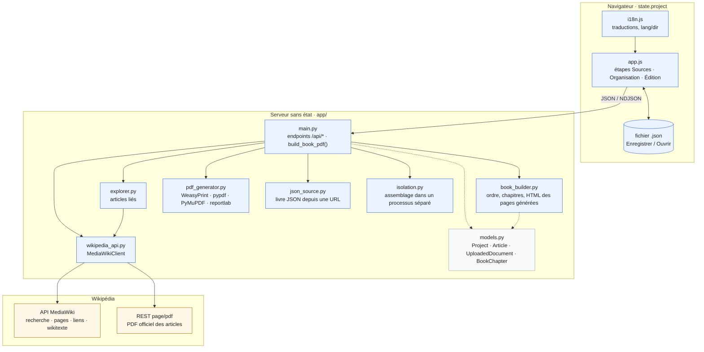
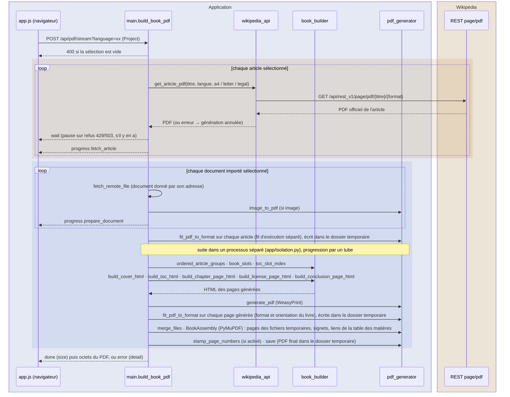

# Wikipedia2Book — Spécifications fonctionnelles et techniques

<table border="0" ><tr><td>

</td><td>
Traduction anglaise : [SPECIFICATIONS.en.md](https://gmoulard.github.io/wikipedia2book/SPECIFICATIONS.en.html). Ce document en français fait référence.
</td></tr></table>

## Table des matières

- [1. Présentation de Wikipedia2Book](#1-pr%C3%A9sentation-de-wikipedia2book)
	- [1.1 Objectif](#11-objectif)
	- [1.2 Principes fondamentaux](#12-principes-fondamentaux)
- [2. Le livre en mémoire et sa sauvegarde](#2-le-livre-en-m%C3%A9moire-et-sa-sauvegarde)
- [3. Ajout des articles](#3-ajout-des-articles)
	- [3.1 Méthodes d'ajout](#31-m%C3%A9thodes-dajout)
	- [3.2 Informations conservées par article](#32-informations-conserv%C3%A9es-par-article)
	- [3.3 Introduction et auteur proposés automatiquement](#33-introduction-et-auteur-propos%C3%A9s-automatiquement)
- [4. Exploration des articles liés](#4-exploration-des-articles-li%C3%A9s)
	- [4.1 Principe](#41-principe)
	- [4.2 Profondeur d'exploration](#42-profondeur-dexploration)
	- [4.3 Résultats de l'exploration](#43-r%C3%A9sultats-de-lexploration)
	- [4.4 Lancer l'exploration](#44-lancer-lexploration)
- [5. Sélection des articles](#5-s%C3%A9lection-des-articles)
- [6. Organisation du livre](#6-organisation-du-livre)
	- [6.1 Documents importés (images et PDF)](#61-documents-import%C3%A9s-images-et-pdf)
- [7. Récupération du contenu Wikipédia](#7-r%C3%A9cup%C3%A9ration-du-contenu-wikip%C3%A9dia)
- [8. Références, images et licences](#8-r%C3%A9f%C3%A9rences-images-et-licences)
- [9. Paramétrage du format du livre](#9-param%C3%A9trage-du-format-du-livre)
	- [9.1 Formats standards](#91-formats-standards)
	- [9.2 Format personnalisé](#92-format-personnalis%C3%A9)
	- [9.3 Orientation](#93-orientation)
	- [9.4 Marges](#94-marges)
- [10. Mise en page du livre](#10-mise-en-page-du-livre)
	- [10.1 Format et orientation, appliqués à toutes les pages](#101-format-et-orientation-appliqu%C3%A9s-%C3%A0-toutes-les-pages)
	- [10.2 Numérotation des pages](#102-num%C3%A9rotation-des-pages)
- [11. Génération du PDF](#11-g%C3%A9n%C3%A9ration-du-pdf)
	- [11.1 Déroulement](#111-d%C3%A9roulement)
	- [11.2 Résultat](#112-r%C3%A9sultat)
	- [11.3 Gestion des erreurs](#113-gestion-des-erreurs)
- [12. Interface utilisateur](#12-interface-utilisateur)
	- [12.1 Langues de l'interface](#121-langues-de-linterface)
- [13. Architecture technique](#13-architecture-technique)
	- [13.1 Technologies](#131-technologies)
	- [13.2 API Wikipédia](#132-api-wikip%C3%A9dia)
	- [13.3 Exemples d'appels HTTP](#133-exemples-dappels-http)
	- [13.4 Docker et exécution locale](#134-docker-et-ex%C3%A9cution-locale)
	- [13.5 Environnements et branches](#135-environnements-et-branches)
	- [13.6 Intégration continue (GitHub Actions)](#136-int%C3%A9gration-continue-github-actions)
	- [13.7 Toolforge](#137-toolforge)
	- [13.8 Statistiques d'utilisation (Toolviews)](#138-statistiques-dutilisation-toolviews)
	- [13.9 Modèle de données et fichier de sauvegarde](#139-mod%C3%A8le-de-donn%C3%A9es-et-fichier-de-sauvegarde)
	- [13.10 Schémas de l'architecture](#1310-sch%C3%A9mas-de-larchitecture)
	- [13.11 Atelier de performance](#1311-atelier-de-performance)
	- [13.12 Test aux limites](#1312-test-aux-limites)
- [14. Sécurité et robustesse](#14-s%C3%A9curit%C3%A9-et-robustesse)
- [15. Respect des licences Wikipédia](#15-respect-des-licences-wikip%C3%A9dia)
- [16. Critères d'acceptation](#16-crit%C3%A8res-dacceptation)
- [17. Structure du dépôt](#17-structure-du-dépôt)
- [18. État d'avancement et évolutions futures](#18-%C3%A9tat-davancement-et-%C3%A9volutions-futures)
- [19. Historique des versions](#19-historique-des-versions)

## 1\. Présentation de Wikipedia2Book

### 1.1 Objectif

Wikipedia2Book est un logiciel qui permet de créer directement un livre au format PDF imprimable à partir d'articles Wikipédia. L'utilisateur commence immédiatement à construire son livre.

Dès l'ouverture de l'application, un livre vide est prêt à l'emploi. L'utilisateur ajoute un ou plusieurs articles principaux, explore les articles qui leur sont liés, choisit précisément les contenus à intégrer, organise les articles en chapitres et génère un document PDF structuré.

Le logiciel fonctionne sur toutes les plateformes grâce à une architecture Python conteneurisée avec Docker.

### 1.2 Principes fondamentaux

* Le logiciel n'est pas limité à un thème ou à une catégorie d'articles.

* Plusieurs articles principaux peuvent être ajoutés à un même livre.

* L'exploration des liens Wikipédia part d'un article choisi par l'utilisateur (profondeur et nombre maximal d'articles réglables par l'API).

* Aucun article découvert n'est ajouté automatiquement au livre.

* L'utilisateur garde le contrôle total sur la sélection des articles.

* Le format du livre est configurable (dimensions, orientation, marges).

* Le PDF produit est adapté à l'impression.

## 2\. Le livre en mémoire et sa sauvegarde

Le logiciel gère un seul livre à la fois, construit entièrement en mémoire dans le navigateur.

* À l'ouverture de l'application, un livre vide est créé automatiquement; l'utilisateur peut lui donner un nom et une description.

* Toutes les modifications (articles, sélection, organisation, mise en page) sont conservées en mémoire dans le navigateur pendant la session, et envoyées à l'API uniquement pour les opérations qui le nécessitent (recherche, exploration, génération du PDF).

* L'utilisateur peut télécharger explicitement l'état du livre sous forme de fichier JSON, nommé d'après le titre du livre (ou, si aucun titre n'est renseigné, le titre du premier article du livre).

* L'utilisateur peut importer un fichier JSON précédemment téléchargé pour reprendre un livre; l'import remplace le livre en cours.

* Un livre peut aussi s'ouvrir depuis l'adresse d'un fichier JSON publié en ligne, en la passant dans l'adresse de la page : `https://wikipedia2book.toolforge.org/?json=<url-du-fichier>` (exemple : [https://wikipedia2book.toolforge.org/?json=https://gmoulard.github.io/wikipedia2book/static/Wrecks-of-Saint-Pierre-harbor.json](https://wikipedia2book.toolforge.org/?json=https://gmoulard.github.io/wikipedia2book/static/Wrecks-of-Saint-Pierre-harbor.json), qui ouvre le livre d'exemple *Wrecks of Saint-Pierre harbor*). C'est le navigateur qui lit le fichier (`fetchWorkspaceText` dans `app.js`), comme un import : il faut que le site qui l'héberge l'autorise (CORS), ce que font GitHub Pages et raw.githubusercontent.com ; sinon, ou si le fichier n'est pas un livre valide, un message « Import JSON impossible : … » s'affiche et la page reste sur un livre vide. Le serveur, lui, ne voit pas cette adresse.

* Le serveur ne persiste aucun livre ni fichier sur son disque : la persistance est entièrement à la charge de l'utilisateur, via le téléchargement puis l'import manuel du fichier JSON. Seuls des fichiers temporaires existent le temps d'une génération de PDF (section 11.1), supprimés dès qu'elle se termine, échoue ou est abandonnée.

Le livre contient notamment :

* Les articles principaux.

* Les articles découverts.

* La sélection des articles.

* La structure du livre (ordre, chapitres, présence et position de la table des matières).

* Les paramètres de mise en page.

* Les informations de couverture (titre, sous-titre, auteur, introduction, conclusion).

Le modèle de données complet et le format du fichier JSON sont décrits en section 13.9.

## 3\. Ajout des articles

### 3.1 Méthodes d'ajout

Un seul champ de saisie, dans l'étape Sources, sert à tous les moyens d'ajout : l'utilisateur n'indique pas le type de ce qu'il saisit, le logiciel le reconnaît en interrogeant Wikipédia (`POST /api/sources/resolve`, qui reçoit `input`, `language` et `site`) :

* une URL `https://<langue>.wikipedia.org/wiki/…` est lue avec la langue de l'URL; une URL d'un autre projet Wikimédia de la forme `https://<langue>.<projet>.org/wiki/…` aussi, sur ce projet (voir plus bas); sinon, le texte saisi est pris comme un titre de page, dans la langue de Wikipédia choisie à côté du champ. Ce sélecteur propose FR, EN, DE, ES, IT, PT et NL; à l'ouverture de l'application, il est positionné sur la langue du navigateur (partie principale du code, par exemple `pt` pour `pt-BR`, `no` pour `nb`), ajoutée à la liste si elle n'y figure pas (par exemple JA). Si la langue du navigateur est absente ou n'est pas un code valide, EN est sélectionné. Ce choix n'est enregistré ni dans le livre ni dans le navigateur;

* la page est recherchée sur Wikipédia, redirections suivies : une page de l'espace principal (un article) est ajoutée comme article; une page d'un autre espace de noms (`Utilisateur:…/Livres/…`, `Livre:…`, etc.) est importée comme page de livre;

* si aucune page ne porte exactement ce titre, les résultats de la recherche Wikipédia sont proposés sous le champ, à ajouter d'un clic; une URL vers une page inexistante est signalée comme introuvable.

* **Autres projets Wikimédia** : une page de l'espace principal, ou d'un espace propre au projet, de Wikisource (`wikisource`), Wikilivres (`wikibooks`), Wikivoyage (`wikivoyage`), Wikiversité (`wikiversity`), Wikiquote (`wikiquote`), Wiktionnaire (`wiktionary`) ou Wikinews (`wikinews`) est ajoutée comme un article, avec le PDF officiel du projet (même service que Wikipédia, section 13.2), par exemple `https://zh.wikisource.org/wiki/論語/學而第一`, `https://fr.wikibooks.org/wiki/Programmation_Python` ou `https://fr.wikivoyage.org/wiki/Lyon`. Elle est donnée par son URL ou par un titre précédé d'un préfixe interwiki de projet (voir la liste plus bas) : la page est alors cherchée sur ce projet et, s'il n'y a pas de page exacte, les résultats de la recherche de ce projet sont proposés. Les pages de livre restent propres à Wikipédia. Les espaces propres au projet sont ceux que MediaWiki numérote à partir de 100, hors pages de discussion (numéros impairs) : par exemple la page d'auteur `https://fr.wikisource.org/wiki/Auteur:François_Rabelais` (espace 102 en français, 106 en espagnol), `Page:…` et `Livre:…` sur Wikisource, ou `Annexe:…` sur le Wiktionnaire ; elle est ajoutée telle quelle, avec son PDF officiel (pour une page d'auteur : biographie et liste des œuvres, sans les œuvres elles-mêmes). Une page des espaces standard (`Wikilivres:…`, `Aide:…`, `Catégorie:…`, etc.) ou de discussion est refusée. Chaque page est ajoutée telle quelle : pour une œuvre ou un livre découpé en sous-pages (Wikisource, Wikilivres), la page principale ne contient souvent que le sommaire, et il faut ajouter chaque sous-page (on peut coller la liste de leurs URL, une par ligne). La carte de l'article indique le nom du projet, dans la langue de l'interface (par exemple « Wikilivres »), à côté de la langue. Les projets sans adresse `<langue>.<projet>.org` (Commons, Meta-Wiki, MediaWiki.org, Wikispecies, Wikidata) ne sont pas acceptés.

Le champ accepte aussi une **liste de pages, une par ligne** (collée, ou saisie avec Maj+Entrée; Entrée seule lance l'ajout). Chaque ligne est reconnue puis recherchée sur Wikipédia l'une après l'autre, avec un message « Ajout de la liste : n / total — titre » :

* les puces et numéros en début de ligne (`1.`, `2)`, `#`, `*`, `-`, `•`) sont ignorés, ainsi que les lignes vides;
* lien wiki `[[Titre]]`, `[[:fr:Titre]]` ou `[[nl:Titre|texte]]` : le titre, dans la langue indiquée par le préfixe s'il y en a un;
* lien Markdown `[texte](https://…)` : l'URL, parenthèses comprises (`…/Suchet%20(navire)`);
* préfixe de langue `nl:Titre` (2 ou 3 lettres minuscules, éventuellement suivies d'une variante, par exemple `zh-yue`) : la page de ce titre sur cette Wikipédia, ce qui permet des listes multilingues;
* préfixe interwiki de projet, seul ou combiné avec un préfixe de langue dans un ordre quelconque : `w:` Wikipédia, `s:` Wikisource, `b:` Wikilivres, `voy:` Wikivoyage, `v:` Wikiversité, `q:` Wikiquote, `wikt:` Wiktionnaire, `n:` Wikinews (par exemple `b:Programmation Python`, `[[voy:en:Lyon]]`, `fr:wikt:chat`) : la page de ce titre sur ce projet, dans la langue du préfixe ou, à défaut, celle choisie à côté du champ;
* URL Wikipédia ou d'un autre projet accepté : lue avec sa langue; titre seul : sur Wikipédia, dans la langue choisie à côté du champ.

Chaque page trouvée est ajoutée comme un article (ou, pour une page de livre, tous ses articles); une page déjà dans le livre est ignorée. Les lignes sans page exacte, ou en erreur, restent dans le champ pour être corrigées, et sont rappelées sous le champ. Un message final indique le nombre de pages ajoutées, déjà présentes et introuvables. La recherche au fil de la frappe est désactivée dès que le champ contient plusieurs lignes.

Sous le champ, un libellé permanent rappelle ce qu'on peut y saisir : l'URL d'un article, une page de livre (URL ou nom) ou le nom d'une page Wikipédia. Les messages d'état (article ajouté, pages importées, aucune page exacte) s'affichent sur une ligne distincte en dessous, sans remplacer ce libellé. Pendant la saisie d'un texte qui n'est pas une URL, des résultats de recherche sont proposés au fil de la frappe, sur le projet et dans la langue des préfixes s'il y en a (`b:fr:Program…` cherche sur Wikilivres en français). Les endpoints précédents (`POST /api/articles`, `POST /api/books/structure`, `GET /api/search`) restent disponibles.

L'utilisateur ajoute ainsi des articles à son livre par l'un des moyens suivants :

* URL d'un article Wikipédia.

* Titre d'article saisi directement.

* Recherche dans Wikipédia : des résultats sont proposés au fil de la saisie, à ajouter d'un clic.

* URL d'une page de « livre » Wikipédia listant des articles : tous les articles qu'elle référence sont importés et pré-sélectionnés, **dans l'ordre où ils apparaissent sur la page de livre** (et non par ordre alphabétique — l'API MediaWiki trie les liens, le logiciel relit donc le wikitexte de la page pour retrouver l'ordre réel). Seuls leur titre et leur URL sont chargés à ce stade; leur PDF complet n'est téléchargé qu'au moment de la génération. La structure de la page de livre est aussi reprise : la première ligne de la forme `=== … ===` devient le sous-titre du livre (seulement si le champ « Sous-titre » de l'étape Édition est vide), et chaque ligne commençant par `;` ouvre un chapitre qui reçoit les articles listés en dessous, jusqu'au chapitre suivant (étape Organisation, section 6). Le livre garde l'ordre exact de la page : les articles placés avant le premier `;` restent sans chapitre mais **en tête du livre**, avant le premier chapitre et sans page de chapitre ni intitulé « Sans chapitre » (réglage `unassigned_first` du livre, enregistré dans le fichier JSON); cela ne vaut que si le livre n'avait encore aucun chapitre avant l'import, sinon ces articles rejoignent les autres articles sans chapitre, à la fin. Les liens et la mise en forme `''`/`'''` de ces lignes sont réduits à leur texte; un chapitre sans article est ignoré, et les lignes `== … ==` (titre enregistré par le créateur de livres) ne sont pas utilisées. Le message de confirmation renvoie vers la page d'aide Wikipédia sur les livres (`https://fr.wikipedia.org/wiki/Aide:Livres`).
  Syntaxe d'une page de livre, telle que décrite par l'aide Wikipédia ([Aide:Livres/Aide avancée](https://fr.wikipedia.org/wiki/Aide:Livres/Aide_avanc%C3%A9e)), et traitement par le logiciel (`wikipedia_api.get_book`) :
  * Titre — `== Titre ==` : ignoré; le titre du livre se saisit dans l'étape Édition.
  * Sous-titre — `=== Sous-titre ===` : la première ligne de cette forme devient le sous-titre du livre (voir ci-dessus).
  * Chapitre — `;Nom du chapitre` : ouvre un chapitre.
  * Article — `:[[Article]]` : l'article est ajouté au chapitre en cours. En pratique, tout lien `[[…]]` d'une ligne qui n'est ni un titre ni un chapitre est pris, même sans `:` initial; une ancre (`#section`) est retirée; les liens dont le titre contient `:` (autres espaces de noms, liens interlangues, fichiers) et les doublons sont ignorés; au plus 200 articles sont lus.
  * Article renommé — `:[[Frégate (bateau)|Frégate]]` : c'est l'article cible (`Frégate (bateau)`) qui est ajouté; le libellé après `|` est ignoré, le livre affiche le titre de l'article.
  * Version donnée — `:[{{fullurl:Nom de l'article|oldid=numéro de version}} Titre de l'article]` : non prise en charge. Ce n'est pas un lien `[[…]]`, l'article n'est donc pas importé; le PDF d'un article est toujours celui de sa version actuelle.

Exemple d'URL d'article :

`https://fr.wikipedia.org/wiki/Épaves_de_la_rade_de_Saint-Pierre`

### 3.2 Informations conservées par article

Pour chaque article, le logiciel conserve :

* Le titre.

* L'URL Wikipédia.

* La langue.

* Le résumé, lorsqu'il provient d'une recherche (les articles ajoutés par URL, par titre ou importés depuis une page de livre n'ont pas de résumé pré-rempli).

* L'identifiant de page Wikipédia, lorsqu'il est connu (résultats de recherche).

L'utilisateur peut supprimer un article principal sans affecter les autres.

### 3.3 Introduction et auteur proposés automatiquement

Quand le tout premier article principal du livre est ajouté (y compris le premier article d'une page de livre importée, section 3.1), le logiciel propose automatiquement, dans l'étape Édition (section 12) :

* L'introduction du livre, à partir du résumé introductif de cet article sur Wikipédia.

* L'auteur du livre, à partir du pseudonyme (ou de l'IP, pour une contribution anonyme) ayant créé la page sur Wikipédia.

Cette proposition ne remplace jamais un champ déjà renseigné par l'utilisateur, et reste entièrement modifiable. Elle ne se déclenche qu'une fois, pour le premier article seulement — ajouter d'autres articles ensuite ne la redéclenche pas.

## 4\. Exploration des articles liés

### 4.1 Principe

Le logiciel explore les liens internes présents dans les articles principaux afin de proposer des articles complémentaires, en s'appuyant sur l'API officielle MediaWiki (`action=parse&prop=text`) : les liens sont lus dans le rendu HTML de l'article, donc **dans leur ordre d'apparition dans la page** (bandeaux, infobox et légendes compris), et non par ordre alphabétique comme le renverrait `prop=links`. Sont ignorés : les liens vers des pages inexistantes (liens rouges), les liens hors espace principal (`Fichier:`, `Catégorie:`, `Aide:`, etc.), les ancres internes, le lien de la page vers elle-même et les doublons.

### 4.2 Profondeur d'exploration

La profondeur est paramétrable, entre 0 et 3, côté API (`/api/explore`); l'interface utilise toujours la profondeur 1 (section 4.4) :

| Profondeur | Comportement                                      |
| ---------- | ------------------------------------------------- |
| 0          | Aucun article complémentaire                      |
| 1          | Articles directement liés aux articles principaux |
| 2          | Articles liés aux articles de profondeur 1        |
| 3          | Articles liés aux articles de profondeur 2        |

La profondeur maximale est bornée à 3 niveaux afin d'éviter une exploration excessive.

### 4.3 Résultats de l'exploration

Pour chaque article découvert, le logiciel affiche :

* Son titre.

* Son URL.

* Un bouton « Ajouter au livre » et un bouton « × » pour l'écarter (section 5).

Au-dessus de la liste, une ligne rappelle de quel article viennent les suggestions (« Liens de « … », dans l'ordre de la page »). Les doublons sont éliminés automatiquement (comparaison insensible à la casse sur la langue et le titre), et les articles déjà présents dans « Vos articles » ne sont pas reproposés.

### 4.4 Lancer l'exploration

* Par défaut, la section « Suggestions » est vide et ne contient aucun bouton : un message invite à cliquer sur « Articles liés » sur l'un de ses articles.

* Le bouton « Articles liés », présent sur chaque carte de « Vos articles », remplit la liste avec les articles cités par cet article, dans l'ordre de la page (profondeur 1, jusqu'à 200 liens). Le bouton de l'article dont les liens sont affichés est mis en évidence.

* Un clic sur « Articles liés » d'un autre article **vide la liste** et la remplit avec les liens de ce nouvel article : la liste montre toujours les liens d'un seul article à la fois.

* Aucun réglage n'est demandé. L'API, elle, accepte toujours une profondeur de 0 à 3 et un maximum de 1 à 200.

* À la fin, un message indique le nombre de suggestions trouvées, puis la page défile jusqu'à la liste; si l'article ne cite aucun nouvel article, un message le précise.

## 5\. Sélection des articles

Cette fonctionnalité est essentielle.

Aucun article découvert ne doit être intégré automatiquement au livre.

Le logiciel présente la liste des articles découverts (« Suggestions ») et laisse l'utilisateur choisir exactement ceux qu'il souhaite conserver.

Fonctionnalités disponibles :

* « Ajouter au livre » sur une suggestion : elle quitte la liste des suggestions et rejoint « Vos articles », cochée, avec la mention de l'article d'origine; un message confirme l'ajout. Elle devient alors un article principal comme les autres : elle peut être décochée, retirée, ou servir de point de départ à une nouvelle exploration.

* « × » sur une suggestion : elle est retirée de la liste.

* « Tout ajouter » : ajoute toutes les suggestions visibles (en respectant le filtre par titre). Ce bouton, le filtre et le choix du tri n'apparaissent que lorsque la liste contient des suggestions.

* Recherche par titre parmi les suggestions.

* Tri des suggestions, sur la même ligne que le filtre (qui se raccourcit pour leur laisser la place, y compris sur smartphone), par deux boutons : « Ordre de la page » (ordre d'apparition des liens dans l'article, choix initial à chaque ouverture de l'application) ou « A → Z » (ordre alphabétique selon la langue de l'interface, sans tenir compte des majuscules ni des accents : « Éruption » est rangé à la lettre E). Le tri se combine avec le filtre; la phrase indiquant l'article d'origine précise l'ordre affiché. Ce choix n'est pas enregistré dans le fichier JSON du livre.

* Dans « Vos articles », une case à cocher par article indique s'il est inclus dans le livre.

La sélection est conservée avec le reste du livre, en mémoire et dans l'export JSON. Les suggestions, elles, ne sont pas enregistrées dans l'export JSON (`discovered_articles` y est toujours vide depuis la 1.9.6) : on les retrouve en relançant « Articles liés ». À l'ouverture d'un fichier JSON plus ancien, les articles découverts qui y étaient cochés sont rangés dans « Vos articles », les autres restent dans les suggestions.

## 6\. Organisation du livre

L'utilisateur organise les articles sélectionnés avant la génération du PDF.

Fonctionnalités :

* Réordonner les articles par glisser-déposer.

* Créer des chapitres et leur donner un titre. Le premier chapitre créé s'ajoute après les articles déjà présents, qui restent en tête du livre sans intitulé (`unassigned_first`), sans faire apparaître « Sans chapitre » ; il suffit ensuite d'y glisser des articles.

* Déplacer un article d'un chapitre à un autre, ou hors de tout chapitre, par glisser-déposer : l'appartenance à un chapitre vient de la place de l'article sous la ligne du chapitre (il n'y a pas de menu de choix du chapitre). Un article lâché sur la ligne d'un chapitre entre en tête de ce chapitre ; lâché sur « Sans chapitre », il sort de tout chapitre ; lâché sur un autre article, il prend sa place (`applyOrgSequence` dans `app.js`, qui met à jour `chapters`, `article_order` et `unassigned_first`).

* Déplacer un chapitre par glisser-déposer, en l'attrapant par n'importe quel endroit de sa ligne hors de son titre (le champ du titre n'est pas plus large que le titre, car Chrome ne lance pas de glisser-déposer depuis un champ de saisie). La liste se lit comme une suite : seule la ligne du chapitre se déplace, et chaque article appartient au chapitre placé au-dessus de lui ; les articles placés avant le premier chapitre sont en tête du livre, sans intitulé (`unassigned_first`). Quand le livre a un groupe « Sans chapitre » en fin de liste, un chapitre ne peut pas passer sous cette ligne.

* Chaque ligne d'article ou de document importé tient sur une ligne (titre, puis origine en plus petit) et porte un bouton « × » qui le retire du livre (un article retiré disparaît aussi de « Vos articles », un document importé est supprimé) et un bouton « ↗ » qui ouvre l'article sur Wikipédia ou le document importé dans un nouvel onglet. Les chapitres, la table des matières et les coupures de volume ont la même croix « × ».

* La table des matières ne figure pas dans la liste de l'étape Organisation : elle se choisit dans l'étape Édition, à côté de « Numéroter les pages », parmi trois choix — « Aucune » (`table_of_contents` faux), « Au début », juste après la couverture (`toc_position` `start`), ou « À la fin », après le dernier article, avant la licence et la conclusion (`toc_position` `end`). Le serveur accepte toujours `before:<clé>` (clé d'article/document, `chapter:<id>`, ou `chapter:` pour le groupe « Sans chapitre ») pour un appel direct de l'API ; un fichier JSON qui place la table des matières au milieu du livre la remet au début à l'ouverture.


* Un livre d'un seul article ou document n'a pas de table des matières, quel que soit le choix de l'étape Édition : le PDF n'en contient pas (`book_builder.toc_slot_index`). Elle revient dès que le livre compte deux éléments ; un volume d'un seul article n'en a pas non plus.

* Quand le livre a des chapitres, les articles qui n'appartiennent à aucun chapitre sont affichés à la fin de la liste, sous l'intitulé « Sans chapitre », comme dans le PDF. Exception : quand le premier chapitre a été créé après eux, qu'ils ont été glissés avant le premier chapitre, ou pour un livre importé d'une page de livre Wikipédia dont des articles précèdent le premier chapitre (section 3.1), ces articles sont affichés et placés dans le PDF en tête, avant le premier chapitre, sans intitulé ni page de chapitre.

* Couper le livre en plusieurs volumes à sa guise, même sous la limite du serveur : le bouton « Nouveau volume + » de la barre d'outils ajoute une coupure au milieu du dernier volume ; la ligne « Début d'un volume » se déplace par glisser-déposer comme la table des matières, et se retire par sa croix « × » (le volume rejoint alors le précédent). Chaque coupure est enregistrée par rapport à l'élément qui la suit (`volume_breaks`, liste de `before:<clé>`, mêmes clés que `toc_position`, gardée dans l'export JSON et ignorée par le serveur) ; une coupure dont l'élément disparaît, qui viserait le premier élément du livre ou un chapitre sans article est ignorée. Chaque volume est généré dans un PDF à part (section 11.1).

* Ajouter une introduction générale et une conclusion.

* Choisir dans l'étape Édition une image de fond pour la couverture et une autre pour la dernière page, chacune importée depuis un fichier ou depuis son adresse (section 11.1).

* Activer ou non la numérotation des pages (activée par défaut).

Un article peut être déplacé librement dans la structure du livre.

### 6.1 Documents importés (images et PDF)

Dans l'étape Organisation, l'utilisateur peut aussi importer ses propres fichiers (image ou PDF), par le bouton « Choisir un fichier + » de la barre d'outils, à côté de « Nouveau volume + », ou par leur adresse (champ d'adresse suivi de « Utiliser l'adresse », ou touche Entrée), pour les intégrer au livre comme s'il s'agissait d'articles :

* Formats acceptés : images (`image/*`) et PDF (`application/pdf`); 15 Mo maximum par fichier.

* Par adresse : l'adresse doit commencer par `https://` (sinon « L'adresse doit commencer par https://. »). Une page de fichier Wikimédia passe par l'API `imageinfo`, comme pour les images de fond (section 11.1) : un PDF donne l'adresse du fichier original, une image sa vignette de 2 000 px ; pour toute autre adresse, le document est un PDF si l'adresse finit par `.pdf`, sinon une image, que le navigateur essaie d'afficher avant de l'accepter (« Document inaccessible à cette adresse (…). » en cas d'échec). Seule l'adresse est gardée dans le livre et dans l'export JSON (`url`, sans `data_base64`) : le serveur télécharge le document à chaque génération, pendant l'étape « Préparation du document importé », avec les mêmes contrôles que les images de fond (PNG, JPEG, GIF, WebP ou PDF d'après l'en-tête `Content-Type`, qui décide aussi s'il s'agit d'un PDF), et la génération s'arrête avec l'adresse en cause s'il est inaccessible. « ↗ » ouvre alors l'adresse elle-même.

* Un document importé apparaît dans la liste des éléments à organiser au même titre qu'un article : il peut être réordonné et déplacé dans un chapitre par glisser-déposer, compte dans un volume, se retire par « × » et s'ouvre par « ↗ » (à partir d'une adresse `blob:`, Chrome refusant d'ouvrir une adresse `data:` dans un nouvel onglet), et sa page de départ apparaît dans la table des matières si la numérotation est activée.

* Une image importée est intégrée comme une page entière, centrée et mise à l'échelle au format du livre; un PDF importé est intégré tel quel, page par page.

* Le document se retire du livre par son bouton « × », indépendamment des autres documents et articles ; il n'y a pas de liste séparée des documents importés ni de case pour les exclure sans les supprimer. Un document désélectionné dans un fichier JSON antérieur à la 1.9.6 revient dans le livre à l'ouverture du fichier.

* Le contenu du fichier est conservé encodé en base64 dans l'état du livre et dans l'export JSON, afin de pouvoir régénérer le PDF ou reprendre le livre sans avoir à ré-importer le fichier.

## 7\. Récupération du contenu Wikipédia

L'ajout et l'exploration ne téléchargent pas le contenu complet des pages. Au moment de générer le PDF, chaque article sélectionné est récupéré via l'endpoint PDF officiel de Wikimedia (`/api/rest_v1/page/pdf/{titre}/{format}`), équivalent à la fonction « Télécharger comme PDF » de Wikipédia. Wikipédia ne compose ses PDF qu'en trois formats (`a4`, `letter`, `legal`, toujours en portrait) : le logiciel demande `letter` pour un livre au format Letter, `legal` pour un livre au format Legal, et `a4` pour tous les autres formats (A0 à A6, personnalisé). Pour Letter et Legal, les pages des articles sont donc composées par Wikipédia directement au bon format, sans marges blanches dues à un changement de proportions.

Le contenu de chaque article (texte, structure, images, références) n'est jamais reconstruit : c'est exactement celui du PDF officiel Wikipédia. Seule sa mise en page physique change : chaque page est recomposée (mise à l'échelle et centrée, sans déformation) sur le format et l'orientation choisis pour le livre — voir section 10.1.

## 8\. Références, images et licences

Le logiciel ne reconstruit pas le contenu des articles : chaque article sélectionné est intégré sous la forme du PDF officiel généré par Wikipédia. En conséquence :

* Les références et citations restent exactement celles du PDF Wikipédia, avec leur mise en forme d'origine.

* Les images et leurs légendes sont celles intégrées par Wikipédia à l'export PDF, avec leur mise en page d'origine.

* Les crédits et licences des textes et des images sont ceux imprimés par Wikipédia dans son propre PDF; le logiciel ne les extrait pas et ne les réécrit pas séparément.

* Quand Wikimédia refuse temporairement une requête parce qu'il reçoit trop de demandes (HTTP 429) ou qu'il est surchargé (HTTP 503), le logiciel attend puis réessaie, jusqu'à 4 fois : le délai indiqué par Wikimédia (en-tête `Retry-After`, borné à 20 s), ou sinon 2, 4, 8 puis 16 s. L'attente est commune à tous les téléchargements en cours d'un même livre (ils reprennent ensemble au lieu de relancer Wikimédia chacun de leur côté) et ne bloque pas le serveur, qui continue de répondre aux autres requêtes. Pendant la génération du PDF, chaque nouvelle pause est signalée dans la fenêtre de statut, sous le libellé de l'étape en cours, par un compte à rebours (« Wikipédia limite les requêtes en ce moment : nouvel essai dans 5 s… ») qui disparaît à la fin de la pause; l'étape et la barre de progression ne bougent pas. Cela vaut pour toutes les requêtes vers Wikipédia (PDF et API MediaWiki).
* Si Wikipédia ne peut pas produire de PDF pour un article sélectionné (page introuvable, service indisponible, réponse invalide, ou encore refus après ces 4 nouvelles tentatives, avec le message « Wikipédia limite le nombre de requêtes en ce moment… »), la génération du livre échoue dans son ensemble et un message d'erreur explicite est affiché; aucun livre partiel n'est produit.

* Seule exception à l'intégrité du PDF officiel : lorsque la numérotation des pages est activée (section 10), un numéro de page est superposé en bas de chaque page, y compris les pages d'articles — sans toucher au contenu, aux crédits ni aux licences imprimés par Wikipédia.

## 9\. Paramétrage du format du livre

Le format du document est entièrement configurable.

### 9.1 Formats standards

Formats proposés :

| Format | Dimensions    |
| ------ | ------------- |
| A0     | 841 × 1189 mm |
| A1     | 594 × 841 mm  |
| A2     | 420 × 594 mm  |
| A3     | 297 × 420 mm  |
| A4     | 210 × 297 mm  |
| A5     | 148 × 210 mm  |
| A6     | 105 × 148 mm  |
| Letter | 216 × 279 mm  |
| Legal  | 216 × 356 mm  |

Le format A4 est proposé par défaut, sans être imposé.

### 9.2 Format personnalisé

L'utilisateur peut saisir :

* La largeur en millimètres.

* La hauteur en millimètres.

### 9.3 Orientation

Deux orientations sont disponibles :

* Portrait.

* Paysage.

### 9.4 Marges

L'utilisateur choisit d'abord un jeu de marges prédéfini :

| Préréglage    | Haut | Bas | Intérieure | Extérieure | Reliure |
| ------------- | ---- | --- | ---------- | ---------- | ------- |
| Standard      | 18   | 18  | 18         | 16         | 0       |
| Étroites      | 10   | 10  | 12         | 10         | 0       |
| Larges        | 25   | 25  | 25         | 22         | 0       |
| Pour reliure  | 18   | 18  | 20         | 16         | 10      |

Valeurs en millimètres; « Standard » correspond aux valeurs par défaut. Le choix « Personnalisées », ou le dépliage de « Régler les marges au millimètre », donne accès au réglage individuel de chaque marge. Le préréglage affiché est déduit des valeurs du livre : dès qu'une marge ne correspond plus à aucun préréglage, « Personnalisées » est affiché. Les préréglages ne sont pas enregistrés en tant que tels dans le livre ni dans l'export JSON, seules les cinq valeurs le sont.

Les marges réglables individuellement sont :

* La marge supérieure.

* La marge inférieure.

* La marge intérieure.

* La marge extérieure.

* La marge de reliure, en complément de la marge intérieure.

## 10\. Mise en page du livre

Le PDF est structuré comme un véritable livre.

Éléments générés par l'application :

* Couverture (titre du livre, sous-titre, auteur, note ; la date d'édition est en fin de livre, sous le logo).

* Introduction, si elle a été saisie.

* Table des matières, groupée par chapitre : sous un titre souligné, chaque chapitre est une ligne en gras (titre à gauche, numéro de page aligné à droite), suivie en retrait de la liste de ses articles et documents, avec leur numéro de page aligné dans la même colonne. Chaque ligne, numéro de page compris, est un lien interne cliquable vers la première page du chapitre ou de l'article.

* Pages de titre de chapitre, pour chaque chapitre contenant des articles.

La table des matières peut être absente si l'utilisateur l'a retirée (section 6).

* Conclusion, si elle a été saisie.

* Page de licence (section 15), toujours présente, après la conclusion (ou après le dernier article, et après la table des matières si elle est en fin de livre), terminée par le logo, la date d'édition et les liens de Wikipedia2Book.

* Image de fond de dernière page, seule sur une page, si elle a été choisie.

Le contenu des articles et des documents importés n'est pas mis en page par l'application : ce sont les pages de leur PDF d'origine (officiel Wikipédia, ou document importé). Leur format physique, lui, est systématiquement harmonisé avec le reste du livre — voir section 10.1.

La couverture et la table des matières sont deux sections distinctes dans le PDF final : la position choisie pour la table des matières dans l'étape Édition (section 6) est celle effectivement utilisée à la génération — la couverture reste toujours la première page, et la table des matières s'insère exactement à l'endroit choisi : juste après la couverture, avant un chapitre (avant sa page de titre), avant un article, ou après le dernier article (avant la licence et la conclusion).

La navigation dans le PDF final s'appuie sur des signets (couverture, table des matières, une entrée par chapitre et par article, licence, conclusion) et sur les liens de la table des matières. Ces liens sont produits ainsi : WeasyPrint génère chaque ligne comme un lien vers une adresse provisoire (`https://wikipedia2book.invalid/toc/<clé>`, clé d'article ou de document, ou `chapter:<n>`); après l'assemblage, ces liens sont relus (`pdf_generator.internal_links`), retirés, puis remplacés par des liens internes vers la page réelle de l'élément dans le livre (`BookAssembly.link_toc`), y compris quand la numérotation des pages est désactivée.

### 10.1 Format et orientation, appliqués à toutes les pages

Toutes les pages du PDF final respectent le format et l'orientation choisis pour le livre (section 9), sans exception :

* Les pages générées par l'application (couverture, introduction, table des matières, pages de chapitre, licence, conclusion) sont nativement produites à ce format.

* Chaque page d'article (PDF officiel Wikipédia) et chaque page de document importé est recomposée sur une page de ce même format : son contenu est mis à l'échelle et centré, en conservant ses proportions d'origine (pas de déformation). Si les proportions de la page source diffèrent de celles du livre, des marges blanches apparaissent sur les côtés ou en haut/bas plutôt que de déformer le contenu. Une page qui a déjà le format du livre à 1 point près (0,35 mm), sans rotation, n'est pas recomposée : sa taille est seulement fixée exactement au format du livre, sans réécrire son contenu. C'est le cas des PDF Wikipédia pour les livres A4, Letter et Legal, demandés directement dans ce format (section 7) : leur assemblage est alors environ sept fois plus rapide.

* Le contenu lui-même (texte, images, références) n'est jamais modifié ni reconstruit — seule sa mise à l'échelle et sa position sur la page changent.

### 10.2 Numérotation des pages

L'option « Numéroter les pages » (section 6) est activée par défaut et peut être désactivée.

Quand elle est activée :

* Toutes les pages du livre affichent un numéro en bas de page, de façon continue — y compris les pages d'articles et de documents importés, à l'exception de la couverture.

* La table des matières affiche, pour chaque chapitre et chaque article, le numéro de la page où il commence.

* Pour calculer ces numéros avant d'assembler le livre, le logiciel génère la couverture (qui ne dépend pas des numéros et sert telle quelle dans le livre, sans être générée une seconde fois) et une première version de la table des matières si elle n'est pas placée à la fin, afin d'en mesurer la pagination (les numéros des éléments placés après la table des matières en tiennent compte); il régénère ensuite la table des matières avec les numéros corrects. Dans de rares cas (livre très dense), l'ajout des numéros dans la table des matières peut légèrement décaler cette pagination d'une page.

Aucune fonctionnalité de prévisualisation n'est proposée actuellement.

## 11\. Génération du PDF

### 11.1 Déroulement

Le bouton « Générer le PDF » est toujours visible et actif, quel que soit l'onglet affiché; si aucun article ni document n'est sélectionné, un message l'indique au moment du clic plutôt que de désactiver le bouton.

Une fois le PDF lancé, le logiciel :

* Vérifie qu'au moins un article ou document est sélectionné; sinon, la génération est refusée.

* Télécharge le PDF officiel de chaque article sélectionné; décode chaque document importé sélectionné (section 6.1), en convertissant une image en page PDF si besoin.

* Si la numérotation des pages est activée, calcule à l'avance la page de départ de chaque chapitre et de chaque article (section 10.2).

* Génère la couverture (avec l'introduction éventuelle) et la table des matières (avec les numéros de page si activés) comme deux sections distinctes; la couverture reçoit le signet racine portant le titre du livre.

* Insère la table des matières à la position choisie (section 6), ou l'omet si elle a été retirée.

* Pour chaque chapitre (ou pour l'ensemble des articles s'il n'y a pas de chapitre) : génère une page de titre de chapitre avec son propre signet, puis ajoute le PDF officiel de chaque article du chapitre, avec un signet par article.

* Recompose chaque page ajoutée (couverture, table des matières, chapitres, articles, documents importés) sur le format et l'orientation choisis pour le livre (section 10.1), avant de l'assembler au document final. Le PDF de chaque article ou document est recomposé en arrière-plan dès qu'il est téléchargé ou préparé, pendant le téléchargement du suivant, si bien qu'au moment de l'assemblage ses pages sont en général déjà prêtes.

* Ajoute une page de licence avec signet « Licence » (section 15), après la conclusion, ou après le dernier chapitre/article et la table des matières éventuellement placée en fin de livre quand il n'y a pas de conclusion.

* Termine la page de licence, juste après son texte, par le logo de Wikipedia2Book (`app/static/Wikipedia2bookLogoPrint.png`, incorporé au PDF, 100 mm de large au plus, lui-même cliquable vers https://wikipedia2book.toolforge.org/), la date d'édition (« Édition du JJ/MM/AAAA », qui n'est plus sur la couverture) et deux liens cliquables, https://wikipedia2book.toolforge.org/ et https://github.com/gmoulard/wikipedia2book ; un livre en volumes les a à la fin de chaque volume.

* **Images de fond** (étape Édition, champs « Image de fond de la couverture » et « Image de fond de la dernière page ») : chaque image est importée depuis un fichier (PNG, JPEG, GIF, WebP ou SVG, 15 Mo au plus) ou depuis son adresse ; une adresse de page de fichier Wikimédia (`https://commons.wikimedia.org/wiki/File:…`, ou `Fichier:…` sur un projet en `<langue>.<projet>.org`) passe par l'API `imageinfo` de ce wiki, appelée par le navigateur (`origin=*`) pour obtenir une vignette de 2 000 px de large sur `upload.wikimedia.org` ; paramètres de suivi `utm_*` retirés ; toute autre adresse doit commencer par `https://` (sinon « L'adresse doit commencer par https://. ») et n'est acceptée que si le navigateur arrive à afficher l'image, sans besoin d'autorisation CORS (sinon un message invite à télécharger l'image puis à importer le fichier). Une image importée depuis un fichier est gardée dans le livre en base64 ; une image donnée par son adresse ne garde que l'adresse, dans le livre comme dans l'export JSON, et le serveur la télécharge à chaque génération (étape de progression `fetch_image`, « Téléchargement de l'image « … » », avant les articles) : `main.fetch_remote_file`, puis `json_source.download`, avec les contrôles de `GET /api/pdf/from-json` (HTTPS, adresses publiques seulement, revérifiées à chaque redirection, 3 au plus, 30 s au plus) et 15 Mo au plus, type PNG, JPEG, GIF, WebP ou SVG d'après l'en-tête `Content-Type`. L'image téléchargée n'est gardée en mémoire que le temps de la génération ; si elle est inaccessible ou d'un autre type, la génération s'arrête avec un message qui donne l'adresse (événement `error`, HTTP 502 sur `/api/pdf`). Modèle `BookImage` (`cover_image`, `back_image`) : `title`, puis soit `url`, soit `mime_type` et `data_base64` (base64 vérifié par le serveur), jamais les deux. L'aperçu s'affiche depuis l'adresse ou le contenu, avec un bouton « Retirer ». Chaque image remplit toute sa page, marges comprises, sans déformation : ce qui dépasse en largeur ou en hauteur est rogné à partir du centre (`background-size: cover` ; `background-attachment: fixed`, sans lequel WeasyPrint dimensionne le fond sur la zone intérieure aux marges). Sous chaque champ, l'interface indique la taille recommandée en pixels, calculée à 300 dpi d'après le format et l'orientation du livre (2 480 × 3 508 px en A4 portrait, `recommendedBackgroundSize` dans `app.js`) et mise à jour quand ils changent, puis signale une image trop petite (moins de 150 dpi une fois la page remplie : « Image trop petite (… px) : elle sera floue à l'impression. ») ou d'orientation différente de la page (« L'image n'a pas l'orientation de la page : une grande partie sera rognée. ») ; rien n'est signalé pour une image SVG. L'image de couverture est placée sous le titre, le sous-titre, l'auteur et la note de couverture, dont la couleur dépend de l'image (`book_builder.cover_text_style`, Pillow) : le serveur mesure la luminance de la partie de l'image visible derrière le texte (zone intérieure aux marges, 65 % supérieurs de la hauteur utile) ; texte noir si 95 % de cette zone est assez claire pour un contraste de 4,5:1, blanc si 95 % est assez sombre, sinon (image contrastée, SVG ou image illisible) texte noir sur un bandeau blanc semi-transparent. Les pages d'introduction n'ont pas d'image. Avec une image de dernière page, une page de plus est ajoutée après la licence, sans marge ni texte, entièrement couverte par l'image (`book_builder.build_back_cover_html`, étape `render_back_cover` du journal) ; le logo, la date et les liens restent sur la licence. Chaque volume d'un livre en volumes reprend les deux images. Tests : `tests/test_backgrounds.py`.

* Ajoute une page de conclusion avec signet, si une conclusion a été saisie — après la table des matières, même quand elle est positionnée en fin de livre, et avant la licence.

* Si la numérotation des pages est activée, superpose un numéro de page en bas de chaque page du document assemblé (sauf la couverture).

* Fusionne l'ensemble en un seul fichier PDF et le rend accessible au téléchargement, nommé d'après le titre du livre.

* **Assemblage sur disque temporaire** : chaque PDF recomposé (article, document importé, page générée) est écrit dans un dossier temporaire propre à la génération, au lieu de rester en mémoire. Le livre est assemblé par PyMuPDF (bibliothèque MuPDF) en deux temps : fusion des fichiers par lots de 20, chaque lot ajouté au fichier fusionné en mise à jour incrémentale puis libéré de la mémoire, suppression aussitôt des fichiers des parties, puis réouverture de ce fichier pour y ajouter signets, liens de la table des matières et numéros de page, et écriture du PDF final, lui aussi dans ce dossier, puis envoyé par morceaux à l'utilisateur (`/api/pdf/stream` comme `/api/pdf`, qui annonce sa taille). Le dossier est supprimé dès que l'envoi se termine, que la génération échoue ou que l'utilisateur l'abandonne. Chaque téléchargement garde son créneau jusqu'à ce que son PDF soit recomposé et écrit : au plus 2 ou 4 PDF bruts (section 13.2) sont en mémoire en même temps, même sur un serveur au processeur limité. La mémoire du serveur ne croît donc presque plus avec la taille du livre : sur un livre de test de 100 articles et 197 Mo, le pic passe de 1 100 Mo à 158 Mo, de 2 130 Mo à 200 Mo pour 200 articles et 393 Mo, et à 262 Mo pour 300 articles et 590 Mo (mesures locales, section 13.12). Les flux sont recopiés tels quels, sans décompression ni recompression : le PDF final a la même taille qu'avant.

* **Numérotation sans réécriture des pages** : le numéro de chaque page est ajouté dans deux petits flux placés autour du contenu existant de la page, qui n'est ni relu ni réécrit (police Helvetica intégrée de MuPDF). L'ancienne superposition d'une page de numéros réécrivait le contenu de chaque page sans le compresser : un livre de 100 articles pesait 173 Mo au lieu de 96 (mesure locale du 16/11/2026).

* **Limite de 300 articles par livre, sur tous les hébergements** : au-delà, la génération est refusée d'emblée (HTTP 413, `detail` = `{"code": "too_many_articles", "count", "limit", "message"}`), sur `/api/pdf`, `/api/pdf/stream` et les endpoints de génération directe. C'est une limite volontaire, pour ménager le service PDF de Wikimédia (chaque livre y télécharge tous ses articles) et la mémoire du conteneur, que le test aux limites remplit presque entièrement vers 600 articles (section 13.12). La valeur (300 sur Toolforge en 1.8.7 et 1.8.8, 2 000 en 1.8.9 et 1.9.0, 300 partout depuis la 1.9.1) reste sous la limite mesurée de la mémoire de Toolforge, entre 800 et 1 000 articles. L'interface ne propose pas de choix : au-delà de la limite, elle découpe d'elle-même le livre en volumes (voir ci-dessous) ; la fenêtre d'alerte avec le message traduit (« Ce livre compte {count} articles, mais la génération est limitée à {limit} articles par livre… ») ne reste que pour un volume que le serveur refuserait encore. Deux variables d'environnement, posées dans le `Dockerfile` (`ENV`) ou passées au conteneur (`docker run -e`), règlent un déploiement : `WIKIPEDIA2BOOK_ARTICLE_LIMIT` (nombre maximal d'articles par livre, `0` = pas de limite ; `300` dans le `Dockerfile`, et 300 aussi quand elle n'est pas positionnée, sur Toolforge comme ailleurs) et `WIKIPEDIA2BOOK_DOWNLOADS` (téléchargements simultanés par livre : de 1 à 2 hors Toolforge, politique robots de Wikimédia, de 1 à 4 sur Toolforge ; `2` dans le `Dockerfile`). Une valeur invalide empêche le serveur de démarrer, avec un message explicite (`main.deployment_settings`). La limite d'articles se règle d'après la mémoire du conteneur : environ 250 Mo pour le serveur et le processus d'assemblage, plus 2 à 2,5 Mo par article au pic, avec une large marge pour plusieurs utilisateurs (README, « Deploying your own container » ; mesures en section 13.12).
* **Volumes** : les coupures posées dans l'étape Organisation (section 6) délimitent d'abord les volumes ; le découpage automatique ci-dessous s'applique ensuite à chaque volume qui dépasse encore la limite. Avec des coupures et sans dépassement, « Générer le PDF » génère de même un volume par requête et annonce « Ce livre est généré en {count} volumes, téléchargés l'un après l'autre. » ; l'indication sous le compteur n'apparaît que si le découpage automatique ajoute des volumes. `/api/version` renvoie aussi `article_limit` (la limite du serveur, `null` sans limite), lue au chargement de la page. Quand le livre compte plus d'articles Wikimédia que cette limite (les documents importés ne comptent pas), l'étape Organisation l'annonce sous le compteur (« Au-delà de {limit} articles, le livre sera généré en {count} volumes, chacun avec sa propre numérotation des pages. »), et « Générer le PDF » génère les volumes l'un après l'autre, chacun par une requête `/api/pdf/stream` séparée, sans rien demander. Le découpage suit l'ordre de l'étape Organisation et coupe entre deux chapitres ; un chapitre est coupé seulement s'il dépasse la limite à lui seul, et son titre est alors repris en tête du volume suivant. Chaque volume est un livre complet : couverture au titre « {titre} — Tome {n}/{total} », table des matières, pages de chapitre, numérotation des pages repartant de 1, page de licence ; l'introduction n'est que dans le premier volume, la conclusion que dans le dernier. Les fichiers s'appellent `<nom-du-livre>-1.pdf`, `<nom-du-livre>-2.pdf`, etc. ; le navigateur peut demander l'autorisation de télécharger plusieurs fichiers. La carte de progression affiche « Volume {n} sur {total} » au-dessus de l'étape en cours, et la relance après un plantage reprend le volume en cours, pas le livre entier. Si la limite n'a pas pu être lue (`/api/version` injoignable), le premier refus `too_many_articles` du serveur fournit la limite et la génération repart en volumes. L'API ne change pas : elle génère toujours un livre par requête, et un appelant qui veut des volumes envoie un `Project` par volume.

* **Assemblage dans un processus séparé** : une fois tous les articles téléchargés et recomposés, la suite de la génération (rendus WeasyPrint de la couverture, de la table des matières, des pages de chapitre, de la licence et de la conclusion, puis fusion, signets, liens, numérotation et écriture du PDF final) s'exécute dans un processus séparé, démarré pour cette génération (`app/isolation.py`, méthode `forkserver` : les modules sont chargés une fois pour toutes dans le processus qui démarre les autres). Ce processus envoie la progression au serveur par un tube, écrit le PDF final dans le dossier temporaire, puis se termine : la mémoire de l'assemblage, plusieurs centaines de Mo pour un gros livre (section 13.12), est rendue au système à la fin de chaque génération au lieu de rester au serveur. S'il manque de mémoire et qu'il est arrêté, la génération échoue avec un message explicite (« L'assemblage du livre s'est arrêté (code …), probablement faute de mémoire : essayez avec moins d'articles. ») ; le serveur, lui, n'est arrêté que si la plateforme arrête tout le conteneur. Si l'utilisateur abandonne la génération, le processus est arrêté aussitôt. Chaque étape de l'assemblage est notée, avec la mémoire, dans le journal des générations (section 13.3).

* **Pages générées légères** : la table des matières d'un gros livre est rendue par blocs de 100 entrées (`book_builder.GENERATED_BLOCK_ENTRIES`), chacun dans un rendu WeasyPrint séparé, pour que la mémoire du rendu ne grandisse pas avec le livre ; chaque bloc commence sur une nouvelle page, le titre n'apparaît que dans le premier. La table des matières n'utilise plus de boîte flexible (le numéro de page est placé en flottant), et toutes les pages générées imposent les polices DejaVu Serif et DejaVu Sans. La page de licence ne contient plus la liste des articles : elle tient en une page quelle que soit la taille du livre.

Pendant toute la génération, une fenêtre de statut indique l'étape en cours sous la forme « Étape n / total », avec son libellé (dans la langue de l'interface) et une barre de progression. Les étapes sont, dans l'ordre : le téléchargement de chaque article (une étape par article, avec son titre; jusqu'à 4 articles sont téléchargés en même temps depuis Wikipédia sur Toolforge, 2 sur les autres hébergements (section 13.2), et chaque étape s'affiche au début de son téléchargement — l'ordre des articles dans le livre n'en dépend pas; si un téléchargement échoue, les autres sont abandonnés et l'erreur du premier article en échec, dans l'ordre du livre, est affichée) ou la préparation de chaque document importé, le calcul des numéros de page (si la numérotation est activée), la composition de la couverture et de la table des matières, l'assemblage des pages au format du livre, la numérotation des pages (si activée), puis la finalisation du fichier. Le total est connu dès le départ. Chaque message est envoyé au moment où l'étape commence : la recomposition des articles s'exécute dans un fil d'exécution séparé (`asyncio.to_thread`) et l'assemblage dans un processus séparé, ce qui laisse le serveur libre d'envoyer la progression et de répondre aux autres utilisateurs pendant une génération. La fenêtre se ferme à la fin, en cas de succès comme d'échec.

Côté serveur, cette progression est transmise par l'endpoint `POST /api/pdf/stream`, qui renvoie un flux NDJSON (une ligne JSON par événement) : `{"type": "progress", "step", "total", "code", "title"?}` pour chaque étape, `{"type": "wait", "seconds"}` au début de chaque pause imposée par Wikimédia (section 8; durée arrondie à la seconde supérieure, ne compte pas comme une étape), puis `{"type": "done", "size"}` immédiatement suivi des `size` octets du PDF, en binaire et sans encodage (envoyés par morceaux de 256 Ko), ou `{"type": "error", "detail"}` en cas d'échec en cours de génération. Le navigateur lit les lignes JSON jusqu'au message `done`, puis rassemble les octets du PDF; s'il en reçoit moins que `size`, il affiche « la connexion avec le serveur a été interrompue avant la fin ». **Relance après un plantage** : quand la génération est coupée par un plantage du serveur — connexion perdue ou flux interrompu avant la fin, serveur injoignable, ou réponse 502, 503 ou 504 du proxy pendant un redémarrage (« no healthy upstream » sur Toolforge) —, le navigateur attend que le serveur réponde de nouveau à `GET /health` (vérifié toutes les 3 s, au plus 2 min), puis relance la génération depuis le début, avec un message dans la fenêtre de statut (« Le serveur a été interrompu : nouvel essai n° 1, la génération repart de zéro… »). Il le fait deux fois automatiquement ; au-delà, il demande à l'utilisateur avant chaque nouvel essai, et s'arrête sur l'erreur s'il refuse. Une erreur renvoyée par le serveur lui-même (événement `error` : article introuvable, refus de Wikipédia, requête invalide…) n'est jamais relancée : elle s'affiche aussitôt. Une sélection vide est refusée avant le début du flux (erreur HTTP 400). L'endpoint `POST /api/pdf`, qui renvoie directement le fichier PDF sans progression, reste disponible pour un usage direct de l'API.

Deux endpoints de génération de haut niveau renvoient également directement un fichier PDF : `POST /api/books/generate` reçoit une liste explicite de références d'articles (titre ou URL), les métadonnées et les principaux réglages de mise en page; `POST /api/books/generate-from-wikipedia-book` reçoit l'URL d'une page de livre Wikipédia et un titre de livre facultatif. Dans ce dernier cas, tous les articles listés par Wikipédia sont inclus dans leur ordre d'apparition et sélectionnés pour la génération, avec les chapitres (lignes `;`) et, sauf si `book_subtitle` est fourni, le sous-titre (ligne `=== … ===`) de la page de livre, comme pour l'import dans l'interface (section 3.1). `POST /api/books/structure` renvoie cette lecture sans générer de PDF (`articles`, `subtitle`, `chapters` au format des chapitres du livre, `unassigned_first` vrai quand des articles précèdent le premier chapitre); `POST /api/books/import` renvoie seulement la liste des articles. Sans `book_title`, le titre du livre (couverture, signet, nom du fichier PDF) est la dernière partie du nom de la page de livre : `Utilisateur:X/Livres/Les épaves` donne « Les épaves », `Livre:Animaux` donne « Animaux ». Le paramètre `book_conclusion` (GET et POST) fixe le texte de la page de conclusion; il est vide par défaut (pas de page de conclusion), comme dans l'interface web. Ces endpoints ne conservent aucun livre côté serveur.

### 11.2 Résultat

Le PDF produit est :

* Imprimable et structuré par des signets de navigation.

* Conforme, sur toutes ses pages, au format et à l'orientation choisis pour le livre.

* Fidèle au contenu du PDF officiel Wikipédia pour les articles, et de chaque document importé.

* Compatible avec les lecteurs PDF courants.

### 11.3 Gestion des erreurs

En cas d'échec, le logiciel affiche un message explicite. Les erreurs possibles sont :

* Aucun article sélectionné avant l'export.

* URL, titre d'article ou code de langue invalide.

* Page de livre ou article introuvable sur Wikipédia.

* Impossible de joindre l'API Wikipédia, ou PDF officiel indisponible/invalide pour un article : la génération échoue dans son ensemble, sans produire de livre partiel.

* Échec inattendu pendant l'assemblage du PDF.

## 12\. Interface utilisateur

L'application est une page unique, organisée en trois étapes accessibles par des onglets. Les onglets des étapes sont affichés directement sous la barre supérieure : le titre du livre et la note de couverture ne sont pas affichés au-dessus des étapes, ils se saisissent uniquement dans l'étape Édition (partie A, « Identité du livre »).

**Titre par défaut :** si le champ « Titre du livre » est laissé vide, le titre utilisé (couverture, signet racine, nom des fichiers PDF et JSON) est celui du premier article Wikipédia du livre, dans l'ordre défini à l'étape Organisation (à défaut d'article Wikipédia, le premier document importé). Ce titre par défaut est affiché en grisé dans le champ vide, pour que l'utilisateur sache ce qui sera imprimé; il est calculé au moment de la génération et n'est pas enregistré dans le livre. Un titre importé d'une page de livre Wikipédia (section 3.1) ou saisi par l'utilisateur est toujours prioritaire.

* 01 — Sources : ajout des articles principaux (affichés sous le titre « Vos articles ») et exploration des liens (articles découverts, affichés sous le titre « Suggestions »).

* 02 — Organisation : réorganisation des articles, documents importés, chapitres et volumes.

* 03 — Édition : identité du livre (titre, sous-titre, auteur, note de couverture, introduction, conclusion, images de fond de la couverture et de la dernière page), table des matières (aucune, au début, à la fin) et format d'impression (format papier, orientation, préréglage de marges, numérotation des pages).

En bas des étapes Sources et Organisation, un bouton « Étape suivante : … » ouvre l'étape suivante et remonte en haut de la page.

Le logo de la barre supérieure s'agrandit à 5 cm de côté au survol de la souris, puis reprend sa taille.

Le pied de page affiche le logo, l'état de connexion à l'API, un lien vers le dépôt Git du projet (https://github.com/gmoulard/wikipedia2book, ouvert dans un nouvel onglet) puis le numéro de version, le commit, la date et l'auteur du déploiement.

Une barre supérieure permet à tout moment d'ouvrir un livre enregistré (bouton « Ouvrir », import JSON), d'enregistrer le livre sur son ordinateur (bouton « Enregistrer », export JSON) et de lancer la génération du PDF. Elle indique aussi si le livre en cours a été enregistré. Sur smartphone, les boutons « Ouvrir » et « Enregistrer » ne montrent que leur icône et le nom de l'application est masqué, pour que la barre tienne dans la largeur de l'écran.

L'interface est utilisable sur ordinateur, tablette et smartphone, et respecte le thème clair/sombre du système.

Son apparence reprend le système de design Codex de Wikimedia (couleurs, boutons, onglets, champs, coins à 2 px, polices système sans-serif et titres en serif comme sur Wikipédia), pour s'intégrer à l'environnement Wikimedia. Aucune police ni ressource n'est chargée depuis un service tiers (pas de Google Fonts).

### 12.1 Langues de l'interface

L'interface (libellés, boutons, messages) est disponible en français, anglais, espagnol, portugais, italien, allemand, néerlandais, turc, chinois, japonais, arabe et persan, via un sélecteur dans la barre supérieure. L'arabe et le persan s'affichent de droite à gauche : toute la page passe alors en sens d'écriture `rtl` (attribut `dir` du document), et revient en `ltr` pour les autres langues. La langue choisie est mémorisée dans le navigateur (elle n'est pas enregistrée dans le livre ni dans l'export JSON) et détectée automatiquement à la première visite à partir de la langue du navigateur, avec repli sur l'anglais quand celle-ci ne fait pas partie des 12 langues.

Cette langue d'interface est indépendante de la langue des articles Wikipédia (section 3), qui reste un réglage séparé par article. Elle ne s'applique pas aux messages d'erreur renvoyés par le serveur. En revanche, elle est transmise au serveur au moment de la génération du PDF (paramètre `language` de `/api/pdf` et `/api/pdf/stream`, français par défaut, toute autre valeur que les 12 langues de l'interface est refusée) : les titres et libellés ajoutés par l'application dans le PDF sont alors rédigés dans cette langue — « Introduction », « Table des matières », mention « Chapitre » des pages de chapitre, « Sans chapitre », « Conclusion », « Licence », la mention « Édition du … » placée sous le logo en fin de livre, ainsi que les signets correspondants. Les pages générées portent la langue choisie (attribut `lang`) et passent en écriture de droite à gauche pour l'arabe et le persan. La page de licence est entièrement rédigée dans cette langue : nom officiel traduit de la licence CC BY-SA 4.0, lien vers la version de l'acte de licence dans cette langue sur creativecommons.org, conditions de réutilisation, mentions sur les médias, les documents importés et le caractère non officiel du livre. Le texte saisi par l'utilisateur (titre, introduction, conclusion, titres de chapitre) et le contenu des articles Wikipédia ne sont jamais traduits.

## 13\. Architecture technique

### 13.1 Technologies

| Composant        | Technologie utilisée    |
| ----------------- | ------------------------------------------------------------ |
| Langage           | Python 3.12                                                   |
| Backend           | FastAPI + Uvicorn                                             |
| Client HTTP       | httpx (appels à l'API MediaWiki et à l'endpoint PDF)          |
| Analyse HTML      | BeautifulSoup4 (extraits de recherche, liens des articles rendus) |
| Interface         | HTML, CSS, JavaScript (page unique, sans framework)           |
| Internationalisation | Dictionnaire JavaScript interne (`i18n.js`), FR/EN/ES/PT/IT/DE/NL/TR/ZH/JA/AR/FA, sans dépendance externe |
| API Wikipédia     | API MediaWiki (`action=query`, `action=parse`) + endpoint REST `page/pdf` |
| Échange du livre  | JSON navigateur ↔ API                                         |
| Génération PDF    | PDF officiel Wikimedia (articles) + WeasyPrint (couverture, table des matières, chapitres, licence, conclusion) + pypdf (lecture du nombre de pages, recomposition au format du livre, lecture des liens provisoires de la table des matières) + PyMuPDF (assemblage sur disque temporaire, signets, liens internes, numéros de page, écriture du PDF final) + reportlab (largeur des numéros de page, conversion d'une image importée en page PDF) + Pillow (couleur du texte de couverture d'après l'image de fond) |
| Conteneurisation  | Docker                                                        |

### 13.2 API Wikipédia

Tous les échanges avec Wikipédia passent par la classe `MediaWikiClient` de `app/wikipedia_api.py`; aucun autre module n'appelle Wikipédia. Deux services sont utilisés, sur le wiki de la langue de l'article (`<langue>` = code validé par `^[a-z0-9-]{2,12}$`) :

Pour une page d'un autre projet Wikimédia (section 3.1), les mêmes appels sont faits sur `https://<langue>.<projet>.org` au lieu de `https://<langue>.wikipedia.org` (reconnaissance de la page, recherche, introduction et auteur proposés, liens pour l'exploration, PDF); seules les pages de livre restent sur Wikipédia. Les projets acceptés sont la liste `SITES` de `app/wikipedia_api.py`, tirée du type `Site` de `app/models.py`. La politique robots de Wikimédia (section 3) est la même pour tous les projets : les limites de téléchargement des PDF sont communes à tous.

* **API MediaWiki (Action API)** : `https://<langue>.wikipedia.org/w/api.php`, en GET, toujours avec `format=json&formatversion=2` et, par défaut, `action=query`.
* **API REST** : `https://<langue>.wikipedia.org/api/rest_v1/page/pdf/<titre>/<format>`, pour le PDF officiel d'un article (le titre a ses espaces remplacés par `_` et est encodé dans l'URL).

| Usage | Appel et paramètres | Fonction | Utilisé par | Section |
| --- | --- | --- | --- | --- |
| Rechercher des articles | `list=search&srsearch=<texte>&srlimit=<1–20>&srnamespace=0` | `search` | `GET /api/search`, `POST /api/sources/resolve` (repli quand aucune page exacte) | 3.1 |
| Reconnaître une page (article ou page de livre), redirections suivies | `prop=info&titles=<titre>&redirects=1` (titre final et espace de noms `ns`) | `get_page` | `POST /api/sources/resolve` | 3.1 |
| Lire une page de livre dans l'ordre réel, avec sous-titre et chapitres | `prop=revisions&titles=<titre>&rvprop=content&rvslots=main` (wikitexte) | `get_book` | `POST /api/books/structure`, `/api/books/import`, `/api/sources/resolve`, `/api/books/generate-from-wikipedia-book` | 3.1 |
| Liens d'un article, dans l'ordre de la page | `action=parse&page=<titre>&prop=text&redirects=1&disabletoc=1` (HTML rendu, lu avec BeautifulSoup) | `get_links` | `POST /api/explore` (via `explorer.py`) | 4.1 |
| Introduction d'un article | `prop=extracts&titles=<titre>&exintro=1&explaintext=1` | `get_intro_and_creator` (1er appel) | `GET /api/articles/intro` | 3.3 |
| Créateur d'une page (première révision) | `prop=revisions&titles=<titre>&rvlimit=1&rvdir=newer&rvprop=user` | `get_intro_and_creator` (2e appel) | `GET /api/articles/intro`, `/api/books/generate-from-wikipedia-book` (créateur de la page de livre, pris comme auteur quand `book_author` est absent) | 3.3 |
| PDF officiel d'un article | REST `page/pdf/<titre>/<a4, letter ou legal>` | `get_article_pdf` | génération du PDF (`/api/pdf`, `/api/pdf/stream`, `/api/books/generate*`) | 7 |

Règles communes :

* En-tête `User-Agent` conforme à la politique User-Agent de la Wikimedia Foundation (nom et version de l'outil, moyen de contact, bibliothèque et sa version) : `Wikipedia2Book/<version> (https://wikipedia2book.toolforge.org/; https://github.com/gmoulard/wikipedia2book) httpx/<version>`, la version étant celle de `app/version.py`.
* Respect de la politique robots de Wikimédia (*Robot policy*) pour les PDF officiels, hors Toolforge : le service PDF relève des règles de l'API REST (sans authentification, au plus 3 requêtes simultanées et moins de 5 par seconde), respectées avec **au plus 2 téléchargements simultanés pour tout le serveur**, quel que soit le nombre de livres générés en même temps, et **au plus 25 Mbit/s** de téléchargement mesurés sur 10 s glissantes (31,25 Mo par fenêtre) : le PDF est lu par morceaux et la lecture attend quand la fenêtre est pleine. Le compteur vaut pour un processus serveur (une seule instance uvicorn par plateforme) : chaque déploiement hors Toolforge (Northflank) a son propre plafond. **Sur Toolforge, ces limites sont levées** : la politique en exempte les outils hébergés sur Wikimedia Cloud Services ; jusqu'à 4 téléchargements simultanés par livre, sans plafond de débit. Toolforge est reconnu par la variable d'environnement `WIKIPEDIA2BOOK_PLATFORM=toolforge`, que seul le `Procfile` positionne.
* Délais d'attente : 20 secondes pour l'API MediaWiki, 120 secondes pour le téléchargement d'un PDF.
* Erreurs : un échec réseau, une réponse HTTP en erreur, une réponse non JSON ou un champ `error` de l'API MediaWiki produisent une erreur explicite, renvoyée par l'API de l'application avec le code 502 (404 pour une page introuvable, 422 pour une entrée invalide). Une réponse REST qui ne commence pas par `%PDF-` est refusée; pendant la génération, la moindre erreur sur un article annule tout le livre (section 8).
* Aucune donnée n'est mise en cache ni conservée : chaque opération refait ses appels.

### 13.3 Exemples d'appels HTTP

Les exemples ci-dessous supposent que le serveur fonctionne sur `http://localhost:8000`. Remplacer cette adresse par le domaine du déploiement pour appeler une instance distante.

#### Dans un navigateur web

Les endpoints GET peuvent être ouverts directement dans la barre d'adresse :

* Rechercher des articles : `http://localhost:8000/api/search?query=Albert%20Einstein&language=fr&limit=5`.

* Rechercher sur un autre projet Wikimédia : `http://localhost:8000/api/search?query=Lyon&language=fr&site=wikivoyage`.

* Obtenir l'introduction et le créateur d'un article : `http://localhost:8000/api/articles/intro?title=Albert%20Einstein&language=fr`.

* Hits par heure depuis le démarrage du serveur (section 13.8) : `http://localhost:8000/api/stats/hourly`.

* État du conteneur, à suivre en direct pendant un test aux limites (section 13.12) : `http://localhost:8000/api/health/details`, par exemple sur la production `https://wikipedia2book.toolforge.org/api/health/details`. Réponse JSON, sans aucune donnée personnelle, CORS ouvert, jamais mise en cache, non comptée dans les hits par heure : `version`, `started` (démarrage du serveur : s'il change, le serveur a redémarré), `now`, `generations_in_progress` (générations de PDF en cours), `memory` (`used_bytes`, `limit_bytes`, `peak_bytes` et `used_percent` du conteneur, lus dans les fichiers cgroup `memory.current`, `memory.max`, `memory.peak` — ou `memory.usage_in_bytes`, `memory.limit_in_bytes`, `memory.max_usage_in_bytes` en cgroup v1 —, puis `process_rss_bytes` et `process_peak_rss_bytes` du processus, lus dans `/proc/self/status`; `null` quand l'information n'existe pas, par exemple hors Linux ou sans limite) et `temporary` (`free_bytes` et `total_bytes` du disque du dossier temporaire, `generation_files_bytes` occupés par les dossiers des générations en cours). Juste avant un plantage, il montre si c'est la mémoire ou l'espace temporaire qui approche de sa limite. Tests : `tests/test_health_details.py`.

* Journal des générations, pour diagnostiquer après coup une génération lente ou en échec : `http://localhost:8000/api/health/generations`, par exemple `https://wikipedia2book.toolforge.org/api/health/generations`. Réponse JSON, CORS ouvert, jamais mise en cache, non comptée dans les hits par heure : `version`, `started`, `now` et `generations`, les 50 dernières générations depuis le démarrage du serveur, la plus récente en premier. Chaque génération donne `id`, `started`, `version`, `language`, le nombre d'`articles`, de `documents` et de `chapters`, `page_format`, `orientation`, `page_numbers`, `table_of_contents`, `status` (`running`, `done`, `error` ou `aborted` si le client abandonne), `duration_s`, `size_bytes` (réussite) ou `error` (type de l'erreur seulement, ou le message d'arrêt du processus d'assemblage), et `stages`, la liste des étapes franchies : `at_s` (secondes depuis le début), `stage`, `process` (`server` ou `assembly`), `container_bytes` (mémoire du conteneur), `rss_bytes` et `peak_rss_bytes` (mémoire du processus qui a franchi l'étape) et, pour le processus d'assemblage, `server_rss_bytes`. Étapes : `start`, `fetch_image` (image de fond donnée par son adresse : `image` = `cover_image` ou `back_image`, `duration_s` du téléchargement, `size_bytes`), `fetch_document` (document importé donné par son adresse : `duration_s`, `size_bytes`, `pdf`), `downloads_done` (avec `article_pages`), puis dans le processus d'assemblage `assembly_start`, `cover_html` (HTML de la couverture, dont l'analyse de l'image de fond pour la couleur du texte : `duration_s`, `background`), `render_cover`, `render_toc_count` (numérotation), `render_toc`, `render_chapters`, `render_conclusion`, `render_license`, `render_back_cover` (image de fond de dernière page), `merge_parts` (fusion des parties), `merge_reopen` (réouverture du livre fusionné), `outline_and_links`, `stamp_page_numbers` (numérotation) et `save`. Aucun titre, aucune adresse ni rien qui identifie l'utilisateur n'y figure. Le journal vit en mémoire et disparaît quand le serveur redémarre : chaque étape est donc aussi écrite sur la sortie standard, en une ligne JSON, et reste lisible dans les journaux de la plateforme (`toolforge webservice logs` sur Toolforge), même quand la plateforme arrête tout le conteneur faute de mémoire. Tests : `tests/test_generation_log.py`.

* Générer le PDF d'une page de livre Wikipédia : `http://localhost:8000/api/books/generate-from-wikipedia-book?url=https%3A%2F%2Ffr.wikipedia.org%2Fwiki%2FLivre%3AAnimaux`. Le paramètre `url` est obligatoire; `language` est facultatif et vaut `fr` par défaut. Sont aussi acceptés, facultatifs : `book_title`, `book_subtitle`, `book_author`, `book_conclusion`, `page_format`, `orientation`, `page_numbers`, `table_of_contents`. Le PDF est renvoyé en téléchargement.

* Générer le PDF d'un livre enregistré en JSON et publié en ligne : `http://localhost:8000/api/pdf/from-json?url=https%3A%2F%2Fgmoulard.github.io%2Fwikipedia2book%2Fstatic%2FWrecks-of-Saint-Pierre-harbor.json`, avec `language` facultatif (`fr` par défaut, mêmes valeurs que `/api/pdf`). Le serveur télécharge le fichier (`app/json_source.py`, `fetch_project`) : HTTPS seulement, hôte qui doit se résoudre en adresses publiques (refus de `127.0.0.1`, `10.x`, `192.168.x`, adresses de lien local…, vérifié de nouveau à chaque redirection, 3 redirections au plus), 60 Mo au plus, 30 s au plus ; le fichier peut être un export de l'interface (`wikipedia2book-workspace`, premier livre), une liste de livres (le premier) ou un livre seul. Il n'est gardé qu'en mémoire le temps de la génération, comme un livre envoyé à `POST /api/pdf`, et la génération suit les mêmes règles (sélection, limite d'articles, PDF en téléchargement). Erreurs : 422 (adresse refusée, JSON ou livre invalide, `url` absent), 413 (fichier trop gros), 502 (téléchargement impossible, HTTP autre que 200, trop de redirections). Tests : `tests/test_json_source.py`.

* Vérifier que le service répond : `http://localhost:8000/health`.

* Afficher la documentation interactive et appeler également les endpoints POST : `http://localhost:8000/docs`.

L'endpoint GET de génération depuis une page de livre Wikipédia peut être appelé directement dans le navigateur. Les autres endpoints de génération de PDF utilisent POST; pour ceux-ci, utiliser `curl` ou la documentation interactive `/docs`.

#### Avec curl

Reconnaître une saisie (URL, page de livre ou titre) et obtenir l'article, le livre ou les résultats de recherche correspondants (`kind` = `article`, `book` ou `search`) :

```bash
curl --fail --show-error --request POST 'http://localhost:8000/api/sources/resolve' \
	--header 'Content-Type: application/json' \
	--data '{"input":"Albert Einstein","language":"fr"}'
```

Générer un PDF à partir d'une liste explicite de références d'articles :

```bash
curl --fail --show-error --request POST 'http://localhost:8000/api/books/generate?language=fr' \
	--header 'Content-Type: application/json' \
	--data '{"book_title":"Animaux","articles":[{"title":"Chat","language":"fr"},{"url":"https://fr.wikipedia.org/wiki/Chien"}]}' \
	--output animaux.pdf
```

Générer un PDF à partir d'une page de livre Wikipédia, en remplaçant l'URL d'exemple par celle d'une page de livre existante :

```bash
curl --fail --show-error --request POST 'http://localhost:8000/api/books/generate-from-wikipedia-book?language=fr' \
	--header 'Content-Type: application/json' \
	--data '{"url":"https://fr.wikipedia.org/wiki/Livre:Animaux","book_title":"Animaux","book_conclusion":"Bonne lecture !"}' \
	--output animaux.pdf
```

La même génération peut être appelée avec GET et uniquement l'URL de la page de livre :

```bash
curl --fail --show-error --get 'http://localhost:8000/api/books/generate-from-wikipedia-book' \
	--data-urlencode 'url=https://fr.wikipedia.org/wiki/Livre:Animaux' \
	--output animaux.pdf
```

Dans les deux cas, la réponse est le fichier PDF binaire; `--output` le sauvegarde localement. `language` règle la langue des libellés générés dans le PDF et les langues prises en charge sont celles de la section 12.1.

### 13.4 Docker et exécution locale

Le logiciel est livré avec :

* Un `Dockerfile` (image Python 3.12-slim avec les dépendances système de WeasyPrint et les polices DejaVu et Noto CJK).

* Un fichier `requirements.txt` aux versions figées (`==`) pour les dépendances directes, dont `pydantic` (importé par `app/models.py`) : chaque build installe exactement les versions avec lesquelles les tests passent.

* Un script `scripts/docker-build.sh` qui construit l'image en y injectant le commit, la date et l'auteur git courants, affichés en pied de page de l'application.

Exemple :

```bash
sh scripts/docker-build.sh
docker run --rm -p 8000:8000 wikipedia2book
```

L'application est alors accessible sur `http://localhost:8000`, avec sa documentation interactive sur `http://localhost:8000/docs`.

La page de l'application (`/`) et ses fichiers (`/static/…`) sont servis avec `Cache-Control: no-cache` : le navigateur revérifie chaque fichier à chaque chargement (réponse 304 s'il n'a pas changé), ce qui évite de mélanger, après un déploiement, une nouvelle page avec d'anciens scripts ou traductions restés en cache.

Le serveur ne stocke aucun livre ni PDF sur disque; tout l'état est conservé dans le navigateur et échangé via JSON. Le déploiement ne demande donc ni base de données ni volume persistant, sur aucune plateforme. Seul un dossier temporaire (répertoire temporaire du système) sert pendant chaque génération de PDF, et il est supprimé à la fin (section 11.1) : la plateforme doit offrir un espace temporaire d'environ deux fois la taille du plus gros livre généré.

### 13.5 Environnements et branches

L'application est déployée sur deux plateformes, chacune reliée à une branche du dépôt GitHub `gmoulard/wikipedia2book` :

| Plateforme | URL | Branche suivie | Construction de l'image | Déclenchement |
| --- | --- | --- | --- | --- |
| Toolforge (Wikimedia Cloud) | https://wikipedia2book.toolforge.org | `production-toolforge` | Buildpacks Toolforge (`Procfile`, `Aptfile`, `.python-version`) | Workflow GitHub Actions du dépôt (section 13.6) |
| Northflank | https://prod--wikipedia2book--wkvpbnfj6h4v.code.run | `main` | `Dockerfile` | Intégration GitHub de Northflank, réglée dans son interface |

Toolforge est l'instance de référence, proposée à la communauté Wikipédia. Northflank reçoit chaque changement poussé sur `main` et sert de préproduction.

Cycle de publication :

1. Développer et pousser sur `main` (ou par pull request vers `main`) : les tests tournent sur GitHub Actions, Northflank se redéploie, Toolforge n'est pas touché.
2. Vérifier la nouvelle version sur Northflank.
3. Publier sur Toolforge en avançant la branche de production :

```bash
git push origin main:production-toolforge
```

`production-toolforge` ne reçoit pas de commits propres : elle ne fait qu'avancer vers un commit déjà présent sur `main`. Revenir à une version antérieure sur Toolforge se fait en y poussant un commit plus ancien de `main` (`git push --force origin <commit>:production-toolforge`).

Chaque version de l'application est repérée dans Git par un **tag annoté** `vX.Y.Z` (par exemple `v1.6.6`), posé sur le commit qui fait passer `app/version.py` à cette version, puis poussé sur GitHub :

```bash
git tag -a v1.6.6 -m "Wikipedia2Book 1.6.6"
git push origin v1.6.6
```

Les tags servent à retrouver le code d'une version (`git checkout v1.4.0`), à comparer deux versions (`git diff v1.5.2 v1.6.6`) ou à republier une version antérieure sur Toolforge (`git push --force origin v1.6.5^{}:production-toolforge`). Pousser un tag ne déclenche aucun déploiement ni aucun workflow : seuls les pushs de branches le font. Les versions 0.16.0, 0.17.0 et 1.6.0 de l'historique (section 19) n'ont jamais été écrites dans `app/main.py` et n'ont donc pas de tag; à l'inverse, `v0.18.0` existe dans le code (l'API de haut niveau, décrite dans l'historique sous 0.16.0 et 0.17.0).

Le choix de branche de Northflank ne fait pas partie du dépôt : il se modifie dans son interface (service de build, Build settings, Branch).

### 13.6 Intégration continue (GitHub Actions)

Cinq workflows. Le principal, `.github/workflows/deploy-toolforge.yml` (« Tests and Toolforge deploy »), a deux jobs :

* `test` : à chaque push sur `main` ou `production-toolforge`, à chaque pull request et sur lancement manuel (`workflow_dispatch`). Installe Python 3.12 et `requirements.txt`, puis lance `python -m unittest discover -s tests -v`.

* `deploy` : uniquement après la réussite de `test`, et uniquement pour un push (ou un lancement manuel) sur `production-toolforge`; il est ignoré (« skipped ») partout ailleurs. Il écrit la clé SSH du secret GitHub `TOOLFORGE_SSH_KEY`, fige l'empreinte ED25519 de `login.toolforge.org` dans `known_hosts` (pas de confiance aveugle au premier contact), puis exécute `scripts/toolforge-deploy.sh` dans le compte de l'outil :

```bash
ssh <login>@login.toolforge.org "become wikipedia2book bash -s" < scripts/toolforge-deploy.sh
```

Juste avant ce redémarrage, qui efface les journaux du webservice, l'étape « Hourly statistics before restart » relève les hits par heure (section 13.8, « Hits par heure ») et les committe sur `main`. Elle est en `continue-on-error` : un échec du relevé apparaît en avertissement dans GitHub Actions mais ne bloque jamais le déploiement. Le job a pour cela la permission `contents: write`.

Les déploiements Toolforge sont sérialisés (groupe de concurrence `toolforge-deploy`, sans annulation du déploiement en cours); les autres exécutions sont indépendantes.

Le secret `TOOLFORGE_SSH_KEY` contient une clé privée OpenSSH dédiée au déploiement, distincte de la clé personnelle, dont la partie publique est enregistrée sur le compte Wikimedia (idm.wikimedia.org). La révoquer suffit à couper le déploiement automatique sans toucher aux autres accès.

Le second, `.github/workflows/toolviews-stats.yml` (« Toolviews stats »), met à jour chaque jour les statistiques d'utilisation (section 13.8).

Le troisième, `.github/workflows/jekyll-gh-pages.yml`, publie à chaque push sur `main` (et sur lancement manuel) le site de documentation https://gmoulard.github.io/wikipedia2book/ avec GitHub Pages : Le site est construit à partir du dossier `docs/` : Jekyll y convertit en HTML les fichiers Markdown (`SPECIFICATIONS.fr.md`, `SPECIFICATIONS.en.md`, `stats.md`). La page d'accueil `docs/index.md` est recopiée depuis `README.md` à chaque construction (non committée), avec ses liens adaptés : `docs/…` devient relatif au site, et `LICENSE`, `CODE_OF_CONDUCT.md`, `CITATION.cff` et `codemeta.json`, restés à la racine du dépôt, pointent vers GitHub. C'est l'adresse déclarée comme documentation utilisateur dans `toolinfo.json`. GitHub Pages n'affiche pas les blocs Mermaid nativement : `docs/_includes/head-custom.html`, ajouté par Jekyll dans l'en-tête de chaque page (thème par défaut), charge Mermaid 11.17.2 depuis jsDelivr et dessine les blocs ```` ```mermaid ```` (section 13.10). Le site est aussi reconstruit (déclencheur `workflow_run`) après chaque exécution de « Toolviews stats » qui n'a pas été annulée, même en échec partiel puisque des statistiques ont pu être committées, et après chaque exécution de « Tests and Toolforge deploy » sur `production-toolforge` (relevé horaire d'avant déploiement), et chaque construction ajoute la page de statistiques d'utilisation https://gmoulard.github.io/wikipedia2book/stats.html (section 13.8).

Le quatrième, `.github/workflows/tag-check.yml` (« Tag check »), se lance à chaque push d'un tag `v*` : il échoue si le numéro du tag ne correspond pas à la version écrite dans `app/version.py` (`VERSION = "x.y.z"`, depuis la 1.7.4; `app/main.py` avant). Un tel échec ne se corrige jamais en déplaçant le tag, mais par une nouvelle version.

Le cinquième, `.github/workflows/perf-check.yml` (« Performance check »), joue l'atelier de performance à la demande (section 13.11).

### 13.7 Toolforge

#### Fichiers propres à Toolforge

Toolforge construit l'image avec des buildpacks et ignore le `Dockerfile`. Le dépôt fournit :

* `Procfile` : commande `uvicorn` sur le port 8000 attendu par Toolforge, précédée de `env WIKIPEDIA2BOOK_PLATFORM=toolforge` (lève les limites de téléchargement, section 13.2).

* `Aptfile` : mêmes dépendances système et polices que le `Dockerfile`.

* `.python-version` : Python 3.12.

* `toolforge-fonts.conf` : les polices de l'`Aptfile` (dont Noto CJK pour le chinois et le japonais) sont installées dans `/layers/fagiani_apt/apt/usr/share/fonts`, hors des dossiers lus par fontconfig; ce fichier les y ajoute et place le cache fontconfig dans `/tmp` (sans lui, WeasyPrint ne trouve pas Noto CJK et le journal affiche « Fontconfig error: No writable cache directories »).

* `scripts/toolforge-deploy.sh` : script de déploiement, exécuté dans le compte de l'outil.

* `toolinfo.json` : fiche de l'outil au format Toolhub (schéma toolinfo 1.2.2, validé contre le schéma officiel de Toolhub : nom, description, URL, API, dépôt, suivi des bugs, licence AGPL-3.0, auteur et son compte Wikimédia `474D6F756C617264`, documentation utilisateur https://gmoulard.github.io/wikipedia2book/, langues d'interface; `keywords` y est une chaîne séparée par des virgules, pas une liste), à enregistrer sur https://toolhub.wikimedia.org via son URL brute GitHub (`https://raw.githubusercontent.com/gmoulard/wikipedia2book/main/toolinfo.json`). Les langues d'interface qu'elle déclare doivent rester celles de `SUPPORTED_LANGUAGES`.

#### Script de déploiement

`scripts/toolforge-deploy.sh` :

1. lance le build de la branche `production-toolforge` (`toolforge build start --detach --json --use-latest-versions --ref production-toolforge`) et relève dans la réponse l'identifiant du build et le commit réellement construit (`resolved_ref`);
2. suit ce build précis par son identifiant jusqu'à sa fin (au plus 15 minutes), et affiche ses journaux en cas d'échec;
3. crée ou met à jour les variables d'environnement `FONTCONFIG_FILE=/workspace/toolforge-fonts.conf` et `GIT_COMMIT=<commit construit>` (l'image ne contient pas de dépôt git : le pied de page lit le commit dans cette variable);
4. redémarre le webservice (`toolforge webservice buildservice restart`);
5. vérifie, pendant au plus 200 secondes, que `https://wikipedia2book.toolforge.org/api/version` renvoie bien ce commit, et affiche les journaux du webservice sinon.

Toute étape en échec arrête le script avec un code d'erreur, ce qui fait échouer le workflow.

`--use-latest-versions` est nécessaire : avec les versions par défaut des buildpacks, la récupération des paquets de l'`Aptfile` échoue (`libharfbuzz-subset0`) dès que le cache apt de l'outil est vidé. Suivre le build par son identifiant, et non par « le dernier build », évite de lire l'état d'un build précédent avant que le nouveau soit enregistré.

#### Mise en place initiale

À faire une seule fois, depuis `login.toolforge.org`, dans le compte de l'outil (`become wikipedia2book`) :

```bash
toolforge envvars create FONTCONFIG_FILE /workspace/toolforge-fonts.conf
toolforge build start --use-latest-versions --ref production-toolforge https://github.com/gmoulard/wikipedia2book
toolforge webservice buildservice start --mount=none --mem 2Gi --cpu 1
```

`--mount=none` : l'application n'utilise pas le stockage NFS de Toolforge. `--mem 2Gi --cpu 1` : WeasyPrint et l'assemblage de PDF de plusieurs centaines de pages dépassent les 512 Mi attribués par défaut.

#### Déploiement manuel et exploitation

* Redéployer sans nouveau commit : relancer le workflow sur la branche `production-toolforge` depuis l'onglet Actions de GitHub, ou exécuter le script à la main :

```bash
ssh <login>@login.toolforge.org "become wikipedia2book bash -s" < scripts/toolforge-deploy.sh
```

* État et journaux, dans le compte de l'outil : `toolforge webservice status`, `toolforge webservice logs -f`, `toolforge build list`, `toolforge build logs <identifiant>`, `toolforge envvars list`.

* Le port SSH 22 de `login.toolforge.org` peut être bloqué par certains réseaux d'entreprise; les exécuteurs GitHub Actions n'ont pas cette limite.

### 13.8 Statistiques d'utilisation (Toolviews)

Aucun pisteur, rien n'est écrit sur disque, et personne n'est identifié. La fréquentation par jour vient de Toolviews (https://toolviews.toolforge.org/api/), qui compte les requêtes reçues par le proxy d'entrée de Toolforge pour chaque outil; la fréquentation par heure, des journaux du webservice et d'un compteur en mémoire de l'application (« Hits par heure » ci-dessous). Les scripts de relevé sont annexes : ils ne font pas partie de l'application déployée et ne changent pas sa version; le compteur en mémoire, lui, en fait partie.

#### Script `scripts/toolviews_stats.py`

Script local (bibliothèque standard Python uniquement) qui complète un fichier CSV avec la fréquentation quotidienne de l'outil :

```bash
python scripts/toolviews_stats.py [fichier.csv]
```

* Fichier : par défaut `docs/toolviews.csv`, séparé par des points-virgules pour s'ouvrir directement dans Excel en français, avec l'en-tête `date;hits`. Un ancien fichier qui contient encore la colonne `unique_visitors` est réécrit sans elle.
* Sources : `https://toolviews.toolforge.org/api/v1/tool/wikipedia2book/daily/<début>/<fin>` pour les requêtes (`hits`); un seul appel pour toute la période manquante. Le nombre de visiteurs distincts de Toolviews (`…/api/v1/unique/…`) n'est pas relevé : il vaut 0 pour tous les outils de Toolforge (compteur inactif), une valeur erronée.
* Jours traités : seulement ceux absents du CSV, du 1er novembre 2026 à la veille; le jour courant, incomplet, n'est jamais écrit. Un jour déjà présent n'est jamais recalculé (pour corriger une valeur, supprimer la ligne et relancer).
* Jours sans visite : Toolviews ne les renvoie pas; ils sont écrits avec 0 jusqu'au dernier jour publié par Toolviews (ou déjà présent dans le CSV). Les jours suivants, pas encore publiés, ne sont pas écrits, pour ne pas figer un 0 provisoire.
* Robustesse : un ancien fichier séparé par des virgules est relu puis réécrit avec des points-virgules; un fichier verrouillé (ouvert dans Excel) produit un message explicite; une erreur réseau ou une réponse invalide de Toolviews arrête le script avec un code d'erreur, sans rien écrire. Est invalide : un JSON illisible, l'absence du dictionnaire `results`, une clé qui n'est pas une date, ou un jour dont la valeur n'est pas un dictionnaire, qui ne contient pas la clé `wikipedia2book` alors qu'il n'est pas vide, ou dont le compte n'est pas un entier positif. Un jour vide (`{}`) vaut 0.
* Tests : `tests/test_toolviews_stats.py` (faux `fetcher`, sans réseau).

#### Mise à jour quotidienne (GitHub Actions)

`.github/workflows/toolviews-stats.yml` (« Toolviews stats ») tourne chaque jour à 00:34 UTC (01:34 à Paris en hiver, 02:34 en été ; GitHub ne programme pas à la seconde), et sur lancement manuel (`workflow_dispatch`). L'heure est volontairement hors des minutes rondes, où GitHub concentre les exécutions programmées et les retarde le plus. Elle n'est pas garantie : GitHub peut retarder une exécution programmée de plusieurs heures, voire la sauter, ce que le script rattrape au passage suivant puisqu'il complète tous les jours manquants. Il exécute le script sur le `docs/toolviews.csv` de `main`, régénère `docs/stats.md` avec `scripts/toolviews_chart.py`, puis committe les deux fichiers sur `main` s'ils ont changé, au nom de `github-actions[bot]` (après un `git pull --rebase` pour ne pas échouer si `main` a bougé pendant l'exécution). Les fichiers sont consultables sur https://github.com/gmoulard/wikipedia2book/blob/main/docs/toolviews.csv et https://github.com/gmoulard/wikipedia2book/blob/main/docs/stats.md (GitHub y dessine aussi les graphiques Mermaid).

Conséquence acceptée : ce commit quotidien sur `main` fait redéployer Northflank une fois par jour. Il ne relance pas les autres workflows GitHub Actions (un push fait avec le jeton `GITHUB_TOKEN` n'en déclenche aucun) : le site GitHub Pages est reconstruit par le déclencheur `workflow_run`. Toolforge n'est pas concerné (branche `production-toolforge`).

#### Graphiques sur GitHub Pages

Page publiée : https://gmoulard.github.io/wikipedia2book/stats.html (statistiques d'utilisation de l'instance Toolforge, mises à jour chaque jour).

`docs/stats.md` (publiée en `stats.html`) est écrite par `scripts/toolviews_chart.py docs/toolviews.csv docs/stats.md`, lors de la mise à jour quotidienne et à nouveau avant chaque construction Jekyll (`.github/workflows/jekyll-gh-pages.yml`), pour qu'une modification du script soit visible sans attendre le lendemain : total des hits et période couverte, puis deux histogrammes Mermaid (`xychart-beta`, dessinés par `_includes/head-custom.html`) — hits par jour sur les 31 derniers jours (axe : numéro du jour, période dans le titre, graphique de 1000 px de large), et hits par mois depuis le début. Le nombre de hits est affiché au-dessus de chaque barre (`showDataLabel`, `showDataLabelOutsideBar`); l'axe vertical va jusqu'à 115 % du maximum pour laisser la place à l'étiquette la plus haute. Mermaid calcule la taille de ces étiquettes d'après la largeur des barres, de façon inutilisable (-1 px dès qu'une barre vaut 0, énorme pour une barre seule) : `head-custom.html` la recalcule après le rendu, d'après la largeur des barres et la longueur du plus grand nombre, entre 6 et 12 px. Un CSV absent ou vide arrête la construction du site avec un message d'erreur. Tests : `tests/test_toolviews_chart.py`.

#### Hits par heure (journaux Toolforge)

Toolviews ne compte que par jour. Pour les heures, la source est le journal du webservice sur Toolforge : uvicorn y écrit une ligne par requête, sans heure, mais `kubectl logs --timestamps` en ajoute une. Ce journal est effacé à chaque redémarrage du webservice : il est donc relevé chaque jour par « Toolviews stats », et juste avant chaque déploiement en production par « Tests and Toolforge deploy ».

* `scripts/toolforge-hourly.sh`, exécuté dans le compte de l'outil (`ssh … "become wikipedia2book bash -s" < scripts/toolforge-hourly.sh`, même clé SSH que le déploiement) : pour chaque pod en cours d'exécution dont le nom commence par `wikipedia2book-`, compte les lignes de requête HTTP du journal par heure UTC et n'imprime que `pod;heure;hits`, entre les marqueurs `BEGIN-HOURLY` et `END-HOURLY`. Les adresses IP du journal ne quittent jamais Toolforge. Aucun pod trouvé : code d'erreur.
* `scripts/toolforge_hourly.py <csv> <relevé>` : vérifie le relevé (marqueurs présents, chaque ligne au format attendu, sinon erreur sans rien écrire) et le fusionne dans `docs/toolforge_hourly.csv` (`hour;pod;hits`). Pour un même pod et une même heure, il garde le maximum : un relevé plus récent du même pod contient le précédent, et une rotation du journal ne fait pas baisser un compte. Des pods différents (avant et après un redémarrage) s'additionnent. Les lignes de plus de 7 jours sont supprimées.
* `scripts/update-stats.sh daily|deploy` enchaîne, sur le poste GitHub Actions : Toolviews (`daily` seulement), le relevé horaire, la régénération de `docs/stats.md`, puis le commit et le push sur `main` (avec `git fetch` + `git rebase`, trois essais). Une étape en échec n'empêche pas les suivantes, mais le script finit en erreur pour que l'échec soit visible.
* Graphique : `scripts/toolviews_chart.py … --hourly docs/toolforge_hourly.csv` ajoute en tête de `stats.md` un histogramme des 36 dernières heures relevées (somme des pods par heure, heures UTC, 1000 px de large), qui commence à l'heure la plus ancienne disponible si le relevé couvre moins de 36 heures. Une heure dont le journal a été perdu avant d'être relevé (redémarrage du webservice par Toolforge entre deux relevés) vaut 0. Sans fichier horaire ou sans ligne, la section est omise.
* Heures en direct : l'application compte elle-même ses requêtes par heure UTC, en mémoire (middleware `count_hourly_hits` de `app/main.py`) : un simple nombre par heure, sans adresse IP, chemin ni autre détail, les 48 dernières heures seulement, remis à zéro à chaque redémarrage (même portée que le journal). L'endpoint public `GET /api/stats/hourly` renvoie `{"started": <démarrage du serveur>, "now": <heure en cours>, "hours": {"AAAA-MM-JJTHH": hits, …}}`, avec `Access-Control-Allow-Origin: *` (lisible depuis GitHub Pages) et `Cache-Control: no-store`. Ses propres appels ne sont comptés ni par le compteur ni par le relevé des journaux, pour que l'ouverture de la page de statistiques ne gonfle pas les chiffres.
* Page : `docs/stats.md` contient, dans un élément caché `#hourly-data`, les totaux relevés par heure. À l'ouverture de `stats.html`, `docs/_includes/head-custom.html` dessine d'abord tous les graphiques tels que relevés, puis interroge `https://wikipedia2book.toolforge.org/api/stats/hourly` (5 s au plus) : pour chaque heure, il garde le maximum entre le relevé et le compteur, redessine le seul graphique horaire (36 heures jusqu'à l'heure en cours, incomplète) et l'indique sous le graphique. Si l'application ne répond pas, le graphique relevé reste affiché avec un message qui le dit. Le site n'a donc pas besoin d'être reconstruit pour montrer les dernières heures.
* Tests : `tests/test_toolforge_hourly.py` (analyse et fusion du relevé, graphique, et `toolforge-hourly.sh` exécuté avec un faux `kubectl`) et `tests/test_hourly_stats.py` (compteur et endpoint, via `TestClient`).

#### Lecture des chiffres

* `hits` compte des requêtes HTTP, pas des personnes : une visite charge la page, les fichiers statiques, `/api/version`, puis chaque recherche ou génération. Il ne distingue pas l'interface web de l'API (seuls les journaux du webservice, `toolforge webservice logs`, le permettent, et ils sont effacés à chaque redéploiement).
* Les hits par heure (journaux du webservice) et par jour (Toolviews) ne sont pas mesurés au même endroit : Toolviews compte au proxy d'entrée de Toolforge, le journal compte les requêtes arrivées jusqu'à l'application. Les totaux peuvent donc différer légèrement.

### 13.9 Modèle de données et fichier de sauvegarde

L'état complet du livre est un objet `Project` (`app/models.py`), le même côté navigateur (`state.project`), dans les requêtes à l'API et dans le fichier de sauvegarde. Le nom `Project` est historique et conservé pour la compatibilité des fichiers déjà exportés. Toute valeur hors bornes est refusée par l'API (erreur 422).

#### Fichier de sauvegarde (JSON)

Le bouton de téléchargement produit un fichier `<titre-du-livre>.json` (caractères non alphanumériques retirés, espaces remplacés par des tirets; `livre.json` si le nom obtenu est vide) :

```json
{
  "format": "wikipedia2book-workspace",
  "version": 1,
  "saved_at": "2026-11-13T12:00:00.000Z",
  "projects": [ { "id": "…", "name": "…", "main_articles": [], "…": "…" } ]
}
```

À l'import, sont acceptés : ce format en version 1 (une autre version est refusée avec un message), un tableau de livres, ou un livre seul (objet avec `id` et `name`). Seul le premier livre est chargé; il remplace le livre en cours, après confirmation si celui-ci a des modifications non téléchargées. Les documents importés y sont inclus en base64, ce qui peut rendre le fichier volumineux.

#### `Project` (le livre)

| Champ | Type, défaut | Contraintes / rôle |
| --- | --- | --- |
| `id` | texte, UUID généré | identifiant du livre |
| `name` | texte | 1 à 120 caractères; nom interne du livre |
| `description` | texte, `""` | 2000 caractères au plus |
| `main_articles` | liste d'`Article` | articles ajoutés par l'utilisateur (« Vos articles ») |
| `discovered_articles` | liste d'`Article` | articles trouvés par l'exploration des liens |
| `uploaded_documents` | liste d'`UploadedDocument` | images et PDF importés |
| `book_title` | texte, `""` | 200 caractères au plus |
| `book_subtitle` | texte, `""` | 300 caractères au plus |
| `book_author` | texte, `""` | 200 caractères au plus |
| `introduction` | texte, `""` | 20 000 caractères au plus |
| `conclusion` | texte, `""` | 20 000 caractères au plus; vide = pas de page de conclusion |
| `page_format` | `A0`…`A6`, `Letter`, `Legal`, `custom`; `A4` | format de page (section 9.1) |
| `custom_width_mm`, `custom_height_mm` | nombres, 148 × 210 | 50 à 1000 mm; utilisés si `page_format` = `custom` |
| `orientation` | `portrait` ou `landscape`; `portrait` | orientation (section 9.3) |
| `margin_top_mm`, `margin_bottom_mm` | nombres, 18 et 18 | 0 à 100 mm |
| `margin_inside_mm`, `margin_outside_mm` | nombres, 18 et 16 | 0 à 100 mm |
| `margin_binding_mm` | nombre, 0 | 0 à 40 mm, ajoutée à la marge intérieure |
| `article_order` | liste de clés | ordre des articles et documents dans le livre |
| `chapters` | liste de `BookChapter` | chapitres, dans l'ordre |
| `unassigned_first` | booléen, faux | place le groupe « Sans chapitre » en tête, sans titre ni page de chapitre |
| `toc_position` | texte, `start` | `start`, `end` ou `before:<clé>` (clé d'article ou de document, `chapter:<id>`, ou `chapter:` pour le groupe sans chapitre) |
| `table_of_contents` | booléen, vrai | faux = pas de table des matières |
| `page_numbers` | booléen, vrai | numérotation des pages |
| `created_at`, `updated_at` | dates UTC | horodatage |

#### `Article`

| Champ | Type, défaut | Rôle |
| --- | --- | --- |
| `page_id` | entier ≥ 1 ou absent | identifiant de page Wikipédia |
| `title`, `language`, `url` | textes | titre, code de langue, URL de l'article |
| `site` | `wikipedia`, `wikisource`, `wikibooks`, `wikivoyage`, `wikiversity`, `wikiquote`, `wiktionary` ou `wikinews`, `wikipedia` | projet Wikimédia de la page (absent des fichiers JSON plus anciens, qui restent lisibles) |
| `summary` | texte, `""` | résumé affiché sur la carte |
| `origin_title` | texte ou absent | article depuis lequel il a été découvert |
| `depth` | entier ≥ 0, 0 | profondeur d'exploration (0 = ajouté directement) |
| `selected` | booléen, faux | inclus dans le livre |

Clé d'un article : `<langue>:<page_id>`, ou `<langue>:title:<titre en minuscules>` sans `page_id`; pour une page d'un autre projet que Wikipédia, la même clé précédée du nom du projet et de `:` (par exemple `wikisource:`, `wikibooks:`).

#### `UploadedDocument`

| Champ | Type, défaut | Rôle |
| --- | --- | --- |
| `id` | texte, UUID généré | identifiant; clé `doc:<id>` |
| `title` | texte | 1 à 300 caractères |
| `kind` | `image` ou `pdf` | nature du document |
| `mime_type` | texte, vide | 100 caractères au plus ; obligatoire avec `data_base64` |
| `data_base64` | texte ou `null` | contenu encodé en base64, 30 000 000 caractères au plus |
| `url` | texte ou `null` | adresse `https://` du document, téléchargé par le serveur à chaque génération ; exactement l'un de `url` et `data_base64` |
| `selected` | booléen, vrai | inclus dans le livre |

#### `BookChapter`

| Champ | Type, défaut | Rôle |
| --- | --- | --- |
| `id` | texte, UUID généré | identifiant; clé `chapter:<id>` |
| `title` | texte | 1 à 120 caractères |
| `article_keys` | liste de clés | articles et documents du chapitre, dans l'ordre |

### 13.10 Schémas de l'architecture

Schémas Mermaid, affichés directement par GitHub et, sur le site de documentation, par le script `docs/_includes/head-custom.html` (section 13.6). Ils doivent être mis à jour quand un module, un endpoint ou une étape de génération change.

#### Modules et dépendances

Les flèches vont de l'appelant vers le module appelé. En bleu, le code de l'application; en orange, les services de Wikipédia. `wikipedia_api.py` est le seul module qui parle à Wikipédia; `models.py` (en gris) est partagé par tous les modules du serveur.



#### Génération du PDF (`POST /api/pdf/stream`)

Le seul appel à Wikipédia pendant la génération est le téléchargement du PDF officiel de chaque article (cadre orange). Tout le reste — ordre du livre, pages générées, recomposition au format, numérotation — est fait par l'application, sans réseau (cadre bleu).



### 13.11 Atelier de performance

Atelier à jouer avant toute mise en production d'une version (skill `deploy-production`). Il mesure, par l'API, le temps de génération de livres PDF réels et le compare à une référence enregistrée.

* **Scénarios** (`scripts/perf/scenarios.json`), en français, chaque article téléchargé depuis Wikipédia par l'application comme pour un vrai livre :
  * validation minimale (`min`, 3 générations par scénario) : `50-pages`, 10 articles courts, environ 50 pages de PDF (Baguette, Croissant, Fougasse, Clafoutis, Brie, Bouillabaisse, Ratatouille, Tarte Tatin, Camembert, Pétanque); `200-pages`, 10 articles longs, environ 200 pages (Mont Blanc, Saint-Tropez, Château de Chambord, Loire, Lavande, Galette des rois, Mistral, Cassoulet, Pain d'épices, Baguette);
  * validation maximale (`max`, 2 générations par scénario) : les deux précédents, plus `1-article` (coût fixe d'une génération), `50-pages-sans-numerotation` (sans numéros ni table des matières), `200-pages-chapitres` (5 chapitres, table des matières à la fin), `200-pages-a5-paysage` (recomposition de chaque page sur un autre format) et `20-articles` (environ 250 pages).
* **Mesure** (`scripts/perf_check.py`, bibliothèque standard et `pypdf`) : chaque livre est généré par `POST /api/pdf/stream`; le flux de progression découpe le temps total en trois phases : *Wikipédia* (jusqu'au premier événement qui n'est pas un téléchargement; elle inclut la recomposition des articles déjà reçus, faite en parallèle des téléchargements suivants, d'où un temps plus long quand chaque page doit être recomposée), *application* (de là jusqu'à l'événement `done` : pages de l'application, assemblage, numérotation, écriture) et *transfert* (envoi du PDF). Le PDF reçu est vérifié (taille annoncée, en-tête `%PDF-`) et ses pages comptées. Pour chaque scénario, on garde la médiane des générations. Un échec de téléchargement Wikipédia est retenté une seule fois après 60 s.
* **Référence** : `scripts/perf/reference.json` (date, environnement, mesures par scénario), enregistrée avec `--save-reference`. Chaque exécution affiche, par scénario, l'écart du temps *application par page* et du temps total à la référence.
* **Verdict**, sur le temps *application par page* (le temps Wikipédia dépend du réseau et de la charge de Wikimédia, il est affiché mais ne compte pas) : `ok` jusqu'à +50 %, `à surveiller` jusqu'à +100 %, `régression` au-delà, `échec` si la génération n'aboutit pas. Une régression ou un échec font sortir le script en erreur. Un nombre de pages qui varie de plus de 5 % est signalé : le contenu des articles a changé, les temps sont moins comparables.
* **Exécution** : workflow « Performance check » (`.github/workflows/perf-check.yml`), lancement manuel depuis l'onglet Actions avec le niveau (`min` ou `max`) et, sur `main` seulement, l'option d'enregistrer la référence (commit de `scripts/perf/reference.json` sur `main`). Il construit l'image Docker de production, la démarre sur l'exécuteur GitHub, joue l'atelier contre `http://localhost:8000` et publie le rapport dans le résumé de l'exécution (et en artefact `perf-report`). Les mesures ne sont comparables qu'entre exécutions du même environnement : la référence est mesurée par ce workflow. À la main : `python scripts/perf_check.py --base-url <url> --level min|max` (écarts seulement indicatifs sur une autre machine).
* **Tests** : `tests/test_perf_check.py` (faux serveur local qui imite `/api/pdf/stream`).

#### Résultats mesurés

Deux séries de mesures, dans des tableaux aux colonnes communes alignées (date, version, cible, puis pages et phases *Wikipédia*, *Application*, *Transfert*, *Total*, définies plus haut). La *cible* est l'hébergement mesuré ou le workflow. Seules les mesures d'une même cible se comparent entre elles : une cible autre que le workflow (Toolforge, Northflank, mesuré depuis un poste client) n'est pas dans l'environnement de la référence, ses écarts ne sont qu'indicatifs et son transfert inclut le réseau jusqu'au poste. Les mesures de taille maximale d'un livre sont à part, dans `docs/testLimitetoolforge.md` (section 13.12).

* **Mesures par version** : génération d'un même livre réel, *Épaves de la rade de Saint-Pierre* (11 articles : 104 pages et 13,7 Mo jusqu'à la 1.9.4, 101 pages et 9,8 Mo depuis la 1.9.5, sans la liste « Sources et auteurs »), par `POST /api/pdf/stream` depuis un poste client, première génération après la mise en ligne de la version. Une génération répétée est plus rapide, car Wikimédia garde les PDF d'articles en cache : seule la phase *Wikipédia* en dépend. *Tests* : nombre de tests automatisés, tous réussis à la publication.

  | Date | Version | Cible | Téléchargements simultanés | Pages | Wikipédia | Application | Transfert | Total | Tests |
  |---|---|---|---|---|---|---|---|---|---|
  | 2026-11-14 | 1.6.10 | Railway | 1 | 104 | 31 s | 9,7 s ¹ | — | 40,7 s | 83 |
  | 2026-11-14 | 1.7.1 | Railway | 4 | 104 | 10,5 s | 1,7 s | 1,4 s | 13,6 s | 85 |
  | 2026-11-15 | 1.7.5 | Railway | 2 | 104 | 17,2 s | 1,6 s | 1,6 s | 20,4 s | 117 |
  | 2026-11-15 | 1.7.5 | Toolforge | 4 | 104 | 10,9 s | 2,3 s | 2,8 s | 16,0 s | 117 |
  | 2026-11-16 | 1.9.5 | Toolforge | 4 | 101 | 12,9 s | 1,0 s | 2,4 s | 16,3 s ² | 186 |

  ¹ En 1.6.10, le PDF voyageait en base64 dans le flux : application et transfert ne se distinguaient pas.

  ² Mesurée quatre heures après la mise en ligne (12:24 UTC), pas à la première génération : d'autres livres avaient déjà été générés, une partie des PDF d'articles pouvait être en cache chez Wikimédia.

* **Résultats de l'atelier** : chaque passage de l'atelier est reporté ici, médiane des générations de chaque scénario, regroupé par passage (date, version, cible) ; le bilan de chaque passage suit le tableau.

  | Date | Version | Cible | Niveau | Scénario | Pages | Wikipédia | Application | Transfert | Total | Écart application / page | Verdict |
  |---|---|---|---|---|---|---|---|---|---|---|---|
  | 2026-11-15 | 1.8.2 | Toolforge | max | `50-pages` | 51 | 6,88 s | 0,4 s | 1,96 s | 9,24 s | −47 % | ok |
  | 2026-11-15 | 1.8.2 | Toolforge | max | `200-pages` | 200 | 10,41 s | 0,94 s | 6,04 s | 17,38 s | −57 % | ok |
  | 2026-11-15 | 1.8.2 | Toolforge | max | `1-article` | 5 | 0,37 s | 0,22 s | 0,31 s | 0,9 s | +57 % | à surveiller |
  | 2026-11-15 | 1.8.2 | Toolforge | max | `50-pages-sans-numerotation` | 50 | 2,7 s | 0,05 s | 0,94 s | 3,69 s | −91 % | ok |
  | 2026-11-15 | 1.8.2 | Toolforge | max | `200-pages-chapitres` | 205 | 4,76 s | 1,18 s | 6,24 s | 12,18 s | −50 % | ok |
  | 2026-11-15 | 1.8.2 | Toolforge | max | `200-pages-a5-paysage` | 201 | 47,03 s | 0,9 s | 5,63 s | 53,57 s | −93 % | ok |
  | 2026-11-15 | 1.8.2 | Toolforge | max | `20-articles` | 253 | 9,61 s | 1,53 s | 6,75 s | 17,89 s | −47 % | ok |
  | 2026-11-16 | 1.8.6 | Toolforge | max | `50-pages` | 51 | 6,89 s | 0,78 s | 8,03 s | 15,7 s | +3 % | ok |
  | 2026-11-16 | 1.8.6 | Toolforge | max | `200-pages` | 200 | 8,49 s | 2,13 s | 6,12 s | 16,74 s | −4 % | ok |
  | 2026-11-16 | 1.8.6 | Toolforge | max | `1-article` | 5 | 0,5 s | 0,27 s | 0,98 s | 1,76 s | +93 % | à surveiller |
  | 2026-11-16 | 1.8.6 | Toolforge | max | `50-pages-sans-numerotation` | 50 | 1,78 s | 0,4 s | 1,9 s | 4,07 s | −25 % | ok |
  | 2026-11-16 | 1.8.6 | Toolforge | max | `200-pages-chapitres` | 205 | 5,08 s | 2,41 s | 16,2 s | 23,69 s | +2 % | ok |
  | 2026-11-16 | 1.8.6 | Toolforge | max | `200-pages-a5-paysage` | 201 | 48,84 s | 2,17 s | 34,05 s | 85,05 s | −83 % | ok |
  | 2026-11-16 | 1.8.6 | Toolforge | max | `20-articles` | 253 | 8,38 s | 3,24 s | 11,64 s | 23,26 s | +12 % | ok |
  | 2026-11-16 | 1.9.5 | Toolforge | max | `50-pages` | 50 | 7,05 s | 0,62 s | 1,22 s | 8,89 s | −17 % | ok |
  | 2026-11-16 | 1.9.5 | Toolforge | max | `200-pages` | 200 | 8,84 s | 2,02 s | 2,96 s | 13,81 s | −9 % | ok |
  | 2026-11-16 | 1.9.5 | Toolforge | max | `1-article` | 4 | 0,56 s | 0,37 s | 0,59 s | 1,51 s | +230 % | régression |
  | 2026-11-16 | 1.9.5 | Toolforge | max | `50-pages-sans-numerotation` | 49 | 3,55 s | 0,29 s | 1,61 s | 5,45 s | −44 % | ok |
  | 2026-11-16 | 1.9.5 | Toolforge | max | `200-pages-chapitres` | 205 | 6,11 s | 2,25 s | 2,84 s | 11,2 s | −5 % | ok |
  | 2026-11-16 | 1.9.5 | Toolforge | max | `200-pages-a5-paysage` | 201 | 49,36 s | 1,95 s | 5,97 s | 57,29 s | −84 % | ok |
  | 2026-11-16 | 1.9.5 | Toolforge | max | `20-articles` | 253 | 6,98 s | 2,59 s | 3,14 s | 12,71 s | −11 % | ok |
  | 2026-11-16 | 1.9.5 | workflow | max | `50-pages` | 50 | 11,61 s | 0,57 s | 0 s | 12,19 s | −24 % | ok |
  | 2026-11-16 | 1.9.5 | workflow | max | `200-pages` | 200 | 12,63 s | 1,29 s | 0,02 s | 13,94 s | −42 % | ok |
  | 2026-11-16 | 1.9.5 | workflow | max | `1-article` | 4 | 0,19 s | 0,27 s | 0 s | 0,46 s | +141 % | régression |
  | 2026-11-16 | 1.9.5 | workflow | max | `50-pages-sans-numerotation` | 49 | 1,63 s | 0,39 s | 0 s | 2,02 s | −25 % | ok |
  | 2026-11-16 | 1.9.5 | workflow | max | `200-pages-chapitres` | 205 | 5,45 s | 1,41 s | 0,01 s | 6,88 s | −41 % | ok |
  | 2026-11-16 | 1.9.5 | workflow | max | `200-pages-a5-paysage` | 201 | 28,64 s | 1,27 s | 0,03 s | 29,95 s | −90 % | ok |
  | 2026-11-16 | 1.9.5 | workflow | max | `20-articles` | 253 | 6,85 s | 1,62 s | 0,02 s | 8,49 s | −44 % | ok |
  | 2026-11-16 | 1.9.6 | workflow | min | `50-pages` | 50 | 0,77 s | 0,58 s | 0,01 s | 1,36 s | −22 % | ok |
  | 2026-11-16 | 1.9.6 | workflow | min | `200-pages` | 200 | 16,22 s | 1,3 s | 0,02 s | 17,53 s | −41 % | ok |
  | 2026-11-16 | 1.9.7+ | workflow | min | `50-pages` | 50 | 3,34 s | 0,58 s | 0,01 s | 3,93 s | −22 % | ok |
  | 2026-11-16 | 1.9.7+ | workflow | min | `200-pages` | 200 | 7,63 s | 1,32 s | 0,02 s | 8,99 s | −40 % | ok |

  * Passage du 2026-11-15 sur Toolforge (4 téléchargements simultanés) : aucun échec ni régression. Le seul « à surveiller » (`1-article`) porte sur 0,22 s pour 5 pages, un écart de quelques centièmes de seconde, dans le bruit de la mesure. La phase Wikipédia de `200-pages-a5-paysage` (47 s) comprend la recomposition de chaque page au format A5 paysage, faite pendant les téléchargements.
  * Passage du 2026-11-16 sur Toolforge, version 1.8.6 (assemblage par PyMuPDF dans un processus séparé) : aucun échec ni régression par rapport à la référence. Le seul « à surveiller » (`1-article`) porte encore sur quelques centièmes de seconde. Par rapport à la 1.8.2 sur la même cible, la phase *Application* est environ deux fois plus longue (0,78 s au lieu de 0,4 s pour `50-pages`, 2,13 s au lieu de 0,94 s pour `200-pages`) : démarrage du processus d'assemblage, journal des étapes et numérotation par MuPDF ; c'est le prix d'un assemblage qui tient jusqu'à 800 articles au lieu de 150 (docs/testLimitetoolforge.md). Les transferts, plus longs, dépendent du réseau jusqu'au poste client.
  * Passage du 2026-11-16 sur Toolforge, version 1.9.5 (limite de 300 articles par livre, plus de liste « Sources et auteurs » dans la page de licence) : aucun échec. Une « régression » sur `1-article` : 0,37 s d'application pour 4 pages au lieu de 5 (page de licence plus courte), soit un écart de quelques dixièmes de seconde dans le coût fixe d'une génération (démarrage du processus d'assemblage), que le calcul par page grossit ; tous les autres scénarios ont un temps *application par page* inférieur à la référence et proche de la 1.8.6 (2,02 s au lieu de 2,13 s pour `200-pages`). Les transferts sont plus courts qu'en 1.8.6 (2,96 s au lieu de 6,12 s pour `200-pages`), grâce au réseau du poste client et à des PDF plus légers. Le script sort en erreur à cause de cette « régression » : à ne pas prendre pour un blocage de mise en production.
  * Passage du 2026-11-16 dans le workflow « Performance check », version 1.9.5 (environnement de la référence, écarts significatifs) : aucun échec. Temps *application par page* de 24 à 90 % sous la référence pour tous les scénarios sauf `1-article` : 0,27 s pour 4 pages au lieu de 5, verdict « régression » qui porte sur un dixième de seconde de coût fixe (démarrage du processus d'assemblage, absent de la référence du 2026-11-15) ; le script sort en erreur pour cette seule raison. Les temps *Wikipédia*, plus longs que sur Toolforge, viennent des 2 téléchargements simultanés imposés hors Toolforge.
  * Passage du 2026-11-16 dans le workflow, version 1.9.6 et changements suivants sans version (commit `cb35484` : table des matières choisie dans l'étape Édition, logo et date après la licence, livre depuis l'URL d'un JSON), avant la mise en production sur Toolforge : `ok` sur les deux scénarios, temps *application par page* 22 et 41 % sous la référence ; les PDF ont été générés par le vrai WeasyPrint de l'image Docker, avec la nouvelle fin de livre. Le temps *Wikipédia* de `200-pages` (16,2 s) dépend du cache de Wikimédia.
  * Passage du 2026-11-16 dans le workflow, version 1.9.7 et changements suivants sans version (commit `c1b2f7a` : images de fond et documents donnés par leur adresse, retéléchargés à chaque génération, durées de ces traitements dans le journal), avant la mise en production sur Toolforge : `ok` sur les deux scénarios, temps *application par page* 22 et 40 % sous la référence, identique au passage précédent (0,58 s et 1,32 s) : les nouveaux traitements d'images ne coûtent rien aux livres sans image de fond ni document par adresse, ceux des scénarios. Le temps *Wikipédia* dépend du cache de Wikimédia.

### 13.12 Test aux limites

Test à jouer à la main pour connaître la taille maximale d'un livre qu'un déploiement sait générer. Contrairement à l'atelier de performance, il pousse le serveur jusqu'à l'échec : un serveur qui manque de mémoire est arrêté et redémarré par sa plateforme, ce qui interrompt les générations en cours des autres utilisateurs et remet à zéro le compteur horaire (section 13.8). Le jouer sur Toolforge seulement, exempté des limites de Wikimédia (section 13.2), et pas aux heures d'usage.

* **Script** : `scripts/limit_check.py --base-url <url> [--steps 25,50,100,200,400,800] [--source-page France] [--language fr]`, ou par dichotomie : `--search <départ> [--precision 50] [--max 2000]` double le nombre d'articles à partir de `<départ>` jusqu'au premier échec, puis coupe en deux l'intervalle entre le dernier succès et le premier échec jusqu'à la précision demandée ; après chaque échec, il attend que le serveur réponde de nouveau (`/api/version`, 10 minutes au plus) ; les paliers testés en redescendant réutilisent des articles déjà demandés à Wikimédia, qui les sert depuis son cache ; il termine par « Limite entre N articles (réussi) et M articles (échec) ». `--save-pdf <dossier>` enregistre chaque PDF reçu (`limite-<N>-articles.pdf`), par exemple dans `./tmp`, que git ignore ; sans cette option, le PDF est vérifié, compté puis oublié. Il prend les pages liées depuis une page Wikipédia (par défaut, l'article *France* en français ; pages existantes seulement, liens rouges exclus, par ordre alphabétique), génère des livres de plus en plus gros avec les N premiers, mesure chaque génération comme l'atelier de performance (mêmes phases, PDF vérifié et pages comptées), et s'arrête au premier échec. Chaque palier réutilise les articles du précédent, déjà en cache chez Wikimédia.
* **Tests** : `tests/test_limit_check.py` (faux générateur, sans réseau).
* **Résultats sur Toolforge, depuis la version 1.8.3** (format A4, numérotation et table des matières, pages liées depuis l'article *France*, depuis un poste client ; détail de chaque passage : [testLimitetoolforge.md](testLimitetoolforge.md)) :

  | Version | Date       | Articles | Pages  | Taille du PDF | Total     | Résultat |
  |---------|------------|----------|--------|---------------|-----------|----------|
  | 1.8.3   | 2026-11-15 | 100      | 1 637  | 181,8 Mo      | 154,0 s   | réussi   |
  | 1.8.3   | 2026-11-15 | 150      | 2 586  | 280,0 Mo      | 163,5 s   | réussi   |
  | 1.8.3   | 2026-11-15 | 200      | —      | —             | 217,2 s   | échec, redémarrage du serveur |
  | 1.8.5   | 2026-11-15 | 100      | —      | 182,2 Mo      | 176,1 s ¹ | réussi   |
  | 1.8.5   | 2026-11-15 | 150      | —      | 280,4 Mo      | 168,7 s ¹ | réussi (test arrêté ensuite) |
  | 1.8.6   | 2026-11-16 | 400      | 7 305  | 420,6 Mo      | 1 422,7 s | réussi   |
  | 1.8.6   | 2026-11-16 | 600      | 10 629 | 603,6 Mo      | 2 411,6 s | réussi   |
  | 1.8.6   | 2026-11-16 | 800      | 14 092 | 778,6 Mo      | 3 468,8 s | réussi   |
  | 1.8.6   | 2026-11-16 | 1 000    | —      | —             | 1 403,8 s | échec, message d'erreur sans redémarrage |
  | 1.8.9   | 2026-11-16 | 900      | 15 641 | 855,8 Mo      | 3 608,6 s | réussi   |
  | 1.8.9   | 2026-11-16 | 1 000    | 17 518 | 949,2 Mo      | 4 153,3 s | réussi   |
  | 1.8.9   | 2026-11-16 | 1 500    | —      | —             | 3 481,0 s | échec, redémarrage du serveur |
  | 1.9.5   | 2026-11-16 | 1 500 en 6 volumes de 250 | 28 072 | 1 467,0 Mo | 2 592,3 s | réussi (6 volumes) |

  ¹ Durée côté serveur ; pages non comptées.

  * **1.8.3** : limite de 150 articles ; à 200 articles, tout le conteneur est arrêté pendant l'assemblage.
  * **1.8.5** : 150 articles réussis ; le journal des générations montre que le pic de mémoire vient de la fusion (1 538 Mo à 150 articles).
  * **1.8.6** : limite de 800 articles, sans redémarrage ; à 1 000 articles, échec par un message d'erreur (une même partie supprimée deux fois). La numérotation des pages devient l'étape la plus gourmande (1 295 Mo à 800 articles).
  * **1.8.9** : limite entre 1 000 articles (réussi) et 1 500 (échec) ; à 1 500 articles, le serveur redémarre pendant la numérotation des 28 178 pages (environ 0,086 Mo par page).
  * **1.9.5** : la limite volontaire de 300 articles par livre refuse un livre de 1 500 articles ; les mêmes 1 500 articles en 6 volumes de 250 passent en 44 minutes, avec un conteneur à 58 % au plus.

## 14\. Sécurité et robustesse

Le logiciel met en œuvre aujourd'hui :

* La validation stricte des URL fournies (schéma HTTPS, domaine `<langue>.<projet>.org` d'un projet accepté, titre présent).

* La validation des codes de langue (expression régulière, 2 à 12 caractères).

* La validation des champs de formulaire (longueurs minimales/maximales, exclusivité titre/URL) au niveau de l'API.

* La gestion des erreurs réseau vers Wikipédia, traduites en messages explicites côté interface.

* Des délais d'attente bornés sur les appels réseau.

* Une attente avant de réessayer, partagée et asynchrone, quand Wikimédia répond HTTP 429 ou 503 (au plus 4 nouvelles tentatives, section 7), en plus, hors Toolforge, des limites de la politique robots de Wikimédia (2 téléchargements de PDF simultanés pour tout le serveur, 25 Mbit/s sur 10 s, section 13.2).

* Aucun contenu HTML d'article n'est interprété ni réinjecté par l'application : seuls le PDF officiel Wikipédia (binaire) et les champs texte validés par l'API transitent par le serveur.

Les URL externes ne sont jamais exécutées comme du code.

Points non couverts par l'implémentation actuelle, à considérer pour une version ultérieure : limitation préventive du débit des requêtes vers l'API Wikipédia (aujourd'hui, seul un refus 429/503 fait attendre), journalisation structurée des erreurs, quotas explicites sur la taille des PDFs téléchargés.

## 15\. Respect des licences Wikipédia

Le logiciel doit respecter les licences applicables aux contenus récupérés depuis Wikipédia.

Les textes Wikipédia sont généralement publiés sous licence Creative Commons Attribution-Partage dans les Mêmes Conditions (CC BY-SA). Chaque article conserve, dans le PDF officiel Wikipédia intégré au livre, les mentions de licence et d'attribution telles que générées par Wikipédia elle-même.

Le logiciel :

* Conserve le lien vers chaque article original.

* Ajoute au livre une page « Licence », juste après la conclusion, qui indique que les textes de Wikipédia et des autres projets sous la même licence (Wikilivres, Wikivoyage, Wikiversité, Wikiquote, Wiktionnaire) sont sous licence Creative Commons Attribution – Partage dans les mêmes conditions 4.0 International (CC BY-SA 4.0), en nommant les projets présents dans le livre, avec le lien vers la licence, un résumé des conditions de réutilisation, et une phrase indiquant que les auteurs de chaque article sont crédités par le lien vers sa source placé à la fin de l'article (« Ce document provient de… » dans le PDF de Wikipédia : lien permanent vers la version reproduite, dont l'historique recense les auteurs). Elle ne reprend plus la liste des articles avec leur adresse et celle de leur historique (« Sources et auteurs », jusqu'en 1.9.4), redondante avec ce lien. Les documents importés y sont cités comme non couverts par cette licence. Si le livre contient des textes de Wikisource, la page précise qu'ils sont pour la plupart dans le domaine public, les autres (traductions, éditions récentes) étant sous la licence indiquée sur leur page Wikisource, en général CC BY-SA 4.0; s'il contient des articles de Wikinews, qu'ils sont sous licence Creative Commons Attribution (CC BY), dans la version indiquée sur leur page; la mention CC BY-SA n'est affichée que si le livre contient au moins une page d'un projet sous cette licence. Cette page rappelle aussi que le livre n'est pas une publication officielle des projets dont il reprend des pages (Wikipédia par défaut) ni de la Wikimedia Foundation; les noms des projets y sont ceux de la langue de l'interface (`site_*` de `PDF_LABELS`, par exemple « Wikilivres » en français, « Wikibooks » en anglais); elle est entièrement rédigée dans la langue de l'interface (section 12.1).

* N'altère pas le contenu, les crédits ni les mentions de licence imprimés par Wikipédia dans son propre PDF.

* Ne présente pas le livre généré comme une publication officielle de Wikipédia.

Les images et médias intégrés par Wikipédia à son export PDF conservent leurs propres mentions de licence; le logiciel ne les extrait pas séparément et n'effectue pas de vérification de licence indépendante.

## 16\. Critères d'acceptation

La version actuelle est considérée comme fonctionnelle si les points suivants sont validés :

* Ajout de plusieurs articles principaux (URL, titre, recherche, page de livre Wikipédia) depuis un champ unique, le type de saisie étant reconnu automatiquement.

* Exploration des liens internes avec profondeur paramétrable (API).

* Détection des doublons parmi les articles découverts.

* Affichage des liens d'un article dans l'ordre de la page ou par ordre alphabétique, filtre par titre et ajout au livre en un clic.

* Sélection manuelle des articles; aucun ajout automatique d'article découvert.

* Réorganisation des articles et création de chapitres.

* Import d'une page de livre Wikipédia en conservant l'ordre réel des articles, son sous-titre et ses chapitres.

* Import d'images ou de PDF comme documents intégrés au livre, au même titre que des articles.

* Positionnement de la table des matières n'importe où dans le livre, ou retrait.

* Récupération du PDF officiel de chaque article sélectionné au moment de l'export.

* Choix du format papier, de l'orientation et des marges, y compris la marge de reliure.

* Génération d'un PDF imprimable dont toutes les pages respectent le format et l'orientation choisis, avec couverture, table des matières, signets de navigation et pagination (activée par défaut); la table des matières indique alors la page de chaque chapitre et de chaque article.

* Le bouton de génération du PDF est toujours visible et actif.

* Téléchargement du PDF généré.

* Export puis import du livre via un fichier JSON local, nommé d'après le titre du livre.

* Changement de la langue de l'interface (12 langues, section 12.1) sans rechargement de la page.

* Proposition automatique, non destructive, de l'introduction et de l'auteur du livre à partir du premier article ajouté.

## 17\. Structure du dépôt

```text
Wikipedia2Book/
│
├── app/
│   ├── __init__.py
│   ├── version.py
│   ├── main.py
│   ├── models.py
│   ├── wikipedia_api.py
│   ├── explorer.py
│   ├── json_source.py
│   ├── book_builder.py
│   ├── pdf_generator.py
│   ├── isolation.py
│   │
│   └── static/
│       ├── index.html
│       ├── styles.css
│       ├── app.js
│       ├── i18n.js
│       └── Wikipedia2bookLogo.png
│
├── scripts/
│   ├── docker-build.sh
│   ├── toolforge-deploy.sh
│   ├── toolforge-hourly.sh
│   ├── toolforge_hourly.py
│   ├── update-stats.sh
│   ├── toolviews_stats.py
│   ├── toolviews_chart.py
│   ├── perf_check.py
│   ├── limit_check.py
│   └── perf/                  (scenarios.json, reference.json)
│
├── tests/
│   ├── test_syntax.py
│   ├── test_pdf_generation.py
│   ├── test_uploaded_documents.py
│   ├── test_backgrounds.py
│   ├── test_wikipedia_api.py
│   ├── test_pdf_stream.py
│   ├── test_resolve_source.py
│   ├── test_json_source.py
│   ├── test_toolviews_stats.py
│   ├── test_toolforge_hourly.py
│   ├── test_hourly_stats.py
│   ├── test_health_details.py
│   ├── test_generation_log.py
│   ├── test_isolation.py
│   ├── test_rate_limit.py
│   ├── test_media_policy.py
│   ├── test_toolviews_chart.py
│   ├── test_perf_check.py
│   ├── test_limit_check.py
│   └── test_i18n.py
│
├── Dockerfile
├── Procfile
├── Aptfile
├── .python-version
├── toolforge-fonts.conf
├── toolinfo.json
├── CITATION.cff
├── codemeta.json
├── .github/workflows/deploy-toolforge.yml
├── .github/workflows/toolviews-stats.yml
├── .github/workflows/jekyll-gh-pages.yml
├── .github/workflows/tag-check.yml
├── .github/workflows/perf-check.yml
├── requirements.txt
├── .gitignore
├── CLAUDE.md
├── .claude/skills/              (sous-module git gmoulard/claude_skills, procédures génériques pour Claude Code : code-style, spec-sync, debug-frontend, release, deploy-production; leurs valeurs pour ce dépôt sont dans CLAUDE.md)
├── CODE_OF_CONDUCT.md
├── LICENSE
├── README.md
└── docs/                         (source du site GitHub Pages)
    ├── SPECIFICATIONS.fr.md
    ├── SPECIFICATIONS.en.md
    ├── toolviews.csv             (généré chaque jour)
    ├── toolforge_hourly.csv      (généré chaque jour et avant chaque déploiement)
    ├── stats.md                  (généré chaque jour et avant chaque déploiement)
    ├── comparison-mediawiki2latex.md  (comparaison avec mediawiki2latex, en anglais)
    ├── testLimitetoolforge.md  (résultats du test aux limites sur Toolforge, version par version)
    └── _includes/head-custom.html
```

Chaque fichier de code (`.py`, `.js`, `.css`, `index.html`, scripts shell, `Dockerfile`, workflows GitHub Actions) commence par un en-tête de licence AGPL-3.0 (projet, dépôt, copyright, version 3 de la licence). `CITATION.cff` et `codemeta.json` décrivent la version archivée sur Software Heritage (v1.6.4, SWHID `swh:1:dir:9c7c016d9603a4b0201ad64535767a353031bd91`) ; `CODE_OF_CONDUCT.md` renvoie au code de conduite MediaWiki.

## 18\. État d'avancement et évolutions futures

L'essentiel du socle fonctionnel décrit dans ce document est implémenté : livre unique en mémoire, ajout et exploration des articles, sélection manuelle, organisation en chapitres, formats et marges configurables, génération du PDF avec signets de navigation.

Évolutions envisageables, non implémentées à ce jour :

* Filtrage de l'exploration par langue ou par catégorie d'article.

* Prise en charge, dans les pages de livre, des versions données d'un article (`{{fullurl:…|oldid=…}}`, section 3.1), avec le PDF de la révision indiquée.

* Extraction indépendante des crédits et licences des images, au-delà de ce qu'intègre le PDF officiel Wikipédia.

* Journalisation des erreurs et limitation du débit des requêtes API.

* Couverture de tests automatisés plus large (aujourd'hui : syntaxe Python, numérotation des pages/table des matières, documents importés, API Wikipédia, traductions, script de statistiques Toolviews, et déroulement de `/api/pdf` et `/api/pdf/stream` via `tests/test_pdf_stream.py` — avec Wikipédia et WeasyPrint simulés : le rendu réel des pages par WeasyPrint et l'interface ne sont pas couverts).

* Prévisualisation du livre avant génération.

* Importation de contenus depuis d'autres encyclopédies.

* Wikisource, au-delà des pages isolées (section 3.1) : remarque — il faudra peut-être étendre la fonctionnalité pour répondre aux besoins exprimés par PacmanD sur le Bistro technique de la Wikipédia en chinois (novembre 2026) : importer une œuvre entière à partir de sa page sommaire (sous-pages dans l'ordre, comme une page de livre, avec chapitres), et bon rendu des caractères chinois rares (僻字) — à vérifier dans le PDF officiel de Wikisource, que le logiciel ne modifie pas, et dans les pages générées par le logiciel, qui n'ont que les polices Noto CJK (extensions CJK B et suivantes non couvertes).

* Wikilivres : importer un livre entier à partir de sa page de sommaire (sous-pages `Livre/Chapitre` dans l'ordre, comme une page de livre Wikipédia); aujourd'hui chaque sous-page s'ajoute à part (section 3.1).

* Projets Wikimédia à domaine unique, sans langue dans l'adresse (Commons, Meta-Wiki, MediaWiki.org, Wikispecies) : non acceptés, peu utiles pour un livre; Wikidata est sans intérêt ici.

* Personnalisation avancée de la couverture et des styles typographiques.

* Volumes : table des matières commune à tous les volumes ; aujourd'hui, chaque volume a sa propre table des matières (section 11.1).

Toute évolution doit préserver les principes fondamentaux du logiciel, notamment le contrôle total de l'utilisateur sur la sélection des articles et la gestion d'un seul livre à la fois.

## 19\. Historique des versions

Numéro de version applicatif (`app/version.py`, repris par `app/main.py` et par le User-Agent envoyé à Wikimédia, affiché dans le pied de page de l'application — voir section 12). Incrémenté sur décision de l'utilisateur avant chaque commit (patch, minor ou major), selon la règle définie dans `CLAUDE.md`. Chaque version correspond au tag Git `vX.Y.Z` (section 13.5).

| Version | Date       | Auteur    | Modifications apportées |
| ------- | ---------- | --------- | ------------------------ |
| 0.1.0   | 2026-11-07 | GMoulard  | Version initiale : livre unique en mémoire, ajout et exploration des articles, sélection manuelle, organisation en chapitres, formats et marges configurables, génération du PDF avec signets de navigation. |
| 0.2.0   | 2026-11-09 | GMoulard  | Nettoyage du code mort (suppression de `article_parser.py`, des champs `Article` inutilisés, du flux de création de « projet »). Ajout d'un test automatisé de syntaxe (`tests/test_syntax.py`) et de la politique de versionnement. |
| 0.2.1   | 2026-11-09 | GMoulard  | Correction : le bouton « Ajouter » ne réagissait pas quand le champ de saisie était vide (validation HTML silencieuse) — un message d'erreur explicite est affiché à la place. |
| 0.3.0   | 2026-11-09 | GMoulard  | Le numéro de version applicatif est désormais affiché dans le pied de page, en plus du commit git. |
| 0.4.0   | 2026-11-09 | GMoulard  | Numérotation continue de toutes les pages du PDF généré (y compris les pages d'articles, via une superposition reportlab/pypdf) et affichage du numéro de page de chaque chapitre/article dans la table des matières. Ajout de `tests/test_pdf_generation.py`. |
| 0.5.0   | 2026-11-09 | GMoulard  | Import d'une page de livre Wikipédia : conservation de l'ordre réel des articles (lecture du wikitexte) au lieu de l'ordre alphabétique renvoyé par l'API. Agrandissement du champ de titre du livre (correction d'un bug de mise en page qui ne laissait voir qu'environ 26 caractères). Nouvelle fonctionnalité : import d'images ou de PDF comme documents intégrés au livre (section 6.1), conservés en base64 dans l'état du livre et l'export JSON. |
| 0.6.0   | 2026-11-09 | GMoulard  | Le bouton « Générer le PDF » n'est plus jamais désactivé. Toutes les pages du PDF généré (y compris les articles et documents importés) sont désormais recomposées sur le format et l'orientation choisis pour le livre (section 10.1) — ce qui fiabilise aussi la numérotation des pages, activée par défaut. Le fichier JSON de sauvegarde est nommé d'après le titre du livre. Le message d'import d'un livre Wikipédia pointe vers l'aide Wikipédia correspondante. |
| 0.7.0   | 2026-11-09 | GMoulard  | Interface multilingue : français, anglais, chinois, italien, allemand, via un sélecteur dans la barre supérieure (`app/static/i18n.js`, section 12.1). Langue détectée automatiquement et mémorisée dans le navigateur. Ajout de `tests/test_i18n.py` (parité des clés et des paramètres `{...}` entre les 5 langues). |
| 0.8.0   | 2026-11-09 | GMoulard  | Lors de l'ajout du tout premier article principal, le logiciel propose automatiquement (sans écraser une saisie existante) l'introduction du livre à partir du résumé introductif de l'article, et l'auteur à partir du créateur de la page Wikipédia (section 3.3). Nouvel endpoint `/api/articles/intro`. |
| 0.9.0   | 2026-11-09 | GMoulard  | Correction : la position de la table des matières (section 6) n'était jamais appliquée dans le PDF généré, elle se retrouvait toujours au début — la couverture et la table des matières sont désormais deux sections distinctes, assemblées à la position choisie. Correction d'un conflit de fusion Git resté non résolu dans la feuille de style, qui rendait le bouton « Générer le PDF » (et les notifications) illisibles sans survol de la souris dans certaines configurations. |
| 0.10.0  | 2026-11-10 | GMoulard  | Fenêtre de statut pendant la génération du PDF : numéro de l'étape en cours, nombre total d'étapes, libellé de l'étape (traduit dans toutes les langues de l'interface) et barre de progression (section 11.1). Nouvel endpoint `/api/pdf/stream` (flux NDJSON de progression puis PDF en base64), utilisé par l'interface; `/api/pdf` reste disponible. Ajout de `tests/test_pdf_stream.py`. |
| 0.11.0  | 2026-11-10 | GMoulard  | Six nouvelles langues d'interface : espagnol, portugais, néerlandais, turc, japonais et persan (11 langues au total, section 12.1). Le persan bascule la page en écriture de droite à gauche. Le sélecteur de langue affiche le nom de chaque langue dans cette langue. |
| 0.12.0  | 2026-11-10 | GMoulard  | Ajout de l'arabe comme langue d'interface (12 langues au total), affiché de droite à gauche comme le persan. |
| 0.13.0  | 2026-11-10 | GMoulard  | Nouvelle page « Licence » dans le PDF généré, entre le dernier article et la conclusion : licence CC BY-SA 4.0, conditions de réutilisation, et liste des articles sources avec lien vers l'article et son historique (section 15). |
| 0.14.0  | 2026-11-10 | GMoulard  | Les titres et libellés ajoutés par l'application dans le PDF (introduction, table des matières, chapitre, sans chapitre, conclusion, licence, sources, date d'édition, signets) sont rédigés dans la langue choisie pour l'interface au moment de la génération, avec écriture de droite à gauche pour l'arabe et le persan (section 12.1). Ajout des polices Noto CJK dans l'image Docker pour le chinois et le japonais. |
| 0.15.0  | 2026-11-10 | GMoulard  | Le texte explicatif de la page de licence (nom officiel de la licence, lien vers l'acte localisé, conditions de réutilisation, mentions) est lui aussi traduit dans la langue de l'interface (sections 12.1 et 15). |
| 0.16.0  | 2026-11-10 | GMoulard  | Ajout des API de génération directe d'un livre PDF depuis une liste explicite d'articles ou depuis une page de livre Wikipédia, avec conservation de l'ordre des articles de cette dernière. |
| 0.17.0  | 2026-11-10 | GMoulard  | Ajout d'un endpoint GET qui génère un PDF depuis l'URL d'une page de livre Wikipédia, appelable directement dans un navigateur. |
| 0.19.0  | 2026-11-11 | GMoulard  | Interface plus intuitive : titre du livre modifiable directement en tête de page (plus de mention « projet » ni de champ titre en double dans l'étape Édition); boutons « Ouvrir » et « Enregistrer » libellés dans la barre supérieure; bouton « Étape suivante » en bas des étapes Sources et Organisation; préréglages de marges (Standard, Étroites, Larges, Pour reliure, Personnalisées) avec réglage au millimètre replié; case « Numéroter les pages » alignée avec son libellé; libellés « Vos articles » et « Suggestions » à la place de « Articles principaux » et « Articles découverts », dans les 12 langues; la barre supérieure ne déborde plus sur smartphone. |
| 0.20.0  | 2026-11-11 | GMoulard  | Nouvelle ergonomie de l'exploration des liens (section 4.4) : le panneau « Explorer les liens » (profondeur, maximum d'articles) est remplacé, dans la section « Suggestions », par un bouton « Trouver des articles liés à vos articles » désactivé tant qu'aucun article n'est ajouté, un choix en trois niveaux du nombre de suggestions, la profondeur dans des options avancées repliées, et un bouton « Articles liés » sur chaque article pour explorer à partir de lui seul. Les nouvelles explorations s'ajoutent aux suggestions existantes. Correction : le bouton « Ajouter » restait dans l'ancienne langue après un ajout suivi d'un changement de langue. |
| 0.20.1  | 2026-11-11 | GMoulard  | Le pied de page n'affiche plus « unknown » quand le commit git n'est pas connu au déploiement (valeur par défaut `unknown` de l'image Docker ignorée) : seuls la version et les informations disponibles sont affichées. |
| 0.21.0  | 2026-11-11 | GMoulard  | Articles liés plus simples : plus aucun réglage avant l'exploration (profondeur 1, 30 suggestions par exploration, les suivantes en relançant). Chaque suggestion a un bouton « Ajouter au livre » qui la fait passer visiblement dans « Vos articles » et un bouton « × » pour l'écarter, à la place des cases à cocher; « Tout ajouter » remplace les boutons de sélection groupée; le filtre par profondeur disparaît. Les suggestions cochées d'un ancien fichier JSON sont rangées dans « Vos articles » à l'ouverture (sections 4 et 5). |
| 0.22.0  | 2026-11-11 | GMoulard  | Suggestions encore simplifiées : la section est vide et sans bouton par défaut; « Articles liés » sur un article remplit la liste avec les articles qu'il cite, dans l'ordre d'apparition dans la page (lecture du HTML rendu via `action=parse`, au lieu de `prop=links` trié par ordre alphabétique), et un clic sur un autre article remplace la liste. Disparition du bouton global d'exploration et du filtre par origine (sections 4 et 5). |
| 0.23.0  | 2026-11-11 | GMoulard  | Table des matières libre dans l'étape Organisation : elle peut être glissée n'importe où (avant n'importe quel chapitre ou article, ou à la fin), et plus seulement basculée entre début et fin; elle peut être retirée puis remise. `toc_position` accepte désormais `before:<clé>` en plus de `start`/`end` (fichiers JSON existants toujours valides). Les numéros de page tiennent compte de sa position. Correction : la liste d'organisation affichait les articles sans chapitre avant les chapitres, alors que le PDF les place après, sous « Sans chapitre » (section 6). |
| 0.24.0  | 2026-11-11 | GMoulard  | Le titre du livre et la note de couverture ne sont plus affichés au-dessus des étapes Sources et Organisation : ils se saisissent dans l'étape Édition, partie A « Identité du livre ». Si le titre est laissé vide, le PDF (couverture, signet, nom de fichier) et le fichier JSON prennent le titre du premier article du livre, affiché en grisé dans le champ (section 12). |
| 0.25.0  | 2026-11-11 | GMoulard  | Interface restylée selon le système de design Codex de Wikimedia (bleu progressif #36c, gris Wikipédia, coins 2 px, titres serif), thème sombre aligné sur le mode nuit de Wikipédia ; Google Fonts supprimé (polices système). |
| 0.25.1  | 2026-11-11 | GMoulard  | Déploiement sur Toolforge : ajout d'un `Procfile`, d'un `Aptfile` et d'un `.python-version` pour le Build Service (buildpacks), documentés en section 13.7. |
| 0.25.2  | 2026-11-12 | GMoulard  | Correction : le téléchargement du PDF par l'API (`/api/pdf`, `/api/books/generate`, etc.) échouait avec une erreur 500 quand le titre du livre contenait des caractères non latins (japonais, chinois, arabe…) ; le nom de fichier est désormais transmis encodé en UTF-8 (RFC 5987). Toolforge : ajout de `toolforge-fonts.conf` pour que les polices installées par l'`Aptfile` (Noto CJK) soient trouvées par WeasyPrint (section 13.7). |
| 1.0.0   | 2026-11-12 | GMoulard  | Première version stable, en ligne sur wikipedia2book.toolforge.org. Déploiement automatique sur Toolforge à chaque push sur `main` : workflow GitHub Actions (tests puis déploiement SSH) et script `toolforge-deploy.sh` (sections 13.6 et 13.7). |
| 1.1.0   | 2026-11-12 | GMoulard  | Génération depuis une page de livre Wikipédia (GET et POST `/api/books/generate-from-wikipedia-book`) : nouveau paramètre `book_conclusion`, par défaut « Generated by https://wikipedia2book.toolforge.org/ », vide pour supprimer la conclusion; sans `book_title`, le titre du livre ne garde que la dernière partie du nom de la page de livre (« Les épaves… » au lieu de « Utilisateur:…/Livres/Les épaves… »). |
| 1.2.0   | 2026-11-12 | GMoulard  | Toolforge ne se déploie plus à chaque push sur `main` mais sur la branche `production-toolforge` (`git push origin main:production-toolforge`); `main` et les pull requests lancent seulement les tests. Railway et Northflank suivent toujours `main` (section 13.5). |
| 1.2.1   | 2026-11-12 | GMoulard  | Documentation : la section 13 décrit désormais l'ensemble du système de déploiement (13.4 exécution locale, 13.5 environnements et branches, 13.6 intégration continue, 13.7 Toolforge). |
| 1.3.0   | 2026-11-12 | GMoulard  | Import et génération depuis une page de livre Wikipédia : le sous-titre (ligne `=== … ===`) et les chapitres (lignes `;`) de la page sont repris, dans l'interface comme dans `/api/books/generate-from-wikipedia-book`. Nouvel endpoint `POST /api/books/structure` (articles, sous-titre, chapitres) utilisé par l'interface; `POST /api/books/import` inchangé. L'ordre de la page de livre est conservé : les articles placés avant le premier chapitre restent en tête du livre, sans page de chapitre (nouveau réglage `unassigned_first`, section 3.1). |
| 1.4.0   | 2026-11-12 | GMoulard  | Le PDF officiel de chaque article est demandé à Wikipédia au format du livre quand il le propose : `letter` pour un livre Letter, `legal` pour un livre Legal, `a4` sinon (auparavant toujours A4, puis remis à l'échelle). |
| 1.5.0   | 2026-11-12 | GMoulard  | Suggestions : deux boutons à côté du filtre pour trier la liste dans l'ordre de la page (choix initial) ou par ordre alphabétique, traduits dans les 12 langues (section 5). |
| 1.5.1   | 2026-11-12 | GMoulard  | Correction : les boutons de tri des suggestions affichaient leur nom technique (`discovered.sortPage`…) quand le navigateur gardait en cache l'ancien fichier de traductions; la page et ses fichiers sont désormais servis avec `Cache-Control: no-cache` (section 13.4). Le filtre et les boutons de tri restent sur la même ligne, y compris sur smartphone. |
| 1.5.2   | 2026-11-12 | GMoulard  | Pied de page : lien vers le dépôt Git du projet (github.com/gmoulard/wikipedia2book), placé avant le numéro de version. |
| 1.6.0   | 2026-11-13 | GMoulard  | Étape Sources : un seul champ pour une URL d'article, une page de livre ou un titre; les onglets « Livre Wikipédia / URL Wikipédia / Rechercher » sont supprimés. Nouvel endpoint `POST /api/sources/resolve` qui reconnaît le type de page sur Wikipédia (espace de noms, redirections suivies) et renvoie l'article, le livre ou des résultats de recherche (section 3.1); les endpoints existants sont conservés. Ajout de `tests/test_resolve_source.py`. |
| 1.6.1   | 2026-11-13 | GMoulard  | Étape Sources : libellé permanent sous le champ unique, expliquant qu'on peut saisir une URL d'article, une page de livre (URL ou nom) ou un nom de page Wikipédia; les messages d'état s'affichent sur une ligne séparée. |
| 1.6.2   | 2026-11-13 | GMoulard  | Ajout de `toolinfo.json` (fiche Toolhub de l'outil Toolforge, section 13.7). |
| 1.6.3   | 2026-11-13 | GMoulard  | `toolinfo.json` complété (compte Wikimédia de l'auteur, documentation utilisateur, lien de retour) et rendu conforme au schéma Toolhub (`keywords` en chaîne, `$schema` invalide retiré). |
| 1.6.4   | 2026-11-13 | GMoulard  | Commentaires `NE PAS …` d'une ligne au-dessus des pièges connus du code (ordre des liens Wikipédia, alignement Python/JS de l'organisation et de la table des matières, avertissement pypdf, boutons d'export, couleurs fixes, langues) pour les agents qui modifient le code; aucun changement de comportement. |
| 1.6.5   | 2026-11-13 | GMoulard  | Étape Sources : le sélecteur de langue Wikipédia est positionné à l'ouverture sur la langue du navigateur, ajoutée à la liste si elle n'y figure pas (section 3.1). |
| 1.6.6   | 2026-11-13 | GMoulard  | Repli sur l'anglais, au lieu du français, quand la langue du navigateur n'est pas prise en charge (interface) ou n'est pas un code valide (sélecteur de langue Wikipédia) (sections 3.1 et 12.1). Logo en tête du README et du site de documentation. |
| 1.6.7   | 2026-11-14 | GMoulard  | Versions des dépendances Python figées dans `requirements.txt` (`==`), `pydantic` listé explicitement (section 13.4). Code de conduite, métadonnées de citation (`CITATION.cff`, `codemeta.json`) et en-têtes de licence AGPL-3.0 dans les fichiers de code (contribution de ftosoni, section 17). |
| 1.6.8   | 2026-11-14 | GMoulard  | Table des matières du PDF : chapitres en blocs en gras avec leurs articles en retrait dessous et numéros de page alignés à droite (au lieu de trois colonnes), et chaque ligne devient un lien interne cliquable vers la page du chapitre ou de l'article (section 10). |
| 1.6.9   | 2026-11-14 | GMoulard  | Génération du PDF : rendus WeasyPrint, recomposition des pages, numérotation et écriture exécutés dans un fil séparé; les messages de progression arrivent au début de chaque étape (l'étape « couverture et table des matières » ne cumule plus le temps des étapes voisines) et le serveur reste disponible pendant une génération. La couverture n'est plus générée deux fois (sections 10.2 et 11.1). |
| 1.6.10  | 2026-11-14 | GMoulard  | Assemblage du PDF plus rapide : une page déjà au format du livre (à 1 point près, sans rotation) n'est plus recomposée, seule sa taille est ajustée — environ 8 fois plus rapide pour les livres A4, Letter et Legal; les articles sont recomposés en arrière-plan pendant le téléchargement des suivants (sections 10.1 et 11.1). |
| 1.7.0   | 2026-11-14 | GMoulard  | Étape Sources : le champ accepte une liste de pages, une par ligne (liens wiki `[[…]]` avec préfixe de langue, liens Markdown, URL, titres, puces et numéros ignorés), recherchées et ajoutées une par une; les lignes introuvables restent dans le champ; livres multilingues possibles (section 3.1). Textes traduits dans les 12 langues. |
| 1.7.1   | 2026-11-14 | GMoulard  | Génération du PDF plus rapide : jusqu'à 4 articles téléchargés à la fois depuis Wikipédia (ordre du livre et numérotation des étapes conservés), nombre de pages de chaque PDF calculé dès son arrivée; `/api/pdf/stream` envoie le PDF en octets bruts après la ligne `done` (`size`) au lieu de `pdf_base64` (section 11.1). |
| 1.7.2   | 2026-11-15 | GMoulard  | Statistiques : l'application compte ses requêtes par heure en mémoire (48 h, sans IP ni chemin, remis à zéro au redémarrage) et les expose sur `GET /api/stats/hourly` (CORS ouvert); la page de statistiques complète en direct le graphique des hits par heure, sans reconstruire le site. |
| 1.7.3   | 2026-11-15 | GMoulard  | Génération plus fiable quand Wikimédia limite les requêtes : sur un refus HTTP 429 ou 503, attente (délai indiqué par Wikimédia, borné à 20 s, ou 2, 4, 8 puis 16 s) partagée par tous les téléchargements du livre, puis nouvelle tentative, jusqu'à 4 fois ; au-delà, message d'erreur explicite. |
| 1.7.4   | 2026-11-15 | GMoulard  | Respect de la politique robots de Wikimédia : au plus 2 téléchargements de PDF simultanés pour tout le serveur (au lieu de 4 par livre) et débit plafonné à 25 Mbit/s sur 10 s; User-Agent conforme à la politique de la Wikimedia Foundation (version et contacts). La génération des gros livres peut être un peu plus lente. |
| 1.7.5   | 2026-11-15 | GMoulard  | Génération plus rapide sur Toolforge : les limites de téléchargement de la politique robots de Wikimédia, dont Toolforge est exempté, y sont levées (4 PDF à la fois par livre, sans plafond de débit), et gardées sur Railway et Northflank (2 à la fois, 25 Mbit/s); Toolforge reconnu par `WIKIPEDIA2BOOK_PLATFORM=toolforge` dans le `Procfile` (section 13.2). Documentation : syntaxe des pages de livre (section 3.1). |
| 1.7.6   | 2026-11-15 | GMoulard  | Fenêtre de génération : pendant une pause due à un refus HTTP 429 ou 503 de Wikimédia, un compte à rebours indique le délai avant le nouvel essai (événement `wait` du flux `/api/pdf/stream`, textes traduits dans les 12 langues). Atelier de performance : seuils du verdict à +50 % (à surveiller) et +100 % (régression). |
| 1.7.7   | 2026-11-15 | GMoulard  | Génération des gros livres sans manquer de mémoire : chaque PDF recomposé est écrit dans un dossier temporaire propre à la génération, supprimé à la fin, et le livre est assemblé par qpdf (`pikepdf`), qui laisse le contenu des pages dans ces fichiers; mémoire au pic divisée par environ 3 (mesure locale : 1 100 → 360 Mo pour 100 articles, 2 130 → 630 Mo pour 200); `/api/pdf` renvoie le fichier en flux avec sa taille (sections 2, 11.1, 13.5, 13.12). |
| 1.7.8   | 2026-11-15 | GMoulard  | Pages de texte de Wikisource acceptées par URL (`https://<langue>.wikisource.org/wiki/…`), intégrées avec le PDF officiel de Wikisource; champ `site` des articles (fichiers JSON plus anciens toujours lisibles); page de licence adaptée aux textes de Wikisource (sections 3.1, 13.2, 13.9, 14, 15, 18). |
| 1.7.9   | 2026-11-15 | GMoulard  | Gros livres : fusion des fichiers temporaires par qpdf (`--pages`) au lieu d'une copie des pages par pikepdf, qui chargeait leur contenu en mémoire, et créneau de téléchargement gardé jusqu'à la fin de la recomposition; mémoire au pic mesurée en local : 158 Mo pour 100 articles, 262 Mo pour 300 (au lieu de 360 et 912 Mo en 1.7.7). Test aux limites : liens rouges exclus (sections 11.1, 13.12). |
| 1.7.10  | 2026-11-15 | GMoulard  | Gros livres : fichiers temporaires des parties supprimés dès la fusion, l'espace temporaire passe de trois à deux fois la taille du livre (piste retenue pour l'échec à 300 articles sur Toolforge en 1.7.9) (sections 11.1, 13.12). |
| 1.8.0   | 2026-11-15 | GMoulard  | Autres projets Wikimédia : pages de Wikilivres, Wikivoyage, Wikiversité, Wikiquote, Wiktionnaire et Wikinews acceptées par URL ou par préfixe interwiki (`b:`, `voy:`, `v:`, `q:`, `wikt:`, `n:`), intégrées avec le PDF officiel du projet; recherche, introduction et exploration sur le site du projet; page de licence nommant chaque projet, 12 langues (sections 3.1, 13.2, 15). |
| 1.8.1   | 2026-11-15 | GMoulard  | Hors Wikipédia, les pages des espaces propres au projet (numéros pairs à partir de 100) sont acceptées comme des articles, dont les pages d'auteur de Wikisource (`Auteur:…`, `Author:…`, `Autor:…`); les espaces standard et de discussion restent refusés (section 3.1). |
| 1.8.2   | 2026-11-15 | GMoulard  | Surveillance : `GET /api/health/details` donne en direct la mémoire du conteneur et sa limite (cgroup), la mémoire du processus, l'espace libre du dossier temporaire et le nombre de générations en cours, sans donnée personnelle, CORS ouvert, non compté dans les hits par heure (section 13.3). |
| 1.8.3   | 2026-11-15 | GMoulard  | Gros livres : une fois les articles téléchargés, l'assemblage (rendus WeasyPrint, fusion, signets, numérotation, écriture) se fait dans un processus séparé qui rend toute sa mémoire au système en se terminant, au lieu de laisser plusieurs centaines de Mo au serveur après chaque génération ; s'il manque de mémoire, la génération échoue avec un message explicite (sections 11.1, 13.10). |
| 1.8.4   | 2026-11-15 | GMoulard  | Relance après un plantage du serveur pendant la génération (connexion ou flux coupé, serveur injoignable, réponse 502/503/504) : le navigateur attend que le serveur réponde de nouveau, puis relance la génération depuis le début, deux fois automatiquement, ensuite seulement si l'utilisateur le demande; une erreur renvoyée par le serveur n'est jamais relancée. Textes dans les 12 langues (section 11.1). |
| 1.8.5   | 2026-11-15 | GMoulard  | Gros livres : table des matières et page de licence rendues par blocs de 100 entrées, table des matières sans boîte flexible, URL de la licence coupées à des endroits prévus au lieu de `overflow-wrap: anywhere`, polices DejaVu imposées, pour réduire la mémoire de WeasyPrint. Diagnostic : `GET /api/health/generations`, journal en mémoire des 50 dernières générations (étapes, mémoire, statut, sans titre ni donnée identifiante), recopié sur la sortie standard (sections 11.1, 13.3). |
| 1.8.6   | 2026-11-16 | GMoulard  | Gros livres : assemblage par PyMuPDF au lieu de qpdf/pikepdf (fusion par lots de 20 en mise à jour incrémentale, signets, liens, numéros, écriture), pic de mémoire de l'assemblage divisé par environ cinq (236 Mo au lieu de 957 pour 100 articles, mesuré en local) ; numéros de page ajoutés sans réécrire le contenu des pages, livres numérotés presque deux fois plus légers (89 Mo au lieu de 173 pour 100 articles). Journal : étapes `merge_parts` et `merge_reopen` (sections 11.1, 13.3, 13.10). |
| 1.8.7   | 2026-11-16 | GMoulard  | Limite volontaire de 300 articles par livre sur Toolforge, pour ménager le service PDF de Wikimédia : au-delà, génération refusée (HTTP 413 `too_many_articles`) avec un message traduit dans l'interface ; pas de limite sur les autres hébergements. Test aux limites : recherche par dichotomie (`--search`), avec attente du redémarrage du serveur après un échec (sections 11.1, 13.12). |
| 1.8.8   | 2026-11-16 | GMoulard  | Déploiement : limite d'articles par livre et nombre de téléchargements simultanés réglables par variables d'environnement (`WIKIPEDIA2BOOK_ARTICLE_LIMIT`, `0` = pas de limite ; `WIKIPEDIA2BOOK_DOWNLOADS`, 1 à 2 hors Toolforge), posées dans le `Dockerfile` ; valeur invalide refusée au démarrage. README : réglage de la limite d'après la mémoire du conteneur (section 11.1). |
| 1.8.9   | 2026-11-16 | GMoulard  | Correction : un livre contenant deux titres de même clé d'article (« France Info » et « France info ») échouait juste après la fusion, la même partie étant supprimée deux fois. Limite d'articles par livre sur Toolforge relevée de 300 à 2 000 (section 11.1). |
| 1.9.0   | 2026-11-16 | GMoulard  | Volumes : au-delà de la limite d'articles du serveur, l'interface découpe d'office le livre en volumes (coupure entre chapitres), générés et téléchargés l'un après l'autre, chacun avec sa couverture « Tome n/total », sa table des matières et sa propre numérotation des pages ; `/api/version` expose `article_limit` (section 11.1). |
| 1.9.1   | 2026-11-16 | GMoulard  | Limite volontaire de 300 articles par livre sur tous les hébergements (2 000 sur Toolforge seulement auparavant) ; au-delà, l'interface génère le livre en volumes (section 11.1). |
| 1.9.2   | 2026-11-16 | GMoulard  | Volumes au choix de l'utilisateur : dans l'étape Organisation, le bouton « Nouveau volume + » ajoute une coupure, déplaçable par glisser-déposer et retirable ; chaque volume est généré dans un PDF à part, même sous la limite du serveur, et le découpage automatique s'applique encore à tout volume qui la dépasse (sections 6, 11.1). |
| 1.9.3   | 2026-11-16 | GMoulard  | Dernière page de chaque PDF : logo de Wikipedia2Book et liens cliquables vers https://wikipedia2book.toolforge.org/ et https://github.com/gmoulard/wikipedia2book. Génération depuis une page de livre Wikipédia : plus de conclusion par défaut (`book_conclusion` vide) (sections 11.1, 13.3). |
| 1.9.4   | 2026-11-16 | GMoulard  | Un livre d'un seul article ou document n'a plus de table des matières (ni à l'écran ni dans le PDF), même quand elle n'a pas été retirée ; logo de la dernière page deux fois plus grand et cliquable vers https://wikipedia2book.toolforge.org/ (sections 6, 11.1). |
| 1.9.5   | 2026-11-16 | GMoulard  | Page de licence : plus de liste « Sources et auteurs » (adresse et historique de chaque article), redondante avec le lien vers la version reproduite à la fin de chaque article ; une phrase traduite indique que les auteurs sont crédités par ce lien. La page de licence tient en une page quelle que soit la taille du livre (sections 11.1, 12.1, 15). |
| 1.9.6   | 2026-11-16 | GMoulard  | Images de fond au choix dans l'étape Édition, pour la couverture et pour une dernière page qui porte le logo et les liens, importées depuis un fichier ou une adresse (page de fichier Wikimedia Commons acceptée). Étape Organisation : chaque élément sur une ligne, chapitres et articles déplacés par glisser-déposer sans menu de choix du chapitre, boutons « × » (retirer) et « ↗ » (ouvrir, documents importés compris) sur chaque article et document, « Choisir un fichier + » dans la barre d'outils à la place du cadre « Importer un document », icône en double retirée de la table des matières ; les suggestions ne sont plus enregistrées dans le fichier JSON (sections 5, 6, 6.1, 11.1). |
| 1.9.7   | 2026-11-16 | GMoulard  | Images de fond de couverture et de dernière page étendues à toute la page, marges comprises, sans déformation (rognées à partir du centre) ; couleur du texte de couverture choisie d'après l'image (noir, blanc, ou bandeau clair si aucune ne se lit) ; taille recommandée en pixels sous chaque image, avec alerte si l'image est trop petite ou mal orientée. Table des matières choisie dans l'étape Édition (aucune, au début, à la fin), conclusion avant la licence, logo et date d'édition après la licence. Livre ouvert depuis l'adresse d'un fichier JSON (`?json=<url>`), PDF direct par `GET /api/pdf/from-json?url=<url>` (sections 5, 11.1, 13.3). |

Fin du document
