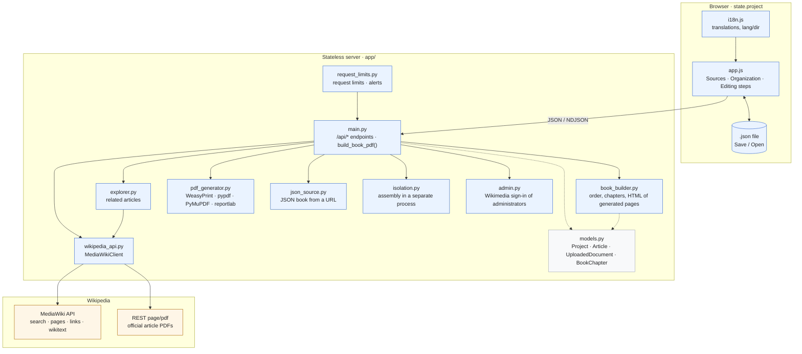
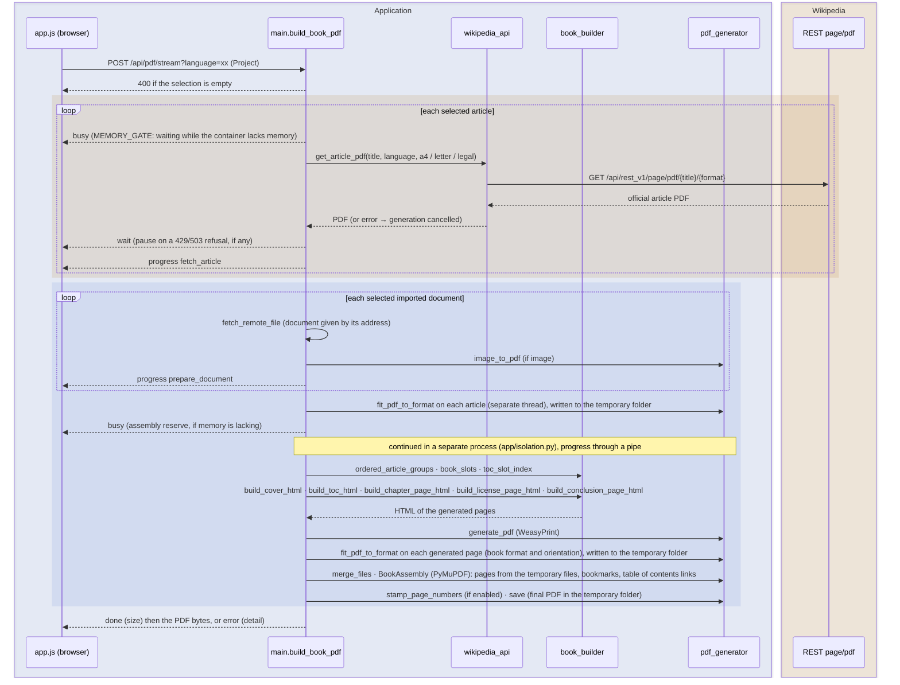

# Wikipedia2Book — Technical specification

<table border="0" ><tr><td>

</td><td markdown="1">
This is the English translation of [TechnicalSpec.fr.md](https://gmoulard.github.io/wikipedia2book/TechnicalSpec.fr.html). The French document is the reference: if the two ever differ, the French version prevails. Interface labels are quoted as they appear in the English interface. The documentation has three parts: functional specification ([FunctionalSpec.en.md](https://gmoulard.github.io/wikipedia2book/FunctionalSpec.en.html)), technical specification ([TechnicalSpec.en.md](https://gmoulard.github.io/wikipedia2book/TechnicalSpec.en.html)) and version history, in French only ([CHANGELOG.fr.md](https://gmoulard.github.io/wikipedia2book/CHANGELOG.fr.html)); the technical specification is numbered from 1; a reference to another document names it ("section 1.3 of the technical specification", "section 3.1 of the functional specification").
</td></tr></table>

---

## Table of contents

- [1. Technical architecture](#1-technical-architecture)
	- [1.1 Technologies](#11-technologies)
	- [1.2 Wikipedia API](#12-wikipedia-api)
	- [1.3 HTTP call examples](#13-http-call-examples)
	- [1.4 Docker and running locally](#14-docker-and-running-locally)
	- [1.5 Environments and branches](#15-environments-and-branches)
	- [1.6 Continuous integration (GitHub Actions)](#16-continuous-integration-github-actions)
	- [1.7 Toolforge](#17-toolforge)
	- [1.8 Usage statistics (Toolviews)](#18-usage-statistics-toolviews)
	- [1.9 Data model and save file](#19-data-model-and-save-file)
	- [1.10 Architecture diagrams](#110-architecture-diagrams)
	- [1.11 Benchmark](#111-benchmark)
	- [1.12 Limit test](#112-limit-test)
	- [1.13 Container optimisation strategy](#113-container-optimisation-strategy)
- [2. Security and robustness](#2-security-and-robustness)
- [3. Repository structure](#3-repository-structure)

## 1\. Technical architecture

### 1.1 Technologies

| Component            | Technology used |
| -------------------- | --------------- |
| Language             | Python 3.12 |
| Backend              | FastAPI + Uvicorn |
| HTTP client          | httpx (calls to the MediaWiki API and to the PDF endpoint) |
| HTML parsing         | BeautifulSoup4 (search snippets, links of rendered articles) |
| Interface            | HTML, CSS, JavaScript (single page, no framework) |
| Internationalization | Internal JavaScript dictionary (`i18n.js`), FR/EN/ES/PT/IT/DE/NL/TR/ZH/JA/AR/FA, no external dependency |
| Wikipedia API        | MediaWiki API (`action=query`, `action=parse`) + REST endpoint `page/pdf` |
| Book exchange        | JSON browser ↔ API |
| PDF generation       | Official Wikimedia PDF (articles) + WeasyPrint (cover, table of contents, chapters, license, conclusion) + pypdf (page count, recomposition to the book format, reading the placeholder links of the table of contents) + PyMuPDF (assembly on temporary disk, bookmarks, internal links, page numbers, writing the final PDF) + reportlab (width of page numbers, conversion of an imported image into a PDF page) + Pillow (cover text color from the background image) |
| Containerization     | Docker |

Repository badges:

<p align="left">
  <!-- Project status, license & archive -->
  <a href="https://github.com/gmoulard/wikipedia2book/actions/workflows/deploy-toolforge.yml"></a>
  <a href="https://github.com/gmoulard/wikipedia2book/blob/main/LICENSE"></a>
  <a href="https://archive.softwareheritage.org/browse/origin/?origin_url=https://github.com/gmoulard/wikipedia2book"></a>
  <a href="https://archive.softwareheritage.org/swh:1:dir:9c7c016d9603a4b0201ad64535767a353031bd91;origin=https://github.com/gmoulard/wikipedia2book;visit=swh:1:snp:3b1fa78021c1ad7819b82a6f38f200a9f3bfa85e;anchor=swh:1:rev:d0cd2a14a00fb848f2555a9ee62c4147230e6080"></a>
  <a href="https://github.com/gmoulard/wikipedia2book/blob/main/CODE_OF_CONDUCT.md"></a>
  
</p>

<p align="left">
  <!-- Frontend -->
  <a href="https://developer.mozilla.org/en-US/docs/Web/JavaScript"></a>
  <a href="https://developer.mozilla.org/en-US/docs/Web/HTML"></a>
  <a href="https://developer.mozilla.org/en-US/docs/Web/CSS"></a>
  
</p>

<p align="left">
  <!-- Backend -->
  <a href="https://www.python.org/"></a>
  <a href="https://fastapi.tiangolo.com/"></a>
  <a href="https://docs.pydantic.dev/"></a>
  <a href="https://www.uvicorn.org/"></a>
</p>

<p align="left">
  <!-- PDF & content -->
  <a href="https://weasyprint.org/"></a>
  <a href="https://pypdf.readthedocs.io/"></a>
  <a href="https://www.reportlab.com/"></a>
  <a href="https://www.mediawiki.org/wiki/API:Main_page"></a>
  <a href="https://creativecommons.org/licenses/by-sa/4.0/"></a>
</p>

<p align="left">
  <!-- Deployment & tests -->
  <a href="https://wikipedia2book.toolforge.org"></a>
  <a href="https://www.docker.com/"></a>
  <a href="https://github.com/gmoulard/wikipedia2book/actions"></a>
  <a href="https://docs.python.org/3/library/unittest.html"></a>
</p>

### 1.2 Wikipedia API

All exchanges with Wikipedia go through the `MediaWikiClient` class in `app/wikipedia_api.py`; no other module calls Wikipedia. Two services are used, on the wiki of the article's language (`<language>` = code validated by `^[a-z0-9-]{2,12}$`):

For a page of another Wikimedia project (section 3.1 of the functional specification), the same calls are made on `https://<language>.<project>.org` instead of `https://<language>.wikipedia.org` (page recognition, search, suggested introduction and author, links for exploration, PDF); only book pages stay on Wikipedia. The accepted projects are the `SITES` list in `app/wikipedia_api.py`, derived from the `Site` type in `app/models.py`. The Wikimedia robot policy (section 3 of the functional specification) is the same for every project: the PDF download limits are shared by all of them.

* **MediaWiki API (Action API)**: `https://<language>.wikipedia.org/w/api.php`, with GET, always with `format=json&formatversion=2` and, by default, `action=query`.
* **REST API**: `https://<language>.wikipedia.org/api/rest_v1/page/pdf/<title>/<format>`, for the official PDF of an article (spaces in the title are replaced with `_` and it is URL-encoded).

| Use | Call and parameters | Function | Used by | Section |
| --- | --- | --- | --- | --- |
| Search for articles | `list=search&srsearch=<text>&srlimit=<1–20>&srnamespace=0` | `search` | `GET /api/search`, `POST /api/sources/resolve` (fallback when no exact page exists) | 3.1 |
| Recognize a page (article or book page), following redirects | `prop=info&titles=<title>&redirects=1` (final title and namespace `ns`) | `get_page` | `POST /api/sources/resolve` | 3.1 |
| Read a book page in its real order, with subtitle and chapters | `prop=revisions&titles=<title>&rvprop=content&rvslots=main` (wikitext) | `get_book` | `POST /api/books/structure`, `/api/books/import`, `/api/sources/resolve`, `/api/books/generate-from-wikipedia-book` (pasted content, read by `parse_book_wikitext` without any MediaWiki call: `POST /api/books/from-wikitext`) | 3.1 |
| Read the contents page of a Wikibooks book or a Wikisource work in order, sections included | `action=parse&page=<title>&prop=text` (rendered HTML, links to the `<title>/…` subpages) | `get_subpage_book` | `POST /api/sources/resolve` | 3.1 |
| Links of an article, in page order | `action=parse&page=<title>&prop=text&redirects=1&disabletoc=1` (rendered HTML, read with BeautifulSoup) | `get_links` | `POST /api/explore` (through `explorer.py`) | 4.1 |
| Introduction of an article | `prop=extracts&titles=<title>&exintro=1&explaintext=1` | `get_intro_and_creator` (1st call) | `GET /api/articles/intro` | 3.3 |
| Creator of a page (first revision) | `prop=revisions&titles=<title>&rvlimit=1&rvdir=newer&rvprop=user` | `get_intro_and_creator` (2nd call) | `GET /api/articles/intro`, `/api/books/generate-from-wikipedia-book` (creator of the book page, used as author when `book_author` is missing) | 3.3 |
| Official PDF of an article | REST `page/pdf/<title>/<a4, letter or legal>` | `get_article_pdf` | PDF generation (`/api/pdf`, `/api/pdf/stream`, `/api/books/generate*`) | 7 |

Common rules:

* `User-Agent` header following the Wikimedia Foundation User-Agent policy (tool name and version, contact, library and its version): `Wikipedia2Book/<version> (https://wikipedia2book.toolforge.org/; https://github.com/gmoulard/wikipedia2book) httpx/<version>`, the version being the one in `app/version.py`.
* Compliance with the Wikimedia robot policy (*Robot policy*) for the official PDFs, outside Toolforge: the PDF service falls under the REST API rules (unauthenticated, at most 3 simultaneous requests and fewer than 5 per second), met with **at most 2 simultaneous downloads for the whole server**, whatever the number of books generated at the same time, and **at most 25 Mbps** of download measured over sliding 10 s windows (31.25 MB per window): the PDF is read in chunks and reading waits when the window is full. The count applies per server process (a single uvicorn instance per platform): each deployment outside Toolforge (Northflank) has its own cap. **On Toolforge, these limits are lifted**: the policy exempts tools hosted on Wikimedia Cloud Services; up to 4 simultaneous downloads per book, with no speed cap. Toolforge is recognised by the `WIKIPEDIA2BOOK_PLATFORM=toolforge` environment variable, which only the `Procfile` sets.
* Timeouts: 20 seconds for the MediaWiki API, 120 seconds for downloading a PDF.
* Errors: a network failure, an HTTP error response, a non-JSON response or an `error` field from the MediaWiki API produce an explicit error, returned by the application's API with code 502 (404 for a page not found, 422 for invalid input). A REST response that does not start with `%PDF-` is refused; during generation, any error on an article cancels the whole book, except a PDF answered with HTTP 404 (`MediaWikiPageNotFound`, deleted page): the article is removed from the book and reported by the `missing` event (section 8 of the functional specification). Generation log stage: `missing_article` (`url`).
* No data is cached or kept: each operation makes its calls again.

### 1.3 HTTP call examples

The examples below assume that the server runs on `http://localhost:8000`. Replace this address with the deployment's domain to call a remote instance.

#### In a web browser

GET endpoints can be opened directly in the address bar:

* Search for articles: `http://localhost:8000/api/search?query=Albert%20Einstein&language=fr&limit=5`. Each result carries its language (`language`).
* Search in every language: `http://localhost:8000/api/search?query=Paris&language=all&limit=3`, by default in `SEARCH_LANGUAGES` (fr, en, de, es, it, pt, nl), or in a chosen list: `&languages=fr,ja,nl` (12 languages at most, codes validated, otherwise HTTP 422). `limit` then applies per language; the requests leave at the same time, and a language in error is ignored as long as another one answers (HTTP 502 if all fail). `POST /api/sources/resolve` likewise accepts `"language": "all"` and `"languages": [...]`: a title always gives `kind` = `search` (five results per language), a URL is still read normally. Tests: `AllLanguagesTest` in `tests/test_resolve_source.py`.

* Search another Wikimedia project: `http://localhost:8000/api/search?query=Lyon&language=fr&site=wikivoyage`.

* Get the introduction and the creator of an article: `http://localhost:8000/api/articles/intro?title=Albert%20Einstein&language=fr`.

* Hits per hour since the server started (section 1.8): `http://localhost:8000/api/stats/hourly`.

* Container state, to follow live during a limit test (section 1.12): `http://localhost:8000/api/health/details`, for example in production `https://wikipedia2book.toolforge.org/api/health/details`. Reserved for monitoring: `Authorization: Bearer <token>` header, the token being set by `WIKIPEDIA2BOOK_MONITOR_TOKEN` (at least 32 characters, for example `python -c "import secrets; print(secrets.token_urlsafe(32))"`; without it, the endpoint always answers HTTP 401, `detail.code` = `monitor_token_required`), for example `curl -H "Authorization: Bearer $WIKIPEDIA2BOOK_MONITOR_TOKEN" <address>`. JSON response, with no personal data at all, never cached, not counted in the hits per hour: `version`, `started` (server start: if it changes, the server has restarted), `now`, `generations_in_progress` (PDF generations in progress), `memory_gate`, `disk_gate` and `generation_gate` (memory and disk space checks and admission of generations: `ratio`, `reserved_bytes`, `active_stages`, `waiting_stages`), `request_limits` (generation limits per client and for the whole server, waiting queue, number of clients and generations in progress, section 2), `alerts` (limit crossings per type: `count`, `last`), `memory` (the container's `used_bytes`, `limit_bytes`, `peak_bytes` and `used_percent`, read from the cgroup files `memory.current`, `memory.max`, `memory.peak` — or `memory.usage_in_bytes`, `memory.limit_in_bytes`, `memory.max_usage_in_bytes` with cgroup v1 —, then the process's `process_rss_bytes` and `process_peak_rss_bytes`, read from `/proc/self/status`; `null` when the information does not exist, for example outside Linux or without a limit) and `temporary` (`free_bytes` and `total_bytes` of the temporary folder's disk, `generation_files_bytes` used by the folders of the generations in progress). Just before a crash, it shows whether memory or temporary space is reaching its limit. Tests: `tests/test_health_details.py`.

* Generation journal, to diagnose a slow or failed generation afterwards: `http://localhost:8000/api/health/generations`, for example `https://wikipedia2book.toolforge.org/api/health/generations`. Same monitoring token. JSON response, never cached, not counted in the hits per hour: `version`, `started`, `now` and `generations`, up to the last 1,000 generations since the server started (`GENERATION_LOG_KEEP`), fewer when together they exceed 40,000 stages (`GENERATION_LOG_STAGES`, about 30 MB of memory, a stage taking about 760 bytes; a 10-article book has about thirty stages, a 300-article book about 330), the oldest being removed first, newest first. Each generation gives `id`, `started`, `version`, `language`, the number of `articles`, `documents` and `chapters`, `page_format`, `orientation`, `page_numbers`, `table_of_contents`, `status` (`running`, `done`, `error`, or `aborted` if the client gives up), `duration_s`, `size_bytes` (success) or `error` (error type only, or the stop message of the assembly process), and `stages`, the list of stages reached: `at_s` (seconds since the start), `stage`, `process` (`server` or `assembly`), `container_bytes` (container memory), `rss_bytes` and `peak_rss_bytes` (memory of the process that reached the stage) and, for the assembly process, `server_rss_bytes`. Stages: `start`, `fetch_image` (background image given by its address: `image` = `cover_image` or `back_image`, download `duration_s`, `size_bytes`), `fetch_document` (imported document given by its address: `duration_s`, `size_bytes`, `pdf`), `downloads_done` (with `article_pages`), `memory_wait` (a stage waited for memory: `reason` = `generation`, `disk`, `download`, `fit`, `fetch_image`, `assembly_disk` or `assembly`, `waited_s`, `reserved_bytes`), then in the assembly process `assembly_start`, `fit_backgrounds` (shrinking of background images: `duration_s`, `bytes_before`, `bytes_after`), `cover_html` (cover HTML, including the analysis of the background image for the text color: `duration_s`, `background`), `render_cover`, `render_toc_count` (numbering), `render_toc`, `render_chapters`, `render_conclusion`, `render_license`, `render_back_cover` (last page background image), `merge_parts` (merging the parts), `merge_reopen` (reopening the merged book), `outline_and_links`, `stamp_page_numbers` (numbering) and `save`. No title, address or anything identifying the user is recorded. The journal lives in memory and is lost when the server restarts: each stage is therefore also written to standard output as one JSON line, and stays readable in the platform logs (`toolforge webservice logs` on Toolforge), even when the platform stops the whole container for lack of memory. Those platform logs are themselves erased at each restart: when `WIKIPEDIA2BOOK_GENERATION_LOG_DIR` names a persistent folder (on Toolforge, `/data/project/wikipedia2book/generations`, in the NFS storage of the tool account, set by the `Procfile`), the same lines are also written there, one per line in one file per UTC day (`YYYY-MM-DD.jsonl`), with `at` (UTC date and time) and `pod` (container name) added; files older than 30 days (`GENERATION_FILES_DAYS`) are deleted on the first write of each day (`main.GenerationFiles`). Writing happens in a separate thread, so that slow NFS storage never freezes the server; the parent folder is never created (without the mount, nothing is written to the container's ephemeral disk), and a write failure is reported once on standard output (`generation_files_error`) without stopping the generation. Exception to the "nothing on disk" rule, wanted by the user: only these lines, with no title, address or anything identifying the user. Variable absent (default, `Dockerfile`, Northflank): nothing is written. Each downloaded article or document has its `download` stage (`kind` = `article` or `document`, `download_s`, `fit_s`, `size_bytes`, `pages`), and each background image its `fetch_image` stage; the downloaded address (`url`: article PDF, full address of a file given by the user) is only kept in the in-memory journal, read with the monitoring token or by the admin page, never copied to standard output (user's choice). A single generation: `GET /api/health/generations/{id}` (`id` from the journal), response `{"version", "started", "generation"}`, or HTTP 404 when it is no longer in the journal; not counted in the hits per hour, like the whole journal. Its request: `GET /api/health/generations/{id}/request`, the requested book in the `wikipedia2book-workspace` format (JSON file as an attachment, content of imported files removed, `removed_base64_chars`), kept apart from the journal (`generation_requests`, at most 1 MB per request, `GENERATION_REQUEST_MAX_BYTES`, 30 MB in all, `GENERATION_REQUESTS_BYTES`), never written to standard output; `request_bytes` gives its size in the journal; HTTP 404 when it is no longer in memory. Tests: `tests/test_generation_log.py`, `tests/test_admin.py`.

* Generate the PDF of a Wikipedia book page: `http://localhost:8000/api/books/generate-from-wikipedia-book?url=https%3A%2F%2Ffr.wikipedia.org%2Fwiki%2FLivre%3AAnimaux`. The `url` parameter is required; `language` is optional and defaults to `fr`. Also accepted, all optional: `book_title`, `book_subtitle`, `book_author`, `book_conclusion`, `page_format`, `orientation`, `page_numbers`, `table_of_contents`. The PDF is returned as a download.

* Generate the PDF of a book saved as JSON and published online: `http://localhost:8000/api/pdf/from-json?url=https%3A%2F%2Fgmoulard.github.io%2Fwikipedia2book%2Fstatic%2FWrecks-of-Saint-Pierre-harbor.json`, with optional `language` (`fr` by default, same values as `/api/pdf`). The server downloads the file (`app/json_source.py`, `fetch_project`): HTTPS only, a host that must resolve to public addresses (refusing `127.0.0.1`, `10.x`, `192.168.x`, link-local addresses…, checked again at each redirect, 3 redirects at most), 60 MB at most, 30 s at most; the file can be an interface export (`wikipedia2book-workspace`, first book), a list of books (the first one) or a single book. It is only kept in memory during the generation, like a book sent to `POST /api/pdf`, and the generation follows the same rules (selection, article limit, PDF as a download). Errors: 422 (refused address, invalid JSON or book, missing `url`), 413 (file too large), 502 (download impossible, HTTP other than 200, too many redirects). Tests: `tests/test_json_source.py`.

* Directly generate the PDF of a book built from one or more sources: `http://localhost:8000/api/pdf/from-source?source=https%3A%2F%2Ffr.wikibooks.org%2Fwiki%2FCosmologie`, for example `https://wikipedia2book.toolforge.org/api/pdf/from-source?source=b:Cosmologie`. Parameters: `source` (repeatable, 50 at most, same reading as the Sources field, `main.parse_source_line`, to be kept aligned with `parseSourceLine` in `app.js`), `language` (language of the titles added to the PDF, `fr` by default), `wiki` (language of titles without a prefix, by default `language`) and `summary=1` to also add the contents page of a Wikibooks book or a Wikisource work, which otherwise gives its subpages without the contents page, without asking. A Wikipedia book page gives its articles and chapters; several sources follow each other in order, without duplicates, articles without chapter first when the book has chapters; the book title is that of the single book page or contents page, otherwise the first article. Errors: 404 (no exact page for a source, named in the message), 422 (missing parameter or invalid source), 502 (Wikipedia unreachable). Tests: `tests/test_resolve_source.py`.

* Check that the service responds: `http://localhost:8000/health`.

* Show the interactive documentation and also call the POST endpoints: `http://localhost:8000/docs`.

The GET endpoint for generating from a Wikipedia book page can be called directly in the browser. The other PDF generation endpoints use POST; for those, use `curl` or the interactive documentation at `/docs`.

#### With curl

Recognize an input (URL, book page or title) and get the matching article, book or search results (`kind` = `article`, `book`, `subpages` — a Wikibooks or Wikisource contents page, with `article` for the page alone and `book` for its subpages — or `search`):

```bash
curl --fail --show-error --request POST 'http://localhost:8000/api/sources/resolve' \
	--header 'Content-Type: application/json' \
	--data '{"input":"Albert Einstein","language":"fr"}'
```

Read the pasted content of a "Book:" page (title, subtitle, chapters, articles), without any call to Wikipedia:

```bash
curl --fail --show-error --request POST 'http://localhost:8000/api/books/from-wikitext' \
	--header 'Content-Type: application/json' \
	--data '{"wikitext":"== Ports bretons ==\n=== Guide des ports ===\n:[[Brest]]\n;Finistère\n:[[Concarneau]]","language":"fr"}'
```

Generate a PDF from an explicit list of article references:

```bash
curl --fail --show-error --request POST 'http://localhost:8000/api/books/generate?language=fr' \
	--header 'Content-Type: application/json' \
	--data '{"book_title":"Animaux","articles":[{"title":"Chat","language":"fr"},{"url":"https://fr.wikipedia.org/wiki/Chien"}]}' \
	--output animaux.pdf
```

Generate a PDF from a Wikipedia book page, replacing the example URL with that of an existing book page:

```bash
curl --fail --show-error --request POST 'http://localhost:8000/api/books/generate-from-wikipedia-book?language=fr' \
	--header 'Content-Type: application/json' \
	--data '{"url":"https://fr.wikipedia.org/wiki/Livre:Animaux","book_title":"Animaux","book_conclusion":"Bonne lecture !"}' \
	--output animaux.pdf
```

The same generation can be called with GET and only the URL of the book page:

```bash
curl --fail --show-error --get 'http://localhost:8000/api/books/generate-from-wikipedia-book' \
	--data-urlencode 'url=https://fr.wikipedia.org/wiki/Livre:Animaux' \
	--output animaux.pdf
```

In both cases, the response is the binary PDF file; `--output` saves it locally. `language` sets the language of the labels generated in the PDF, and the supported languages are those of section 12.1 of the functional specification.

### 1.4 Docker and running locally

The software ships with:

* A `Dockerfile` (Python 3.12-slim image with WeasyPrint's system dependencies and the DejaVu, Noto CJK and Hanazono fonts — HanaMinB, for rare Chinese characters of the CJK extensions B and later, in the pages generated by the application).

* A `requirements.txt` file with pinned versions (`==`) for the direct dependencies, including `pydantic` (imported by `app/models.py`): every build installs exactly the versions the tests pass with.

* A `scripts/docker-build.sh` script that builds the image while injecting the current git commit, date and author, shown in the application's footer.

Example:

```bash
sh scripts/docker-build.sh
docker run --rm -p 8000:8000 wikipedia2book
```

The application is then available at `http://localhost:8000`, with its interactive documentation at `http://localhost:8000/docs`.

Without Docker, with Python 3.12 and the system dependencies of WeasyPrint installed (GTK, Pango, Cairo):

```bash
python -m venv .venv
source .venv/bin/activate
pip install -r requirements.txt
uvicorn app.main:app --reload
```

The application is served at the same address.

The application page (`/`) and its files (`/static/…`) are served with `Cache-Control: no-cache`: the browser revalidates each file on every load (304 response if unchanged), which avoids mixing, after a deployment, a new page with old scripts or translations still in cache. Files under `/static/` carry a fingerprint (`ETag`) computed from their content, and no modification date (`Last-Modified`) (`main.ContentStaticFiles`): on Toolforge, every built file is dated 1980; with Starlette's fingerprint (date and size) and that date, a browser revalidating by date got 304 on every version and kept an old `i18n.js` (labels shown as keys, for example `admin.limits`). Tests: `tests/test_static_cache.py`.

The server stores no book or PDF on disk; all the state is kept in the browser and exchanged through JSON. Deployment therefore needs neither a database nor a persistent volume, on any platform. Only a temporary folder (the system temporary directory) is used during each PDF generation, and it is deleted at the end (section 11.1 of the functional specification): the platform must offer temporary space of about twice the size of the largest book generated.

#### Deploying your own container

These settings control how heavy a generation can be. They are environment variables, set in the `Dockerfile` (`ENV` line) and read when the server starts:

| Variable | Default in the `Dockerfile` | Meaning |
|---|---|---|
| `WIKIPEDIA2BOOK_ARTICLE_LIMIT` | `300` (also the default when the variable is not set, on every host) | Maximum number of articles per book. Beyond it, the API refuses the book at once (HTTP 413, code `too_many_articles`); the web interface reads the limit from `/api/version` and generates the book in several volumes instead, each under the limit. `0` lifts the limit. |
| `WIKIPEDIA2BOOK_DOWNLOADS` | `2` | Number of article PDFs downloaded from Wikipedia at the same time for a book. |
| `WIKIPEDIA2BOOK_MEMORY_RATIO` | `0.95` (default, not set in the `Dockerfile`) | Share of the container memory limit that the generations may use. Before each stage (download, refitting, assembly), a generation estimates the memory it needs from the file sizes and waits, showing "Server busy", while the used memory plus the running reserves plus its estimate would exceed this share. `0` disables the check. |
| `WIKIPEDIA2BOOK_GENERATIONS_RATIO` | `0.5` (default, not set in the `Dockerfile`) | Share of the container memory limit reserved by the generations admitted at once (25 MB + 3 times the base64 data of the book each). Further generations wait at the very start, showing "Server busy", before loading anything. `0` disables the check. |
| `MALLOC_ARENA_MAX` | `2` (set in the `Dockerfile` and the Toolforge `Procfile`) | Limits glibc memory arenas so that the server gives freed memory back to the system. |
| `WIKIPEDIA2BOOK_CLIENT_GENERATIONS` | `5` (default) | Simultaneous generations per client (public IP address, and the random token kept by the browser). Beyond it, HTTP 429 with `Retry-After`; the web interface waits and tries again. `0` lifts the limit. |
| `WIKIPEDIA2BOOK_CLIENT_PER_MINUTE` | `20` (default) | Generations started per client and per minute. `0` lifts the limit. |
| `WIKIPEDIA2BOOK_TOTAL_GENERATIONS` | `0` (default; `50` on Toolforge) | Simultaneous generations for the whole server, for hosts that hide visitors' addresses. `0` lifts the limit. |
| `WIKIPEDIA2BOOK_TOTAL_PER_MINUTE` | `0` (default; `200` on Toolforge) | Generations started per minute for the whole server. `0` lifts the limit. |
| `WIKIPEDIA2BOOK_WAITING_GENERATIONS` | `100` (default) | Generations waiting for admission at the same time; further ones get HTTP 429. `0` lifts the limit. |
| `WIKIPEDIA2BOOK_GENERATION_LOG_DIR` | empty (default); `/data/project/wikipedia2book/generations` on Toolforge (`Procfile`) | Persistent folder where the generation journal is also written, one file per day, 30 days kept (section 1.4). Its parent folder must already exist. Empty: nothing is written to disk. |
| `WIKIPEDIA2BOOK_CLIENT_IP_HEADER` | empty (default) | Header holding the visitor's address when the container runs behind a trusted proxy, for example `x-forwarded-for` (its last value is used). Leave it empty without a proxy: a client could write the header itself. |
| `WIKIPEDIA2BOOK_DISK_RATIO` | `0.95` (default, not set in the `Dockerfile`) | Share of the temporary disk that generations may fill. An article download (30 MB reserved) and the book assembly (50 MB + twice the size of the articles) wait, showing "Server busy", while the used disk space plus the running reserves plus their estimate would exceed this share. `0` disables the check. |

Change them in the `Dockerfile` and rebuild the image, or override them when starting the container, without rebuilding:

```bash
docker run --rm -p 8000:8000 -e WIKIPEDIA2BOOK_ARTICLE_LIMIT=100 -e WIKIPEDIA2BOOK_DOWNLOADS=1 wikipedia2book
```

The server refuses to start with an invalid value and says why.

**Number of parallel downloads.** It can only be lowered, to `1`, not raised above `2`: the [Wikimedia robot policy](https://wikitech.wikimedia.org/wiki/Robot_policy) limits the PDF service to a few simultaneous requests, and the server enforces at most 2 downloads and 25 Mbps for the whole process, whatever this setting. Only the Toolforge instance, which the policy exempts, downloads 4 PDFs at a time. Lower it to `1` to make generation gentler on Wikimedia and on a small server, at the cost of a longer download phase.

**Article limit and container memory.** Lifting the limit (`0`) is safe only if the container has enough memory: a book that does not fit makes the platform stop and restart the whole container, which also cuts the generations of every other user. Set the limit from the memory of your container, with margin for several users at once. Measurements with real articles (about 17 pages per article):

| Container memory | Largest book generated | Notes |
|---|---|---|
| 256 MB | under 20 articles | Northflank: restart at 20 articles, already very slow at 10 |
| 2 GiB | about 800 articles (14,000 pages, 780 MB of PDF) | Toolforge: failure at 1,000 articles; the official instance limits books to 300 articles (larger ones are generated in volumes) |

Count about 250 MB for the server and the assembly process themselves, plus roughly 2 to 2.5 MB per article at the peak, and keep the limit well below what your container can hold, for example a third to a half: with 2 GiB, that gives a few hundred articles; with 256 MB, nothing is left for a book of any size. To find the real maximum of your deployment, run the limit test against it (section 1.12; it can make the server restart, so not during busy hours):

```bash
python scripts/limit_check.py --base-url https://your-server --search 50
```

It doubles the number of articles until the first failure, then narrows down by bisection. Add `--save-pdf ./tmp` to keep each generated book (`./tmp` is ignored by git). With the monitoring token (`Authorization: Bearer`, section 1.7), `GET /api/health/details` shows the memory of the container and its limit, and `GET /api/health/generations` the memory reached at each stage of the last generations.

**Viewing alerts.** Each time a limit is crossed, the server writes a JSON line containing `"alert"` to its standard output and counts it in `GET /api/health/details`. Commands to read them on Toolforge, Northflank, Docker and a local server, and how to interpret them: section 2.

### 1.5 Environments and branches

The application is deployed on two platforms, each linked to a branch of the GitHub repository `gmoulard/wikipedia2book`:

| Platform | URL | Branch followed | Image build | Trigger |
| --- | --- | --- | --- | --- |
| Toolforge (Wikimedia Cloud) | https://wikipedia2book.toolforge.org | `production-toolforge` | Toolforge buildpacks (`Procfile`, `Aptfile`, `.python-version`) | The repository's GitHub Actions workflow (section 1.6) |
| Northflank | https://prod--wikipedia2book--wkvpbnfj6h4v.code.run | `main` | `Dockerfile` | Northflank's GitHub integration, set in its interface |

Toolforge is the reference instance, offered to the Wikipedia community. Northflank receives every change pushed to `main` and serves as pre-production.

On each platform, the interactive API documentation is at `/docs` (https://wikipedia2book.toolforge.org/docs). Example on Toolforge with the book *Wrecks of Saint-Pierre harbor*: [PDF generated directly](https://wikipedia2book.toolforge.org/api/pdf/from-json?url=https%3A%2F%2Fgmoulard.github.io%2Fwikipedia2book%2Fstatic%2FWrecks-of-Saint-Pierre-harbor.json) or [book opened in the interface](https://wikipedia2book.toolforge.org/?json=https://gmoulard.github.io/wikipedia2book/static/Wrecks-of-Saint-Pierre-harbor.json). Toolforge usage statistics are at https://gmoulard.github.io/wikipedia2book/stats.html (section 1.8).

Release cycle:

1. Develop and push to `main` (or through a pull request to `main`): tests run on GitHub Actions, Northflank redeploys, Toolforge is not touched.
2. Check the new version on Northflank.
3. Publish to Toolforge by moving the production branch forward:

```bash
git push origin main:production-toolforge
```

`production-toolforge` receives no commits of its own: it only moves forward to a commit already on `main`. Going back to an earlier version on Toolforge is done by pushing an older `main` commit to it (`git push --force origin <commit>:production-toolforge`).

Each version of the application is marked in Git by an **annotated tag** `vX.Y.Z` (for example `v1.6.6`), placed on the commit that sets `app/version.py` to that version, then pushed to GitHub:

```bash
git tag -a v1.6.6 -m "Wikipedia2Book 1.6.6"
git push origin v1.6.6
```

Tags make it possible to get the code of a version (`git checkout v1.4.0`), compare two versions (`git diff v1.5.2 v1.6.6`) or republish an earlier version on Toolforge (`git push --force origin v1.6.5^{}:production-toolforge`). Pushing a tag triggers no deployment and no workflow: only branch pushes do. Versions 0.16.0, 0.17.0 and 1.6.0 of the history (section 19) were never written in `app/main.py` and therefore have no tag; conversely, `v0.18.0` exists in the code (the high-level API, described in the history under 0.16.0 and 0.17.0).

The branch choice for Northflank is not part of the repository: it is changed in its interface (build service, Build settings, Branch).

### 1.6 Continuous integration (GitHub Actions)

Five workflows. The main one, `.github/workflows/deploy-toolforge.yml` ("Tests and Toolforge deploy"), has two jobs:

* `test`: on every push to `main` or `production-toolforge`, on every pull request and on manual start (`workflow_dispatch`). Installs Python 3.12 and `requirements.txt`, then runs `python -m unittest discover -s tests -v`.

* `deploy`: only after `test` succeeds, and only for a push (or a manual start) on `production-toolforge`; it is skipped everywhere else. It writes the SSH key from the GitHub secret `TOOLFORGE_SSH_KEY`, pins the ED25519 fingerprint of `login.toolforge.org` in `known_hosts` (no blind trust on first contact), then runs `scripts/toolforge-deploy.sh` in the tool account:

```bash
ssh <login>@login.toolforge.org "become wikipedia2book bash -s" < scripts/toolforge-deploy.sh
```

Just before this restart, which erases the webservice logs, the "Hourly statistics before restart" step collects the hits per hour (section 1.8, "Hits per hour") and commits them to `main`. It is `continue-on-error`: a failed collection shows as a warning in GitHub Actions but never blocks the deployment. For this, the job has the `contents: write` permission.

Toolforge deployments are serialized (concurrency group `toolforge-deploy`, without cancelling the deployment in progress); other runs are independent.

The `TOOLFORGE_SSH_KEY` secret contains an OpenSSH private key dedicated to deployment, separate from the personal key, whose public part is registered on the Wikimedia account (idm.wikimedia.org). Revoking it is enough to cut off automatic deployment without touching other access.

The second, `.github/workflows/toolviews-stats.yml` ("Toolviews stats"), updates the usage statistics every day (section 1.8).

The third, `.github/workflows/jekyll-gh-pages.yml`, publishes on every push to `main`, every day at 04:17 UTC (and on manual start) the documentation site https://gmoulard.github.io/wikipedia2book/ with GitHub Pages: The site is built from the `docs/` folder: Jekyll converts its Markdown files to HTML (functional and technical specifications, version history, `stats.md`…) with the Just the Docs theme (`docs/_config.yml`: theme pinned to `just-the-docs/just-the-docs@v0.12.0` through `remote_theme`, side menu in two parts, "Fonctionnel / Functional" (`fonctionnel.md`: functional specification, version history, "Search help", comparisons) and "Technique / Technical" (`technique.md`: technical specification, manual tests, limit test, statistics), in `nav_order` order, search, page titles, redirection of the old `SPECIFICATIONS.fr.html` and `SPECIFICATIONS.en.html` addresses to the functional specifications); `docs/_includes/head_custom.html`, inserted by the theme in every page, draws the Mermaid diagrams and the hourly chart, opens both parts of the menu as soon as the page loads, keeps the menu against the left edge and gives the rest of the width to the content on wide screens, adds to the menu a small French flag after "Functional specification" and "Technical specification" (the French versions, which are the reference, are no longer in the menu, `nav_exclude`), a "Français" entry at the top of "Search help" and a flag before each of the 12 help pages (flag-icons 7.2.3 library, jsDelivr), and adds to the header of translated pages (help in 12 languages, specifications in French and English) a language selector that opens the same page in the chosen language; Persian and Arabic pages are displayed right to left. The home page is `docs/index.md`, a document of its own in the `docs/` folder, initialised from `README.md` but no longer a copy of it; its links are relative to the site, and `LICENSE`, `CODE_OF_CONDUCT.md`, `CITATION.cff` and `codemeta.json`, which stay at the root of the repository, point to GitHub. This is the address declared as user documentation in `toolinfo.json`. GitHub Pages does not render Mermaid blocks natively: `docs/_includes/head_custom.html`, added by Jekyll to the head of every page (default theme), loads Mermaid 11.17.2 from jsDelivr and draws the ```` ```mermaid ```` blocks (section 1.10). The site is also rebuilt (`workflow_run` trigger) after each run of "Toolviews stats" that was not cancelled, even a partial failure since statistics may have been committed, and after each run of "Tests and Toolforge deploy" on `production-toolforge` (pre-deployment hourly collection), and every build adds the usage statistics page https://gmoulard.github.io/wikipedia2book/stats.html (section 1.8). Every build also publishes an example PDF of the day, `static/Wrecks-of-Saint-Pierre-harbor.pdf`: the repository's book `docs/static/Wrecks-of-Saint-Pierre-harbor.json` is sent to production (`POST https://wikipedia2book.toolforge.org/api/pdf/from-json?language=en`, 3 retries, 15 min at most), the answer is checked (`%PDF-` header, `%%EOF` end, more than 1 MB) and kept in the actions cache under a key made of the day and the hash of the JSON: the PDF is therefore generated only once a day (or whenever the JSON changes), the other builds of the day reuse the cache. If the generation fails, the step reports it with a warning and the site keeps the repository's PDF, without blocking the publication.

The fourth, `.github/workflows/tag-check.yml` ("Tag check"), runs on every push of a `v*` tag: it fails if the tag number does not match the version written in `app/version.py` (`VERSION = "x.y.z"`, since 1.7.4; `app/main.py` before). Such a failure is never fixed by moving the tag, but by a new version.

The fifth, `.github/workflows/benchmark.yml` ("Benchmark"), runs the benchmark on demand (section 1.11).

The sixth, `.github/workflows/security.yml` ("Security"), runs on every push to `main`, on every pull request, every Monday and on demand: known vulnerabilities in the `requirements.txt` dependencies (pip-audit), static analysis of the Python in `app/` and `scripts/` (bandit, medium severity and above), security tests (`tests/test_security.py`) and packages of the Docker image (Trivy, fixable critical and high vulnerabilities, action pinned to a commit). CodeQL (Python and JavaScript) is not part of it: it runs in GitHub's default setup ("CodeQL" workflow, results in the Security tab), which refuses a second CodeQL analysis in a workflow. It deploys nothing and does not block "Tests and Toolforge deploy". The security tests check:

* downloads by address (`json_source.download`): HTTPS only; internal addresses refused, including an internal IPv4 hidden in an IPv6 address (`::ffff:`, NAT64, 6to4, Teredo) and multicast addresses (`is_public_address`); disguised hosts; redirects checked again and bounded; connection to the checked address; size bounded without `Content-Length`;
* generated pages: no text of the book (titles, introduction, conclusion, chapters, articles, documents) becomes HTML, only `data:`, application or repository addresses appear, table of contents links stay inside their attribute;
* background images: type and base64 content checked, HTTPS address only;
* images read by Pillow (backgrounds, imported documents) limited to the formats it decodes itself (`models.SAFE_IMAGE_FORMATS`: PNG, JPEG, GIF, WebP, BMP, TIFF): an image announced as PNG but containing EPS is never handed to Ghostscript; WeasyPrint 70.0 at least (`requirements.txt`), which no longer hands EPS to Ghostscript and applies the address filter everywhere;
* WeasyPrint rendering limited to `data:` addresses (`pdf_generator.RENDER_PROTOCOLS`): an SVG image cannot make the server read one of its files or an internal address;
* pasted wikitext: parsed in linear time, even for a hostile 200,000-character text (a quadratic regular expression blocked the server for minutes);
* `language` parameter refused unless it is a language code;
* page: any address coming from a JSON book goes through `safeUrl` (HTTPS only) before being put in a link.

### 1.7 Toolforge

#### Toolforge-specific files

Toolforge builds the image with buildpacks and ignores the `Dockerfile`. The repository provides:

* `Procfile`: `uvicorn` command on port 8000, as expected by Toolforge, preceded by `env WIKIPEDIA2BOOK_PLATFORM=toolforge` (lifts the download limits, section 1.2).

* `Aptfile`: the same system dependencies and fonts as the `Dockerfile`.

* `.python-version`: Python 3.12.

* `toolforge-fonts.conf`: the fonts from the `Aptfile` (including Noto CJK for Chinese and Japanese, and Hanazono for their rare characters) are installed in `/layers/fagiani_apt/apt/usr/share/fonts`, outside the folders read by fontconfig; this file adds them and puts the fontconfig cache in `/tmp` (without it, WeasyPrint does not find Noto CJK and the log shows "Fontconfig error: No writable cache directories").

* `scripts/toolforge-deploy.sh`: deployment script, run in the tool account.

* `toolinfo.json`: the tool's record in Toolhub format (toolinfo schema 1.2.2, validated against Toolhub's official schema: name, description, URL, API, repository, bug tracker, AGPL-3.0 license, author and their Wikimedia account `474D6F756C617264`, user documentation https://gmoulard.github.io/wikipedia2book/, interface languages; `keywords` is a comma-separated string there, not a list), to be registered on https://toolhub.wikimedia.org through its raw GitHub URL (`https://raw.githubusercontent.com/gmoulard/wikipedia2book/main/toolinfo.json`). The interface languages it declares must remain those of `SUPPORTED_LANGUAGES`.

#### Deployment script

`scripts/toolforge-deploy.sh`:

1. starts the build of the `production-toolforge` branch (`toolforge build start --detach --json --use-latest-versions --ref production-toolforge`) and reads from the response the build identifier and the commit actually built (`resolved_ref`);
2. follows that specific build by its identifier until it ends (15 minutes at most), and prints its logs on failure;
3. creates or updates the environment variables `FONTCONFIG_FILE=/workspace/toolforge-fonts.conf` and `GIT_COMMIT=<built commit>` (the image contains no git repository: the footer reads the commit from this variable), then `WIKIPEDIA2BOOK_MONITOR_TOKEN`, `WIKIPEDIA2BOOK_OAUTH_CLIENT_ID` and `WIKIPEDIA2BOOK_OAUTH_CLIENT_SECRET` from the GitHub secrets of the same name (section 12.2 of the functional specification), only when the secret exists: a variable missing from the secrets keeps its value on Toolforge. These three values travel in the script read on the standard input of `ssh` and are passed to `toolforge envvars create` on its standard input, never as an argument: on the shared bastion, a command argument is visible to other users. To change a value: `gh secret set WIKIPEDIA2BOOK_MONITOR_TOKEN` (the command asks for the value), then a new deployment;
4. waits until no generation is in progress (`generations_in_progress` from `/api/health/details`, with the monitoring token passed through `curl`'s standard input, checked every 10 s, at most 30 minutes, then restarts anyway; without a token, no wait), so as not to cut off a book being generated, then restarts the webservice (`toolforge webservice buildservice restart`);
5. checks, for at most 200 seconds, that `https://wikipedia2book.toolforge.org/api/version` does return that commit, and prints the webservice logs otherwise.

Any failing step stops the script with an error code, which makes the workflow fail.

`--use-latest-versions` is required: with the default buildpack versions, fetching the `Aptfile` packages fails (`libharfbuzz-subset0`) as soon as the tool's apt cache is emptied. Following the build by its identifier, rather than "the latest build", avoids reading the state of a previous build before the new one is registered.

#### Initial setup

To be done once, from `login.toolforge.org`, in the tool account (`become wikipedia2book`):

```bash
toolforge envvars create FONTCONFIG_FILE /workspace/toolforge-fonts.conf
toolforge build start --use-latest-versions --ref production-toolforge https://github.com/gmoulard/wikipedia2book
toolforge webservice buildservice start --mount=all --mem 2Gi --cpu 1
```

`--mount=all`: the NFS storage of the tool account is mounted in the container, for the 30-day generation journal (`/data/project/wikipedia2book/generations`, section 1.4); the rest of the application does not use it (`--mount=none` until 2026-11-19). `scripts/toolforge-deploy.sh` checks `~/service.manifest`: if the service is not mounted (`mount: none`), it stops it and starts it again with `--mount=all --mem 2Gi --cpu 1`, otherwise it only runs `restart`, which keeps the mount; a restart slower than expected no longer makes the script fail, which waits up to 300 s for `/api/version` to answer. `--mem 2Gi --cpu 1`: WeasyPrint and the assembly of PDFs of several hundred pages exceed the 512 Mi allocated by default.

#### Administration page setup

The `/admin` page (section 12.2 of the functional specification) needs, on each host:

1. Register an OAuth 2.0 application on [Special:OAuthConsumerRegistration](https://meta.wikimedia.org/wiki/Special:OAuthConsumerRegistration/propose/oauth2): "User identity verification only", callback URL `https://<host>/admin/callback`. It is approved automatically.
2. Give the server the client ID, the client secret and the callback URL. On Toolforge, the callback is in the `Procfile` and the two secrets go in the tool's environment (value asked by the command, never as an argument):

   ```bash
   toolforge envvars create WIKIPEDIA2BOOK_OAUTH_CLIENT_ID
   ```

   ```bash
   toolforge envvars create WIKIPEDIA2BOOK_OAUTH_CLIENT_SECRET
   ```

   then restart the webservice. Elsewhere, set `WIKIPEDIA2BOOK_OAUTH_CLIENT_ID`, `WIKIPEDIA2BOOK_OAUTH_CLIENT_SECRET` and `WIKIPEDIA2BOOK_OAUTH_CALLBACK` in the container environment.
3. Optional: the list of administrators in `WIKIPEDIA2BOOK_ADMINS`, Wikimedia usernames in UTF-8 hexadecimal separated by commas (`python -c "print('Example'.encode().hex())"`).
4. To read `GET /api/health/details` and `GET /api/health/generations` from a script, set `WIKIPEDIA2BOOK_MONITOR_TOKEN` (at least 32 characters, `python -c "import secrets; print(secrets.token_urlsafe(32))"`) and send it as `Authorization: Bearer <token>`; without the variable, these endpoints always answer HTTP 401.

#### Manual deployment and operations

* Redeploy without a new commit: restart the workflow on the `production-toolforge` branch from GitHub's Actions tab, or run the script by hand:

```bash
ssh <login>@login.toolforge.org "become wikipedia2book bash -s" < scripts/toolforge-deploy.sh
```

* Status and logs, in the tool account: `toolforge webservice status`, `toolforge webservice logs -f`, `toolforge build list`, `toolforge build logs <identifier>`, `toolforge envvars list`.

* Port 22 of `login.toolforge.org` may be blocked by some corporate networks; GitHub Actions runners do not have this limitation.

### 1.8 Usage statistics (Toolviews)

No tracker, nothing is written to disk, and nobody is identified. Traffic per day comes from Toolviews (https://toolviews.toolforge.org/api/), which counts the requests received by Toolforge's front proxy for each tool; traffic per hour, from the webservice logs and an in-memory counter of the application ("Hits per hour" below). The collection scripts are auxiliary: they are not part of the deployed application and do not change its version; the in-memory counter is part of it.

#### Script `scripts/toolviews_stats.py`

Local script (Python standard library only) that fills a CSV file with the tool's daily traffic:

```bash
python scripts/toolviews_stats.py [file.csv]
```

* File: `docs/toolviews.csv` by default, separated by semicolons so that it opens directly in a French-locale Excel, with the header `date;hits`. An older file that still contains the `unique_visitors` column is rewritten without it.
* Sources: `https://toolviews.toolforge.org/api/v1/tool/wikipedia2book/daily/<start>/<end>` for requests (`hits`); a single call for the whole missing period. The Toolviews count of distinct visitors (`…/api/v1/unique/…`) is not collected: it is 0 for every Toolforge tool (inactive counter), a wrong value.
* Days processed: only those missing from the CSV, from 1 November 2026 to the day before; the current day, incomplete, is never written. A day already present is never recomputed (to correct a value, delete the line and run again).
* Days without visits: Toolviews does not return them; they are written as 0 up to the last day published by Toolviews (or already in the CSV). Later days, not yet published, are not written, so as not to freeze a provisional 0.
* Robustness: an older comma-separated file is read and rewritten with semicolons; a locked file (open in Excel) produces an explicit message; a network error or an invalid Toolviews response stops the script with an error code, without writing anything. Invalid means: unreadable JSON, no `results` dictionary, a key that is not a date, or a day whose value is not a dictionary, lacks the `wikipedia2book` key while not empty, or whose count is not a non-negative integer. An empty day (`{}`) counts as 0.
* Tests: `tests/test_toolviews_stats.py` (fake `fetcher`, no network).

#### Daily update (GitHub Actions)

`.github/workflows/toolviews-stats.yml` ("Toolviews stats") runs every day at 00:34 UTC (01:34 in Paris in winter, 02:34 in summer; GitHub does not schedule to the second), and on manual start (`workflow_dispatch`). The time is deliberately off the round minutes, where GitHub concentrates scheduled runs and delays them most. It is not guaranteed: GitHub can delay a scheduled run by several hours, or skip it, which the script catches up on the next run since it fills in every missing day. It runs the script on the `docs/toolviews.csv` of `main`, regenerates `docs/stats.md` with `scripts/toolviews_chart.py`, then commits both files to `main` if they changed, as `github-actions[bot]` (after a `git pull --rebase` so as not to fail if `main` moved during the run). The files can be viewed at https://github.com/gmoulard/wikipedia2book/blob/main/docs/toolviews.csv and https://github.com/gmoulard/wikipedia2book/blob/main/docs/stats.md (GitHub also draws the Mermaid charts there).

Accepted consequence: this daily commit to `main` makes Northflank redeploy once a day. It does not rerun the other GitHub Actions workflows (a push made with the `GITHUB_TOKEN` token triggers none): the GitHub Pages site is rebuilt by the `workflow_run` trigger. Toolforge is not affected (`production-toolforge` branch).

#### Charts on GitHub Pages

Published page: https://gmoulard.github.io/wikipedia2book/stats.html (usage statistics of the Toolforge instance, updated daily).

`docs/stats.md` (published as `stats.html`) is written by `scripts/toolviews_chart.py docs/toolviews.csv docs/stats.md`, during the daily update and again before each Jekyll build (`.github/workflows/jekyll-gh-pages.yml`), so that a change to the script shows without waiting for the next day: total hits and period covered, then two Mermaid bar charts (`xychart-beta`, drawn by `_includes/head_custom.html`) — hits per day over the last 31 days (axis: day of the month, period in the title, chart 1000 px wide), and hits per month since the start. The number of hits is shown above each bar (`showDataLabel`, `showDataLabelOutsideBar`); the vertical axis goes up to 115% of the maximum to leave room for the highest label. Mermaid sizes these labels from the bar width in an unusable way (-1 px as soon as a bar is 0, huge for a single bar): `head_custom.html` recomputes the size after rendering, from the bar width and the length of the largest number, between 6 and 12 px. A missing or empty CSV stops the site build with an error message. Tests: `tests/test_toolviews_chart.py`.

#### Hits per hour (Toolforge logs)

Toolviews only counts per day. For hours, the source is the webservice log on Toolforge: uvicorn writes one line per request there, without a time, but `kubectl logs --timestamps` adds one. This log is erased on each webservice restart, so it is collected every day by "Toolviews stats", and just before each production deployment by "Tests and Toolforge deploy".

* `scripts/toolforge-hourly.sh`, run in the tool account (`ssh … "become wikipedia2book bash -s" < scripts/toolforge-hourly.sh`, same SSH key as the deployment): for each running pod whose name starts with `wikipedia2book-`, counts the HTTP request lines of the log per UTC hour and prints only `pod;hour;hits`, between the `BEGIN-HOURLY` and `END-HOURLY` markers; then counts the generation end lines written by `GenerationRecord.finish` (`{"generation": <n>, "status": "done"|"error"|"aborted", …}`) per UTC hour and per status, and prints only `pod;hour;status;generations`, between `BEGIN-GENERATIONS` and `END-GENERATIONS`; it adds the same counts taken from the daily files of `~/generations` (30 days, section 1.4; `GENERATIONS_DIR` for tests), and keeps for each pod, hour and status the larger of the two counts: the generations of a pod restarted between two collections are no longer lost. The IP addresses in the log never leave Toolforge. No pod found: error code.
* `scripts/toolforge_hourly.py <csv> <capture>`: checks the capture (markers present, every line in the expected format, otherwise an error without writing anything) and merges it into `docs/toolforge_hourly.csv` (`hour;pod;hits`). For the same pod and hour it keeps the maximum: a newer capture of the same pod contains the previous one, and a log rotation does not lower a count. Different pods (before and after a restart) are added up. Lines older than 7 days are removed. With `--generations docs/toolforge_generations.csv`, it also checks the generations section and merges it the same way (maximum per hour, pod and status) into that file (`hour;pod;status;generations`), which keeps the whole history.
* `scripts/update-stats.sh daily|deploy` runs, on the GitHub Actions runner: Toolviews (`daily` only), the hourly collection, the regeneration of `docs/stats.md`, then the commit and push to `main` (with `git fetch` + `git rebase`, three attempts). A failed step does not prevent the following ones, but the script ends with an error so that the failure is visible.
* Chart: `scripts/toolviews_chart.py … --hourly docs/toolforge_hourly.csv` adds at the top of `stats.md` a bar chart of the last 36 collected hours (sum of the pods per hour, UTC hours, 1000 px wide), which starts at the oldest available hour if the collection covers less than 36 hours. An hour whose log was lost before being collected (webservice restarted by Toolforge between two collections) counts as 0. Without an hourly file or without lines, the section is omitted. With `--generations docs/toolforge_generations.csv`, it then adds "Daily PDF generations": the total since the first collected day (finished, with an error, abandoned; a book in volumes counts one generation per volume) and a bar chart of the last 31 days (sum of pods and statuses, days without a generation at 0). Without a file or without lines, the section is omitted. The collection only starts with the version that added it: older generations are not counted.
* Live hours: the application counts its own requests per UTC hour, in memory (`count_hourly_hits` middleware in `app/main.py`): a plain number per hour, with no IP address, path or other detail, for the last 48 hours only, reset on each restart (same scope as the log). The public endpoint `GET /api/stats/hourly` returns `{"started": <server start>, "now": <current hour>, "hours": {"YYYY-MM-DDTHH": hits, …}}`, with `Access-Control-Allow-Origin: *` (readable from GitHub Pages) and `Cache-Control: no-store`. Its own calls are counted neither by the counter nor by the log collection, so that opening the statistics page does not inflate the figures.
* Page: `docs/stats.md` contains, in a hidden `#hourly-data` element, the collected totals per hour. When `stats.html` opens, `docs/_includes/head_custom.html` first draws every chart as collected, then queries `https://wikipedia2book.toolforge.org/api/stats/hourly` (5 s at most): for each hour it keeps the maximum of the collection and the counter, redraws only the hourly chart (36 hours up to the current, incomplete hour) and says so under the chart. If the application does not answer, the collected chart stays, with a message saying so. The site therefore does not need to be rebuilt to show the latest hours.
* Tests: `tests/test_toolforge_hourly.py` (parsing and merging of the capture, chart, and `toolforge-hourly.sh` run with a fake `kubectl`) and `tests/test_hourly_stats.py` (counter and endpoint, through `TestClient`).

#### Reading the figures

* `hits` counts HTTP requests, not people: one visit loads the page, the static files, `/api/version`, then each search or generation. It does not distinguish the web interface from the API (only the webservice logs, `toolforge webservice logs`, do, and they are erased on each redeployment).
* Hits per hour (webservice logs) and per day (Toolviews) are not measured at the same place: Toolviews counts at the Toolforge entry proxy, the log counts the requests that reached the application. The totals can therefore differ slightly.

### 1.9 Data model and save file

The complete state of the book is a `Project` object (`app/models.py`), the same in the browser (`state.project`), in API requests and in the save file. The name `Project` is historical and kept for compatibility with files already exported. Any out-of-range value is refused by the API (error 422).

#### Save file (JSON)

The download button produces a `<book-title>.json` file (non-alphanumeric characters removed, spaces replaced by hyphens; `livre.json` if the resulting name is empty):

```json
{
  "format": "wikipedia2book-workspace",
  "version": 1,
  "saved_at": "2026-11-13T12:00:00.000Z",
  "projects": [ { "id": "…", "name": "…", "main_articles": [], "…": "…" } ]
}
```

On import, the following are accepted: this format in version 1 (any other version is refused with a message), an array of books, or a single book (object with `id` and `name`). Only the first book is loaded; it replaces the current book, after confirmation if that book has changes that were not downloaded. Imported documents are included in base64, which can make the file large.

#### `Project` (the book)

| Field | Type, default | Constraints / role |
| --- | --- | --- |
| `id` | text, generated UUID | book identifier |
| `name` | text | 1 to 120 characters; internal name of the book |
| `description` | text, `""` | at most 2,000 characters |
| `main_articles` | list of `Article` | articles added by the user ("Your articles") |
| `discovered_articles` | list of `Article` | articles found by link exploration |
| `uploaded_documents` | list of `UploadedDocument` | imported images and PDFs |
| `book_title` | text, `""` | at most 200 characters |
| `book_subtitle` | text, `""` | at most 300 characters |
| `book_author` | text, `""` | at most 200 characters |
| `introduction` | text, `""` | at most 20,000 characters |
| `conclusion` | text, `""` | at most 20,000 characters; empty = no conclusion page |
| `page_format` | `A0`…`A6`, `Letter`, `Legal`, `custom`; `A4` | page format (section 9.1 of the functional specification) |
| `custom_width_mm`, `custom_height_mm` | numbers, 148 × 210 | 50 to 1,000 mm; used when `page_format` = `custom` |
| `orientation` | `portrait` or `landscape`; `portrait` | orientation (section 9.3 of the functional specification) |
| `margin_top_mm`, `margin_bottom_mm` | numbers, 18 and 18 | 0 to 100 mm |
| `margin_inside_mm`, `margin_outside_mm` | numbers, 18 and 16 | 0 to 100 mm |
| `margin_binding_mm` | number, 0 | 0 to 40 mm, added to the inside margin |
| `article_order` | list of keys | order of articles and documents in the book |
| `chapters` | list of `BookChapter` | chapters, in order |
| `unassigned_first` | boolean, false | puts the "No chapter" group first, without a title or chapter page |
| `toc_position` | text, `start` | `start`, `end` or `before:<key>` (article or document key, `chapter:<id>`, or `chapter:` for the group without a chapter) |
| `table_of_contents` | boolean, true | false = no table of contents |
| `page_numbers` | boolean, true | page numbering |
| `created_at`, `updated_at` | UTC dates | timestamps |

#### `Article`

| Field | Type, default | Role |
| --- | --- | --- |
| `page_id` | integer ≥ 1 or absent | Wikipedia page identifier |
| `title`, `language`, `url` | texts | title, language code, article URL |
| `site` | `wikipedia`, `wikisource`, `wikibooks`, `wikivoyage`, `wikiversity`, `wikiquote`, `wiktionary` or `wikinews`, `wikipedia` | Wikimedia project of the page (missing from older JSON files, which remain readable) |
| `summary` | text, `""` | summary shown on the card |
| `origin_title` | text or absent | article from which it was discovered |
| `depth` | integer ≥ 0, 0 | exploration depth (0 = added directly) |
| `selected` | boolean, false | included in the book |

Article key: `<language>:<page_id>`, or `<language>:title:<lowercase title>` without `page_id`; for a page of a project other than Wikipedia, the same key prefixed with the project name and `:` (for example `wikisource:`, `wikibooks:`).

#### `UploadedDocument`

| Field | Type, default | Role |
| --- | --- | --- |
| `id` | text, generated UUID | identifier; key `doc:<id>` |
| `title` | text | 1 to 300 characters |
| `kind` | `image` or `pdf` | kind of document |
| `mime_type` | text, empty | at most 100 characters; required with `data_base64` |
| `data_base64` | text or `null` | base64-encoded content, at most 30,000,000 characters |
| `url` | text or `null` | `https://` address of the document, downloaded by the server at each generation; exactly one of `url` and `data_base64` |
| `selected` | boolean, true | included in the book |

#### `BookChapter`

| Field | Type, default | Role |
| --- | --- | --- |
| `id` | text, generated UUID | identifier; key `chapter:<id>` |
| `title` | text | 1 to 120 characters |
| `article_keys` | list of keys | articles and documents of the chapter, in order |

### 1.10 Architecture diagrams

Mermaid diagrams, rendered directly by GitHub and, on the documentation site, by the `docs/_includes/head_custom.html` script (section 1.6). They must be updated when a module, an endpoint or a generation step changes.

#### Modules and dependencies

Arrows go from the caller to the module it calls. In blue, the application's code; in orange, Wikipedia's services. `wikipedia_api.py` is the only module that talks to Wikipedia; `models.py` (in grey) is shared by every server module.



#### PDF generation (`POST /api/pdf/stream`)

The only call to Wikipedia during generation is the download of each article's official PDF (orange frame). Everything else — book order, generated pages, recomposition to the format, numbering — is done by the application, without network access (blue frame).



### 1.11 Benchmark

Benchmark to run before any production deployment of a version (`deploy-production` skill). It measures, through the API, the generation time of real PDF books and compares it with a saved reference.

* **Scenarios** (`scripts/benchmark/scenarios.json`), in French, each article downloaded from Wikipedia by the application as for a real book:
  * minimum validation (`min`, 3 generations per scenario): `50-pages`, 10 short articles, about 50 PDF pages (Baguette, Croissant, Fougasse, Clafoutis, Brie, Bouillabaisse, Ratatouille, Tarte Tatin, Camembert, Pétanque); `200-pages`, 10 long articles, about 200 pages (Mont Blanc, Saint-Tropez, Château de Chambord, Loire, Lavande, Galette des rois, Mistral, Cassoulet, Pain d'épices, Baguette); `livre-reference-images`, the reference book `app/static/testPerformanceReference.json` (frozen copy of the sample book *Wrecks of Saint-Pierre harbor*, not to be changed without saving a new reference; `json_file` field of the scenario, path from the repository root, the book as is with any `options` on top): 10 articles in 2 chapters, about 107 pages, a cover image and a last page image given by their address (downloaded again by the server at each generation) and an imported document; it is the scenario that measures the cost of images;
  * maximum validation (`max`, 2 generations per scenario): the two above, plus `1-article` (fixed cost of a generation), `50-pages-sans-numerotation` (no page numbers or table of contents), `200-pages-chapitres` (5 chapters, table of contents at the end), `200-pages-a5-paysage` (every page refitted to another format) and `20-articles` (about 250 pages); `livre-reference-images` is run at both levels.
* **Measurement** (`scripts/benchmark.py`, standard library and `pypdf`): each book is generated through `POST /api/pdf/stream`; the progress stream splits the total time into three phases: *Wikipedia* (until the first event that is not a download — `fetch_image`, `fetch_article` or `prepare_document`; it includes the refitting of the articles already received, done in parallel with the following downloads, hence a longer time when every page must be refitted), *application* (from there to the `done` event: application pages, assembly, numbering, writing) and *transfer* (sending the PDF). The received PDF is checked (announced size, `%PDF-` header) and its pages counted. For each scenario the median of the generations is kept. A failed Wikipedia download is retried once after 60 s.
* **Reference**: `scripts/benchmark/reference.json` (date, environment, measurements per scenario), saved with `--save-reference`. Each run shows, per scenario, the divergence of the *application time per page* and of the total time from the reference.
* **Verdict**, on the *application time per page* (Wikipedia time depends on the network and on Wikimedia's load; it is shown but does not count): `ok` up to +50%, `à surveiller` (to watch) up to +100%, `régression` beyond, `échec` (failure) if the generation does not complete. A regression or a failure makes the script exit with an error. A page count that changes by more than 5% is reported: the articles' content changed, times are less comparable.
* **Running it**: "Benchmark" workflow (`.github/workflows/benchmark.yml`), started manually from the Actions tab with the level (`min` or `max`), the number of generations per scenario (`repeat`, `0` for the level's: 3 for `min`, 2 for `max`; the script's `--repeat` option) and, on `main` only, the option to save the reference (commit of `scripts/benchmark/reference.json` to `main`, message "benchmark: référence <level> <date> sur <n> générations"). The measured scenarios replace their reference, the others keep theirs; a successful save does not make the script exit with an error for a regression against the old reference, which is abandoned (otherwise the step that commits the reference would be skipped). It builds the production Docker image, starts it on the GitHub runner, runs the benchmark against `http://localhost:8000` and publishes the report in the run summary (and as the `benchmark-report` artifact). Measurements are only comparable between runs in the same environment: the reference is measured by this workflow. By hand: `python scripts/benchmark.py --base-url <url> --level min|max` (divergences only indicative on another machine).
* **Tests**: `tests/test_benchmark.py` (fake local server imitating `/api/pdf/stream`).

#### Measured results

Two series of measurements, in tables whose common columns are aligned (date, version, target, then pages and the *Wikipedia*, *Application*, *Transfer*, *Total* phases defined above). The *target* is the measured host or the workflow. Only measurements of the same target compare with each other: a target other than the workflow (Toolforge, Northflank, measured from a client computer) is not in the reference environment, its deviations are only indicative and its transfer includes the network up to the client. Measurements of the maximum size of a book are separate, in `docs/testLimitetoolforge.md` (section 1.12).

* **Measurements by version**: generation of the same real book, *Épaves de la rade de Saint-Pierre* (11 articles: 104 pages and 13.7 MB up to 1.9.4, 101 pages and 9.8 MB from 1.9.5 on, without the "Sources and authors" list), through `POST /api/pdf/stream` from a client machine, first generation after the version went live. A repeated generation is faster, because Wikimedia keeps article PDFs in its cache: only the *Wikipedia* phase depends on it. *Tests*: number of automated tests, all passing at release.

  | Date | Version | Target | Simultaneous downloads | Pages | Wikipedia | Application | Transfer | Total | Tests |
  |---|---|---|---|---|---|---|---|---|---|
  | 2026-11-15 | 1.7.5 | Toolforge | 4 | 104 | 10.9 s | 2.3 s | 2.8 s | 16.0 s | 117 |
  | 2026-11-16 | 1.9.5 | Toolforge | 4 | 101 | 12.9 s | 1.0 s | 2.4 s | 16.3 s ¹ | 186 |

  ¹ Measured four hours after going live (12:24 UTC), not at the first generation: other books had already been generated, some article PDFs may have been in Wikimedia's cache.

* **Benchmark results**: every run of the benchmark is recorded here (median of the generations of each scenario); the summary of each run follows the table. The table is produced by `scripts/benchmark_table.py` from [benchmark-results.csv](benchmark-results.csv): add to the CSV one row per scenario of the run (verdict `ok`, `watch`, `regression`, `failure` or `new`), then run `python scripts/benchmark_table.py`, which rewrites the table of both specifications between its markers.

  <!-- benchmark-table:start -->

  | Version | Date | Target | Level | 50 p. | 200 p. | 1 art. | 50 p. no numbers | 200 p. chapters | 200 p. A5 landscape | 20 art. | Sample book | Reference book |
  |---|---|---|---|---|---|---|---|---|---|---|---|---|
  | 1.8.2 | 2026-11-15 | Toolforge | max | ✅ | ✅ | ⚠️ (+57%) | ✅ | ✅ | ✅ | ✅ |  |  |
  | 1.8.6 | 2026-11-16 | Toolforge | max | ✅ | ✅ | ⚠️ (+93%) | ✅ | ✅ | ✅ | ✅ |  |  |
  | 1.9.5 | 2026-11-16 | Toolforge | max | ✅ | ✅ | ❌ (+230%) | ✅ | ✅ | ✅ | ✅ |  |  |
  | 1.9.5 | 2026-11-16 | workflow | max | ✅ | ✅ | ❌ (+141%) | ✅ | ✅ | ✅ | ✅ |  |  |
  | 1.9.6 | 2026-11-16 | workflow | min | ✅ | ✅ |  |  |  |  |  |  |  |
  | 1.9.7+ | 2026-11-16 | workflow | min | ✅ | ✅ |  |  |  |  |  |  |  |
  | 1.9.7+ | 2026-11-16 | Toolforge | trial (1 generation) |  |  |  |  |  |  |  | <span class="bench-new">new</span> |  |
  | 1.9.7+ | 2026-11-16 | workflow | min | ✅ | ✅ |  |  |  |  |  |  | <span class="bench-new">new</span> |
  | 1.9.7+ | 2026-11-16 | workflow | min | ✅ | ✅ |  |  |  |  |  |  | <span class="bench-new">new</span> |
  | 1.11.0 | 2026-11-16 | workflow | max | ✅ | ✅ | ❌ (+132%) | ✅ | ✅ | ✅ | ✅ |  | <span class="bench-new">new</span> |
  | 1.11.0+ | 2026-11-16 | workflow | max ×9 | ✅ | ✅ | ❌ (+284%) | ✅ | ✅ | ✅ | ✅ |  | <span class="bench-new">new</span> |
  | 1.12.0 | 2026-11-17 | workflow | max | ✅ | ✅ | ✅ | ✅ | ✅ | ✅ | ✅ |  | ❌ failed |
  | 1.12.0+ | 2026-11-17 | workflow | min | ✅ | ✅ |  |  |  |  |  |  | ✅ |
  | 1.12.2 | 2026-11-17 | workflow | max | ✅ | ✅ | ✅ | ✅ | ✅ | ✅ | ✅ |  | ✅ |
  | 1.12.3 | 2026-11-17 | workflow | min | ✅ | ✅ |  |  |  |  |  |  | ✅ |
  | 1.12.3+ | 2026-11-17 | workflow | min | ✅ | ✅ |  |  |  |  |  |  | ✅ |
  | 1.12.4+ | 2026-11-17 | workflow | min | ✅ | ✅ |  |  |  |  |  |  | ✅ |
  | 1.12.5 | 2026-11-17 | workflow | min | ✅ | ✅ |  |  |  |  |  |  | ✅ |
  | 1.12.5+ | 2026-11-17 | workflow | min | ✅ | ✅ |  |  |  |  |  |  | ✅ |
  | 1.13.0 | 2026-11-18 | workflow | max | ✅ | ✅ | ✅ | ✅ | ✅ | ✅ | ✅ |  | ✅ |
  | 1.13.1+ | 2026-11-18 | workflow | min | ✅ | ✅ |  |  |  |  |  |  | ✅ |
  | 1.13.1+ | 2026-11-18 | workflow | min | ✅ | ✅ |  |  |  |  |  |  | ✅ |
  | 1.13.2+ | 2026-11-19 | workflow | min | ✅ | ✅ |  |  |  |  |  |  | ✅ |

  One row per run, one column per scenario. ✅ ok; <span class="bench-new">new</span>: first run of the scenario, no reference yet; ⚠️ to watch and ❌ regression, with in brackets the gap of the *application per page* time to the reference; ❌ failed: the generation did not complete; empty cell: scenario not run. Every measurement (pages, *Wikipedia*, *Application*, *Transfer*, *Total* phases, gap) is in [benchmark-results.csv](benchmark-results.csv), one row per scenario and per run.
  <!-- benchmark-table:end -->

  * Run of 2026-11-15 on Toolforge (4 simultaneous downloads): no failure or regression. The only "to watch" (`1-article`) concerns 0.22 s for 5 pages, a gap of a few hundredths of a second, within measurement noise. The Wikipedia phase of `200-pages-a5-paysage` (47 s) includes recomposing every page to A5 landscape, done during the downloads.
  * Run of 2026-11-16 on Toolforge, version 1.8.6 (assembly by PyMuPDF in a separate process): no failure or regression compared with the reference. The only "to watch" (`1-article`) is again a matter of a few hundredths of a second. Compared with 1.8.2 on the same target, the *Application* phase takes about twice as long (0.78 s instead of 0.4 s for `50-pages`, 2.13 s instead of 0.94 s for `200-pages`): starting the assembly process, the stage journal and numbering by MuPDF; this is the price of an assembly that holds up to 800 articles instead of 150 (docs/testLimitetoolforge.md). The longer transfers depend on the network to the client computer.
  * Run of 2026-11-16 on Toolforge, version 1.9.5 (limit of 300 articles per book, no more "Sources and authors" list in the licence page): no failure. One "regression" on `1-article`: 0.37 s of application for 4 pages instead of 5 (shorter licence page), a gap of a few tenths of a second in the fixed cost of a generation (starting the assembly process), which the per-page calculation magnifies; every other scenario has an *application per page* time below the reference and close to 1.8.6 (2.02 s instead of 2.13 s for `200-pages`). Transfers are shorter than in 1.8.6 (2.96 s instead of 6.12 s for `200-pages`), thanks to the client machine's network and lighter PDFs. The script exits with an error because of this "regression": not to be taken as a release blocker.
  * Run of 2026-11-16 in the "Benchmark" workflow, version 1.9.5 (reference environment, meaningful deviations): no failure. *Application per page* time 24 to 90% below the reference for every scenario except `1-article`: 0.27 s for 4 pages instead of 5, a "regression" verdict about a tenth of a second of fixed cost (starting the assembly process, absent from the 2026-11-15 reference); the script exits with an error for this reason only. The *Wikipedia* times, longer than on Toolforge, come from the 2 simultaneous downloads imposed outside Toolforge.
  * Run of 2026-11-16 in the workflow, version 1.9.6 and the following changes without a version (commit `cb35484`: table of contents chosen in the Editing step, logo and date after the license, book from a JSON URL), before going live on Toolforge: `ok` on both scenarios, *application per page* time 22 and 41% below the reference; the PDFs were generated by the real WeasyPrint of the Docker image, with the new end of book. The *Wikipedia* time of `200-pages` (16.2 s) depends on Wikimedia's cache.
  * Run of 2026-11-16 in the workflow, version 1.9.7 and later changes without a version (commit `c1b2f7a`: background images and documents given by their address, downloaded again at each generation, durations of this processing in the journal), before going to production on Toolforge: `ok` on both scenarios, *application per page* time 22 and 40% below the reference, the same as the previous run (0.58 s and 1.32 s): the new image processing costs nothing for books without a background image or a document given by address, like those of the scenarios. The *Wikipedia* time depends on the Wikimedia cache.
  * Trial of 2026-11-16 of the new `livre-exemple-images` scenario against Toolforge (1.9.7 and later changes, commit `1d32c06`), a single generation from a client machine: 107 pages, 3.17 s of application; no reference yet (verdict "new", no effect on the script exit). The generation journal of a generation of the same book on Toolforge details the cost of images: cover download (5.2 MB) in 0.24 s and last page image in 0.09 s, cover preparation (text color analysis included) in 0.17 s, but cover rendering by WeasyPrint in 2.0 s with a peak memory of the assembly process going from 120 to 328 MB: the 5,616 × 3,744 px image is decoded in full there.
  * Run of 2026-11-16 in the workflow, commit `0ab2d1c` (1.9.7 and later changes without a version: background images shrunk to the page size before rendering, new `livre-reference-images` scenario), before going to production on Toolforge: `ok` on `50-pages` and `200-pages`, *application per page* time 30 and 48% below the reference; `livre-reference-images` (107 pages, 1.14 s of application) has no reference yet. After going to production, a generation of the sample book on Toolforge (generation journal) compares before and after shrinking: cover rendering by WeasyPrint from 2.0 s to 0.7 s, but image shrinking (`fit_backgrounds`) in 0.9 s with a peak memory of the assembly process at 341 MB, instead of 328 MB without shrinking; the PDF only gains 0.3 MB (11.1 MB instead of 11.4), since WeasyPrint already recompressed the photo (1.90 MB in the PDF before, 1.63 MB after). Hence the switch to `resize(box=…)`, which only resizes the visible part: 70 MB less peak and 0.14 s less measured on a local machine.
  * Run of 2026-11-16 in the workflow, commit `5f0942c` (background image shrinking limited to the visible part, `resize(box=…)`), before going to production on Toolforge: `ok` on `50-pages` and `200-pages` (24 and 42% below the reference), 1.19 s of application for `livre-reference-images` (1.14 s in the previous run, within measurement noise); longer *Wikipedia* times, due to the Wikimedia cache. After going to production, the sample book generated on Toolforge: cover shrinking in 0.6 s (0.9 s before), cover rendering in 0.7 s (2.0 s without shrinking), peak memory of the assembly process at 283 MB (341 MB with the first shrinking, 328 MB without shrinking).
  * Run of 2026-11-16 in the workflow, version 1.11.0 (commit `f68c802`), maximum level before going to production on Toolforge: `ok` on six scenarios, *application per page* time 22 to 90% below the reference; `livre-reference-images` at 1.19 s of application, as in the two previous runs. `1-article` marked "regression" (0.26 s for 4 pages, +132%): the same fixed cost of a tenth of a second as in 1.9.5 (0.27 s), startup of the assembly process missing from the 2026-11-15 reference; the script exits with an error for this reason only, and going to production was decided despite this verdict.
  * Run of 2026-11-16 in the workflow, commit `001d2d3` (1.11.0 and later changes), maximum level with 9 generations per scenario (`repeat=9`) and `save_reference`: **new reference** (`scripts/benchmark/reference.json`, commit `26f62e9`), which replaces the 2026-11-15 one for the eight scenarios and gives `livre-reference-images` its first reference (107 pages, 1.99 s of application). The divergences in this table are therefore those of this run against the old reference; `1-article` stays at "regression" there (0.43 s for 4 pages), the fixed cost of the assembly process, now included in the reference: later runs will no longer report it. Application times longer than in the previous runs of the same day (2.02 s instead of 1.3 s for `200-pages`): slower GitHub runner, hence the value of a median over 9 generations.
  * Run of 2026-11-17 in the workflow, version 1.12.0 (commit `36abb8f`, memory and disk space checked before each stage), maximum level before going to production: `ok` on the seven article scenarios, *application per page* time 35 to 37% below the 9-generation reference of 2026-11-16 (the check costs nothing when memory suffices). `livre-reference-images` failed: `upload.wikimedia.org` answered HTTP 503 to the download of the cover photo (Tamaya.jpg) from the GitHub runner, a refusal of the Wikimedia image service and not of the application; downloading images and documents by address does not retry on 429/503, unlike article downloads. Going to production was decided despite this failure.
  * Run of 2026-11-17 in the workflow, commit `70241f9` (1.12.0 and later changes without a version: protection against abuse), minimal level before going into production on Toolforge: `ok` on all three scenarios, *application per page* time 38 to 41% below the reference of 2026-11-16, `livre-reference-images` succeeding again (1.17 s of application, failed in 1.12.0 on a Wikimedia HTTP 503 refusal). The *Wikipedia* time of `200-pages` (17.3 s) depends on the Wikimedia cache. After going into production, one generation of the reference book on Toolforge, the first after the restart: 18.5 s.
  * Run of 2026-11-17 in the workflow, version 1.12.2 (commit `e8b91fa`: WeasyPrint 70.0 instead of 69.0, rendering limited to `data:` addresses, safe image formats, hardened administration), maximal level before going into production: `ok` on all eight scenarios, *application per page* time equal to the reference of 2026-11-16 within 2%; the PDFs were rendered by the real WeasyPrint 70.0 of the Docker image, without error, with the same number of pages as in 1.12.0. After going into production on Toolforge (commit `90f593e`), one generation of the reference book, the first after the restart: 21.8 s.
  * Run of 2026-11-17 in the workflow, version 1.12.3 (commit `59aff45`: fingerprint of static files computed from their content), minimal level before going into production: `ok` on all three scenarios, *application per page* time 45 to 47% below the reference; the change does not touch book generation.
  * Run of 2026-11-17 in the workflow, commit `a4a7336` (1.12.3 and later changes without a version: time and address of each download in the journal, generation detail page, system information), minimal level before going into production: `ok` on all three scenarios, *application per page* time 3% below the reference, on a GitHub runner slower than in the previous run (0.88 s instead of 0.5 s for `50-pages`). After going into production, the reference book generated on Toolforge in 31.5 s on the server side: the journal gives for each article 2.2 to 5.8 s of download and 0.05 to 2.9 s of refitting.
  * Run of 2026-11-17 in the workflow, commit `af62490` (1.12.4 and later changes without a version: Sources field help in 12 languages, "Downloading the PDF" step shown by the browser), minimal level before going to production on Toolforge: `ok` on all three scenarios, *application per page* time 1 to 3% below the reference, as in the previous run (0.89 s, 2.0 s and 1.93 s of application); no measurable effect, the new step only changes the display in the browser.
  * Run of 2026-11-17 in the workflow, version 1.12.5 (commit `7fea54f`: background color and Wikipedia logo for the cover and the last page, JSON request and refused addresses in the administration), minimal level before going to production on Toolforge: `ok` on all three scenarios, *application per page* time from 2% below to 1% above the reference (0.9 s, 2.04 s and 1.96 s of application, as in the previous run). The *Wikipedia* time of `50-pages` and `livre-reference-images` more than doubled (6.2 s and 8.0 s), hence total time deviations of +117% and +114%: slowness of the Wikimedia PDF service that evening, unrelated to the application.
  * Run of 2026-11-17 in the workflow, 1.12.5 and a following change without a version (commit `93aad1f`: background last page without a number, Wikipedia logo at the bottom right), minimal level before going to production on Toolforge: `ok` on all three scenarios, *application per page* time 4 to 7% below the reference (0.85 s, 1.93 s and 1.85 s of application). The *Wikipedia* time of `livre-reference-images` (18.6 s, +338% total time) again comes from the Wikimedia PDF service, slower that evening; it was 4.6 s a few hours earlier.
  * Run of 2026-11-18 in the workflow, version 1.13.0 (commit `a526723`: web pages converted to PDF, Wikibooks compilations, editable document titles, Wikipedia2Book logo on the covers), maximal level before going to production on Toolforge: `ok` on all eight scenarios, *application per page* time 11 to 15% below the reference (0.37 s for `1-article`, 1.69 s for `livre-reference-images`). The *Wikipedia* time of `50-pages`, `200-pages` and `livre-reference-images` (10 to 20 s, total time up to +269%) comes from the Wikimedia PDF service, slow that night; the new features of the version do not touch the benchmark books (no web page or compilation).
  * Run of 2026-11-18 in the workflow, 1.13.1 and later changes without a version (commit `3d85213`: blue cover by default, gold text and choice of the cover font, three default administrators, Wikipedia2Book logo removed from the covers), minimal level before going to production on Toolforge: `ok` on all three scenarios, *application per page* time 40 to 43% below the reference (0.55 s, 1.2 s and 1.14 s of application), lower than in the earlier runs of the night without any change to the assembly: deviation attributed to the workflow machine. The *Wikipedia* time of `livre-reference-images` (13.9 s) is still long, as in the two previous runs.
  * Second run of 2026-11-18 in the workflow, 1.13.1 and later changes without a version (commit `aeaf152`: Editing step in four blocks, no more white band under the cover title, explained message when a site refuses the server's download), minimal level before going to production on Toolforge: `ok` on all three scenarios, *application per page* time 26 to 28% below the reference (0.66 s, 1.5 s and 1.43 s of application). The *Wikipedia* time of `livre-reference-images` (11 s) is still long, as in the previous runs.
  * Run of 2026-11-19 in the workflow, 1.13.2 and later changes without a version (commit `78634c7`: white cover in the style of Wikipedia headings, Wikipedia logo on the cover by default), minimal level before going to production on Toolforge: `ok` on all three scenarios, *application per page* time 1 to 4% above the reference (0.95 s, 2.05 s and 2.02 s of application), within measurement noise. The *Wikipedia* time of `livre-reference-images` drops back to 4.7 s.

### 1.12 Limit test

Test to run by hand to find the largest book a deployment can generate. Unlike the benchmark, it pushes the server until it fails: a server that runs out of memory is stopped and restarted by its platform, which interrupts other users' generations in progress and resets the hourly counter (section 1.8). Run it on Toolforge only, which is exempt from the Wikimedia limits (section 1.2), and outside busy hours.

* **Script**: `scripts/limit_check.py --base-url <url> [--steps 25,50,100,200,400,800] [--source-page France] [--language fr]`, or by bisection: `--search <start> [--precision 50] [--max 2000]` doubles the number of articles from `<start>` up to the first failure, then halves the interval between the last success and the first failure down to the requested precision; after each failure, it waits until the server answers again (`/api/version`, at most 10 minutes); the steps tested on the way down reuse articles already requested from Wikimedia, which serves them from its cache; it ends with "Limite entre N articles (réussi) et M articles (échec)". `--save-pdf <folder>` saves each PDF received (`limite-<N>-articles.pdf`), for example in `./tmp`, which git ignores; without this option, the PDF is checked, counted and then discarded. It takes the pages linked from a Wikipedia page (by default, the French article *France*; existing pages only, red links excluded, in alphabetical order), generates bigger and bigger books with the first N, measures each generation like the benchmark (same phases, PDF checked and pages counted), and stops at the first failure. Each step reuses the articles of the previous one, already cached by Wikimedia.
* **Simultaneous generations**: `scripts/limit_check.py --base-url <url> --parallel 10,20,50 [--book app/static/testPerformanceReference.json]` requests N generations of the same book at the same time, by default the reference book *Wrecks of Saint-Pierre harbor* (10 articles, 107 pages, background images by address), step after step, and stops at the first step where a generation fails; the script never abandons a generation, however long it waits "Server busy" (no response timeout), after waiting for the server to answer again. An HTTP 429 refusal (generation limits, section 2) is not a failure: the generation is requested again after the given delay. On Toolforge, the limit of 50 simultaneous generations for the whole server makes a large step run in waves; to measure the raw capacity, lift it for the test (`toolforge envvars create WIKIPEDIA2BOOK_TOTAL_GENERATIONS 0`, then restart). Table: books in parallel, passed, failed, 429 refusals requested again, total duration of the step, median generation, slowest, errors met. It measures what a server bears when several people generate at the same time (memory of the assembly processes, shared `DOWNLOAD_CONCURRENCY`, queueing); same precautions as the limit test: on Toolforge only, outside usage hours, since a failure can restart production.
* **Tests**: `tests/test_limit_check.py` (fake generator, no network); `--parallel` mode tested with a fake generator counting simultaneous generations.
* **Results on Toolforge, from version 1.8.3 on** (A4 format, page numbers and table of contents, pages linked from the article *France*, from a client machine; details of each run: [testLimitetoolforge.md](testLimitetoolforge.md), in French):

  | Version | Date       | Articles | Pages  | PDF size   | Total     | Result |
  |---------|------------|----------|--------|------------|-----------|--------|
  | 1.8.3   | 2026-11-15 | 100      | 1,637  | 181.8 MB   | 154.0 s   | passed |
  | 1.8.3   | 2026-11-15 | 150      | 2,586  | 280.0 MB   | 163.5 s   | passed |
  | 1.8.3   | 2026-11-15 | 200      | —      | —          | 217.2 s   | failed, server restart |
  | 1.8.5   | 2026-11-15 | 100      | —      | 182.2 MB   | 176.1 s ¹ | passed |
  | 1.8.5   | 2026-11-15 | 150      | —      | 280.4 MB   | 168.7 s ¹ | passed (test stopped afterwards) |
  | 1.8.6   | 2026-11-16 | 400      | 7,305  | 420.6 MB   | 1,422.7 s | passed |
  | 1.8.6   | 2026-11-16 | 600      | 10,629 | 603.6 MB   | 2,411.6 s | passed |
  | 1.8.6   | 2026-11-16 | 800      | 14,092 | 778.6 MB   | 3,468.8 s | passed |
  | 1.8.6   | 2026-11-16 | 1,000    | —      | —          | 1,403.8 s | failed, error message without restart |
  | 1.8.9   | 2026-11-16 | 900      | 15,641 | 855.8 MB   | 3,608.6 s | passed |
  | 1.8.9   | 2026-11-16 | 1,000    | 17,518 | 949.2 MB   | 4,153.3 s | passed |
  | 1.8.9   | 2026-11-16 | 1,500    | —      | —          | 3,481.0 s | failed, server restart |
  | 1.9.5   | 2026-11-16 | 1,500 in 6 volumes of 250 | 28,072 | 1,467.0 MB | 2,592.3 s | passed (6 volumes) |

  ¹ Server-side duration; pages not counted.

  * **1.8.3**: limit of 150 articles; at 200 articles, the whole container is stopped during assembly.
  * **1.8.5**: 150 articles passed; the generation journal shows that the memory peak comes from merging (1,538 MB at 150 articles).
  * **1.8.6**: limit of 800 articles, with no restart; at 1,000 articles, failure with an error message (the same part deleted twice). Page numbering becomes the most memory-hungry step (1,295 MB at 800 articles).
  * **1.8.9**: limit between 1,000 articles (passed) and 1,500 (failed); at 1,500 articles, the server restarts while numbering the 28,178 pages (about 0.086 MB per page).
  * **1.9.5**: the deliberate limit of 300 articles per book refuses a 1,500-article book; the same 1,500 articles in 6 volumes of 250 pass in 44 minutes, with the container at 58% at most.
  * **1.11.0, simultaneous generations** (2026-11-16, 23:17 UTC, `--parallel 10,20,50`, reference book *Wrecks of Saint-Pierre harbor*, 107 pages, memory read every 5 s from `/api/health/details`): **10 books at the same time passed** (68.5 s in all, 60.2 s per generation instead of about 8 s alone; container peak 1,724 MB, of which 610 MB stayed with the server process afterwards); **at 20, 11 passed and 9 were cut off** ("stream interrupted before the end of the generation"): the container reaches its 2 GiB limit (peak 2,147 MB, server process at 1,303 MB) and Toolforge restarts it at 23:20:42; the 50 step is not run. During both steps, `/api/health/details` stays several times 8 s without answering (a single CPU). Memory rises mostly in the server process, which downloads and refits the articles of all generations at once (up to 4 downloads per generation on Toolforge, no limit on the number of simultaneous generations), on top of the assembly processes.
  * **1.11.0, 15 simultaneous generations** (2026-11-17, 00:15 UTC, `--parallel 15`, same book, same readings): **15 passed**, with no restart (110.7 s in all, 99.4 s per generation as a median); container peak 1,650 MB out of 2,048, server process up to 743 MB and still 667 MB afterwards; `/api/health/details` twice without an answer within 8 s. The Toolforge limit for this book is therefore between 15 (passed) and 20 (restart) simultaneous generations, with about 400 MB of headroom at 15.
  * **1.12.0, memory checked before each stage** (2026-11-17, 01:16 UTC, `--parallel 20,50,100`, same book and same readings): **20 books passed** (119.8 s, 85.5 s per generation; 11 out of 20 with a restart without the check) and **50 books passed** (575.7 s, 465.8 s per generation), with no restart, with up to 197 stages waiting "Server busy"; **at 100, 2 passed and 98 were cut off**: the container reaches its limit (peak 2,147 MB) and Toolforge restarts it at 01:28:33, 56 s after the start. The readings show why: the container memory stays around 1.9 to 2.1 GB during the whole 50 step while the reserves are often zero, because the server process keeps the memory it already used (up to 2,046 MB RSS, the allocator does not give it back to the system); the check then lets one stage through at a time (a lone stage always passes), hence the duration. At 100, it is the data each generation keeps in memory outside the checked stages (received book, downloaded background images and their base64 copy) that overflows the server before any check. The check does not cover the memory kept by the server process.
  * **Memory given back and contained** (2026-11-17, 01:52 UTC, commit `0a27d22`: `MALLOC_ARENA_MAX`, `malloc_trim`, admission at the entry, background images on disk, refitting in worker processes; `--parallel 50,100,500`, same book and same readings): **no restart**, even at 500 (the server keeps its start time from beginning to end). **50 books passed** in 314.6 s (575.7 s before these changes) and **100 passed** in 620.3 s (2 out of 100 before, with a restart); **at 500, 250 passed and 250 were refused** with an HTTP 503 "Service Unavailable" answer that does not come from the application (it never returns 503 for a generation): with up to 240 generations at the same time on the server, the following requests are refused before reaching it, by the Toolforge platform. During the whole test, at most 17 generations admitted at once (the others wait at the entry, up to 223), at most 36 stages running, container at 1,450 MB at most (peak 1,639 MB out of 2,048) and server process at 1,084 MB at most, back to about 480 MB between steps. A single book right after going to production: 8.2 s, of which 3.6 s of downloads and refitting, server process around 200 MB.

### 1.13 Container optimisation strategy

The approach taken to get the most out of a limited container without ever making it restart. Target: Toolforge, 2 GiB of memory (cgroup limit), 1 CPU, no persistent disk. Five steps, each one measured before moving on to the next. Software common to all steps: Python 3.12, FastAPI 0.162.6, Uvicorn 0.54.0, httpx 0.28.1, WeasyPrint 69.0, pypdf 6.21.4 and reportlab 4.5.1 (versions pinned in `requirements.txt` since 1.6.7); libraries specific to a step are named in that step.

| Step | Versions | Libraries | Result on Toolforge |
|---|---|---|---|
| 1. Unit tests and optimisation of the generation tools | 1.6.9 to 1.8.6 | pikepdf 10.18.1 (qpdf) from 1.7.7 to 1.8.5, then PyMuPDF 2.1 | 100, then 800 articles per book |
| 2. Maximum limits identified | 1.7.5 to 1.8.9 | same | 1,000 articles succeeded, 1,500 failed |
| 3. Soft limits, below the maximums | 1.8.7 to 1.9.5 | same | 300 articles per book, volumes beyond that: 1,500 articles in 6 volumes |
| 4. Load tests | 1.11.0 | plus Pillow 13.0.0 | 15 simultaneous books succeeded, restart at 20 |
| 5. Limiting system demands | 1.12.0, then commit `0a27d22` (same version) | glibc (`malloc_trim`) | 100 simultaneous books succeeded, 500 without a restart |

#### Step 1: unit tests and optimisation of the generation tools (1.6.9 to 1.8.6)

Each tool in the generation chain was first measured on its own, locally, on a test book, under automated tests (`tests/test_pdf_generation.py`, `tests/test_pdf_stream.py`, `tests/test_isolation.py`, no network), then optimised:

* **Non-blocking asyncio loop (1.6.9)**: WeasyPrint rendering, page refitting (pypdf), numbering and writing go through `asyncio.to_thread`. The Uvicorn server has a single event loop: a blocking computation in it freezes every request and delays the progress messages.
* **No needless refitting (1.6.10)**: in pypdf, `transfer_rotation_to_content()` rewrites the page's whole content stream. A page already at the book's format (within 1 point, `FORMAT_TOLERANCE_PT`) and without rotation only gets its size adjusted, with the check made before that rewrite: about 8 times faster for A4, Letter and Legal books.
* **Parallel downloads (1.7.1)**: several article PDFs downloaded at once, each one refitted in the background while the next ones download. The Wikimedia robot policy later brings this down to 2 for the whole server outside Toolforge (1.7.4; Toolforge is exempt, 1.7.5).
* **Disk rather than memory (1.7.7)**: each refitted PDF is written to a temporary folder of its own for the generation (`tempfile.TemporaryDirectory`) instead of staying in memory, and the book is assembled by qpdf (pikepdf 10.18.1). Peak memory for 100 articles: from 1,100 to 360 MB.
* **Merging without an in-memory copy (1.7.9, 1.7.10)**: merging with `qpdf --pages` rather than by copying the pages in pikepdf, which loaded their content: 158 MB for 100 articles, 262 MB for 300. The part files are deleted as soon as they are merged, which brings the disk space down from three to two times the size of the book.
* **Separate assembly process (1.8.3)**: the glibc allocator does not give back to the system the memory freed by a long-lived process. The assembly therefore runs in a short-lived process (`isolation.run_isolated`, `forkserver` method), which gives all its memory back when it ends. `fork` is ruled out, because a server thread may hold a WeasyPrint, Pango or MuPDF lock at the moment of the copy, and the child would hang.
* **Lighter WeasyPrint rendering and a stage journal (1.8.5)**:
  * the table of contents and the license page are rendered in blocks of 100 entries, without a flex box;
  * the DejaVu fonts are enforced;
  * the generation journal (`GET /api/health/generations`) gives the memory at each stage, which shows which stage costs the most.
* **PyMuPDF 2.1 instead of qpdf (1.8.6)**:
  * qpdf keeps in memory every object of every page, about 10 times the size of the book (938 MB for 100 articles, against 130 MB, measured locally). PyMuPDF merges in batches of 20 (`insert_pdf`), writes each batch as an incremental update of the merged file, then closes the document.
  * Page numbers are added with `insert_text` (Helvetica font built into MuPDF), without reading or rewriting the content. A page overlay (`add_overlay`) almost doubled the size of the PDF.
  * The assembly peak goes from 957 to 236 MB for 100 articles.

#### Step 2: maximum limits identified (1.7.5 to 1.8.9)

The limit test (`scripts/limit_check.py`, section 1.12) generates ever larger books on Toolforge, in steps and then by bisection (`--search`), until the first failure. During the test, the container memory is read from `GET /api/health/details`, which reads `memory.current` and `memory.max` from cgroup v2 (or `memory.usage_in_bytes` in cgroup v1), and the memory of each stage from the generation journal.

Failure mechanism: when the container exceeds its cgroup limit, the kernel kills the process (OOM), then Toolforge restarts the container, which cuts off every generation in progress.

Limits found (details: [testLimitetoolforge.md](testLimitetoolforge.md)):

| Version | Limit | Most expensive stage |
|---|---|---|
| 1.7.5 | 100 articles | — |
| 1.8.3 | 150 articles | qpdf merge |
| 1.8.6 | 800 articles | page numbering (1,295 MB at 800 articles) |
| 1.8.9 | between 1,000 (succeeded) and 1,500 (failed) | numbering, about 0.086 MB per page (28,178 pages) |

#### Step 3: soft limits so the maximums are never reached (1.8.7 to 1.9.5)

Once the maximum is known, deliberate limits well below it keep a single book from reaching it:

* **Articles per book limit**: 300, refused with HTTP 413 `too_many_articles` before any download. It first applied to Toolforge only (1.8.7), then everywhere (1.9.1). It can be set with `WIKIPEDIA2BOOK_ARTICLE_LIMIT` (1.8.8), chosen from the container memory (README).
* **Volumes**: beyond the limit, the interface splits the book into volumes, automatically (1.9.0) or by hand (1.9.2). Each volume is a separate generation, so memory is bounded by the size of one volume, not by the size of the book. Checked in 1.9.5: 1,500 articles in 6 volumes of 250, container at 58% at most.
* **Safety net (1.8.4)**: after a server crash, the browser waits until it answers again, then restarts the generation.

#### Step 4: load tests with multiple requests (1.11.0)

The `--parallel` mode of `scripts/limit_check.py` requests N generations of the reference book at the same time (*Épaves de la rade de Saint-Pierre*, 10 articles, 107 pages, background images given by address), with the memory read every 5 s:

| Simultaneous books | Result | Container peak | Server process |
|---|---|---|---|
| 10 | succeeded | 1,724 MB | 610 MB kept afterwards |
| 15 | succeeded | 1,650 MB | 743 MB, 667 MB kept afterwards |
| 20 | 11 succeeded, restart | 2,147 MB | 1,303 MB |

What the test showed:

* **The per-book limit does not protect against a sum of books.** Nothing limited the number of simultaneous generations.
* **Memory grows mostly in the server process**, which downloads and refits the articles of all generations at once, and not only in the assembly processes.
* **That memory does not come back down.** By default, glibc opens one memory pool (arena) per thread, up to 8 per core, and keeps freed pages in those pools instead of giving them back to the system.
* **The single CPU saturates**: `/api/health/details` sometimes goes 8 s without answering.

#### Step 5: limiting system demands so the container is never overwhelmed (1.12.0, then commit `0a27d22`)

**Memory and disk check before each stage (1.12.0).** `ResourceGate` (`app/resource_gate.py`) makes each heavy stage wait, with no time limit and in arrival order, as long as used memory + current reservations + the stage's estimate would exceed 95% of the limit (`WIKIPEDIA2BOOK_MEMORY_RATIO`, `WIKIPEDIA2BOOK_DISK_RATIO`). A stage on its own always passes, and the wait is shown as "Server busy". The estimates come from the measurements of steps 1 and 2:

| Stage | Memory reserved | Disk reserved |
|---|---|---|
| Downloading an article | 10 MB | 30 MB |
| Refitting an article | 5 MB + 25 times the size of the PDF | — |
| Assembly | 100 MB + 2.5 times the size of the articles + 35 times that of the background images | 50 MB + 2 times the size of the articles |

Result:

* 20 and 50 simultaneous books succeeded.
* At 100, the server restarts. The check does count the memory already kept by the server, but that memory does not come back down, and the data kept outside the checked stages (received book, background images in base64) overflows before any check.

**Memory given back and contained (commit `0a27d22`, version 1.12.0 unchanged)**:

1. **`MALLOC_ARENA_MAX=2`** (`Dockerfile`, `Procfile`) limits glibc arenas. `malloc_trim(0)` (glibc, called through `ctypes`, `resource_gate.release_memory`), after each article and at the end of each generation, gives freed memory back to the system.
2. **Admission at the entry** (`GENERATION_GATE`, `WIKIPEDIA2BOOK_GENERATIONS_RATIO`, 0.5 by default): before loading anything, each generation reserves 25 MB + 3 times its base64 data + 15 MB per image given by address, kept until it ends. The budget is separate from the stage budget: a reservation kept until the end in the same budget would make the generation's own stages wait forever (deadlock).
3. **Background images on disk**: written to the temporary folder and read back by the assembly, instead of travelling in base64 inside the book.
4. **Refitting in worker processes** (`isolation.run_in_worker`, `ProcessPoolExecutor` of 2 processes, `max_tasks_per_child=1`, `forkserver`): a new process for each article, which gives all its memory back when it ends. Downloads stay in the server, where the Wikimedia limit of 2 downloads is shared by all books.

Result on Toolforge, without a single restart:

| Simultaneous books | Result | Total time |
|---|---|---|
| 50 | succeeded | 314.6 s, instead of 575.7 s |
| 100 | succeeded | 620.3 s |
| 500 | 250 succeeded, 250 refused | — |

Measurements during the whole test:

* at most 17 generations admitted at once, the others waiting at the entry;
* container at 1,639 MB at its highest, out of 2,048;
* server process at 1,084 MB at most, back down to about 480 MB between steps;
* a single book is generated in 8.2 s, and the benchmark shows no difference when memory is sufficient (section 1.11, 1.12.0).

The 250 refusals at 500 are HTTP 503 responses from the Toolforge platform, sent before the request reaches the application, beyond about 240 simultaneous connections. The remaining limit is therefore no longer the container memory.

#### Principles adopted

* Measure before optimising: tool by tool locally, then on the target, with the memory of each stage in the journal.
* Prefer temporary disk to memory, and short-lived processes that give their memory back when they end rather than a long-lived process that keeps it.
* Set soft limits below the measured maximums, and split rather than refuse (volumes).
* Make work wait rather than fail: admit at the entry, then check each stage from the real size of the files, never blocking a stage on its own.
* Rerun the benchmark (section 1.11) and the load tests (section 1.12) after every change to these mechanisms.

## 2\. Security and robustness

The software currently implements:

* Strict validation of the URLs provided (HTTPS scheme, `<language>.<project>.org` domain of an accepted project, title present).

* Validation of language codes (regular expression, 2 to 12 characters).

* Validation of form fields (minimum/maximum lengths, title/URL exclusivity) at the API level.

* Handling of network errors towards Wikipedia, turned into explicit messages in the interface.

* Bounded timeouts on network calls.

* A shared, asynchronous wait before retrying when Wikimedia answers HTTP 429 or 503 (at most 4 retries, section 7 of the functional specification), on top of, outside Toolforge, the limits of the Wikimedia robot policy (2 simultaneous PDF downloads for the whole server, 25 Mbps over 10 s, section 1.2).

* **Protection against abuse** (`app/request_limits.py`, `RequestGuard` middleware in front of the whole application):
  * **Request size**: any request body is limited to 60 MB (`MAX_BODY_BYTES`). It is refused at once from the `Content-Length` header, or as soon as the data read exceeds the limit: HTTP 413, `detail` = `{"code": "request_too_large", "limit", "message"}`, message translated in the interface (key `export.requestTooLarge`). Without this limit, a JSON book holding a gigabyte of base64 documents was read whole into memory before any check.
  * **Generations per client**: at most 5 simultaneous generations and 20 per minute per client (`WIKIPEDIA2BOOK_CLIENT_GENERATIONS`, `WIKIPEDIA2BOOK_CLIENT_PER_MINUTE`), on every endpoint that generates a PDF.
    * A client is recognised in two ways, limited separately: by its IP address when it is public, and by a random token that the interface keeps in the browser (`localStorage`, key `w2b-client`) and sends in the `X-Wikipedia2Book-Client` header.
    * A private address is never used: behind a proxy that hides visitors, they would all have the same one.
    * Toolforge hides the IP address of every visitor; its proxy itself limits each address to 100 requests per minute across Toolforge. Only the token is used there, and a malicious user can erase it.
    * Behind a trusted proxy (Northflank, your own container), `WIKIPEDIA2BOOK_CLIENT_IP_HEADER=x-forwarded-for` reads the address from that header (last value, the one added by the proxy). Only set it behind a proxy, otherwise the client can write the header itself.
    * Keys are salted hashes (random salt per process), never the address or the token in clear. They stay in memory at most one minute after the client's last generation, and are never logged or written to disk.
  * **Generations for the whole server**:
    * on Toolforge, where visitors' addresses are unknown, at most 50 simultaneous generations and 200 per minute (`WIKIPEDIA2BOOK_TOTAL_GENERATIONS`, `WIKIPEDIA2BOOK_TOTAL_PER_MINUTE`, `0` by default elsewhere);
    * everywhere, at most 100 generations waiting for admission (`WIKIPEDIA2BOOK_WAITING_GENERATIONS`).
  * **Response to a refusal**: HTTP 429 with `Retry-After`, and `detail` = `{"code": "too_many_requests", "reason", "limit", "retry_after", "message"}`.
    * Delay: 10 s for a simultaneous generations limit, the time left in the minute for a per-minute limit, 30 s for a full queue.
    * `reason`: `client_concurrent`, `client_per_minute`, `total_concurrent`, `total_per_minute` or `queue_full`.
    * The interface waits for the delay while showing it ("Too many requests right now: retrying automatically in 10 s…", key `progress.limited`), then requests the generation again, endlessly and without counting this refusal as a crash. The limit test requests again in the same way (section 1.12).
    * Each value is set by its environment variable, `0` = no limit; an invalid value prevents startup.
  * **Send timeout**: a client that stops reading the PDF or the progress stream for 20 s (`SEND_TIMEOUT_S`) is cut off. Its generation is closed at once: temporary folder deleted and memory reserves given back (`ClosingStreamingResponse`).
  * **MediaWiki API**: at most 10 requests per second for the whole server (`wikipedia_api.ApiLimiter`: searches, pages, links, explorations); the following ones wait their turn. A malicious user therefore cannot get the tool blocked by Wikimedia under its User-Agent. PDFs follow their own limits (section 1.2).
  * **Internal network**: a file given by its address is downloaded from the checked IP address; the name is only used for the `Host` header and the certificate. A name that changes address between the check and the connection (DNS rebinding) therefore does not lead to the internal network.
  * **Alerts**:
    * Types: `request_too_large`, `client_concurrent`, `client_per_minute`, `total_concurrent`, `total_per_minute`, `queue_full`, `send_timeout`, and `wikimedia_api_throttle` when a MediaWiki API request waits at least 10 s.
    * Each crossing writes a JSON line `{"alert": …}` to standard output (platform logs) and is counted in `/api/health/details`: `alerts` (count and last time per type) and `request_limits` (limits and generations in progress).
    * No email is sent.
    * No IP address, token or title in alerts.
    * **Viewing alerts**: two sources, in every environment.
      * **Server state** (`GET /api/health/details`):
        * the `alerts` field gives, for each type, the number of crossings and the last time (UTC) since the server started;
        * `request_limits` gives the limits, and the generations and clients in progress;
        * `started` gives the start time: the counters go back to zero at each restart (deployment, lack of memory).
        * Example: `curl -s -H "Authorization: Bearer $WIKIPEDIA2BOOK_MONITOR_TOKEN" <address>/api/health/details | jq '.started, .alerts, .request_limits'`. The endpoint needs the monitoring token (`WIKIPEDIA2BOOK_MONITOR_TOKEN`, section 1.3); without a token, the `/admin` page shows the same counters after sign-in.
      * **Server log** (standard output): one JSON line per crossing, to filter on `"alert"`, for example `{"alert": "client_per_minute", "at": "2026-11-17T07:12:03+00:00", "count": 3, "path": "/api/pdf/stream", "limit": 20}`. `count` is the number of crossings of that type since the start.
      * **Per environment**:
        * **Toolforge**: counters from any machine (bash with `jq`, or PowerShell); log over SSH in the tool account (`toolforge webservice logs`, or `kubectl logs` for every line with its time and the number of alerts per type). The last command reads the log without an interactive session. The log only covers the current container: a restart erases it, like the counters. SSH port 22 may be blocked by some corporate networks.

          ```bash
          curl -s -H "Authorization: Bearer $WIKIPEDIA2BOOK_MONITOR_TOKEN" https://wikipedia2book.toolforge.org/api/health/details | jq '.started, .alerts'
          curl -s -H "Authorization: Bearer $WIKIPEDIA2BOOK_MONITOR_TOKEN" https://wikipedia2book.toolforge.org/api/health/details | jq -r '.alerts | to_entries[] | "\(.key)  \(.value.count)  \(.value.last)"'
          ```

          ```powershell
          (Invoke-RestMethod https://wikipedia2book.toolforge.org/api/health/details -Headers @{Authorization = "Bearer $env:WIKIPEDIA2BOOK_MONITOR_TOKEN"}).alerts
          ```

          ```bash
          ssh <login>@login.toolforge.org
          become wikipedia2book
          toolforge webservice logs | grep '"alert"'
          toolforge webservice logs -f | grep --line-buffered '"alert"'
          for pod in $(kubectl get pods -o name | grep '/wikipedia2book-'); do kubectl logs --timestamps "$pod" | grep '"alert"'; done
          for pod in $(kubectl get pods -o name | grep '/wikipedia2book-'); do kubectl logs "$pod" | grep -o '"alert": "[a-z_]*"'; done | sort | uniq -c
          ```

          ```bash
          ssh <login>@login.toolforge.org 'become wikipedia2book toolforge webservice logs' | grep '"alert"'
          ```
        * **Northflank**: counters at the same address as the application; log in the Northflank console (Wikipedia2Book service, *Logs* tab, search `"alert"`) or with the Northflank CLI (Node.js 22.13 or later; `northflank login` opens the browser to sign in). The project `wikipedia2book` and the service `prod` are deduced from the public address `prod--wikipedia2book--….code.run`; check them in the console if they changed. `--textIncludes` filters on the Northflank side, `-f` follows live, the last command counts alerts per type.

          ```bash
          curl -s -H "Authorization: Bearer $WIKIPEDIA2BOOK_MONITOR_TOKEN" https://prod--wikipedia2book--wkvpbnfj6h4v.code.run/api/health/details | jq '.started, .alerts'
          ```

          ```bash
          npm i -g @northflank/cli
          northflank login
          northflank get service logs --projectId wikipedia2book --serviceId prod --textIncludes '"alert"' --lineLimit 500
          northflank get service logs --projectId wikipedia2book --serviceId prod --textIncludes '"alert"' -f
          northflank get service logs --projectId wikipedia2book --serviceId prod --textIncludes '"alert"' --lineLimit 1000 | grep -o '"alert": "[a-z_]*"' | sort | uniq -c
          ```
        * **Docker container**:
          * counters: `curl -s -H "Authorization: Bearer $WIKIPEDIA2BOOK_MONITOR_TOKEN" http://localhost:8000/api/health/details | jq .alerts`;
          * log: `docker logs <container> 2>&1 | grep '"alert"'`, or `docker logs -f` to follow (`docker ps` gives the container name).
        * **Local machine** (`uvicorn`): the lines appear in the terminal that runs the server; the counters are at `http://localhost:8000/api/health/details`, with the monitoring token.
      * **Reading**:
        * repeated `client_concurrent` or `client_per_minute`: a client that insists. A single crossing can come from a user who chains volumes; the interface then retries by itself.
        * `total_concurrent`, `total_per_minute` or `queue_full`: heavy traffic or a distributed attack, to compare with `generations_in_progress` and the memory in the same `/api/health/details`.
        * `send_timeout`: a client that no longer reads, or a very slow network.
        * `request_too_large`: a book too heavy (imported documents) or a malicious upload.
        * `wikimedia_api_throttle`: a burst of requests to the MediaWiki API (explorations, searches), slowed down by the server.
  * Tests: `tests/test_request_limits.py`.

* No article HTML content is interpreted or re-injected by the application: only the official Wikipedia PDF (binary) and the text fields validated by the API pass through the server.

External URLs are never executed as code.

Not covered by the current implementation, to be considered for a later version: structured error logging, explicit quotas on the size of downloaded article PDFs, a limit on the total number of pages of a book.

## 3\. Repository structure

```text
Wikipedia2Book/
│
├── app/
│   ├── __init__.py
│   ├── version.py
│   ├── main.py
│   ├── models.py
│   ├── wikipedia_api.py
│   ├── admin.py
│   ├── explorer.py
│   ├── json_source.py
│   ├── book_builder.py
│   ├── pdf_generator.py
│   ├── isolation.py
│   ├── resource_gate.py
│   ├── request_limits.py
│   │
│   └── static/
│       ├── index.html
│       ├── styles.css
│       ├── app.js
│       ├── i18n.js
│       ├── admin.html, admin.js, admin.css
│       ├── Wikipedia2bookLogo.png
│       ├── WikipediaLogo.png   (Wikipedia logo from Commons, CC BY-SA 3.0, cover and last page)
│       ├── Wikipedia2bookLogoPrintTransparent.png   (license logo with a transparent background)
│       └── testPerformanceReference.json   (reference book of the benchmark)
│
├── scripts/
│   ├── docker-build.sh
│   ├── toolforge-deploy.sh
│   ├── toolforge-hourly.sh
│   ├── toolforge_hourly.py
│   ├── update-stats.sh
│   ├── toolviews_stats.py
│   ├── toolviews_chart.py
│   ├── benchmark.py
│   ├── benchmark_table.py      (benchmark results table, section 1.11)
│   ├── limit_check.py
│   └── perf/                  (scenarios.json, reference.json)
│
├── tests/
│   ├── test_syntax.py
│   ├── test_pdf_generation.py
│   ├── test_uploaded_documents.py
│   ├── test_backgrounds.py
│   ├── test_wikipedia_api.py
│   ├── test_pdf_stream.py
│   ├── test_resolve_source.py
│   ├── test_json_source.py
│   ├── test_toolviews_stats.py
│   ├── test_toolforge_hourly.py
│   ├── test_hourly_stats.py
│   ├── test_health_details.py
│   ├── test_generation_log.py
│   ├── test_isolation.py
│   ├── test_admin.py
│   ├── test_resource_gate.py
│   ├── test_request_limits.py
│   ├── test_rate_limit.py
│   ├── test_media_policy.py
│   ├── test_toolviews_chart.py
│   ├── test_benchmark.py
│   ├── test_benchmark_table.py
│   ├── test_limit_check.py
│   ├── test_security.py
│   └── test_i18n.py
│
├── Dockerfile
├── Procfile
├── Aptfile
├── .python-version
├── toolforge-fonts.conf
├── toolinfo.json
├── CITATION.cff
├── codemeta.json
├── .github/workflows/deploy-toolforge.yml
├── .github/workflows/toolviews-stats.yml
├── .github/workflows/jekyll-gh-pages.yml
├── .github/workflows/tag-check.yml
├── .github/workflows/benchmark.yml
├── .github/workflows/security.yml
├── requirements.txt
├── .gitignore
├── CLAUDE.md
├── .claude/skills/              (git submodule gmoulard/claude_skills, generic procedures for Claude Code: code-style, spec-sync, debug-frontend, release, deploy-production; their values for this repository are in CLAUDE.md)
├── CODE_OF_CONDUCT.md
├── LICENSE
├── README.md
└── docs/                         (GitHub Pages site source)
    ├── fonctionnel.md, technique.md  (menu parent pages: "Functional" and "Technical" parts)
    ├── FunctionalSpec.fr.md, FunctionalSpec.en.md  (functional specification: sections 1 to 12, 15, 16, 18)
    ├── TechnicalSpec.fr.md, TechnicalSpec.en.md    (technical specification: sections 1 to 3)
    ├── CHANGELOG.fr.md          (version history, in French: section 19)
    ├── _config.yml               (Just the Docs theme, menu order)
    ├── benchmark-results.csv     (benchmark results, section 1.11)
    ├── toolviews.csv             (generated daily)
    ├── toolforge_hourly.csv      (generated daily and before each deployment)
    ├── toolforge_generations.csv (generated daily and before each deployment)
    ├── stats.md                  (generated daily and before each deployment)
    ├── comparison-mediawiki2latex.md  (comparison with mediawiki2latex)
    ├── comparison-ws-export.md  (comparison with WS Export)
    ├── helpSearch.<lang>.md  (user guide for the "Build the book" field in the 12 interface languages, opened by the "Help" link in the chosen language; French is the reference)
    ├── tests-manuels.md  (manual tests of the field, browser and API, with the version of each case, in French)
    ├── testLimitetoolforge.md  (limit test results on Toolforge, by version, in French)
    └── _includes/head_custom.html  (Mermaid, hourly statistics chart, language selector)
```

Every code file (`.py`, `.js`, `.css`, `index.html`, shell scripts, `Dockerfile`, GitHub Actions workflows) starts with an AGPL-3.0 license header (project, repository, copyright, license version 3). `CITATION.cff` and `codemeta.json` describe the release archived on Software Heritage (v1.6.4, SWHID `swh:1:dir:9c7c016d9603a4b0201ad64535767a353031bd91`); `CODE_OF_CONDUCT.md` points to the MediaWiki Code of Conduct.

**Code of conduct.** The development of Wikipedia2Book follows a [code of conduct](https://github.com/gmoulard/wikipedia2book/blob/main/CODE_OF_CONDUCT.md), MediaWiki's.

**Citation.** If you use Wikipedia2Book in your work, please cite the archived release on [Software Heritage](https://archive.softwareheritage.org/swh:1:dir:9c7c016d9603a4b0201ad64535767a353031bd91;origin=https://github.com/gmoulard/wikipedia2book;visit=swh:1:snp:3b1fa78021c1ad7819b82a6f38f200a9f3bfa85e;anchor=swh:1:rev:d0cd2a14a00fb848f2555a9ee62c4147230e6080):

```bibtex
@software{moulard_wikipedia2book_2026,
  author  = {Moulard, Guillaume},
  title   = {Wikipedia2Book},
  version = {v1.6.4},
  year    = {2026},
  url     = {https://github.com/gmoulard/wikipedia2book},
  license = {AGPL-3.0-only},
  note    = {SWHID: swh:1:dir:9c7c016d9603a4b0201ad64535767a353031bd91}
}
```

Machine-readable citation metadata is also available in [`CITATION.cff`](https://github.com/gmoulard/wikipedia2book/blob/main/CITATION.cff) and [`codemeta.json`](https://github.com/gmoulard/wikipedia2book/blob/main/codemeta.json).
