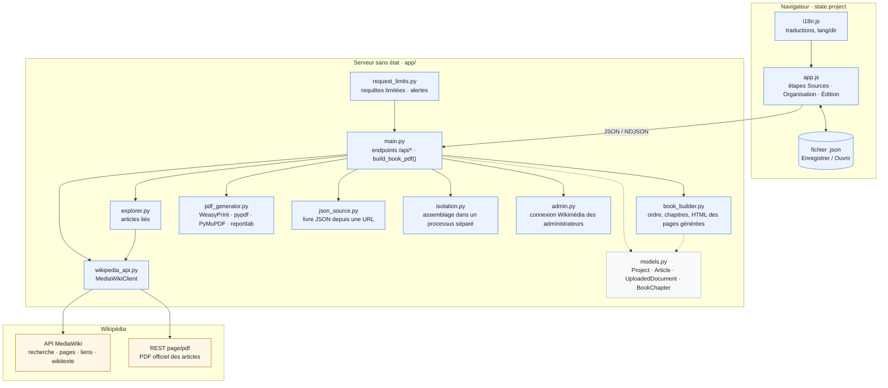
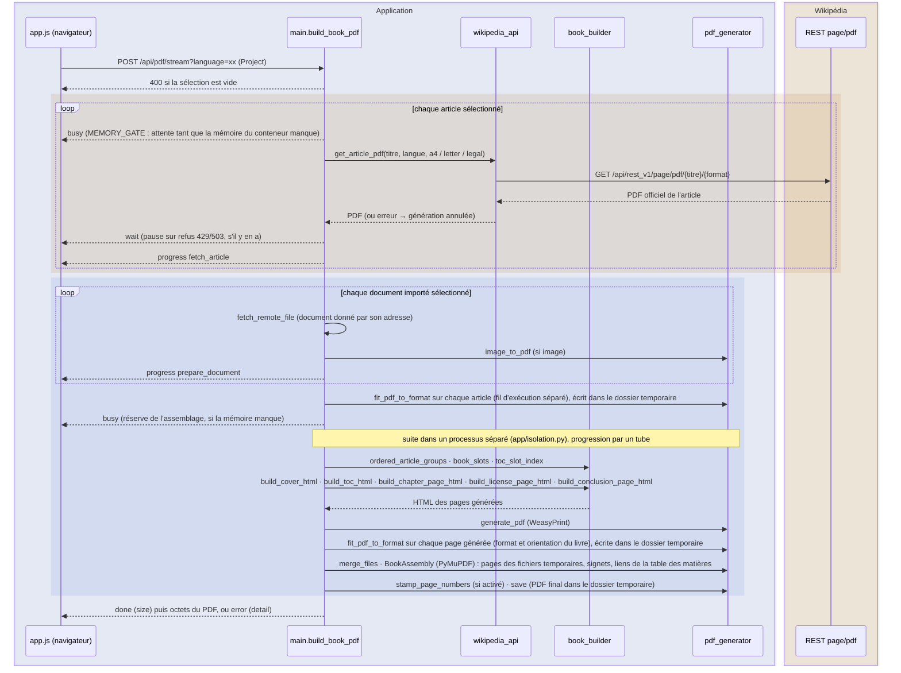

# Wikipedia2Book — Spécification technique

<table border="0" ><tr><td>

</td><td markdown="1">
Traduction anglaise : [TechnicalSpec.en.md](https://gmoulard.github.io/wikipedia2book/TechnicalSpec.en.html). Ce document en français fait référence. La documentation est en trois parties : spécification fonctionnelle ([FunctionalSpec.fr.md](https://gmoulard.github.io/wikipedia2book/FunctionalSpec.fr.html)), spécification technique ([TechnicalSpec.fr.md](https://gmoulard.github.io/wikipedia2book/TechnicalSpec.fr.html)) et historique des versions ([CHANGELOG.fr.md](https://gmoulard.github.io/wikipedia2book/CHANGELOG.fr.html)) ; les numéros de section sont communs aux trois (« section 13.3 » renvoie à la spécification technique).
</td></tr></table>

---

## Table des matières

- [13. Architecture technique](#13-architecture-technique)
	- [13.1 Technologies](#131-technologies)
	- [13.2 API Wikipédia](#132-api-wikip%C3%A9dia)
	- [13.3 Exemples d'appels HTTP](#133-exemples-dappels-http)
	- [13.4 Docker et exécution locale](#134-docker-et-ex%C3%A9cution-locale)
	- [13.5 Environnements et branches](#135-environnements-et-branches)
	- [13.6 Intégration continue (GitHub Actions)](#136-int%C3%A9gration-continue-github-actions)
	- [13.7 Toolforge](#137-toolforge)
	- [13.8 Statistiques d'utilisation (Toolviews)](#138-statistiques-dutilisation-toolviews)
	- [13.9 Modèle de données et fichier de sauvegarde](#139-mod%C3%A8le-de-donn%C3%A9es-et-fichier-de-sauvegarde)
	- [13.10 Schémas de l'architecture](#1310-sch%C3%A9mas-de-larchitecture)
	- [13.11 Benchmark](#1311-benchmark)
	- [13.12 Test aux limites](#1312-test-aux-limites)
	- [13.13 Stratégie d'optimisation du conteneur](#1313-strat%C3%A9gie-doptimisation-du-conteneur)
- [14. Sécurité et robustesse](#14-s%C3%A9curit%C3%A9-et-robustesse)
- [17. Structure du dépôt](#17-structure-du-dépôt)

## 13\. Architecture technique

### 13.1 Technologies

| Composant        | Technologie utilisée    |
| ----------------- | ------------------------------------------------------------ |
| Langage           | Python 3.12                                                   |
| Backend           | FastAPI + Uvicorn                                             |
| Client HTTP       | httpx (appels à l'API MediaWiki et à l'endpoint PDF)          |
| Analyse HTML      | BeautifulSoup4 (extraits de recherche, liens des articles rendus) |
| Interface         | HTML, CSS, JavaScript (page unique, sans framework)           |
| Internationalisation | Dictionnaire JavaScript interne (`i18n.js`), FR/EN/ES/PT/IT/DE/NL/TR/ZH/JA/AR/FA, sans dépendance externe |
| API Wikipédia     | API MediaWiki (`action=query`, `action=parse`) + endpoint REST `page/pdf` |
| Échange du livre  | JSON navigateur ↔ API                                         |
| Génération PDF    | PDF officiel Wikimedia (articles) + WeasyPrint (couverture, table des matières, chapitres, licence, conclusion) + pypdf (lecture du nombre de pages, recomposition au format du livre, lecture des liens provisoires de la table des matières) + PyMuPDF (assemblage sur disque temporaire, signets, liens internes, numéros de page, écriture du PDF final) + reportlab (largeur des numéros de page, conversion d'une image importée en page PDF) + Pillow (couleur du texte de couverture d'après l'image de fond) |
| Conteneurisation  | Docker                                                        |

Badges du dépôt :

<p align="left">
  <!-- Project status, license & archive -->
  <a href="https://github.com/gmoulard/wikipedia2book/actions/workflows/deploy-toolforge.yml"></a>
  <a href="https://github.com/gmoulard/wikipedia2book/blob/main/LICENSE"></a>
  <a href="https://archive.softwareheritage.org/browse/origin/?origin_url=https://github.com/gmoulard/wikipedia2book"></a>
  <a href="https://archive.softwareheritage.org/swh:1:dir:9c7c016d9603a4b0201ad64535767a353031bd91;origin=https://github.com/gmoulard/wikipedia2book;visit=swh:1:snp:3b1fa78021c1ad7819b82a6f38f200a9f3bfa85e;anchor=swh:1:rev:d0cd2a14a00fb848f2555a9ee62c4147230e6080"></a>
  <a href="https://github.com/gmoulard/wikipedia2book/blob/main/CODE_OF_CONDUCT.md"></a>
  
</p>

<p align="left">
  <!-- Frontend -->
  <a href="https://developer.mozilla.org/en-US/docs/Web/JavaScript"></a>
  <a href="https://developer.mozilla.org/en-US/docs/Web/HTML"></a>
  <a href="https://developer.mozilla.org/en-US/docs/Web/CSS"></a>
  
</p>

<p align="left">
  <!-- Backend -->
  <a href="https://www.python.org/"></a>
  <a href="https://fastapi.tiangolo.com/"></a>
  <a href="https://docs.pydantic.dev/"></a>
  <a href="https://www.uvicorn.org/"></a>
</p>

<p align="left">
  <!-- PDF & content -->
  <a href="https://weasyprint.org/"></a>
  <a href="https://pypdf.readthedocs.io/"></a>
  <a href="https://www.reportlab.com/"></a>
  <a href="https://www.mediawiki.org/wiki/API:Main_page"></a>
  <a href="https://creativecommons.org/licenses/by-sa/4.0/"></a>
</p>

<p align="left">
  <!-- Deployment & tests -->
  <a href="https://wikipedia2book.toolforge.org"></a>
  <a href="https://www.docker.com/"></a>
  <a href="https://github.com/gmoulard/wikipedia2book/actions"></a>
  <a href="https://docs.python.org/3/library/unittest.html"></a>
</p>

### 13.2 API Wikipédia

Tous les échanges avec Wikipédia passent par la classe `MediaWikiClient` de `app/wikipedia_api.py`; aucun autre module n'appelle Wikipédia. Deux services sont utilisés, sur le wiki de la langue de l'article (`<langue>` = code validé par `^[a-z0-9-]{2,12}$`) :

Pour une page d'un autre projet Wikimédia (section 3.1), les mêmes appels sont faits sur `https://<langue>.<projet>.org` au lieu de `https://<langue>.wikipedia.org` (reconnaissance de la page, recherche, introduction et auteur proposés, liens pour l'exploration, PDF); seules les pages de livre restent sur Wikipédia. Les projets acceptés sont la liste `SITES` de `app/wikipedia_api.py`, tirée du type `Site` de `app/models.py`. La politique robots de Wikimédia (section 3) est la même pour tous les projets : les limites de téléchargement des PDF sont communes à tous.

* **API MediaWiki (Action API)** : `https://<langue>.wikipedia.org/w/api.php`, en GET, toujours avec `format=json&formatversion=2` et, par défaut, `action=query`.
* **API REST** : `https://<langue>.wikipedia.org/api/rest_v1/page/pdf/<titre>/<format>`, pour le PDF officiel d'un article (le titre a ses espaces remplacés par `_` et est encodé dans l'URL).

| Usage | Appel et paramètres | Fonction | Utilisé par | Section |
| --- | --- | --- | --- | --- |
| Rechercher des articles | `list=search&srsearch=<texte>&srlimit=<1–20>&srnamespace=0` | `search` | `GET /api/search`, `POST /api/sources/resolve` (repli quand aucune page exacte) | 3.1 |
| Reconnaître une page (article ou page de livre), redirections suivies | `prop=info&titles=<titre>&redirects=1` (titre final et espace de noms `ns`) | `get_page` | `POST /api/sources/resolve` | 3.1 |
| Lire une page de livre dans l'ordre réel, avec sous-titre et chapitres | `prop=revisions&titles=<titre>&rvprop=content&rvslots=main` (wikitexte) | `get_book` | `POST /api/books/structure`, `/api/books/import`, `/api/sources/resolve`, `/api/books/generate-from-wikipedia-book` (le contenu collé, lu par `parse_book_wikitext` sans appel à MediaWiki : `POST /api/books/from-wikitext`) | 3.1 |
| Lire le sommaire d'un livre de Wikilivres ou d'une œuvre de Wikisource dans l'ordre, sections comprises | `action=parse&page=<titre>&prop=text` (HTML rendu, liens vers les sous-pages `<titre>/…`) | `get_subpage_book` | `POST /api/sources/resolve` | 3.1 |
| Liens d'un article, dans l'ordre de la page | `action=parse&page=<titre>&prop=text&redirects=1&disabletoc=1` (HTML rendu, lu avec BeautifulSoup) | `get_links` | `POST /api/explore` (via `explorer.py`) | 4.1 |
| Introduction d'un article | `prop=extracts&titles=<titre>&exintro=1&explaintext=1` | `get_intro_and_creator` (1er appel) | `GET /api/articles/intro` | 3.3 |
| Créateur d'une page (première révision) | `prop=revisions&titles=<titre>&rvlimit=1&rvdir=newer&rvprop=user` | `get_intro_and_creator` (2e appel) | `GET /api/articles/intro`, `/api/books/generate-from-wikipedia-book` (créateur de la page de livre, pris comme auteur quand `book_author` est absent) | 3.3 |
| PDF officiel d'un article | REST `page/pdf/<titre>/<a4, letter ou legal>` | `get_article_pdf` | génération du PDF (`/api/pdf`, `/api/pdf/stream`, `/api/books/generate*`) | 7 |

Règles communes :

* En-tête `User-Agent` conforme à la politique User-Agent de la Wikimedia Foundation (nom et version de l'outil, moyen de contact, bibliothèque et sa version) : `Wikipedia2Book/<version> (https://wikipedia2book.toolforge.org/; https://github.com/gmoulard/wikipedia2book) httpx/<version>`, la version étant celle de `app/version.py`.
* Respect de la politique robots de Wikimédia (*Robot policy*) pour les PDF officiels, hors Toolforge : le service PDF relève des règles de l'API REST (sans authentification, au plus 3 requêtes simultanées et moins de 5 par seconde), respectées avec **au plus 2 téléchargements simultanés pour tout le serveur**, quel que soit le nombre de livres générés en même temps, et **au plus 25 Mbit/s** de téléchargement mesurés sur 10 s glissantes (31,25 Mo par fenêtre) : le PDF est lu par morceaux et la lecture attend quand la fenêtre est pleine. Le compteur vaut pour un processus serveur (une seule instance uvicorn par plateforme) : chaque déploiement hors Toolforge (Northflank) a son propre plafond. **Sur Toolforge, ces limites sont levées** : la politique en exempte les outils hébergés sur Wikimedia Cloud Services ; jusqu'à 4 téléchargements simultanés par livre, sans plafond de débit. Toolforge est reconnu par la variable d'environnement `WIKIPEDIA2BOOK_PLATFORM=toolforge`, que seul le `Procfile` positionne.
* Délais d'attente : 20 secondes pour l'API MediaWiki, 120 secondes pour le téléchargement d'un PDF.
* Erreurs : un échec réseau, une réponse HTTP en erreur, une réponse non JSON ou un champ `error` de l'API MediaWiki produisent une erreur explicite, renvoyée par l'API de l'application avec le code 502 (404 pour une page introuvable, 422 pour une entrée invalide). Une réponse REST qui ne commence pas par `%PDF-` est refusée; pendant la génération, la moindre erreur sur un article annule tout le livre, sauf un PDF répondu HTTP 404 (`MediaWikiPageNotFound`, page supprimée) : l'article est retiré du livre et signalé par l'événement `missing` (section 8). Étape du journal des générations : `missing_article` (`url`).
* Aucune donnée n'est mise en cache ni conservée : chaque opération refait ses appels.

### 13.3 Exemples d'appels HTTP

Les exemples ci-dessous supposent que le serveur fonctionne sur `http://localhost:8000`. Remplacer cette adresse par le domaine du déploiement pour appeler une instance distante.

#### Dans un navigateur web

Les endpoints GET peuvent être ouverts directement dans la barre d'adresse :

* Rechercher des articles : `http://localhost:8000/api/search?query=Albert%20Einstein&language=fr&limit=5`. Chaque résultat porte sa langue (`language`).
* Rechercher dans toutes les langues : `http://localhost:8000/api/search?query=Paris&language=all&limit=3`, par défaut dans `SEARCH_LANGUAGES` (fr, en, de, es, it, pt, nl), ou dans une liste choisie : `&languages=fr,ja,nl` (12 langues au plus, codes validés, sinon HTTP 422). `limit` vaut alors par langue ; les requêtes partent en même temps, et une langue en erreur est ignorée tant qu'une autre répond (HTTP 502 si toutes échouent). `POST /api/sources/resolve` accepte de même `"language": "all"` et `"languages": [...]` : un titre donne toujours `kind` = `search` (cinq résultats par langue), une URL reste lue normalement. Tests : `AllLanguagesTest` dans `tests/test_resolve_source.py`.

* Rechercher sur un autre projet Wikimédia : `http://localhost:8000/api/search?query=Lyon&language=fr&site=wikivoyage`.

* Obtenir l'introduction et le créateur d'un article : `http://localhost:8000/api/articles/intro?title=Albert%20Einstein&language=fr`.

* Hits par heure depuis le démarrage du serveur (section 13.8) : `http://localhost:8000/api/stats/hourly`.

* État du conteneur, à suivre en direct pendant un test aux limites (section 13.12) : `http://localhost:8000/api/health/details`, par exemple sur la production `https://wikipedia2book.toolforge.org/api/health/details`. Réservé à la supervision : en-tête `Authorization: Bearer <jeton>`, le jeton étant défini par `WIKIPEDIA2BOOK_MONITOR_TOKEN` (32 caractères au moins, par exemple `python -c "import secrets; print(secrets.token_urlsafe(32))"` ; sans lui, l'endpoint répond toujours HTTP 401, `detail.code` = `monitor_token_required`), par exemple `curl -H "Authorization: Bearer $WIKIPEDIA2BOOK_MONITOR_TOKEN" <adresse>`. Réponse JSON, sans aucune donnée personnelle, jamais mise en cache, non comptée dans les hits par heure : `version`, `started` (démarrage du serveur : s'il change, le serveur a redémarré), `now`, `generations_in_progress` (générations de PDF en cours), `memory_gate`, `disk_gate` et `generation_gate` (contrôles de la mémoire, de la place disque et admission des générations : `ratio`, `reserved_bytes`, `active_stages`, `waiting_stages`), `request_limits` (limites de générations par client et pour tout le serveur, file d'attente, nombre de clients et de générations en cours, section 14), `alerts` (franchissements de limites par type : `count`, `last`), `memory` (`used_bytes`, `limit_bytes`, `peak_bytes` et `used_percent` du conteneur, lus dans les fichiers cgroup `memory.current`, `memory.max`, `memory.peak` — ou `memory.usage_in_bytes`, `memory.limit_in_bytes`, `memory.max_usage_in_bytes` en cgroup v1 —, puis `process_rss_bytes` et `process_peak_rss_bytes` du processus, lus dans `/proc/self/status`; `null` quand l'information n'existe pas, par exemple hors Linux ou sans limite) et `temporary` (`free_bytes` et `total_bytes` du disque du dossier temporaire, `generation_files_bytes` occupés par les dossiers des générations en cours). Juste avant un plantage, il montre si c'est la mémoire ou l'espace temporaire qui approche de sa limite. Tests : `tests/test_health_details.py`.

* Journal des générations, pour diagnostiquer après coup une génération lente ou en échec : `http://localhost:8000/api/health/generations`, par exemple `https://wikipedia2book.toolforge.org/api/health/generations`. Même jeton de supervision. Réponse JSON, jamais mise en cache, non comptée dans les hits par heure : `version`, `started`, `now` et `generations`, jusqu'aux 1 000 dernières générations depuis le démarrage du serveur (`GENERATION_LOG_KEEP`), moins quand elles dépassent ensemble 40 000 étapes (`GENERATION_LOG_STAGES`, environ 30 Mo de mémoire, une étape en prenant environ 760 octets ; un livre de 10 articles compte une trentaine d'étapes, un livre de 300 articles environ 330), les plus anciennes étant retirées d'abord, la plus récente en premier. Chaque génération donne `id`, `started`, `version`, `language`, le nombre d'`articles`, de `documents` et de `chapters`, `page_format`, `orientation`, `page_numbers`, `table_of_contents`, `status` (`running`, `done`, `error` ou `aborted` si le client abandonne), `duration_s`, `size_bytes` (réussite) ou `error` (type de l'erreur seulement, ou le message d'arrêt du processus d'assemblage), et `stages`, la liste des étapes franchies : `at_s` (secondes depuis le début), `stage`, `process` (`server` ou `assembly`), `container_bytes` (mémoire du conteneur), `rss_bytes` et `peak_rss_bytes` (mémoire du processus qui a franchi l'étape) et, pour le processus d'assemblage, `server_rss_bytes`. Étapes : `start`, `fetch_image` (image de fond donnée par son adresse : `image` = `cover_image` ou `back_image`, `duration_s` du téléchargement, `size_bytes`), `fetch_document` (document importé donné par son adresse : `duration_s`, `size_bytes`, `pdf`), `html_without_styles` (une page web que WeasyPrint n'a pas pu rendre avec ses feuilles de style, rendue une seconde fois sans elles : `error`, type de l'erreur), `downloads_done` (avec `article_pages`), `memory_wait` (une étape a attendu de la mémoire : `reason` = `generation`, `disk`, `download`, `fit`, `fetch_image`, `assembly_disk` ou `assembly`, `waited_s`, `reserved_bytes`), puis dans le processus d'assemblage `assembly_start`, `fit_backgrounds` (réduction des images de fond : `duration_s`, `bytes_before`, `bytes_after`), `cover_html` (HTML de la couverture, dont l'analyse de l'image de fond pour la couleur du texte : `duration_s`, `background`), `render_cover`, `render_toc_count` (numérotation), `render_toc`, `render_chapters`, `render_conclusion`, `render_license`, `render_back_cover` (image de fond de dernière page), `merge_parts` (fusion des parties), `merge_reopen` (réouverture du livre fusionné), `outline_and_links`, `stamp_page_numbers` (numérotation) et `save`. Aucun titre, aucune adresse ni rien qui identifie l'utilisateur n'y figure. Le journal vit en mémoire et disparaît quand le serveur redémarre : chaque étape est donc aussi écrite sur la sortie standard, en une ligne JSON, et reste lisible dans les journaux de la plateforme (`toolforge webservice logs` sur Toolforge), même quand la plateforme arrête tout le conteneur faute de mémoire. Ces journaux de la plateforme sont eux-mêmes effacés à chaque redémarrage : quand `WIKIPEDIA2BOOK_GENERATION_LOG_DIR` désigne un dossier persistant (sur Toolforge, `/data/project/wikipedia2book/generations`, dans le stockage NFS du compte de l'outil, posé par le `Procfile`), les mêmes lignes y sont aussi écrites, une par ligne dans un fichier par jour UTC (`AAAA-MM-JJ.jsonl`), avec en plus `at` (date et heure UTC) et `pod` (nom du conteneur) ; les fichiers de plus de 30 jours (`GENERATION_FILES_DAYS`) sont supprimés au premier écrit de chaque jour (`main.GenerationFiles`). L'écriture se fait dans un fil séparé, pour qu'un stockage NFS lent ne gèle jamais le serveur ; le dossier parent n'est jamais créé (sans montage, rien n'est écrit sur le disque éphémère du conteneur), et un échec d'écriture est signalé une fois sur la sortie standard (`generation_files_error`) sans arrêter la génération. Exception voulue par l'utilisateur à la règle « rien sur disque » : seules ces lignes, sans titre, adresse ni rien qui identifie l'utilisateur. Variable absente (défaut, `Dockerfile`, Northflank) : rien n'est écrit. Chaque article ou document téléchargé a son étape `download` (`kind` = `article` ou `document`, `download_s`, `fit_s`, `size_bytes`, `pages`), et chaque image de fond son étape `fetch_image` ; l'adresse téléchargée (`url` : PDF de l'article, adresse complète d'un fichier donné par l'utilisateur) n'est gardée que dans le journal en mémoire, lu avec le jeton de supervision ou par la page d'admin, jamais recopiée sur la sortie standard (choix de l'utilisateur). Une seule génération : `GET /api/health/generations/{id}` (`id` du journal), réponse `{"version", "started", "generation"}`, ou HTTP 404 quand elle n'est plus dans le journal ; non comptée dans les hits par heure, comme le journal entier. Sa demande : `GET /api/health/generations/{id}/request`, le livre demandé au format `wikipedia2book-workspace` (fichier JSON en pièce jointe, contenu des fichiers importés retiré, `removed_base64_chars`), gardé à part du journal (`generation_requests`, 1 Mo au plus par demande, `GENERATION_REQUEST_MAX_BYTES`, 30 Mo en tout, `GENERATION_REQUESTS_BYTES`), jamais écrit sur la sortie standard ; `request_bytes` en donne la taille dans le journal ; HTTP 404 quand elle n'est plus en mémoire. Tests : `tests/test_generation_log.py`, `tests/test_admin.py`.

* Générer le PDF d'une page de livre Wikipédia : `http://localhost:8000/api/books/generate-from-wikipedia-book?url=https%3A%2F%2Ffr.wikipedia.org%2Fwiki%2FLivre%3AAnimaux`. Le paramètre `url` est obligatoire; `language` est facultatif et vaut `fr` par défaut. Sont aussi acceptés, facultatifs : `book_title`, `book_subtitle`, `book_author`, `book_conclusion`, `page_format`, `orientation`, `page_numbers`, `table_of_contents`. Le PDF est renvoyé en téléchargement.

* Générer le PDF d'un livre enregistré en JSON et publié en ligne : `http://localhost:8000/api/pdf/from-json?url=https%3A%2F%2Fgmoulard.github.io%2Fwikipedia2book%2Fstatic%2FWrecks-of-Saint-Pierre-harbor.json`, avec `language` facultatif (`fr` par défaut, mêmes valeurs que `/api/pdf`). Le serveur télécharge le fichier (`app/json_source.py`, `fetch_project`) : HTTPS seulement, hôte qui doit se résoudre en adresses publiques (refus de `127.0.0.1`, `10.x`, `192.168.x`, adresses de lien local…, vérifié de nouveau à chaque redirection, 3 redirections au plus), 60 Mo au plus, 30 s au plus ; le fichier peut être un export de l'interface (`wikipedia2book-workspace`, premier livre), une liste de livres (le premier) ou un livre seul. Il n'est gardé qu'en mémoire le temps de la génération, comme un livre envoyé à `POST /api/pdf`, et la génération suit les mêmes règles (sélection, limite d'articles, PDF en téléchargement). Erreurs : 422 (adresse refusée, JSON ou livre invalide, `url` absent), 413 (fichier trop gros), 502 (téléchargement impossible, HTTP autre que 200, trop de redirections). Tests : `tests/test_json_source.py`.

* Générer directement le PDF d'un livre construit depuis une ou plusieurs sources : `http://localhost:8000/api/pdf/from-source?source=https%3A%2F%2Ffr.wikibooks.org%2Fwiki%2FCosmologie`, par exemple `https://wikipedia2book.toolforge.org/api/pdf/from-source?source=b:Cosmologie`. Paramètres : `source` (répétable, 50 au plus, même lecture que le champ Sources, `main.parse_source_line`, à garder alignée sur `parseSourceLine` de `app.js`), `language` (langue des titres ajoutés au PDF, `fr` par défaut), `wiki` (langue des titres sans préfixe, par défaut `language`) et `summary=1` pour ajouter aussi la page de sommaire d'un livre de Wikilivres ou d'une œuvre de Wikisource, qui sinon donne ses sous-pages sans le sommaire, sans question. Une page de livre Wikipédia donne ses articles et ses chapitres ; plusieurs sources se suivent dans l'ordre, sans doublon, les articles sans chapitre en tête quand le livre en a ; le titre du livre est celui de l'unique page de livre ou sommaire, sinon le premier article. Erreurs : 404 (aucune page exacte pour une source, nommée dans le message), 422 (paramètre manquant ou source invalide), 502 (Wikipédia injoignable). Tests : `tests/test_resolve_source.py`.

* Vérifier que le service répond : `http://localhost:8000/health`.

* Afficher la documentation interactive et appeler également les endpoints POST : `http://localhost:8000/docs`.

L'endpoint GET de génération depuis une page de livre Wikipédia peut être appelé directement dans le navigateur. Les autres endpoints de génération de PDF utilisent POST; pour ceux-ci, utiliser `curl` ou la documentation interactive `/docs`.

#### Avec curl

Reconnaître une saisie (URL, page de livre ou titre) et obtenir l'article, le livre ou les résultats de recherche correspondants (`kind` = `article`, `book`, `subpages` — sommaire de Wikilivres ou de Wikisource, avec `article` pour la page seule et `book` pour ses sous-pages — ou `search`) :

```bash
curl --fail --show-error --request POST 'http://localhost:8000/api/sources/resolve' \
	--header 'Content-Type: application/json' \
	--data '{"input":"Albert Einstein","language":"fr"}'
```

Lire le contenu d'une page « Livre: » collé (titre, sous-titre, chapitres, articles), sans appel à Wikipédia :

```bash
curl --fail --show-error --request POST 'http://localhost:8000/api/books/from-wikitext' \
	--header 'Content-Type: application/json' \
	--data '{"wikitext":"== Ports bretons ==\n=== Guide des ports ===\n:[[Brest]]\n;Finistère\n:[[Concarneau]]","language":"fr"}'
```

Générer un PDF à partir d'une liste explicite de références d'articles :

```bash
curl --fail --show-error --request POST 'http://localhost:8000/api/books/generate?language=fr' \
	--header 'Content-Type: application/json' \
	--data '{"book_title":"Animaux","articles":[{"title":"Chat","language":"fr"},{"url":"https://fr.wikipedia.org/wiki/Chien"}]}' \
	--output animaux.pdf
```

Générer un PDF à partir d'une page de livre Wikipédia, en remplaçant l'URL d'exemple par celle d'une page de livre existante :

```bash
curl --fail --show-error --request POST 'http://localhost:8000/api/books/generate-from-wikipedia-book?language=fr' \
	--header 'Content-Type: application/json' \
	--data '{"url":"https://fr.wikipedia.org/wiki/Livre:Animaux","book_title":"Animaux","book_conclusion":"Bonne lecture !"}' \
	--output animaux.pdf
```

La même génération peut être appelée avec GET et uniquement l'URL de la page de livre :

```bash
curl --fail --show-error --get 'http://localhost:8000/api/books/generate-from-wikipedia-book' \
	--data-urlencode 'url=https://fr.wikipedia.org/wiki/Livre:Animaux' \
	--output animaux.pdf
```

Dans les deux cas, la réponse est le fichier PDF binaire; `--output` le sauvegarde localement. `language` règle la langue des libellés générés dans le PDF et les langues prises en charge sont celles de la section 12.1.

### 13.4 Docker et exécution locale

Le logiciel est livré avec :

* Un `Dockerfile` (image Python 3.12-slim avec les dépendances système de WeasyPrint et les polices DejaVu, Noto CJK et Hanazono — HanaMinB, pour les caractères chinois rares des extensions CJK B et suivantes, dans les pages générées par l'application).

* Un fichier `requirements.txt` aux versions figées (`==`) pour les dépendances directes, dont `pydantic` (importé par `app/models.py`) : chaque build installe exactement les versions avec lesquelles les tests passent.

* Un script `scripts/docker-build.sh` qui construit l'image en y injectant le commit, la date et l'auteur git courants, affichés en pied de page de l'application.

Exemple :

```bash
sh scripts/docker-build.sh
docker run --rm -p 8000:8000 wikipedia2book
```

L'application est alors accessible sur `http://localhost:8000`, avec sa documentation interactive sur `http://localhost:8000/docs`.

Sans Docker, avec Python 3.12 et les dépendances système de WeasyPrint installées (GTK, Pango, Cairo) :

```bash
python -m venv .venv
source .venv/bin/activate
pip install -r requirements.txt
uvicorn app.main:app --reload
```

L'application est servie à la même adresse.

La page de l'application (`/`) et ses fichiers (`/static/…`) sont servis avec `Cache-Control: no-cache` : le navigateur revérifie chaque fichier à chaque chargement (réponse 304 s'il n'a pas changé), ce qui évite de mélanger, après un déploiement, une nouvelle page avec d'anciens scripts ou traductions restés en cache. Les fichiers de `/static/` portent une empreinte (`ETag`) calculée sur leur contenu, et aucune date de modification (`Last-Modified`) (`main.ContentStaticFiles`) : sur Toolforge, tous les fichiers construits sont datés de 1980 ; avec l'empreinte de Starlette (date et taille) et cette date, un navigateur qui revalidait par la date recevait 304 à chaque version et gardait un ancien `i18n.js` (libellés affichés sous forme de clé, par exemple `admin.limits`). Tests : `tests/test_static_cache.py`.

Le serveur ne stocke aucun livre ni PDF sur disque; tout l'état est conservé dans le navigateur et échangé via JSON. Le déploiement ne demande donc ni base de données ni volume persistant, sur aucune plateforme. Seul un dossier temporaire (répertoire temporaire du système) sert pendant chaque génération de PDF, et il est supprimé à la fin (section 11.1) : la plateforme doit offrir un espace temporaire d'environ deux fois la taille du plus gros livre généré.

#### Déployer son propre conteneur

Ces réglages fixent ce qu'une génération peut demander au serveur. Ce sont des variables d'environnement, posées dans le `Dockerfile` (ligne `ENV`) et lues au démarrage du serveur :

| Variable | Valeur dans le `Dockerfile` | Rôle |
|---|---|---|
| `WIKIPEDIA2BOOK_ARTICLE_LIMIT` | `300` (aussi la valeur par défaut sans la variable, sur tous les hébergements) | Nombre maximal d'articles par livre. Au-delà, l'API refuse aussitôt le livre (HTTP 413, code `too_many_articles`) ; l'interface lit la limite dans `/api/version` et génère le livre en plusieurs volumes, chacun sous la limite. `0` lève la limite. |
| `WIKIPEDIA2BOOK_DOWNLOADS` | `2` | Nombre de PDF d'articles téléchargés en même temps depuis Wikipédia pour un livre. |
| `WIKIPEDIA2BOOK_MEMORY_RATIO` | `0.95` (défaut, absent du `Dockerfile`) | Part de la limite mémoire du conteneur que les générations peuvent utiliser. Avant chaque étape (téléchargement, recomposition, assemblage), une génération estime la mémoire nécessaire d'après la taille des fichiers et attend, en affichant « Serveur occupé », tant que la mémoire utilisée plus les réserves en cours plus son estimation dépasseraient cette part. `0` désactive le contrôle. |
| `WIKIPEDIA2BOOK_GENERATIONS_RATIO` | `0.5` (défaut, absent du `Dockerfile`) | Part de la limite mémoire du conteneur réservée par les générations admises en même temps (25 Mo + 3 fois les données base64 du livre chacune). Les suivantes attendent dès le début, en affichant « Serveur occupé », avant de charger quoi que ce soit. `0` désactive le contrôle. |
| `MALLOC_ARENA_MAX` | `2` (posé dans le `Dockerfile` et le `Procfile` de Toolforge) | Limite les arènes mémoire de la glibc pour que le serveur rende au système la mémoire libérée. |
| `WIKIPEDIA2BOOK_CLIENT_GENERATIONS` | `5` (défaut) | Générations simultanées par client (adresse IP publique, et jeton aléatoire gardé par le navigateur). Au-delà, HTTP 429 avec `Retry-After` ; l'interface attend et réessaie. `0` lève la limite. |
| `WIKIPEDIA2BOOK_CLIENT_PER_MINUTE` | `20` (défaut) | Générations lancées par client et par minute. `0` lève la limite. |
| `WIKIPEDIA2BOOK_TOTAL_GENERATIONS` | `0` (défaut ; `50` sur Toolforge) | Générations simultanées pour tout le serveur, pour les hébergements qui masquent l'adresse des visiteurs. `0` lève la limite. |
| `WIKIPEDIA2BOOK_TOTAL_PER_MINUTE` | `0` (défaut ; `200` sur Toolforge) | Générations lancées par minute pour tout le serveur. `0` lève la limite. |
| `WIKIPEDIA2BOOK_WAITING_GENERATIONS` | `100` (défaut) | Générations en attente d'admission en même temps ; les suivantes reçoivent HTTP 429. `0` lève la limite. |
| `WIKIPEDIA2BOOK_GENERATION_LOG_DIR` | vide (défaut) ; `/data/project/wikipedia2book/generations` sur Toolforge (`Procfile`) | Dossier persistant où le journal des générations est aussi écrit, un fichier par jour, 30 jours gardés (section 13.4). Son dossier parent doit déjà exister. Vide : rien n'est écrit sur disque. |
| `WIKIPEDIA2BOOK_CLIENT_IP_HEADER` | vide (défaut) | En-tête qui porte l'adresse du visiteur quand le conteneur est derrière un proxy de confiance, par exemple `x-forwarded-for` (sa dernière valeur est utilisée). À laisser vide sans proxy : un client pourrait écrire l'en-tête lui-même. |
| `WIKIPEDIA2BOOK_DISK_RATIO` | `0.95` (défaut, absent du `Dockerfile`) | Part du disque temporaire que les générations peuvent remplir. Un téléchargement d'article (30 Mo réservés) et l'assemblage du livre (50 Mo + 2 fois la taille des articles) attendent, en affichant « Serveur occupé », tant que l'espace utilisé plus les réserves en cours plus leur estimation dépasseraient cette part. `0` désactive le contrôle. |

Les modifier dans le `Dockerfile` et reconstruire l'image, ou les remplacer au lancement du conteneur, sans reconstruire :

```bash
docker run --rm -p 8000:8000 -e WIKIPEDIA2BOOK_ARTICLE_LIMIT=100 -e WIKIPEDIA2BOOK_DOWNLOADS=1 wikipedia2book
```

Le serveur refuse de démarrer avec une valeur invalide et dit pourquoi.

**Nombre de téléchargements parallèles.** Il ne peut qu'être abaissé, à `1`, pas dépasser `2` : la [politique robots de Wikimédia](https://wikitech.wikimedia.org/wiki/Robot_policy) limite le service PDF à quelques requêtes simultanées, et le serveur impose au plus 2 téléchargements et 25 Mbit/s pour tout le processus, quel que soit ce réglage. Seule l'instance Toolforge, exemptée par la politique, télécharge 4 PDF à la fois. L'abaisser à `1` ménage Wikimédia et un petit serveur, au prix d'une phase de téléchargement plus longue.

**Limite d'articles et mémoire du conteneur.** Lever la limite (`0`) n'est sûr que si le conteneur a assez de mémoire : un livre qui ne tient pas fait arrêter et redémarrer tout le conteneur par la plateforme, ce qui coupe aussi les générations de tous les autres utilisateurs. Régler la limite d'après la mémoire du conteneur, avec de la marge pour plusieurs utilisateurs à la fois. Mesures avec de vrais articles (environ 17 pages par article) :

| Mémoire du conteneur | Plus gros livre généré | Remarques |
|---|---|---|
| 256 Mo | moins de 20 articles | Northflank : redémarrage à 20 articles, déjà très lent à 10 |
| 2 Gio | environ 800 articles (14 000 pages, 780 Mo de PDF) | Toolforge : échec à 1 000 articles ; l'instance officielle limite les livres à 300 articles (au-delà, génération en volumes) |

Compter environ 250 Mo pour le serveur et le processus d'assemblage eux-mêmes, plus 2 à 2,5 Mo par article environ au pic, et garder la limite bien en dessous de ce que le conteneur peut tenir, par exemple du tiers à la moitié : avec 2 Gio, cela donne quelques centaines d'articles ; avec 256 Mo, il ne reste rien pour un livre de quelque taille que ce soit. Pour trouver le vrai maximum d'un déploiement, y lancer le test aux limites (section 13.12 ; il peut faire redémarrer le serveur, donc pas aux heures chargées) :

```bash
python scripts/limit_check.py --base-url https://votre-serveur --search 50
```

Il double le nombre d'articles jusqu'au premier échec, puis affine par dichotomie. Ajouter `--save-pdf ./tmp` pour garder chaque livre généré (`./tmp` est ignoré par git). Avec le jeton de supervision (`Authorization: Bearer`, section 13.7), `GET /api/health/details` donne la mémoire du conteneur et sa limite, et `GET /api/health/generations` la mémoire atteinte à chaque étape des dernières générations.

**Voir les alertes.** À chaque franchissement de limite, le serveur écrit sur sa sortie standard une ligne JSON contenant `"alert"` et la compte dans `GET /api/health/details`. Commandes pour les lire sur Toolforge, Northflank, Docker et un serveur local, et leur interprétation : section 14.

### 13.5 Environnements et branches

L'application est déployée sur deux plateformes, chacune reliée à une branche du dépôt GitHub `gmoulard/wikipedia2book` :

| Plateforme | URL | Branche suivie | Construction de l'image | Déclenchement |
| --- | --- | --- | --- | --- |
| Toolforge (Wikimedia Cloud) | https://wikipedia2book.toolforge.org | `production-toolforge` | Buildpacks Toolforge (`Procfile`, `Aptfile`, `.python-version`) | Workflow GitHub Actions du dépôt (section 13.6) |
| Northflank | https://prod--wikipedia2book--wkvpbnfj6h4v.code.run | `main` | `Dockerfile` | Intégration GitHub de Northflank, réglée dans son interface |

Toolforge est l'instance de référence, proposée à la communauté Wikipédia. Northflank reçoit chaque changement poussé sur `main` et sert de préproduction.

Sur chaque plateforme, la documentation interactive de l'API est à l'adresse `/docs` (https://wikipedia2book.toolforge.org/docs). Exemple sur Toolforge avec le livre *Épaves de la rade de Saint-Pierre* : [PDF généré directement](https://wikipedia2book.toolforge.org/api/pdf/from-json?url=https%3A%2F%2Fgmoulard.github.io%2Fwikipedia2book%2Fstatic%2FWrecks-of-Saint-Pierre-harbor.json) ou [livre ouvert dans l'interface](https://wikipedia2book.toolforge.org/?json=https://gmoulard.github.io/wikipedia2book/static/Wrecks-of-Saint-Pierre-harbor.json). Les statistiques d'utilisation de Toolforge sont sur https://gmoulard.github.io/wikipedia2book/stats.html (section 13.8).

Cycle de publication :

1. Développer et pousser sur `main` (ou par pull request vers `main`) : les tests tournent sur GitHub Actions, Northflank se redéploie, Toolforge n'est pas touché.
2. Vérifier la nouvelle version sur Northflank.
3. Publier sur Toolforge en avançant la branche de production :

```bash
git push origin main:production-toolforge
```

`production-toolforge` ne reçoit pas de commits propres : elle ne fait qu'avancer vers un commit déjà présent sur `main`. Revenir à une version antérieure sur Toolforge se fait en y poussant un commit plus ancien de `main` (`git push --force origin <commit>:production-toolforge`).

Chaque version de l'application est repérée dans Git par un **tag annoté** `vX.Y.Z` (par exemple `v1.6.6`), posé sur le commit qui fait passer `app/version.py` à cette version, puis poussé sur GitHub :

```bash
git tag -a v1.6.6 -m "Wikipedia2Book 1.6.6"
git push origin v1.6.6
```

Les tags servent à retrouver le code d'une version (`git checkout v1.4.0`), à comparer deux versions (`git diff v1.5.2 v1.6.6`) ou à republier une version antérieure sur Toolforge (`git push --force origin v1.6.5^{}:production-toolforge`). Pousser un tag ne déclenche aucun déploiement ni aucun workflow : seuls les pushs de branches le font. Les versions 0.16.0, 0.17.0 et 1.6.0 de l'historique (section 19) n'ont jamais été écrites dans `app/main.py` et n'ont donc pas de tag; à l'inverse, `v0.18.0` existe dans le code (l'API de haut niveau, décrite dans l'historique sous 0.16.0 et 0.17.0).

Le choix de branche de Northflank ne fait pas partie du dépôt : il se modifie dans son interface (service de build, Build settings, Branch).

### 13.6 Intégration continue (GitHub Actions)

Cinq workflows. Le principal, `.github/workflows/deploy-toolforge.yml` (« Tests and Toolforge deploy »), a deux jobs :

* `test` : à chaque push sur `main` ou `production-toolforge`, à chaque pull request et sur lancement manuel (`workflow_dispatch`). Installe Python 3.12 et `requirements.txt`, puis lance `python -m unittest discover -s tests -v`.

* `deploy` : uniquement après la réussite de `test`, et uniquement pour un push (ou un lancement manuel) sur `production-toolforge`; il est ignoré (« skipped ») partout ailleurs. Il écrit la clé SSH du secret GitHub `TOOLFORGE_SSH_KEY`, fige l'empreinte ED25519 de `login.toolforge.org` dans `known_hosts` (pas de confiance aveugle au premier contact), puis exécute `scripts/toolforge-deploy.sh` dans le compte de l'outil :

```bash
ssh <login>@login.toolforge.org "become wikipedia2book bash -s" < scripts/toolforge-deploy.sh
```

Juste avant ce redémarrage, qui efface les journaux du webservice, l'étape « Hourly statistics before restart » relève les hits par heure (section 13.8, « Hits par heure ») et les committe sur `main`. Elle est en `continue-on-error` : un échec du relevé apparaît en avertissement dans GitHub Actions mais ne bloque jamais le déploiement. Le job a pour cela la permission `contents: write`.

Les déploiements Toolforge sont sérialisés (groupe de concurrence `toolforge-deploy`, sans annulation du déploiement en cours); les autres exécutions sont indépendantes.

Le secret `TOOLFORGE_SSH_KEY` contient une clé privée OpenSSH dédiée au déploiement, distincte de la clé personnelle, dont la partie publique est enregistrée sur le compte Wikimedia (idm.wikimedia.org). La révoquer suffit à couper le déploiement automatique sans toucher aux autres accès.

Le second, `.github/workflows/toolviews-stats.yml` (« Toolviews stats »), met à jour chaque jour les statistiques d'utilisation (section 13.8).

Le troisième, `.github/workflows/jekyll-gh-pages.yml`, publie à chaque push sur `main`, chaque jour à 4 h 17 UTC (et sur lancement manuel) le site de documentation https://gmoulard.github.io/wikipedia2book/ avec GitHub Pages : Le site est construit à partir du dossier `docs/` : Jekyll y convertit en HTML les fichiers Markdown (spécifications fonctionnelle et technique, historique des versions, `stats.md`…) avec le thème Just the Docs (`docs/_config.yml` : thème épinglé `just-the-docs/just-the-docs@v0.12.0` par `remote_theme`, menu latéral en deux parties, « Fonctionnel » (`fonctionnel.md` : spécification fonctionnelle, historique, aide « Search help », comparaisons) et « Technique » (`technique.md` : spécification technique, tests manuels, test aux limites, statistiques), dans l'ordre de `nav_order`, recherche, titres des pages, redirection des anciennes adresses `SPECIFICATIONS.fr.html` et `SPECIFICATIONS.en.html` vers les spécifications fonctionnelles) ; `docs/_includes/head_custom.html`, inséré par le thème dans chaque page, dessine les schémas Mermaid et le graphique horaire, ouvre les deux parties du menu dès l'ouverture de la page, colle le menu au bord gauche et donne toute la largeur restante au contenu sur les grands écrans, ajoute dans le menu un petit drapeau français derrière « Functional specification » et « Technical specification » (les versions françaises, qui font référence, ne figurent plus dans le menu, `nav_exclude`), une entrée « Français » en tête de « Search help » et un drapeau devant chacune des 12 aides (bibliothèque flag-icons 7.2.3, jsDelivr), et ajoute dans l'en-tête des pages traduites (aide en 12 langues, spécifications en français et en anglais) un sélecteur de langue qui ouvre la même page dans la langue choisie ; les pages en persan et en arabe s'y affichent de droite à gauche. La page d'accueil est `docs/index.md`, un document à part entière du dossier `docs/`, initialisé depuis `README.md` mais qui n'en est plus une copie ; ses liens sont relatifs au site, et `LICENSE`, `CODE_OF_CONDUCT.md`, `CITATION.cff` et `codemeta.json`, restés à la racine du dépôt, pointent vers GitHub. C'est l'adresse déclarée comme documentation utilisateur dans `toolinfo.json`. GitHub Pages n'affiche pas les blocs Mermaid nativement : `docs/_includes/head_custom.html`, ajouté par Jekyll dans l'en-tête de chaque page (thème par défaut), charge Mermaid 11.17.2 depuis jsDelivr et dessine les blocs ```` ```mermaid ```` (section 13.10). Le site est aussi reconstruit (déclencheur `workflow_run`) après chaque exécution de « Toolviews stats » qui n'a pas été annulée, même en échec partiel puisque des statistiques ont pu être committées, et après chaque exécution de « Tests and Toolforge deploy » sur `production-toolforge` (relevé horaire d'avant déploiement), et chaque construction ajoute la page de statistiques d'utilisation https://gmoulard.github.io/wikipedia2book/stats.html (section 13.8). Chaque construction publie aussi un PDF d'exemple du jour, `static/Wrecks-of-Saint-Pierre-harbor.pdf` : le livre `docs/static/Wrecks-of-Saint-Pierre-harbor.json` du dépôt est envoyé à la production (`POST https://wikipedia2book.toolforge.org/api/pdf/from-json?language=en`, 3 nouvelles tentatives, 15 min au plus), la réponse est vérifiée (en-tête `%PDF-`, fin `%%EOF`, plus de 1 Mo) puis gardée dans le cache des actions sous une clé faite du jour et de l'empreinte du JSON : le PDF n'est donc généré qu'une fois par jour (ou à chaque modification du JSON), les autres constructions du jour reprennent le cache. Si la génération échoue, l'étape le signale par un avertissement et le site garde le PDF du dépôt, sans bloquer la publication.

Le quatrième, `.github/workflows/tag-check.yml` (« Tag check »), se lance à chaque push d'un tag `v*` : il échoue si le numéro du tag ne correspond pas à la version écrite dans `app/version.py` (`VERSION = "x.y.z"`, depuis la 1.7.4; `app/main.py` avant). Un tel échec ne se corrige jamais en déplaçant le tag, mais par une nouvelle version.

Le cinquième, `.github/workflows/benchmark.yml` (« Benchmark »), joue le benchmark à la demande (section 13.11).

Le sixième, `.github/workflows/security.yml` (« Security »), se lance à chaque push sur `main`, sur chaque pull request, chaque lundi et à la demande : vulnérabilités connues des dépendances de `requirements.txt` (pip-audit), analyse statique du Python de `app/` et `scripts/` (bandit, gravité moyenne et plus), tests de sécurité (`tests/test_security.py`) et paquets de l'image Docker (Trivy, failles critiques et élevées corrigeables, action épinglée sur un commit). CodeQL (Python et JavaScript) n'y figure pas : il tourne dans la configuration par défaut de GitHub (workflow « CodeQL », résultats dans l'onglet Security), qui refuse une seconde analyse CodeQL dans un workflow. Il ne déploie rien et ne bloque pas « Tests and Toolforge deploy ». Les tests de sécurité vérifient :

* téléchargements par adresse (`json_source.download`) : HTTPS seul ; adresses internes refusées, y compris une IPv4 interne cachée dans une adresse IPv6 (`::ffff:`, NAT64, 6to4, Teredo) et les adresses multicast (`is_public_address`) ; hôtes déguisés ; redirections revérifiées et bornées ; connexion à l'adresse vérifiée ; taille bornée sans `Content-Length` ;
* pages générées : aucun texte du livre (titres, introduction, conclusion, chapitres, articles, documents) ne devient du HTML, seules des adresses `data:`, de l'application ou du dépôt y figurent, les liens de la table des matières restent dans leur attribut ;
* images de fond : type et contenu base64 vérifiés, adresse HTTPS seule ;
* images lues par Pillow (fonds, documents importés) limitées aux formats qu'il décode lui-même (`models.SAFE_IMAGE_FORMATS` : PNG, JPEG, GIF, WebP, BMP, TIFF) : une image annoncée PNG mais contenant de l'EPS n'est jamais confiée à Ghostscript ; WeasyPrint 70.0 au moins (`requirements.txt`), qui ne passe plus l'EPS à Ghostscript et respecte le filtre d'adresses partout ;
* rendu WeasyPrint limité aux adresses `data:` (`pdf_generator.RENDER_PROTOCOLS`) : une image SVG ne peut pas faire lire un fichier du serveur ni une adresse interne ;
* wikitexte collé : lecture en temps linéaire, même pour un texte piégé de 200 000 caractères (une expression régulière quadratique bloquait le serveur plusieurs minutes) ;
* paramètre `language` refusé s'il n'est pas un code de langue ;
* page : toute adresse venue d'un livre JSON passe par `safeUrl` (HTTPS seul) avant d'être mise dans un lien.

### 13.7 Toolforge

#### Fichiers propres à Toolforge

Toolforge construit l'image avec des buildpacks et ignore le `Dockerfile`. Le dépôt fournit :

* `Procfile` : commande `uvicorn` sur le port 8000 attendu par Toolforge, précédée de `env WIKIPEDIA2BOOK_PLATFORM=toolforge` (lève les limites de téléchargement, section 13.2).

* `Aptfile` : mêmes dépendances système et polices que le `Dockerfile`.

* `.python-version` : Python 3.12.

* `toolforge-fonts.conf` : les polices de l'`Aptfile` (dont Noto CJK pour le chinois et le japonais, et Hanazono pour leurs caractères rares) sont installées dans `/layers/fagiani_apt/apt/usr/share/fonts`, hors des dossiers lus par fontconfig; ce fichier les y ajoute et place le cache fontconfig dans `/tmp` (sans lui, WeasyPrint ne trouve pas Noto CJK et le journal affiche « Fontconfig error: No writable cache directories »).

* `scripts/toolforge-deploy.sh` : script de déploiement, exécuté dans le compte de l'outil.

* `toolinfo.json` : fiche de l'outil au format Toolhub (schéma toolinfo 1.2.2, validé contre le schéma officiel de Toolhub : nom, description, URL, API, dépôt, suivi des bugs, licence AGPL-3.0, auteur et son compte Wikimédia `474D6F756C617264`, documentation utilisateur https://gmoulard.github.io/wikipedia2book/, langues d'interface; `keywords` y est une chaîne séparée par des virgules, pas une liste), à enregistrer sur https://toolhub.wikimedia.org via son URL brute GitHub (`https://raw.githubusercontent.com/gmoulard/wikipedia2book/main/toolinfo.json`). Les langues d'interface qu'elle déclare doivent rester celles de `SUPPORTED_LANGUAGES`.

#### Script de déploiement

`scripts/toolforge-deploy.sh` :

1. lance le build de la branche `production-toolforge` (`toolforge build start --detach --json --use-latest-versions --ref production-toolforge`) et relève dans la réponse l'identifiant du build et le commit réellement construit (`resolved_ref`);
2. suit ce build précis par son identifiant jusqu'à sa fin (au plus 15 minutes), et affiche ses journaux en cas d'échec;
3. crée ou met à jour les variables d'environnement `FONTCONFIG_FILE=/workspace/toolforge-fonts.conf` et `GIT_COMMIT=<commit construit>` (l'image ne contient pas de dépôt git : le pied de page lit le commit dans cette variable), puis `WIKIPEDIA2BOOK_MONITOR_TOKEN`, `WIKIPEDIA2BOOK_OAUTH_CLIENT_ID` et `WIKIPEDIA2BOOK_OAUTH_CLIENT_SECRET` à partir des secrets GitHub du même nom (section 12.2), seulement quand le secret existe : une variable absente des secrets garde sa valeur sur Toolforge. Ces trois valeurs voyagent dans le script lu sur l'entrée standard de `ssh` et sont passées à `toolforge envvars create` par l'entrée standard, jamais en argument : sur le bastion partagé, un argument de commande est visible des autres utilisateurs. Pour changer une valeur : `gh secret set WIKIPEDIA2BOOK_MONITOR_TOKEN` (la commande demande la valeur), puis un nouveau déploiement ;
4. attend qu'aucune génération ne soit en cours (`generations_in_progress` de `/api/health/details`, avec le jeton de supervision passé par l'entrée standard de `curl`, vérifié toutes les 10 s, au plus 30 minutes, puis redémarrage quand même ; sans jeton, pas d'attente), pour ne pas couper un livre en cours de génération, puis redémarre le webservice (`toolforge webservice buildservice restart`);
5. vérifie, pendant au plus 200 secondes, que `https://wikipedia2book.toolforge.org/api/version` renvoie bien ce commit, et affiche les journaux du webservice sinon.

Toute étape en échec arrête le script avec un code d'erreur, ce qui fait échouer le workflow.

`--use-latest-versions` est nécessaire : avec les versions par défaut des buildpacks, la récupération des paquets de l'`Aptfile` échoue (`libharfbuzz-subset0`) dès que le cache apt de l'outil est vidé. Suivre le build par son identifiant, et non par « le dernier build », évite de lire l'état d'un build précédent avant que le nouveau soit enregistré.

#### Mise en place initiale

À faire une seule fois, depuis `login.toolforge.org`, dans le compte de l'outil (`become wikipedia2book`) :

```bash
toolforge envvars create FONTCONFIG_FILE /workspace/toolforge-fonts.conf
toolforge build start --use-latest-versions --ref production-toolforge https://github.com/gmoulard/wikipedia2book
toolforge webservice buildservice start --mount=all --mem 2Gi --cpu 1
```

`--mount=all` : le stockage NFS du compte de l'outil est monté dans le conteneur, pour le journal des générations sur 30 jours (`/data/project/wikipedia2book/generations`, section 13.4) ; le reste de l'application ne l'utilise pas (`--mount=none` jusqu'au 19/11/2026). `scripts/toolforge-deploy.sh` vérifie `~/service.manifest` : si le service n'est pas monté (`mount: none`), il l'arrête et le relance avec `--mount=all --mem 2Gi --cpu 1`, sinon il se contente de `restart`, qui garde le montage ; un redémarrage plus long que prévu ne fait plus échouer le script, qui attend jusqu'à 300 s que `/api/version` réponde. `--mem 2Gi --cpu 1` : WeasyPrint et l'assemblage de PDF de plusieurs centaines de pages dépassent les 512 Mi attribués par défaut.

#### Mise en place de la page d'administration

La page `/admin` (section 12.2 de la spécification fonctionnelle) demande, sur chaque hébergement :

1. Enregistrer une application OAuth 2.0 sur [Special:OAuthConsumerRegistration](https://meta.wikimedia.org/wiki/Special:OAuthConsumerRegistration/propose/oauth2) : « User identity verification only », adresse de retour `https://<hôte>/admin/callback`. Elle est approuvée automatiquement.
2. Donner au serveur l'identifiant, le secret et l'adresse de retour. Sur Toolforge, l'adresse de retour est dans le `Procfile` et les deux secrets vont dans l'environnement de l'outil (valeur demandée par la commande, jamais en argument) :

   ```bash
   toolforge envvars create WIKIPEDIA2BOOK_OAUTH_CLIENT_ID
   ```

   ```bash
   toolforge envvars create WIKIPEDIA2BOOK_OAUTH_CLIENT_SECRET
   ```

   puis redémarrer le service web. Ailleurs, poser `WIKIPEDIA2BOOK_OAUTH_CLIENT_ID`, `WIKIPEDIA2BOOK_OAUTH_CLIENT_SECRET` et `WIKIPEDIA2BOOK_OAUTH_CALLBACK` dans l'environnement du conteneur.
3. Facultatif : la liste des administrateurs dans `WIKIPEDIA2BOOK_ADMINS`, noms d'utilisateur Wikimédia en hexadécimal UTF-8 séparés par des virgules (`python -c "print('Exemple'.encode().hex())"`).
4. Pour lire `GET /api/health/details` et `GET /api/health/generations` depuis un script, poser `WIKIPEDIA2BOOK_MONITOR_TOKEN` (32 caractères au moins, `python -c "import secrets; print(secrets.token_urlsafe(32))"`) et l'envoyer en `Authorization: Bearer <jeton>` ; sans la variable, ces endpoints répondent toujours HTTP 401.

#### Déploiement manuel et exploitation

* Redéployer sans nouveau commit : relancer le workflow sur la branche `production-toolforge` depuis l'onglet Actions de GitHub, ou exécuter le script à la main :

```bash
ssh <login>@login.toolforge.org "become wikipedia2book bash -s" < scripts/toolforge-deploy.sh
```

* État et journaux, dans le compte de l'outil : `toolforge webservice status`, `toolforge webservice logs -f`, `toolforge build list`, `toolforge build logs <identifiant>`, `toolforge envvars list`.

* Le port SSH 22 de `login.toolforge.org` peut être bloqué par certains réseaux d'entreprise; les exécuteurs GitHub Actions n'ont pas cette limite.

### 13.8 Statistiques d'utilisation (Toolviews)

Aucun pisteur, rien n'est écrit sur disque, et personne n'est identifié. La fréquentation par jour vient de Toolviews (https://toolviews.toolforge.org/api/), qui compte les requêtes reçues par le proxy d'entrée de Toolforge pour chaque outil; la fréquentation par heure, des journaux du webservice et d'un compteur en mémoire de l'application (« Hits par heure » ci-dessous). Les scripts de relevé sont annexes : ils ne font pas partie de l'application déployée et ne changent pas sa version; le compteur en mémoire, lui, en fait partie.

#### Script `scripts/toolviews_stats.py`

Script local (bibliothèque standard Python uniquement) qui complète un fichier CSV avec la fréquentation quotidienne de l'outil :

```bash
python scripts/toolviews_stats.py [fichier.csv]
```

* Fichier : par défaut `docs/toolviews.csv`, séparé par des points-virgules pour s'ouvrir directement dans Excel en français, avec l'en-tête `date;hits`. Un ancien fichier qui contient encore la colonne `unique_visitors` est réécrit sans elle.
* Sources : `https://toolviews.toolforge.org/api/v1/tool/wikipedia2book/daily/<début>/<fin>` pour les requêtes (`hits`); un seul appel pour toute la période manquante. Le nombre de visiteurs distincts de Toolviews (`…/api/v1/unique/…`) n'est pas relevé : il vaut 0 pour tous les outils de Toolforge (compteur inactif), une valeur erronée.
* Jours traités : seulement ceux absents du CSV, du 1er novembre 2026 à la veille; le jour courant, incomplet, n'est jamais écrit. Un jour déjà présent n'est jamais recalculé (pour corriger une valeur, supprimer la ligne et relancer).
* Jours sans visite : Toolviews ne les renvoie pas; ils sont écrits avec 0 jusqu'au dernier jour publié par Toolviews (ou déjà présent dans le CSV). Les jours suivants, pas encore publiés, ne sont pas écrits, pour ne pas figer un 0 provisoire.
* Robustesse : un ancien fichier séparé par des virgules est relu puis réécrit avec des points-virgules; un fichier verrouillé (ouvert dans Excel) produit un message explicite; une erreur réseau ou une réponse invalide de Toolviews arrête le script avec un code d'erreur, sans rien écrire. Est invalide : un JSON illisible, l'absence du dictionnaire `results`, une clé qui n'est pas une date, ou un jour dont la valeur n'est pas un dictionnaire, qui ne contient pas la clé `wikipedia2book` alors qu'il n'est pas vide, ou dont le compte n'est pas un entier positif. Un jour vide (`{}`) vaut 0.
* Tests : `tests/test_toolviews_stats.py` (faux `fetcher`, sans réseau).

#### Mise à jour quotidienne (GitHub Actions)

`.github/workflows/toolviews-stats.yml` (« Toolviews stats ») tourne chaque jour à 00:34 UTC (01:34 à Paris en hiver, 02:34 en été ; GitHub ne programme pas à la seconde), et sur lancement manuel (`workflow_dispatch`). L'heure est volontairement hors des minutes rondes, où GitHub concentre les exécutions programmées et les retarde le plus. Elle n'est pas garantie : GitHub peut retarder une exécution programmée de plusieurs heures, voire la sauter, ce que le script rattrape au passage suivant puisqu'il complète tous les jours manquants. Il exécute le script sur le `docs/toolviews.csv` de `main`, régénère `docs/stats.md` avec `scripts/toolviews_chart.py`, puis committe les deux fichiers sur `main` s'ils ont changé, au nom de `github-actions[bot]` (après un `git pull --rebase` pour ne pas échouer si `main` a bougé pendant l'exécution). Les fichiers sont consultables sur https://github.com/gmoulard/wikipedia2book/blob/main/docs/toolviews.csv et https://github.com/gmoulard/wikipedia2book/blob/main/docs/stats.md (GitHub y dessine aussi les graphiques Mermaid).

Conséquence acceptée : ce commit quotidien sur `main` fait redéployer Northflank une fois par jour. Il ne relance pas les autres workflows GitHub Actions (un push fait avec le jeton `GITHUB_TOKEN` n'en déclenche aucun) : le site GitHub Pages est reconstruit par le déclencheur `workflow_run`. Toolforge n'est pas concerné (branche `production-toolforge`).

#### Graphiques sur GitHub Pages

Page publiée : https://gmoulard.github.io/wikipedia2book/stats.html (statistiques d'utilisation de l'instance Toolforge, mises à jour chaque jour).

`docs/stats.md` (publiée en `stats.html`) est écrite par `scripts/toolviews_chart.py docs/toolviews.csv docs/stats.md`, lors de la mise à jour quotidienne et à nouveau avant chaque construction Jekyll (`.github/workflows/jekyll-gh-pages.yml`), pour qu'une modification du script soit visible sans attendre le lendemain : total des hits et période couverte, puis deux histogrammes Mermaid (`xychart-beta`, dessinés par `_includes/head_custom.html`) — hits par jour sur les 31 derniers jours (axe : numéro du jour, période dans le titre, graphique de 1000 px de large), et hits par mois depuis le début. Le nombre de hits est affiché au-dessus de chaque barre (`showDataLabel`, `showDataLabelOutsideBar`); l'axe vertical va jusqu'à 115 % du maximum pour laisser la place à l'étiquette la plus haute. Mermaid calcule la taille de ces étiquettes d'après la largeur des barres, de façon inutilisable (-1 px dès qu'une barre vaut 0, énorme pour une barre seule) : `head_custom.html` la recalcule après le rendu, d'après la largeur des barres et la longueur du plus grand nombre, entre 6 et 12 px. Un CSV absent ou vide arrête la construction du site avec un message d'erreur. Tests : `tests/test_toolviews_chart.py`.

#### Hits par heure (journaux Toolforge)

Toolviews ne compte que par jour. Pour les heures, la source est le journal du webservice sur Toolforge : uvicorn y écrit une ligne par requête, sans heure, mais `kubectl logs --timestamps` en ajoute une. Ce journal est effacé à chaque redémarrage du webservice : il est donc relevé chaque jour par « Toolviews stats », et juste avant chaque déploiement en production par « Tests and Toolforge deploy ».

* `scripts/toolforge-hourly.sh`, exécuté dans le compte de l'outil (`ssh … "become wikipedia2book bash -s" < scripts/toolforge-hourly.sh`, même clé SSH que le déploiement) : pour chaque pod en cours d'exécution dont le nom commence par `wikipedia2book-`, compte les lignes de requête HTTP du journal par heure UTC et n'imprime que `pod;heure;hits`, entre les marqueurs `BEGIN-HOURLY` et `END-HOURLY` ; puis compte les lignes de fin de génération écrites par `GenerationRecord.finish` (`{"generation": <n>, "status": "done"|"error"|"aborted", …}`) par heure UTC et par statut, et n'imprime que `pod;heure;statut;générations`, entre `BEGIN-GENERATIONS` et `END-GENERATIONS` ; il ajoute les mêmes comptes tirés des fichiers journaliers de `~/generations` (30 jours, section 13.4 ; `GENERATIONS_DIR` pour les tests), et garde pour chaque pod, heure et statut le plus grand des deux comptes : les générations d'un pod redémarré entre deux relevés ne sont plus perdues. Les adresses IP du journal ne quittent jamais Toolforge. Aucun pod trouvé : code d'erreur.
* `scripts/toolforge_hourly.py <csv> <relevé>` : vérifie le relevé (marqueurs présents, chaque ligne au format attendu, sinon erreur sans rien écrire) et le fusionne dans `docs/toolforge_hourly.csv` (`hour;pod;hits`). Pour un même pod et une même heure, il garde le maximum : un relevé plus récent du même pod contient le précédent, et une rotation du journal ne fait pas baisser un compte. Des pods différents (avant et après un redémarrage) s'additionnent. Les lignes de plus de 7 jours sont supprimées. Avec `--generations docs/toolforge_generations.csv`, il vérifie aussi la section des générations et la fusionne de la même façon (maximum par heure, pod et statut) dans ce fichier (`hour;pod;status;generations`), qui garde tout l'historique.
* `scripts/update-stats.sh daily|deploy` enchaîne, sur le poste GitHub Actions : Toolviews (`daily` seulement), le relevé horaire, la régénération de `docs/stats.md`, puis le commit et le push sur `main` (avec `git fetch` + `git rebase`, trois essais). Une étape en échec n'empêche pas les suivantes, mais le script finit en erreur pour que l'échec soit visible.
* Graphique : `scripts/toolviews_chart.py … --hourly docs/toolforge_hourly.csv` ajoute en tête de `stats.md` un histogramme des 36 dernières heures relevées (somme des pods par heure, heures UTC, 1000 px de large), qui commence à l'heure la plus ancienne disponible si le relevé couvre moins de 36 heures. Une heure dont le journal a été perdu avant d'être relevé (redémarrage du webservice par Toolforge entre deux relevés) vaut 0. Sans fichier horaire ou sans ligne, la section est omise. Avec `--generations docs/toolforge_generations.csv`, il ajoute ensuite « Générations de PDF par jour » : le total depuis le premier jour relevé (terminées, en erreur, abandonnées ; un livre en volumes compte une génération par volume) et un histogramme des 31 derniers jours (somme des pods et des statuts, jours sans génération à 0). Sans fichier ou sans ligne, la section est omise. Le relevé ne commence qu'avec la version qui l'a ajouté : les générations plus anciennes ne sont pas comptées.
* Heures en direct : l'application compte elle-même ses requêtes par heure UTC, en mémoire (middleware `count_hourly_hits` de `app/main.py`) : un simple nombre par heure, sans adresse IP, chemin ni autre détail, les 48 dernières heures seulement, remis à zéro à chaque redémarrage (même portée que le journal). L'endpoint public `GET /api/stats/hourly` renvoie `{"started": <démarrage du serveur>, "now": <heure en cours>, "hours": {"AAAA-MM-JJTHH": hits, …}}`, avec `Access-Control-Allow-Origin: *` (lisible depuis GitHub Pages) et `Cache-Control: no-store`. Ses propres appels ne sont comptés ni par le compteur ni par le relevé des journaux, pour que l'ouverture de la page de statistiques ne gonfle pas les chiffres.
* Page : `docs/stats.md` contient, dans un élément caché `#hourly-data`, les totaux relevés par heure. À l'ouverture de `stats.html`, `docs/_includes/head_custom.html` dessine d'abord tous les graphiques tels que relevés, puis interroge `https://wikipedia2book.toolforge.org/api/stats/hourly` (5 s au plus) : pour chaque heure, il garde le maximum entre le relevé et le compteur, redessine le seul graphique horaire (36 heures jusqu'à l'heure en cours, incomplète) et l'indique sous le graphique. Si l'application ne répond pas, le graphique relevé reste affiché avec un message qui le dit. Le site n'a donc pas besoin d'être reconstruit pour montrer les dernières heures.
* Tests : `tests/test_toolforge_hourly.py` (analyse et fusion du relevé, graphique, et `toolforge-hourly.sh` exécuté avec un faux `kubectl`) et `tests/test_hourly_stats.py` (compteur et endpoint, via `TestClient`).

#### Lecture des chiffres

* `hits` compte des requêtes HTTP, pas des personnes : une visite charge la page, les fichiers statiques, `/api/version`, puis chaque recherche ou génération. Il ne distingue pas l'interface web de l'API (seuls les journaux du webservice, `toolforge webservice logs`, le permettent, et ils sont effacés à chaque redéploiement).
* Les hits par heure (journaux du webservice) et par jour (Toolviews) ne sont pas mesurés au même endroit : Toolviews compte au proxy d'entrée de Toolforge, le journal compte les requêtes arrivées jusqu'à l'application. Les totaux peuvent donc différer légèrement.

### 13.9 Modèle de données et fichier de sauvegarde

L'état complet du livre est un objet `Project` (`app/models.py`), le même côté navigateur (`state.project`), dans les requêtes à l'API et dans le fichier de sauvegarde. Le nom `Project` est historique et conservé pour la compatibilité des fichiers déjà exportés. Toute valeur hors bornes est refusée par l'API (erreur 422).

#### Fichier de sauvegarde (JSON)

Le bouton de téléchargement produit un fichier `<titre-du-livre>.json` (caractères non alphanumériques retirés, espaces remplacés par des tirets; `livre.json` si le nom obtenu est vide) :

```json
{
  "format": "wikipedia2book-workspace",
  "version": 1,
  "saved_at": "2026-11-13T12:00:00.000Z",
  "projects": [ { "id": "…", "name": "…", "main_articles": [], "…": "…" } ]
}
```

À l'import, sont acceptés : ce format en version 1 (une autre version est refusée avec un message), un tableau de livres, ou un livre seul (objet avec `id` et `name`). Seul le premier livre est chargé; il remplace le livre en cours, après confirmation si celui-ci a des modifications non téléchargées. Les documents importés y sont inclus en base64, ce qui peut rendre le fichier volumineux.

#### `Project` (le livre)

| Champ | Type, défaut | Contraintes / rôle |
| --- | --- | --- |
| `id` | texte, UUID généré | identifiant du livre |
| `name` | texte | 1 à 120 caractères; nom interne du livre |
| `description` | texte, `""` | 2000 caractères au plus |
| `main_articles` | liste d'`Article` | articles ajoutés par l'utilisateur (« Vos articles ») |
| `discovered_articles` | liste d'`Article` | articles trouvés par l'exploration des liens |
| `uploaded_documents` | liste d'`UploadedDocument` | images et PDF importés |
| `book_title` | texte, `""` | 200 caractères au plus |
| `book_subtitle` | texte, `""` | 300 caractères au plus |
| `book_author` | texte, `""` | 200 caractères au plus |
| `introduction` | texte, `""` | 20 000 caractères au plus |
| `conclusion` | texte, `""` | 20 000 caractères au plus; vide = pas de page de conclusion |
| `page_format` | `A0`…`A6`, `Letter`, `Legal`, `custom`; `A4` | format de page (section 9.1) |
| `custom_width_mm`, `custom_height_mm` | nombres, 148 × 210 | 50 à 1000 mm; utilisés si `page_format` = `custom` |
| `orientation` | `portrait` ou `landscape`; `portrait` | orientation (section 9.3) |
| `margin_top_mm`, `margin_bottom_mm` | nombres, 18 et 18 | 0 à 100 mm |
| `margin_inside_mm`, `margin_outside_mm` | nombres, 18 et 16 | 0 à 100 mm |
| `margin_binding_mm` | nombre, 0 | 0 à 40 mm, ajoutée à la marge intérieure |
| `article_order` | liste de clés | ordre des articles et documents dans le livre |
| `chapters` | liste de `BookChapter` | chapitres, dans l'ordre |
| `unassigned_first` | booléen, faux | place le groupe « Sans chapitre » en tête, sans titre ni page de chapitre |
| `toc_position` | texte, `start` | `start`, `end` ou `before:<clé>` (clé d'article ou de document, `chapter:<id>`, ou `chapter:` pour le groupe sans chapitre) |
| `table_of_contents` | booléen, vrai | faux = pas de table des matières |
| `page_numbers` | booléen, vrai | numérotation des pages |
| `created_at`, `updated_at` | dates UTC | horodatage |

#### `Article`

| Champ | Type, défaut | Rôle |
| --- | --- | --- |
| `page_id` | entier ≥ 1 ou absent | identifiant de page Wikipédia |
| `title`, `language`, `url` | textes | titre, code de langue, URL de l'article |
| `site` | `wikipedia`, `wikisource`, `wikibooks`, `wikivoyage`, `wikiversity`, `wikiquote`, `wiktionary` ou `wikinews`, `wikipedia` | projet Wikimédia de la page (absent des fichiers JSON plus anciens, qui restent lisibles) |
| `summary` | texte, `""` | résumé affiché sur la carte |
| `origin_title` | texte ou absent | article depuis lequel il a été découvert |
| `depth` | entier ≥ 0, 0 | profondeur d'exploration (0 = ajouté directement) |
| `selected` | booléen, faux | inclus dans le livre |

Clé d'un article : `<langue>:<page_id>`, ou `<langue>:title:<titre en minuscules>` sans `page_id`; pour une page d'un autre projet que Wikipédia, la même clé précédée du nom du projet et de `:` (par exemple `wikisource:`, `wikibooks:`).

#### `UploadedDocument`

| Champ | Type, défaut | Rôle |
| --- | --- | --- |
| `id` | texte, UUID généré | identifiant; clé `doc:<id>` |
| `title` | texte | 1 à 300 caractères |
| `kind` | `image` ou `pdf` | nature du document |
| `mime_type` | texte, vide | 100 caractères au plus ; obligatoire avec `data_base64` |
| `data_base64` | texte ou `null` | contenu encodé en base64, 30 000 000 caractères au plus |
| `url` | texte ou `null` | adresse `https://` du document, téléchargé par le serveur à chaque génération ; exactement l'un de `url` et `data_base64` |
| `selected` | booléen, vrai | inclus dans le livre |

#### `BookChapter`

| Champ | Type, défaut | Rôle |
| --- | --- | --- |
| `id` | texte, UUID généré | identifiant; clé `chapter:<id>` |
| `title` | texte | 1 à 120 caractères |
| `article_keys` | liste de clés | articles et documents du chapitre, dans l'ordre |

### 13.10 Schémas de l'architecture

Schémas Mermaid, affichés directement par GitHub et, sur le site de documentation, par le script `docs/_includes/head_custom.html` (section 13.6). Ils doivent être mis à jour quand un module, un endpoint ou une étape de génération change.

#### Modules et dépendances

Les flèches vont de l'appelant vers le module appelé. En bleu, le code de l'application; en orange, les services de Wikipédia. `wikipedia_api.py` est le seul module qui parle à Wikipédia; `models.py` (en gris) est partagé par tous les modules du serveur.



#### Génération du PDF (`POST /api/pdf/stream`)

Le seul appel à Wikipédia pendant la génération est le téléchargement du PDF officiel de chaque article (cadre orange). Tout le reste — ordre du livre, pages générées, recomposition au format, numérotation — est fait par l'application, sans réseau (cadre bleu).



### 13.11 Benchmark

Benchmark à jouer avant toute mise en production d'une version (skill `deploy-production`). Il mesure, par l'API, le temps de génération de livres PDF réels et le compare à une référence enregistrée.

* **Scénarios** (`scripts/benchmark/scenarios.json`), en français, chaque article téléchargé depuis Wikipédia par l'application comme pour un vrai livre :
  * validation minimale (`min`, 3 générations par scénario) : `50-pages`, 10 articles courts, environ 50 pages de PDF (Baguette, Croissant, Fougasse, Clafoutis, Brie, Bouillabaisse, Ratatouille, Tarte Tatin, Camembert, Pétanque); `200-pages`, 10 articles longs, environ 200 pages (Mont Blanc, Saint-Tropez, Château de Chambord, Loire, Lavande, Galette des rois, Mistral, Cassoulet, Pain d'épices, Baguette); `livre-reference-images`, le livre de référence `app/static/testPerformanceReference.json` (copie figée du livre d'exemple *Épaves de la rade de Saint-Pierre*, à ne pas modifier sans enregistrer une nouvelle référence ; champ `json_file` du scénario, chemin depuis la racine du dépôt, le livre tel quel avec ses `options` éventuelles par-dessus) : 10 articles en 2 chapitres, environ 107 pages, une image de couverture et une image de dernière page données par leur adresse (retéléchargées par le serveur à chaque génération) et un document importé ; c'est le scénario qui mesure le coût des images ;
  * validation maximale (`max`, 2 générations par scénario) : les deux précédents, plus `1-article` (coût fixe d'une génération), `50-pages-sans-numerotation` (sans numéros ni table des matières), `200-pages-chapitres` (5 chapitres, table des matières à la fin), `200-pages-a5-paysage` (recomposition de chaque page sur un autre format) et `20-articles` (environ 250 pages) ; `livre-reference-images` est joué aux deux niveaux.
* **Mesure** (`scripts/benchmark.py`, bibliothèque standard et `pypdf`) : chaque livre est généré par `POST /api/pdf/stream`; le flux de progression découpe le temps total en trois phases : *Wikipédia* (jusqu'au premier événement qui n'est pas un téléchargement — `fetch_image`, `fetch_article` ou `prepare_document` ; elle inclut la recomposition des articles déjà reçus, faite en parallèle des téléchargements suivants, d'où un temps plus long quand chaque page doit être recomposée), *application* (de là jusqu'à l'événement `done` : pages de l'application, assemblage, numérotation, écriture) et *transfert* (envoi du PDF). Le PDF reçu est vérifié (taille annoncée, en-tête `%PDF-`) et ses pages comptées. Pour chaque scénario, on garde la médiane des générations. Un échec de téléchargement Wikipédia est retenté une seule fois après 60 s.
* **Référence** : `scripts/benchmark/reference.json` (date, environnement, mesures par scénario), enregistrée avec `--save-reference`. Chaque exécution affiche, par scénario, l'écart du temps *application par page* et du temps total à la référence.
* **Verdict**, sur le temps *application par page* (le temps Wikipédia dépend du réseau et de la charge de Wikimédia, il est affiché mais ne compte pas) : `ok` jusqu'à +50 %, `à surveiller` jusqu'à +100 %, `régression` au-delà, `échec` si la génération n'aboutit pas. Une régression ou un échec font sortir le script en erreur. Un nombre de pages qui varie de plus de 5 % est signalé : le contenu des articles a changé, les temps sont moins comparables.
* **Exécution** : workflow « Benchmark » (`.github/workflows/benchmark.yml`), lancement manuel depuis l'onglet Actions avec le niveau (`min` ou `max`), le nombre de générations par scénario (`repeat`, `0` pour celui du niveau : 3 en `min`, 2 en `max` ; option `--repeat` du script) et, sur `main` seulement, l'option d'enregistrer la référence (commit de `scripts/benchmark/reference.json` sur `main`, message « benchmark: référence <niveau> <date> sur <n> générations »). Les scénarios mesurés remplacent leur référence, les autres gardent la leur ; un enregistrement réussi ne fait pas sortir le script en erreur pour une régression par rapport à l'ancienne référence, qui est abandonnée (sinon l'étape qui committe la référence serait sautée). Il construit l'image Docker de production, la démarre sur l'exécuteur GitHub, joue le benchmark contre `http://localhost:8000` et publie le rapport dans le résumé de l'exécution (et en artefact `benchmark-report`). Les mesures ne sont comparables qu'entre exécutions du même environnement : la référence est mesurée par ce workflow. À la main : `python scripts/benchmark.py --base-url <url> --level min|max` (écarts seulement indicatifs sur une autre machine).
* **Tests** : `tests/test_benchmark.py` (faux serveur local qui imite `/api/pdf/stream`).

#### Résultats mesurés

Deux séries de mesures, dans des tableaux aux colonnes communes alignées (date, version, cible, puis pages et phases *Wikipédia*, *Application*, *Transfert*, *Total*, définies plus haut). La *cible* est l'hébergement mesuré ou le workflow. Seules les mesures d'une même cible se comparent entre elles : une cible autre que le workflow (Toolforge, Northflank, mesuré depuis un poste client) n'est pas dans l'environnement de la référence, ses écarts ne sont qu'indicatifs et son transfert inclut le réseau jusqu'au poste. Les mesures de taille maximale d'un livre sont à part, dans `docs/testLimitetoolforge.md` (section 13.12).

* **Mesures par version** : génération d'un même livre réel, *Épaves de la rade de Saint-Pierre* (11 articles : 104 pages et 13,7 Mo jusqu'à la 1.9.4, 101 pages et 9,8 Mo depuis la 1.9.5, sans la liste « Sources et auteurs »), par `POST /api/pdf/stream` depuis un poste client, première génération après la mise en ligne de la version. Une génération répétée est plus rapide, car Wikimédia garde les PDF d'articles en cache : seule la phase *Wikipédia* en dépend. *Tests* : nombre de tests automatisés, tous réussis à la publication.

  | Date | Version | Cible | Téléchargements simultanés | Pages | Wikipédia | Application | Transfert | Total | Tests |
  |---|---|---|---|---|---|---|---|---|---|
  | 2026-11-15 | 1.7.5 | Toolforge | 4 | 104 | 10,9 s | 2,3 s | 2,8 s | 16,0 s | 117 |
  | 2026-11-16 | 1.9.5 | Toolforge | 4 | 101 | 12,9 s | 1,0 s | 2,4 s | 16,3 s ¹ | 186 |

  ¹ Mesurée quatre heures après la mise en ligne (12:24 UTC), pas à la première génération : d'autres livres avaient déjà été générés, une partie des PDF d'articles pouvait être en cache chez Wikimédia.

* **Résultats du benchmark** : chaque passage du benchmark est reporté ici (médiane des générations de chaque scénario) ; le bilan de chaque passage suit le tableau. Le tableau est produit par `scripts/benchmark_table.py` à partir de [benchmark-results.csv](benchmark-results.csv) : ajouter au CSV une ligne par scénario du passage (verdict `ok`, `watch`, `regression`, `failure` ou `new`), puis lancer `python scripts/benchmark_table.py`, qui réécrit le tableau des deux spécifications entre ses marqueurs.

  <!-- benchmark-table:start -->

  | Version | Date | Cible | Niveau | 50 p. | 200 p. | 1 art. | 50 p. sans n° | 200 p. chapitres | 200 p. A5 paysage | 20 art. | Livre exemple | Livre de référence |
  |---|---|---|---|---|---|---|---|---|---|---|---|---|
  | 1.8.2 | 2026-11-15 | Toolforge | max | ✅ | ✅ | ⚠️ (+57 %) | ✅ | ✅ | ✅ | ✅ |  |  |
  | 1.8.6 | 2026-11-16 | Toolforge | max | ✅ | ✅ | ⚠️ (+93 %) | ✅ | ✅ | ✅ | ✅ |  |  |
  | 1.9.5 | 2026-11-16 | Toolforge | max | ✅ | ✅ | ❌ (+230 %) | ✅ | ✅ | ✅ | ✅ |  |  |
  | 1.9.5 | 2026-11-16 | workflow | max | ✅ | ✅ | ❌ (+141 %) | ✅ | ✅ | ✅ | ✅ |  |  |
  | 1.9.6 | 2026-11-16 | workflow | min | ✅ | ✅ |  |  |  |  |  |  |  |
  | 1.9.7+ | 2026-11-16 | workflow | min | ✅ | ✅ |  |  |  |  |  |  |  |
  | 1.9.7+ | 2026-11-16 | Toolforge | essai (1 génération) |  |  |  |  |  |  |  | <span class="bench-new">nouveau</span> |  |
  | 1.9.7+ | 2026-11-16 | workflow | min | ✅ | ✅ |  |  |  |  |  |  | <span class="bench-new">nouveau</span> |
  | 1.9.7+ | 2026-11-16 | workflow | min | ✅ | ✅ |  |  |  |  |  |  | <span class="bench-new">nouveau</span> |
  | 1.11.0 | 2026-11-16 | workflow | max | ✅ | ✅ | ❌ (+132 %) | ✅ | ✅ | ✅ | ✅ |  | <span class="bench-new">nouveau</span> |
  | 1.11.0+ | 2026-11-16 | workflow | max ×9 | ✅ | ✅ | ❌ (+284 %) | ✅ | ✅ | ✅ | ✅ |  | <span class="bench-new">nouveau</span> |
  | 1.12.0 | 2026-11-17 | workflow | max | ✅ | ✅ | ✅ | ✅ | ✅ | ✅ | ✅ |  | ❌ échec |
  | 1.12.0+ | 2026-11-17 | workflow | min | ✅ | ✅ |  |  |  |  |  |  | ✅ |
  | 1.12.2 | 2026-11-17 | workflow | max | ✅ | ✅ | ✅ | ✅ | ✅ | ✅ | ✅ |  | ✅ |
  | 1.12.3 | 2026-11-17 | workflow | min | ✅ | ✅ |  |  |  |  |  |  | ✅ |
  | 1.12.3+ | 2026-11-17 | workflow | min | ✅ | ✅ |  |  |  |  |  |  | ✅ |
  | 1.12.4+ | 2026-11-17 | workflow | min | ✅ | ✅ |  |  |  |  |  |  | ✅ |
  | 1.12.5 | 2026-11-17 | workflow | min | ✅ | ✅ |  |  |  |  |  |  | ✅ |
  | 1.12.5+ | 2026-11-17 | workflow | min | ✅ | ✅ |  |  |  |  |  |  | ✅ |
  | 1.13.0 | 2026-11-18 | workflow | max | ✅ | ✅ | ✅ | ✅ | ✅ | ✅ | ✅ |  | ✅ |
  | 1.13.1+ | 2026-11-18 | workflow | min | ✅ | ✅ |  |  |  |  |  |  | ✅ |
  | 1.13.1+ | 2026-11-18 | workflow | min | ✅ | ✅ |  |  |  |  |  |  | ✅ |
  | 1.13.2+ | 2026-11-19 | workflow | min | ✅ | ✅ |  |  |  |  |  |  | ✅ |

  Une ligne par passage, une colonne par scénario. ✅ ok ; <span class="bench-new">nouveau</span> : premier passage du scénario, pas encore de référence ; ⚠️ à surveiller et ❌ régression, avec entre parenthèses l'écart du temps *application par page* à la référence ; ❌ échec : la génération n'a pas abouti ; case vide : scénario non joué. Toutes les mesures (pages, phases *Wikipédia*, *Application*, *Transfert*, *Total*, écart) sont dans [benchmark-results.csv](benchmark-results.csv), une ligne par scénario et par passage.
  <!-- benchmark-table:end -->

  * Passage du 2026-11-15 sur Toolforge (4 téléchargements simultanés) : aucun échec ni régression. Le seul « à surveiller » (`1-article`) porte sur 0,22 s pour 5 pages, un écart de quelques centièmes de seconde, dans le bruit de la mesure. La phase Wikipédia de `200-pages-a5-paysage` (47 s) comprend la recomposition de chaque page au format A5 paysage, faite pendant les téléchargements.
  * Passage du 2026-11-16 sur Toolforge, version 1.8.6 (assemblage par PyMuPDF dans un processus séparé) : aucun échec ni régression par rapport à la référence. Le seul « à surveiller » (`1-article`) porte encore sur quelques centièmes de seconde. Par rapport à la 1.8.2 sur la même cible, la phase *Application* est environ deux fois plus longue (0,78 s au lieu de 0,4 s pour `50-pages`, 2,13 s au lieu de 0,94 s pour `200-pages`) : démarrage du processus d'assemblage, journal des étapes et numérotation par MuPDF ; c'est le prix d'un assemblage qui tient jusqu'à 800 articles au lieu de 150 (docs/testLimitetoolforge.md). Les transferts, plus longs, dépendent du réseau jusqu'au poste client.
  * Passage du 2026-11-16 sur Toolforge, version 1.9.5 (limite de 300 articles par livre, plus de liste « Sources et auteurs » dans la page de licence) : aucun échec. Une « régression » sur `1-article` : 0,37 s d'application pour 4 pages au lieu de 5 (page de licence plus courte), soit un écart de quelques dixièmes de seconde dans le coût fixe d'une génération (démarrage du processus d'assemblage), que le calcul par page grossit ; tous les autres scénarios ont un temps *application par page* inférieur à la référence et proche de la 1.8.6 (2,02 s au lieu de 2,13 s pour `200-pages`). Les transferts sont plus courts qu'en 1.8.6 (2,96 s au lieu de 6,12 s pour `200-pages`), grâce au réseau du poste client et à des PDF plus légers. Le script sort en erreur à cause de cette « régression » : à ne pas prendre pour un blocage de mise en production.
  * Passage du 2026-11-16 dans le workflow « Benchmark », version 1.9.5 (environnement de la référence, écarts significatifs) : aucun échec. Temps *application par page* de 24 à 90 % sous la référence pour tous les scénarios sauf `1-article` : 0,27 s pour 4 pages au lieu de 5, verdict « régression » qui porte sur un dixième de seconde de coût fixe (démarrage du processus d'assemblage, absent de la référence du 2026-11-15) ; le script sort en erreur pour cette seule raison. Les temps *Wikipédia*, plus longs que sur Toolforge, viennent des 2 téléchargements simultanés imposés hors Toolforge.
  * Passage du 2026-11-16 dans le workflow, version 1.9.6 et changements suivants sans version (commit `cb35484` : table des matières choisie dans l'étape Édition, logo et date après la licence, livre depuis l'URL d'un JSON), avant la mise en production sur Toolforge : `ok` sur les deux scénarios, temps *application par page* 22 et 41 % sous la référence ; les PDF ont été générés par le vrai WeasyPrint de l'image Docker, avec la nouvelle fin de livre. Le temps *Wikipédia* de `200-pages` (16,2 s) dépend du cache de Wikimédia.
  * Passage du 2026-11-16 dans le workflow, version 1.9.7 et changements suivants sans version (commit `c1b2f7a` : images de fond et documents donnés par leur adresse, retéléchargés à chaque génération, durées de ces traitements dans le journal), avant la mise en production sur Toolforge : `ok` sur les deux scénarios, temps *application par page* 22 et 40 % sous la référence, identique au passage précédent (0,58 s et 1,32 s) : les nouveaux traitements d'images ne coûtent rien aux livres sans image de fond ni document par adresse, ceux des scénarios. Le temps *Wikipédia* dépend du cache de Wikimédia.
  * Essai du 2026-11-16 du nouveau scénario `livre-exemple-images` contre Toolforge (1.9.7 et changements suivants, commit `1d32c06`), une seule génération depuis un poste client : 107 pages, 3,17 s d'application ; pas encore de référence (verdict « nouveau », sans effet sur la sortie du script). Le journal des générations d'une génération du même livre sur Toolforge donne le détail du coût des images : téléchargement de la couverture (5,2 Mo) en 0,24 s et de l'image de dernière page en 0,09 s, préparation de la couverture (analyse de la couleur du texte comprise) en 0,17 s, mais rendu de la couverture par WeasyPrint en 2,0 s avec un pic mémoire du processus d'assemblage qui passe de 120 à 328 Mo : l'image de 5 616 × 3 744 px y est décodée en entier.
  * Passage du 2026-11-16 dans le workflow, commit `0ab2d1c` (1.9.7 et changements suivants sans version : images de fond réduites à la taille de la page avant le rendu, nouveau scénario `livre-reference-images`), avant la mise en production sur Toolforge : `ok` sur `50-pages` et `200-pages`, temps *application par page* 30 et 48 % sous la référence ; `livre-reference-images` (107 pages, 1,14 s d'application) n'a pas encore de référence. Après la mise en production, une génération du livre d'exemple sur Toolforge (journal des générations) compare l'avant et l'après réduction : rendu de la couverture par WeasyPrint de 2,0 s à 0,7 s, mais réduction de l'image (`fit_backgrounds`) en 0,9 s avec un pic mémoire du processus d'assemblage à 341 Mo, au lieu de 328 Mo sans réduction ; le PDF n'y gagne que 0,3 Mo (11,1 Mo au lieu de 11,4), WeasyPrint recompressant déjà la photo (1,90 Mo dans le PDF avant, 1,63 Mo après). D'où le passage à `resize(box=…)`, qui ne redimensionne que la partie visible : 70 Mo de pic et 0,14 s de moins mesurés sur un poste local.
  * Passage du 2026-11-16 dans le workflow, commit `5f0942c` (réduction des images de fond limitée à la partie visible, `resize(box=…)`), avant la mise en production sur Toolforge : `ok` sur `50-pages` et `200-pages` (24 et 42 % sous la référence), 1,19 s d'application pour `livre-reference-images` (1,14 s au passage précédent, dans le bruit de la mesure) ; temps *Wikipédia* plus longs, dus au cache de Wikimédia. Après la mise en production, le livre d'exemple généré sur Toolforge : réduction de la couverture en 0,6 s (0,9 s avant), rendu de la couverture en 0,7 s (2,0 s sans réduction), pic mémoire du processus d'assemblage à 283 Mo (341 Mo avec la première réduction, 328 Mo sans réduction).
  * Passage du 2026-11-16 dans le workflow, version 1.11.0 (commit `f68c802`), niveau maximal avant la mise en production sur Toolforge : `ok` sur six scénarios, temps *application par page* 22 à 90 % sous la référence ; `livre-reference-images` à 1,19 s d'application, comme aux deux passages précédents. `1-article` marqué « régression » (0,26 s pour 4 pages, +132 %) : le même coût fixe d'un dixième de seconde qu'en 1.9.5 (0,27 s), démarrage du processus d'assemblage absent de la référence du 2026-11-15 ; le script sort en erreur pour cette seule raison, et la mise en production a été décidée malgré ce verdict.
  * Passage du 2026-11-16 dans le workflow, commit `001d2d3` (1.11.0 et changements suivants), niveau maximal sur 9 générations par scénario (`repeat=9`) avec `save_reference` : **nouvelle référence** (`scripts/benchmark/reference.json`, commit `26f62e9`), qui remplace celle du 2026-11-15 pour les huit scénarios et donne sa première référence à `livre-reference-images` (107 pages, 1,99 s d'application). Les écarts de ce tableau sont donc ceux de ce passage contre l'ancienne référence ; `1-article` y reste en « régression » (0,43 s pour 4 pages), le coût fixe du processus d'assemblage, désormais compris dans la référence : les passages suivants ne le signaleront plus. Temps d'application plus longs que dans les passages précédents du même jour (2,02 s au lieu de 1,3 s pour `200-pages`) : exécuteur GitHub plus lent, d'où l'intérêt d'une médiane sur 9 générations.
  * Passage du 2026-11-17 dans le workflow, version 1.12.0 (commit `36abb8f`, contrôle de la mémoire et de la place disque avant chaque étape), niveau maximal avant la mise en production : `ok` sur les sept scénarios d'articles, temps *application par page* 35 à 37 % sous la référence sur 9 générations du 2026-11-16 (le contrôle ne coûte rien quand la mémoire suffit). `livre-reference-images` en échec : `upload.wikimedia.org` a répondu HTTP 503 au téléchargement de la photo de couverture (Tamaya.jpg) depuis l'exécuteur GitHub, refus du service d'images de Wikimédia et non de l'application ; le téléchargement des images et documents par adresse ne réessaie pas sur 429/503, contrairement à celui des articles. Mise en production décidée malgré cet échec.
  * Passage du 2026-11-17 dans le workflow, commit `70241f9` (1.12.0 et changements suivants sans version : protections contre les abus), niveau minimal avant la mise en production sur Toolforge : `ok` sur les trois scénarios, temps *application par page* 38 à 41 % sous la référence du 2026-11-16, `livre-reference-images` de nouveau réussi (1,17 s d'application, échec en 1.12.0 sur un refus HTTP 503 de Wikimédia). Le temps *Wikipédia* de `200-pages` (17,3 s) dépend du cache de Wikimédia. Après la mise en production, une génération du livre de référence sur Toolforge, la première après le redémarrage : 18,5 s.
  * Passage du 2026-11-17 dans le workflow, version 1.12.2 (commit `e8b91fa` : WeasyPrint 70.0 au lieu de 69.0, rendu limité aux adresses `data:`, formats d'image sûrs, durcissement de l'administration), niveau maximal avant la mise en production : `ok` sur les huit scénarios, temps *application par page* égal à la référence du 2026-11-16 à 2 % près ; les PDF ont été rendus par le vrai WeasyPrint 70.0 de l'image Docker, sans erreur, avec le même nombre de pages qu'en 1.12.0. Après la mise en production sur Toolforge (commit `90f593e`), une génération du livre de référence, la première après le redémarrage : 21,8 s.
  * Passage du 2026-11-17 dans le workflow, version 1.12.3 (commit `59aff45` : empreinte des fichiers statiques calculée sur leur contenu), niveau minimal avant la mise en production : `ok` sur les trois scénarios, temps *application par page* 45 à 47 % sous la référence ; le changement ne touche pas la génération des livres.
  * Passage du 2026-11-17 dans le workflow, commit `a4a7336` (1.12.3 et changements suivants sans version : durée et adresse de chaque téléchargement dans le journal, page de détail d'une génération, informations système), niveau minimal avant la mise en production : `ok` sur les trois scénarios, temps *application par page* 3 % sous la référence, sur un exécuteur GitHub plus lent qu'au passage précédent (0,88 s au lieu de 0,5 s pour `50-pages`). Après la mise en production, le livre de référence généré sur Toolforge en 31,5 s côté serveur : le journal donne pour chaque article de 2,2 à 5,8 s de téléchargement et de 0,05 à 2,9 s de recomposition.
  * Passage du 2026-11-17 dans le workflow, commit `af62490` (1.12.4 et changements suivants sans version : aide du champ Sources en 12 langues, étape « Téléchargement du PDF » affichée par le navigateur), niveau minimal avant la mise en production sur Toolforge : `ok` sur les trois scénarios, temps *application par page* 1 à 3 % sous la référence, comme au passage précédent (0,89 s, 2,0 s et 1,93 s d'application) ; aucun effet mesurable, la nouvelle étape ne touche que l'affichage dans le navigateur.
  * Passage du 2026-11-17 dans le workflow, version 1.12.5 (commit `7fea54f` : couleur de fond et logo Wikipédia pour la couverture et la dernière page, demande JSON et adresses refusées dans l'administration), niveau minimal avant la mise en production sur Toolforge : `ok` sur les trois scénarios, temps *application par page* de 2 % sous à 1 % au-dessus de la référence (0,9 s, 2,04 s et 1,96 s d'application, comme au passage précédent). Le temps *Wikipédia* de `50-pages` et `livre-reference-images` a plus que doublé (6,2 s et 8,0 s), d'où des écarts de temps total de +117 % et +114 % : lenteur du service PDF de Wikimédia ce soir-là, sans lien avec l'application.
  * Passage du 2026-11-17 dans le workflow, 1.12.5 et changement suivant sans version (commit `93aad1f` : dernière page de fond sans numéro, logo Wikipédia en bas à droite), niveau minimal avant la mise en production sur Toolforge : `ok` sur les trois scénarios, temps *application par page* 4 à 7 % sous la référence (0,85 s, 1,93 s et 1,85 s d'application). Le temps *Wikipédia* de `livre-reference-images` (18,6 s, +338 % de temps total) vient encore du service PDF de Wikimédia, plus lent ce soir-là ; il était de 4,6 s quelques heures plus tôt.
  * Passage du 2026-11-18 dans le workflow, version 1.13.0 (commit `a526723` : pages web converties en PDF, compilations de Wikilivres, titre modifiable des documents, logo Wikipedia2Book sur les couvertures), niveau maximal avant la mise en production sur Toolforge : `ok` sur les huit scénarios, temps *application par page* 11 à 15 % sous la référence (0,37 s pour `1-article`, 1,69 s pour `livre-reference-images`). Le temps *Wikipédia* de `50-pages`, `200-pages` et `livre-reference-images` (10 à 20 s, temps total jusqu'à +269 %) vient du service PDF de Wikimédia, lent cette nuit-là ; les nouveautés de la version ne touchent pas les livres du benchmark (aucune page web ni compilation).
  * Passage du 2026-11-18 dans le workflow, 1.13.1 et changements suivants sans version (commit `3d85213` : couverture bleue par défaut, texte en or et choix de la police de couverture, trois administrateurs par défaut, logo Wikipedia2Book retiré des couvertures), niveau minimal avant la mise en production sur Toolforge : `ok` sur les trois scénarios, temps *application par page* 40 à 43 % sous la référence (0,55 s, 1,2 s et 1,14 s d'application), plus bas qu'aux passages précédents de la nuit sans changement de l'assemblage : écart attribué à la machine du workflow. Le temps *Wikipédia* de `livre-reference-images` (13,9 s) reste long, comme aux deux passages précédents.
  * Second passage du 2026-11-18 dans le workflow, 1.13.1 et changements suivants sans version (commit `aeaf152` : étape Édition en quatre blocs, plus de bandeau blanc sous le titre de couverture, message expliqué quand un site refuse le téléchargement par le serveur), niveau minimal avant la mise en production sur Toolforge : `ok` sur les trois scénarios, temps *application par page* 26 à 28 % sous la référence (0,66 s, 1,5 s et 1,43 s d'application). Le temps *Wikipédia* de `livre-reference-images` (11 s) reste long, comme aux passages précédents.
  * Passage du 2026-11-19 dans le workflow, 1.13.2 et changements suivants sans version (commit `78634c7` : couverture blanche à la manière des titres de Wikipédia, logo Wikipédia sur la couverture par défaut), niveau minimal avant la mise en production sur Toolforge : `ok` sur les trois scénarios, temps *application par page* de 1 à 4 % au-dessus de la référence (0,95 s, 2,05 s et 2,02 s d'application), dans le bruit de la mesure. Le temps *Wikipédia* de `livre-reference-images` redescend à 4,7 s.

### 13.12 Test aux limites

Test à jouer à la main pour connaître la taille maximale d'un livre qu'un déploiement sait générer. Contrairement au benchmark, il pousse le serveur jusqu'à l'échec : un serveur qui manque de mémoire est arrêté et redémarré par sa plateforme, ce qui interrompt les générations en cours des autres utilisateurs et remet à zéro le compteur horaire (section 13.8). Le jouer sur Toolforge seulement, exempté des limites de Wikimédia (section 13.2), et pas aux heures d'usage.

* **Script** : `scripts/limit_check.py --base-url <url> [--steps 25,50,100,200,400,800] [--source-page France] [--language fr]`, ou par dichotomie : `--search <départ> [--precision 50] [--max 2000]` double le nombre d'articles à partir de `<départ>` jusqu'au premier échec, puis coupe en deux l'intervalle entre le dernier succès et le premier échec jusqu'à la précision demandée ; après chaque échec, il attend que le serveur réponde de nouveau (`/api/version`, 10 minutes au plus) ; les paliers testés en redescendant réutilisent des articles déjà demandés à Wikimédia, qui les sert depuis son cache ; il termine par « Limite entre N articles (réussi) et M articles (échec) ». `--save-pdf <dossier>` enregistre chaque PDF reçu (`limite-<N>-articles.pdf`), par exemple dans `./tmp`, que git ignore ; sans cette option, le PDF est vérifié, compté puis oublié. Il prend les pages liées depuis une page Wikipédia (par défaut, l'article *France* en français ; pages existantes seulement, liens rouges exclus, par ordre alphabétique), génère des livres de plus en plus gros avec les N premiers, mesure chaque génération comme le benchmark (mêmes phases, PDF vérifié et pages comptées), et s'arrête au premier échec. Chaque palier réutilise les articles du précédent, déjà en cache chez Wikimédia.
* **Générations simultanées** : `scripts/limit_check.py --base-url <url> --parallel 10,20,50 [--book app/static/testPerformanceReference.json]` demande en même temps N générations du même livre, par défaut le livre de référence *Épaves de la rade de Saint-Pierre* (10 articles, 107 pages, images de fond par adresse), palier après palier, et s'arrête au premier palier où une génération échoue ; le script n'abandonne jamais une génération, quelle que soit la durée de son attente « Serveur occupé » (pas de délai de réponse), après avoir attendu que le serveur réponde de nouveau. Un refus HTTP 429 (limites de générations, section 14) n'est pas un échec : la génération est redemandée après le délai indiqué. Sur Toolforge, la limite de 50 générations simultanées pour tout le serveur fait passer un grand palier par vagues ; pour mesurer la capacité brute, la lever le temps du test (`toolforge envvars create WIKIPEDIA2BOOK_TOTAL_GENERATIONS 0`, puis redémarrage). Tableau : livres en parallèle, réussis, échecs, refus 429 redemandés, durée totale du palier, génération médiane, la plus lente, erreurs rencontrées. Il mesure ce que supporte un serveur quand plusieurs personnes génèrent en même temps (mémoire des processus d'assemblage, `DOWNLOAD_CONCURRENCY` partagé, file d'attente) ; mêmes précautions que le test aux limites : sur Toolforge seulement, hors des heures d'usage, un échec pouvant faire redémarrer la production.
* **Tests** : `tests/test_limit_check.py` (faux générateur, sans réseau) ; mode `--parallel` testé avec un faux générateur qui compte les générations simultanées.
* **Résultats sur Toolforge, depuis la version 1.8.3** (format A4, numérotation et table des matières, pages liées depuis l'article *France*, depuis un poste client ; détail de chaque passage : [testLimitetoolforge.md](testLimitetoolforge.md)) :

  | Version | Date       | Articles | Pages  | Taille du PDF | Total     | Résultat |
  |---------|------------|----------|--------|---------------|-----------|----------|
  | 1.8.3   | 2026-11-15 | 100      | 1 637  | 181,8 Mo      | 154,0 s   | réussi   |
  | 1.8.3   | 2026-11-15 | 150      | 2 586  | 280,0 Mo      | 163,5 s   | réussi   |
  | 1.8.3   | 2026-11-15 | 200      | —      | —             | 217,2 s   | échec, redémarrage du serveur |
  | 1.8.5   | 2026-11-15 | 100      | —      | 182,2 Mo      | 176,1 s ¹ | réussi   |
  | 1.8.5   | 2026-11-15 | 150      | —      | 280,4 Mo      | 168,7 s ¹ | réussi (test arrêté ensuite) |
  | 1.8.6   | 2026-11-16 | 400      | 7 305  | 420,6 Mo      | 1 422,7 s | réussi   |
  | 1.8.6   | 2026-11-16 | 600      | 10 629 | 603,6 Mo      | 2 411,6 s | réussi   |
  | 1.8.6   | 2026-11-16 | 800      | 14 092 | 778,6 Mo      | 3 468,8 s | réussi   |
  | 1.8.6   | 2026-11-16 | 1 000    | —      | —             | 1 403,8 s | échec, message d'erreur sans redémarrage |
  | 1.8.9   | 2026-11-16 | 900      | 15 641 | 855,8 Mo      | 3 608,6 s | réussi   |
  | 1.8.9   | 2026-11-16 | 1 000    | 17 518 | 949,2 Mo      | 4 153,3 s | réussi   |
  | 1.8.9   | 2026-11-16 | 1 500    | —      | —             | 3 481,0 s | échec, redémarrage du serveur |
  | 1.9.5   | 2026-11-16 | 1 500 en 6 volumes de 250 | 28 072 | 1 467,0 Mo | 2 592,3 s | réussi (6 volumes) |

  ¹ Durée côté serveur ; pages non comptées.

  * **1.8.3** : limite de 150 articles ; à 200 articles, tout le conteneur est arrêté pendant l'assemblage.
  * **1.8.5** : 150 articles réussis ; le journal des générations montre que le pic de mémoire vient de la fusion (1 538 Mo à 150 articles).
  * **1.8.6** : limite de 800 articles, sans redémarrage ; à 1 000 articles, échec par un message d'erreur (une même partie supprimée deux fois). La numérotation des pages devient l'étape la plus gourmande (1 295 Mo à 800 articles).
  * **1.8.9** : limite entre 1 000 articles (réussi) et 1 500 (échec) ; à 1 500 articles, le serveur redémarre pendant la numérotation des 28 178 pages (environ 0,086 Mo par page).
  * **1.9.5** : la limite volontaire de 300 articles par livre refuse un livre de 1 500 articles ; les mêmes 1 500 articles en 6 volumes de 250 passent en 44 minutes, avec un conteneur à 58 % au plus.
  * **1.11.0, générations simultanées** (2026-11-16, 23:17 UTC, `--parallel 10,20,50`, livre de référence *Épaves de la rade de Saint-Pierre*, 107 pages, mémoire relevée toutes les 5 s sur `/api/health/details`) : **10 livres en même temps réussis** (68,5 s en tout, 60,2 s par génération au lieu d'environ 8 s seule ; pic du conteneur 1 724 Mo, dont 610 Mo restés au processus du serveur après coup) ; **à 20, 11 réussis et 9 coupés** (« flux interrompu avant la fin de la génération ») : le conteneur atteint sa limite de 2 Gio (pic 2 147 Mo, processus du serveur à 1 303 Mo) et Toolforge le redémarre à 23:20:42 ; le palier de 50 n'est pas joué. Pendant les deux paliers, `/api/health/details` reste plusieurs fois 8 s sans répondre (un seul CPU). La mémoire monte surtout dans le processus du serveur, qui télécharge et recompose les articles de toutes les générations à la fois (jusqu'à 4 téléchargements par génération sur Toolforge, aucune limite au nombre de générations simultanées), en plus des processus d'assemblage.
  * **1.11.0, 15 générations simultanées** (2026-11-17, 00:15 UTC, `--parallel 15`, même livre, même relevé) : **15 réussies**, sans redémarrage (110,7 s en tout, 99,4 s par génération en médiane) ; pic du conteneur 1 650 Mo sur 2 048, processus du serveur jusqu'à 743 Mo et encore 667 Mo après coup ; `/api/health/details` deux fois sans réponse en 8 s. La limite de Toolforge pour ce livre se situe donc entre 15 (réussi) et 20 (redémarrage) générations simultanées, avec environ 400 Mo de marge à 15.
  * **1.12.0, mémoire vérifiée avant chaque étape** (2026-11-17, 01:16 UTC, `--parallel 20,50,100`, même livre et même relevé) : **20 livres réussis** (119,8 s, 85,5 s par génération ; 11 sur 20 avec redémarrage sans le contrôle) et **50 livres réussis** (575,7 s, 465,8 s par génération), sans redémarrage, avec jusqu'à 197 étapes en attente « Serveur occupé » ; **à 100, 2 réussis et 98 coupés** : le conteneur atteint sa limite (pic 2 147 Mo) et Toolforge le redémarre à 01:28:33, 56 s après le départ. Le relevé montre pourquoi : la mémoire du conteneur reste vers 1,9 à 2,1 Go pendant tout le palier de 50 alors que les réserves sont souvent nulles, car le processus du serveur garde la mémoire déjà utilisée (jusqu'à 2 046 Mo de RSS, l'allocateur ne la rend pas au système) ; le contrôle laisse alors passer une étape à la fois (une étape seule passe toujours), d'où la durée. À 100, ce sont les données que chaque génération garde en mémoire hors des étapes contrôlées (livre reçu, images de fond téléchargées et leur copie en base64) qui font déborder le serveur avant tout contrôle. Le contrôle ne couvre pas la mémoire gardée par le processus du serveur.
  * **Mémoire rendue et contenue** (2026-11-17, 01:52 UTC, commit `0a27d22` : `MALLOC_ARENA_MAX`, `malloc_trim`, admission à l'entrée, images de fond sur disque, recomposition dans des processus de travail ; `--parallel 50,100,500`, même livre et même relevé) : **aucun redémarrage**, même à 500 (le serveur garde son heure de démarrage du début à la fin). **50 livres réussis** en 314,6 s (575,7 s avant ces changements) et **100 réussis** en 620,3 s (2 sur 100 avant, avec redémarrage) ; **à 500, 250 réussis et 250 refusés** par une réponse HTTP 503 « Service Unavailable » qui ne vient pas de l'application (elle ne renvoie jamais 503 pour une génération) : jusqu'à 240 générations en même temps sur le serveur, les demandes suivantes sont refusées avant de l'atteindre, par la plateforme Toolforge. Pendant tout le test, au plus 17 générations admises à la fois (les autres attendent à l'entrée, jusqu'à 223), au plus 36 étapes en cours, conteneur à 1 450 Mo au plus (pic 1 639 Mo sur 2 048) et processus du serveur à 1 084 Mo au plus, redescendu vers 480 Mo entre les paliers. Un livre seul juste après la mise en production : 8,2 s, dont 3,6 s de téléchargements et de recompositions, processus du serveur vers 200 Mo.

### 13.13 Stratégie d'optimisation du conteneur

Démarche suivie pour tirer le maximum d'un conteneur limité sans jamais le faire redémarrer. Cible : Toolforge, 2 Gio de mémoire (limite cgroup), 1 CPU, aucun disque persistant. Cinq étapes, chacune mesurée avant de passer à la suivante. Logiciels communs à toutes les étapes : Python 3.12, FastAPI 0.162.6, Uvicorn 0.54.0, httpx 0.28.1, WeasyPrint 69.0, pypdf 6.21.4 et reportlab 4.5.1 (versions figées dans `requirements.txt` depuis la 1.6.7) ; les bibliothèques propres à une étape sont citées dans l'étape.

| Étape | Versions | Bibliothèques | Résultat sur Toolforge |
|---|---|---|---|
| 1. Tests unitaires et optimisation des outils de génération | 1.6.9 à 1.8.6 | pikepdf 10.18.1 (qpdf) de la 1.7.7 à la 1.8.5, puis PyMuPDF 2.1 | 100 puis 800 articles par livre |
| 2. Limites maximales identifiées | 1.7.5 à 1.8.9 | idem | 1 000 articles réussis, 1 500 en échec |
| 3. Limites douces, sous les maximums | 1.8.7 à 1.9.5 | idem | 300 articles par livre, au-delà en volumes : 1 500 articles en 6 volumes |
| 4. Tests de montée en charge | 1.11.0 | Pillow 13.0.0 en plus | 15 livres simultanés réussis, redémarrage à 20 |
| 5. Limitation des sollicitations système | 1.12.0, puis commit `0a27d22` (même version) | glibc (`malloc_trim`) | 100 livres simultanés réussis, 500 sans redémarrage |

#### Étape 1 : tests unitaires et optimisation des outils de génération (1.6.9 à 1.8.6)

Chaque outil de la chaîne de génération a d'abord été mesuré seul, en local, sur un livre de test, sous tests automatisés (`tests/test_pdf_generation.py`, `tests/test_pdf_stream.py`, `tests/test_isolation.py`, sans réseau), puis optimisé :

* **Boucle asyncio non bloquée (1.6.9)** : les rendus WeasyPrint, la recomposition des pages (pypdf), la numérotation et l'écriture passent par `asyncio.to_thread`. Le serveur Uvicorn n'a qu'une boucle d'événements : un calcul bloquant y gèle toutes les requêtes et décale les messages de progression.
* **Pas de recomposition inutile (1.6.10)** : avec pypdf, `transfer_rotation_to_content()` réécrit tout le flux de contenu de la page. Une page déjà au format du livre (à 1 point près, `FORMAT_TOLERANCE_PT`) et sans rotation ne reçoit qu'un ajustement de sa taille, le test étant fait avant cette réécriture : environ 8 fois plus rapide pour les livres A4, Letter et Legal.
* **Téléchargements en parallèle (1.7.1)** : plusieurs PDF d'articles téléchargés à la fois, chacun recomposé en tâche de fond pendant le téléchargement des suivants. La politique robots de Wikimédia ramène ensuite ce nombre à 2 pour tout le serveur hors Toolforge (1.7.4 ; Toolforge en est exempté, 1.7.5).
* **Disque plutôt que mémoire (1.7.7)** : chaque PDF recomposé est écrit dans un dossier temporaire propre à la génération (`tempfile.TemporaryDirectory`) au lieu de rester en mémoire, et le livre est assemblé par qpdf (pikepdf 10.18.1). Pic de mémoire pour 100 articles : de 1 100 à 360 Mo.
* **Fusion sans copie en mémoire (1.7.9, 1.7.10)** : fusion par `qpdf --pages` plutôt que par une copie des pages dans pikepdf, qui chargeait leur contenu : 158 Mo pour 100 articles, 262 Mo pour 300. Les fichiers des parties sont supprimés dès la fusion, ce qui fait passer l'espace disque de trois à deux fois la taille du livre.
* **Processus d'assemblage séparé (1.8.3)** : l'allocateur de la glibc ne rend pas au système la mémoire libérée par un processus qui dure. L'assemblage se fait donc dans un processus court (`isolation.run_isolated`, méthode `forkserver`), qui rend toute sa mémoire en se terminant. `fork` est exclu, car un fil du serveur peut tenir un verrou de WeasyPrint, Pango ou MuPDF au moment de la copie, et l'enfant resterait bloqué.
* **Rendus WeasyPrint allégés et journal des étapes (1.8.5)** :
  * la table des matières et la page de licence sont rendues par blocs de 100 entrées, sans boîte flexible ;
  * les polices DejaVu sont imposées ;
  * le journal des générations (`GET /api/health/generations`) donne la mémoire à chaque étape, ce qui montre quelle étape coûte le plus.
* **PyMuPDF 2.1 à la place de qpdf (1.8.6)** :
  * qpdf garde en mémoire tous les objets de toutes les pages, environ 10 fois la taille du livre (938 Mo pour 100 articles, contre 130 Mo, mesuré en local). PyMuPDF fusionne par lots de 20 (`insert_pdf`), écrit chaque lot en mise à jour incrémentale du fichier fusionné, puis referme le document.
  * Les numéros de page sont posés par `insert_text` (police Helvetica intégrée à MuPDF), sans relire ni réécrire le contenu. Une superposition de page (`add_overlay`) faisait presque doubler la taille du PDF.
  * Le pic de l'assemblage passe de 957 à 236 Mo pour 100 articles.

#### Étape 2 : limites maximales identifiées (1.7.5 à 1.8.9)

Le test aux limites (`scripts/limit_check.py`, section 13.12) génère sur Toolforge des livres de plus en plus gros, par paliers puis par dichotomie (`--search`), jusqu'au premier échec. Pendant le test, la mémoire du conteneur est relevée sur `GET /api/health/details`, qui lit `memory.current` et `memory.max` du cgroup v2 (ou `memory.usage_in_bytes` en cgroup v1), et la mémoire de chaque étape dans le journal des générations.

Mécanisme d'échec : quand le conteneur dépasse sa limite cgroup, le noyau tue le processus (OOM), puis Toolforge redémarre le conteneur, ce qui coupe toutes les générations en cours.

Limites constatées (détail : [testLimitetoolforge.md](testLimitetoolforge.md)) :

| Version | Limite | Étape la plus coûteuse |
|---|---|---|
| 1.7.5 | 100 articles | — |
| 1.8.3 | 150 articles | fusion qpdf |
| 1.8.6 | 800 articles | numérotation des pages (1 295 Mo à 800 articles) |
| 1.8.9 | entre 1 000 (réussi) et 1 500 (échec) | numérotation, environ 0,086 Mo par page (28 178 pages) |

#### Étape 3 : limites douces pour ne jamais atteindre les maximums (1.8.7 à 1.9.5)

Une fois le maximum connu, des limites volontaires, bien en dessous, empêchent un livre seul de l'atteindre :

* **Limite d'articles par livre** : 300, refus HTTP 413 `too_many_articles` avant tout téléchargement. Elle s'est d'abord appliquée à Toolforge seul (1.8.7), puis partout (1.9.1). Elle est réglable par `WIKIPEDIA2BOOK_ARTICLE_LIMIT` (1.8.8), qui se fixe d'après la mémoire du conteneur (README).
* **Volumes** : au-delà de la limite, l'interface découpe le livre en volumes, d'office (1.9.0) ou à la main (1.9.2). Chaque volume est une génération à part, et la mémoire est donc bornée par la taille d'un volume, pas par celle du livre. Vérifié en 1.9.5 : 1 500 articles en 6 volumes de 250, conteneur à 58 % au plus.
* **Filet de sécurité (1.8.4)** : après un plantage du serveur, le navigateur attend qu'il réponde de nouveau, puis relance la génération.

#### Étape 4 : tests de montée en charge de demandes multiples (1.11.0)

Le mode `--parallel` de `scripts/limit_check.py` demande en même temps N générations du livre de référence (*Épaves de la rade de Saint-Pierre*, 10 articles, 107 pages, images de fond par adresse), avec la mémoire relevée toutes les 5 s :

| Livres simultanés | Résultat | Pic du conteneur | Processus du serveur |
|---|---|---|---|
| 10 | réussis | 1 724 Mo | 610 Mo gardés après coup |
| 15 | réussis | 1 650 Mo | 743 Mo, 667 Mo gardés après coup |
| 20 | 11 réussis, redémarrage | 2 147 Mo | 1 303 Mo |

Ce que le test a montré :

* **La limite par livre ne protège pas d'une somme de livres.** Aucune limite ne bornait le nombre de générations simultanées.
* **La mémoire monte surtout dans le processus du serveur**, qui télécharge et recompose les articles de toutes les générations à la fois, et pas seulement dans les processus d'assemblage.
* **Cette mémoire ne redescend pas.** Par défaut, la glibc ouvre une réserve de mémoire (arène) par fil d'exécution, jusqu'à 8 par cœur, et garde les pages libérées dans ces réserves au lieu de les rendre au système.
* **Le CPU unique sature** : `/api/health/details` reste parfois 8 s sans répondre.

#### Étape 5 : limitation des sollicitations système pour ne pas bloquer le conteneur (1.12.0 puis commit `0a27d22`)

**Contrôle de la mémoire et du disque avant chaque étape (1.12.0).** `ResourceGate` (`app/resource_gate.py`) fait attendre chaque étape lourde, sans limite de temps et dans l'ordre d'arrivée, tant que mémoire utilisée + réserves en cours + estimation de l'étape dépasseraient 95 % de la limite (`WIKIPEDIA2BOOK_MEMORY_RATIO`, `WIKIPEDIA2BOOK_DISK_RATIO`). Une étape seule passe toujours, et l'attente s'affiche « Serveur occupé ». Les estimations sont tirées des mesures des étapes 1 et 2 :

| Étape | Mémoire réservée | Disque réservé |
|---|---|---|
| Téléchargement d'un article | 10 Mo | 30 Mo |
| Recomposition d'un article | 5 Mo + 25 fois la taille du PDF | — |
| Assemblage | 100 Mo + 2,5 fois la taille des articles + 35 fois celle des images de fond | 50 Mo + 2 fois la taille des articles |

Résultat :

* 20 livres et 50 livres simultanés réussis.
* À 100, le serveur redémarre. Le contrôle compte bien la mémoire déjà gardée par le serveur, mais celle-ci ne redescend pas, et les données gardées hors des étapes contrôlées (livre reçu, images de fond en base64) débordent avant tout contrôle.

**Mémoire rendue et contenue (commit `0a27d22`, version 1.12.0 inchangée)** :

1. **`MALLOC_ARENA_MAX=2`** (`Dockerfile`, `Procfile`) limite les arènes de la glibc. `malloc_trim(0)` (glibc, appelé par `ctypes`, `resource_gate.release_memory`), après chaque article et à la fin de chaque génération, rend au système la mémoire libérée.
2. **Admission à l'entrée** (`GENERATION_GATE`, `WIKIPEDIA2BOOK_GENERATIONS_RATIO`, 0,5 par défaut) : avant de charger quoi que ce soit, chaque génération réserve 25 Mo + 3 fois ses données en base64 + 15 Mo par image donnée par adresse, gardés jusqu'à sa fin. Le budget est distinct de celui des étapes : une réserve gardée jusqu'à la fin dans le même budget ferait attendre les propres étapes de la génération, sans fin (interblocage).
3. **Images de fond sur disque** : écrites dans le dossier temporaire et relues par l'assemblage, au lieu de voyager en base64 dans le livre.
4. **Recomposition dans des processus de travail** (`isolation.run_in_worker`, `ProcessPoolExecutor` de 2 processus, `max_tasks_per_child=1`, `forkserver`) : un nouveau processus pour chaque article, qui rend toute sa mémoire en se terminant. Les téléchargements restent dans le serveur, où la limite de 2 téléchargements de Wikimédia est commune à tous les livres.

Résultat sur Toolforge, sans aucun redémarrage :

| Livres simultanés | Résultat | Durée totale |
|---|---|---|
| 50 | réussis | 314,6 s, au lieu de 575,7 s |
| 100 | réussis | 620,3 s |
| 500 | 250 réussis, 250 refusés | — |

Mesures pendant tout le test :

* au plus 17 générations admises à la fois, les autres attendant à l'entrée ;
* conteneur à 1 639 Mo au plus haut, sur 2 048 ;
* processus du serveur à 1 084 Mo au plus, redescendu vers 480 Mo entre les paliers ;
* un livre seul se génère en 8,2 s, et le benchmark ne montre aucun écart quand la mémoire suffit (section 13.11, 1.12.0).

Les 250 refus à 500 sont des réponses HTTP 503 de la plateforme Toolforge, émises avant que la demande n'atteigne l'application, au-delà d'environ 240 connexions simultanées. La limite restante n'est donc plus la mémoire du conteneur.

#### Principes retenus

* Mesurer avant d'optimiser : outil par outil en local, puis sur la cible, avec la mémoire de chaque étape dans le journal.
* Préférer le disque temporaire à la mémoire, et des processus courts qui rendent leur mémoire en se terminant plutôt qu'un processus long qui la garde.
* Fixer des limites douces sous les maximums mesurés, et découper plutôt que refuser (volumes).
* Faire attendre plutôt qu'échouer : admettre à l'entrée, puis contrôler chaque étape d'après la taille réelle des fichiers, sans jamais bloquer une étape seule.
* Rejouer le benchmark (section 13.11) et les tests de montée en charge (section 13.12) après chaque changement de ces mécanismes.

## 14\. Sécurité et robustesse

Le logiciel met en œuvre aujourd'hui :

* La validation stricte des URL fournies (schéma HTTPS, domaine `<langue>.<projet>.org` d'un projet accepté, titre présent).

* La validation des codes de langue (expression régulière, 2 à 12 caractères).

* La validation des champs de formulaire (longueurs minimales/maximales, exclusivité titre/URL) au niveau de l'API.

* La gestion des erreurs réseau vers Wikipédia, traduites en messages explicites côté interface.

* Des délais d'attente bornés sur les appels réseau.

* Une attente avant de réessayer, partagée et asynchrone, quand Wikimédia répond HTTP 429 ou 503 (au plus 4 nouvelles tentatives, section 7), en plus, hors Toolforge, des limites de la politique robots de Wikimédia (2 téléchargements de PDF simultanés pour tout le serveur, 25 Mbit/s sur 10 s, section 13.2).

* **Protection contre une utilisation abusive** (`app/request_limits.py`, middleware `RequestGuard` placé devant toute l'application) :
  * **Taille des requêtes** : tout corps de requête est limité à 60 Mo (`MAX_BODY_BYTES`). Il est refusé d'emblée d'après l'en-tête `Content-Length`, ou dès que les données lues dépassent la limite : HTTP 413, `detail` = `{"code": "request_too_large", "limit", "message"}`, message traduit dans l'interface (clé `export.requestTooLarge`). Sans cette limite, un livre JSON contenant un Go de documents en base64 était lu en entier en mémoire avant tout contrôle.
  * **Générations par client** : au plus 5 générations simultanées et 20 par minute par client (`WIKIPEDIA2BOOK_CLIENT_GENERATIONS`, `WIKIPEDIA2BOOK_CLIENT_PER_MINUTE`), sur tous les endpoints qui génèrent un PDF.
    * Un client est reconnu de deux façons, limitées séparément : par son adresse IP quand elle est publique, et par un jeton aléatoire que l'interface garde dans le navigateur (`localStorage`, clé `w2b-client`) et envoie dans l'en-tête `X-Wikipedia2Book-Client`.
    * Une adresse privée n'est jamais prise en compte : derrière un proxy qui masque les visiteurs, tous auraient la même.
    * Toolforge masque l'adresse IP de tous les visiteurs ; son proxy limite lui-même chaque adresse à 100 requêtes par minute pour tout Toolforge. Seul le jeton y sert, et un utilisateur malveillant peut l'effacer.
    * Derrière un proxy de confiance (Northflank, conteneur personnel), `WIKIPEDIA2BOOK_CLIENT_IP_HEADER=x-forwarded-for` fait lire l'adresse dans cet en-tête (dernière valeur, celle ajoutée par le proxy). Ne le positionner que derrière un proxy, sinon le client peut écrire l'en-tête lui-même.
    * Les clés sont des empreintes salées (sel aléatoire propre au processus), jamais l'adresse ou le jeton en clair. Elles restent en mémoire au plus une minute après la dernière génération du client, et ne sont jamais journalisées ni écrites sur disque.
  * **Générations pour tout le serveur** :
    * sur Toolforge, où l'adresse des visiteurs n'est pas connue, au plus 50 générations simultanées et 200 par minute (`WIKIPEDIA2BOOK_TOTAL_GENERATIONS`, `WIKIPEDIA2BOOK_TOTAL_PER_MINUTE`, `0` par défaut ailleurs) ;
    * partout, au plus 100 générations en attente d'admission (`WIKIPEDIA2BOOK_WAITING_GENERATIONS`).
  * **Réponse en cas de refus** : HTTP 429 avec `Retry-After`, et `detail` = `{"code": "too_many_requests", "reason", "limit", "retry_after", "message"}`.
    * Délai : 10 s pour une limite de générations simultanées, le temps restant dans la minute pour une limite par minute, 30 s pour une file pleine.
    * `reason` : `client_concurrent`, `client_per_minute`, `total_concurrent`, `total_per_minute` ou `queue_full`.
    * L'interface attend le délai en l'affichant (« Trop de demandes en ce moment : nouvel essai automatique dans 10 s… », clé `progress.limited`), puis redemande la génération, sans fin et sans compter ce refus comme un plantage. Le test aux limites redemande de la même façon (section 13.12).
    * Chaque valeur se règle par sa variable d'environnement, `0` = pas de limite ; une valeur invalide empêche le démarrage.
  * **Délai d'envoi** : un client qui ne lit plus le PDF ou le flux de progression pendant 20 s (`SEND_TIMEOUT_S`) est coupé. Sa génération est refermée aussitôt : dossier temporaire supprimé et réserves de mémoire rendues (`ClosingStreamingResponse`).
  * **API MediaWiki** : au plus 10 requêtes par seconde pour tout le serveur (`wikipedia_api.ApiLimiter` : recherches, pages, liens, explorations) ; les suivantes attendent leur tour. Un utilisateur malveillant ne peut donc pas faire bloquer l'outil par Wikimédia sous son User-Agent. Les PDF suivent leurs propres limites (section 13.2).
  * **Réseau interne** : un fichier donné par son adresse est téléchargé depuis l'adresse IP vérifiée ; le nom ne sert qu'à l'en-tête `Host` et au certificat. Un nom qui change d'adresse entre la vérification et la connexion (DNS rebinding) ne mène donc pas au réseau interne.
  * **Alertes** :
    * Types : `request_too_large`, `client_concurrent`, `client_per_minute`, `total_concurrent`, `total_per_minute`, `queue_full`, `send_timeout`, et `wikimedia_api_throttle` quand une requête à l'API MediaWiki attend au moins 10 s.
    * Chaque franchissement écrit une ligne JSON `{"alert": …}` sur la sortie standard (journaux de la plateforme) et est compté dans `/api/health/details` : `alerts` (nombre et dernière heure par type) et `request_limits` (limites et générations en cours).
    * Aucun e-mail n'est envoyé.
    * Ni adresse IP, ni jeton, ni titre dans les alertes.
    * **Consulter les alertes** : deux sources, dans tous les environnements.
      * **État du serveur** (`GET /api/health/details`) :
        * le champ `alerts` donne, pour chaque type, le nombre de franchissements et la dernière heure (UTC) depuis le démarrage du serveur ;
        * `request_limits` donne les limites, les générations et les clients en cours ;
        * `started` donne l'heure du démarrage : les compteurs repartent de zéro à chaque redémarrage (déploiement, manque de mémoire).
        * Exemple : `curl -s -H "Authorization: Bearer $WIKIPEDIA2BOOK_MONITOR_TOKEN" <adresse>/api/health/details | jq '.started, .alerts, .request_limits'`. L'endpoint exige le jeton de supervision (`WIKIPEDIA2BOOK_MONITOR_TOKEN`, section 13.3) ; sans jeton, la page `/admin` montre les mêmes compteurs après connexion.
      * **Journal du serveur** (sortie standard) : une ligne JSON par franchissement, à filtrer sur `"alert"`, par exemple `{"alert": "client_per_minute", "at": "2026-11-17T07:12:03+00:00", "count": 3, "path": "/api/pdf/stream", "limit": 20}`. `count` est le nombre de franchissements de ce type depuis le démarrage.
      * **Par environnement** :
        * **Toolforge** : depuis n'importe quel poste pour les compteurs (bash avec `jq`, ou PowerShell) ; par SSH dans le compte de l'outil pour le journal (`toolforge webservice logs`, ou `kubectl logs` pour toutes les lignes avec leur heure et le nombre d'alertes par type). La dernière commande lit le journal sans session interactive. Le journal ne couvre que le conteneur en cours : un redémarrage l'efface, comme les compteurs. Le port SSH 22 peut être bloqué par certains réseaux d'entreprise.

          ```bash
          curl -s -H "Authorization: Bearer $WIKIPEDIA2BOOK_MONITOR_TOKEN" https://wikipedia2book.toolforge.org/api/health/details | jq '.started, .alerts'
          curl -s -H "Authorization: Bearer $WIKIPEDIA2BOOK_MONITOR_TOKEN" https://wikipedia2book.toolforge.org/api/health/details | jq -r '.alerts | to_entries[] | "\(.key)  \(.value.count)  \(.value.last)"'
          ```

          ```powershell
          (Invoke-RestMethod https://wikipedia2book.toolforge.org/api/health/details -Headers @{Authorization = "Bearer $env:WIKIPEDIA2BOOK_MONITOR_TOKEN"}).alerts
          ```

          ```bash
          ssh <login>@login.toolforge.org
          become wikipedia2book
          toolforge webservice logs | grep '"alert"'
          toolforge webservice logs -f | grep --line-buffered '"alert"'
          for pod in $(kubectl get pods -o name | grep '/wikipedia2book-'); do kubectl logs --timestamps "$pod" | grep '"alert"'; done
          for pod in $(kubectl get pods -o name | grep '/wikipedia2book-'); do kubectl logs "$pod" | grep -o '"alert": "[a-z_]*"'; done | sort | uniq -c
          ```

          ```bash
          ssh <login>@login.toolforge.org 'become wikipedia2book toolforge webservice logs' | grep '"alert"'
          ```
        * **Northflank** : compteurs à la même adresse que l'application ; journal dans la console Northflank (service de Wikipedia2Book, onglet *Logs*, recherche `"alert"`) ou avec le CLI Northflank (Node.js 22.13 ou plus ; `northflank login` ouvre le navigateur pour se connecter). Le projet `wikipedia2book` et le service `prod` sont déduits de l'adresse publique `prod--wikipedia2book--….code.run` ; les vérifier dans la console s'ils ont changé. `--textIncludes` filtre côté Northflank, `-f` suit en direct, la dernière commande compte les alertes par type.

          ```bash
          curl -s -H "Authorization: Bearer $WIKIPEDIA2BOOK_MONITOR_TOKEN" https://prod--wikipedia2book--wkvpbnfj6h4v.code.run/api/health/details | jq '.started, .alerts'
          ```

          ```bash
          npm i -g @northflank/cli
          northflank login
          northflank get service logs --projectId wikipedia2book --serviceId prod --textIncludes '"alert"' --lineLimit 500
          northflank get service logs --projectId wikipedia2book --serviceId prod --textIncludes '"alert"' -f
          northflank get service logs --projectId wikipedia2book --serviceId prod --textIncludes '"alert"' --lineLimit 1000 | grep -o '"alert": "[a-z_]*"' | sort | uniq -c
          ```
        * **Conteneur Docker** :
          * compteurs : `curl -s -H "Authorization: Bearer $WIKIPEDIA2BOOK_MONITOR_TOKEN" http://localhost:8000/api/health/details | jq .alerts` ;
          * journal : `docker logs <conteneur> 2>&1 | grep '"alert"'`, ou `docker logs -f` pour suivre (`docker ps` donne le nom du conteneur).
        * **Poste local** (`uvicorn`) : les lignes s'affichent dans le terminal qui lance le serveur ; les compteurs sont sur `http://localhost:8000/api/health/details`, avec le jeton de supervision.
      * **Lecture** :
        * `client_concurrent` ou `client_per_minute` répétés : un client qui insiste. Un seul franchissement peut venir d'un utilisateur qui enchaîne des volumes ; l'interface réessaie alors toute seule.
        * `total_concurrent`, `total_per_minute` ou `queue_full` : affluence ou attaque répartie, à rapprocher de `generations_in_progress` et de la mémoire dans le même `/api/health/details`.
        * `send_timeout` : un client qui ne lit plus, ou un réseau très lent.
        * `request_too_large` : un livre trop lourd (documents importés) ou un envoi malveillant.
        * `wikimedia_api_throttle` : une rafale de requêtes vers l'API MediaWiki (explorations, recherches), freinée par le serveur.
  * Tests : `tests/test_request_limits.py`.

* Aucun contenu HTML d'article n'est interprété ni réinjecté par l'application : seuls le PDF officiel Wikipédia (binaire) et les champs texte validés par l'API transitent par le serveur.

Les URL externes ne sont jamais exécutées comme du code.

Points non couverts par l'implémentation actuelle, à considérer pour une version ultérieure : journalisation structurée des erreurs, quotas explicites sur la taille des PDF d'articles téléchargés, limite du nombre total de pages d'un livre.

## 17\. Structure du dépôt

```text
Wikipedia2Book/
│
├── app/
│   ├── __init__.py
│   ├── version.py
│   ├── main.py
│   ├── models.py
│   ├── wikipedia_api.py
│   ├── admin.py
│   ├── explorer.py
│   ├── json_source.py
│   ├── book_builder.py
│   ├── pdf_generator.py
│   ├── isolation.py
│   ├── resource_gate.py
│   ├── request_limits.py
│   │
│   └── static/
│       ├── index.html
│       ├── styles.css
│       ├── app.js
│       ├── i18n.js
│       ├── admin.html, admin.js, admin.css
│       ├── Wikipedia2bookLogo.png
│       ├── WikipediaLogo.png   (logo Wikipédia de Commons, CC BY-SA 3.0, couverture et dernière page)
│       ├── Wikipedia2bookLogoPrintTransparent.png   (logo de la licence à fond transparent)
│       └── testPerformanceReference.json   (livre de référence du benchmark)
│
├── scripts/
│   ├── docker-build.sh
│   ├── toolforge-deploy.sh
│   ├── toolforge-hourly.sh
│   ├── toolforge_hourly.py
│   ├── update-stats.sh
│   ├── toolviews_stats.py
│   ├── toolviews_chart.py
│   ├── benchmark.py
│   ├── benchmark_table.py      (tableau des résultats du benchmark, section 13.11)
│   ├── limit_check.py
│   └── perf/                  (scenarios.json, reference.json)
│
├── tests/
│   ├── test_syntax.py
│   ├── test_pdf_generation.py
│   ├── test_uploaded_documents.py
│   ├── test_backgrounds.py
│   ├── test_wikipedia_api.py
│   ├── test_pdf_stream.py
│   ├── test_resolve_source.py
│   ├── test_json_source.py
│   ├── test_toolviews_stats.py
│   ├── test_toolforge_hourly.py
│   ├── test_hourly_stats.py
│   ├── test_health_details.py
│   ├── test_generation_log.py
│   ├── test_isolation.py
│   ├── test_admin.py
│   ├── test_resource_gate.py
│   ├── test_request_limits.py
│   ├── test_rate_limit.py
│   ├── test_media_policy.py
│   ├── test_toolviews_chart.py
│   ├── test_benchmark.py
│   ├── test_benchmark_table.py
│   ├── test_limit_check.py
│   ├── test_security.py
│   └── test_i18n.py
│
├── Dockerfile
├── Procfile
├── Aptfile
├── .python-version
├── toolforge-fonts.conf
├── toolinfo.json
├── CITATION.cff
├── codemeta.json
├── .github/workflows/deploy-toolforge.yml
├── .github/workflows/toolviews-stats.yml
├── .github/workflows/jekyll-gh-pages.yml
├── .github/workflows/tag-check.yml
├── .github/workflows/benchmark.yml
├── .github/workflows/security.yml
├── requirements.txt
├── .gitignore
├── CLAUDE.md
├── .claude/skills/              (sous-module git gmoulard/claude_skills, procédures génériques pour Claude Code : code-style, spec-sync, debug-frontend, release, deploy-production; leurs valeurs pour ce dépôt sont dans CLAUDE.md)
├── CODE_OF_CONDUCT.md
├── LICENSE
├── README.md
└── docs/                         (source du site GitHub Pages)
    ├── fonctionnel.md, technique.md  (pages parentes du menu : parties « Fonctionnel » et « Technique »)
    ├── FunctionalSpec.fr.md, FunctionalSpec.en.md  (spécification fonctionnelle : sections 1 à 12, 15, 16, 18)
    ├── TechnicalSpec.fr.md, TechnicalSpec.en.md    (spécification technique : sections 13, 14, 17)
    ├── CHANGELOG.fr.md          (historique des versions : section 19)
    ├── _config.yml               (thème Just the Docs, ordre du menu)
    ├── benchmark-results.csv     (résultats du benchmark, section 13.11)
    ├── toolviews.csv             (généré chaque jour)
    ├── toolforge_hourly.csv      (généré chaque jour et avant chaque déploiement)
    ├── toolforge_generations.csv (généré chaque jour et avant chaque déploiement)
    ├── stats.md                  (généré chaque jour et avant chaque déploiement)
    ├── comparison-mediawiki2latex.md  (comparaison avec mediawiki2latex, en anglais)
    ├── comparison-ws-export.md  (comparaison avec WS Export, en anglais)
    ├── helpSearch.<langue>.md  (guide utilisateur du champ « Construire le livre » dans les 12 langues de l'interface, ouvert par le lien « Aide » dans la langue choisie ; le français fait foi)
    ├── tests-manuels.md  (tests manuels du champ, navigateur et API, avec la version de chaque cas)
    ├── testLimitetoolforge.md  (résultats du test aux limites sur Toolforge, version par version)
    └── _includes/head_custom.html  (Mermaid, graphique horaire des statistiques, sélecteur de langue)
```

Chaque fichier de code (`.py`, `.js`, `.css`, `index.html`, scripts shell, `Dockerfile`, workflows GitHub Actions) commence par un en-tête de licence AGPL-3.0 (projet, dépôt, copyright, version 3 de la licence). `CITATION.cff` et `codemeta.json` décrivent la version archivée sur Software Heritage (v1.6.4, SWHID `swh:1:dir:9c7c016d9603a4b0201ad64535767a353031bd91`) ; `CODE_OF_CONDUCT.md` renvoie au code de conduite MediaWiki.

**Code de conduite.** Le développement de Wikipedia2Book suit un [code de conduite](https://github.com/gmoulard/wikipedia2book/blob/main/CODE_OF_CONDUCT.md), celui de MediaWiki.

**Citation.** Pour citer Wikipedia2Book dans un travail, citer la version archivée sur [Software Heritage](https://archive.softwareheritage.org/swh:1:dir:9c7c016d9603a4b0201ad64535767a353031bd91;origin=https://github.com/gmoulard/wikipedia2book;visit=swh:1:snp:3b1fa78021c1ad7819b82a6f38f200a9f3bfa85e;anchor=swh:1:rev:d0cd2a14a00fb848f2555a9ee62c4147230e6080) :

```bibtex
@software{moulard_wikipedia2book_2026,
  author  = {Moulard, Guillaume},
  title   = {Wikipedia2Book},
  version = {v1.6.4},
  year    = {2026},
  url     = {https://github.com/gmoulard/wikipedia2book},
  license = {AGPL-3.0-only},
  note    = {SWHID: swh:1:dir:9c7c016d9603a4b0201ad64535767a353031bd91}
}
```

Les mêmes métadonnées, lisibles par machine, sont dans [`CITATION.cff`](https://github.com/gmoulard/wikipedia2book/blob/main/CITATION.cff) et [`codemeta.json`](https://github.com/gmoulard/wikipedia2book/blob/main/codemeta.json).
