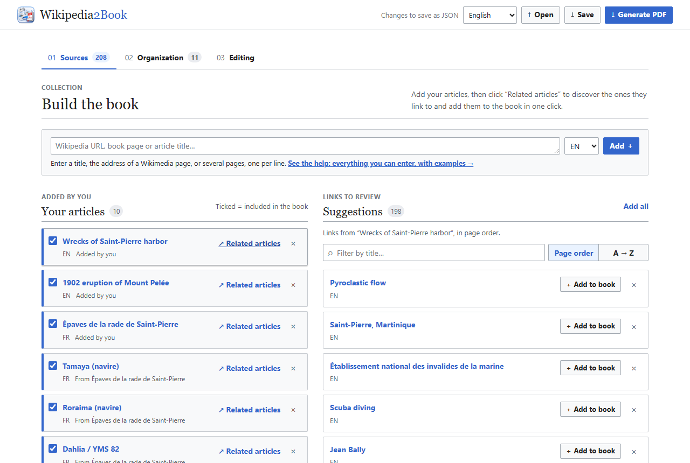
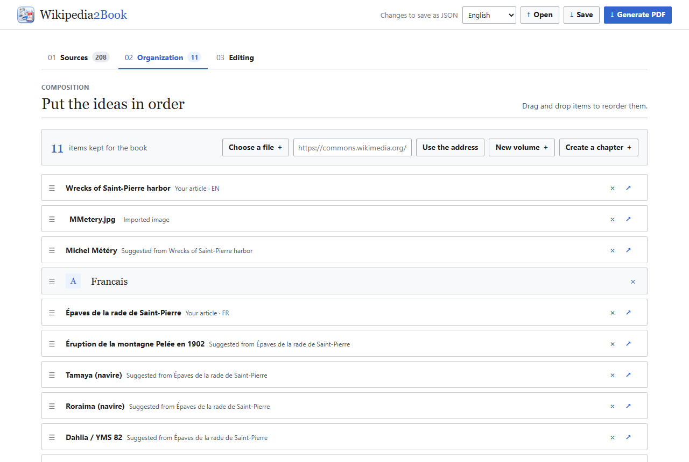
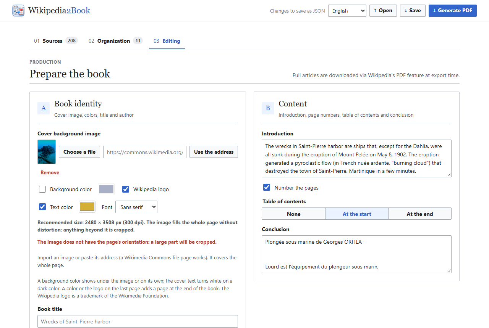

# Wikipedia2Book

<table><tr><td>

</td><td><a href="https://wikipedia2book.toolforge.org/"><strong>Wikipedia2Book</strong></a> is a web application that allows you to compile a book in a printable PDF format.
Users can select a Wikipedia book or specific articles, explore related links, organize content into chapters and volumes, and configure the layout before exporting the final PDF file.
Available for: Wikipedia, Wikisource, Wikibooks, Wikivoyage, Wikiversity, Wikiquote, Wiktionary, and Wikinews.
</td></tr></table>

## Features

Wikipedia2Book turns a selection of Wikimedia pages into one printable book. It never rewrites the articles: each one is included through the official PDF that Wikipedia (or the other Wikimedia project) produces for it, so the text, images and references are exactly those of the wiki. The application only adds what a book needs around them, such as a cover, a table of contents, chapter pages, a license page and page numbers, and it resizes every page to the paper format you choose. Everything happens in your browser, in three steps (Sources, Organization, Editing): nothing is stored on the server, and you keep your work by saving the book as a JSON file that you can open again later. The interface is available in 12 languages (French, English, Spanish, Portuguese, Italian, German, Dutch, Turkish, Chinese, Japanese, Arabic and Persian, the last two right to left), and the headings added to the PDF follow the language you choose.

**Search.** The Sources step has a single input field, and you never have to say what you are typing. Enter the title of an article, the address of a page or the name of a Wikipedia book page, and the application asks Wikipedia what it is, following redirects. When no page has exactly that title, Wikipedia's search results appear under the field while you type and can be added with one click. The "All" choice in the language list searches the same title in every proposed language at once. Once an article is in the book, its "Related articles" button lists the articles it links to, in the order in which they appear in the page. You can filter that list or sort it alphabetically, and add each suggestion yourself: nothing is ever added without your choice. A help page, available in the 12 languages, shows with examples everything the field accepts.

**Sources.** Besides Wikipedia, the field accepts pages from Wikisource, Wikibooks, Wikivoyage, Wikiversity, Wikiquote, Wiktionary and Wikinews, by their address or by an interwiki prefix such as `b:Title` or `voy:en:Lyon`, and each one is printed with its own project's official PDF. A Wikipedia book page (`Book:…` or `User:…/Books/…`) brings all its articles in their real order, with its chapters and subtitle. The table of contents of a Wikibooks book or of a Wikisource work can be imported in full, chapters included, and a Wikibooks printable version is read like a book. You can also paste a whole list of pages, one per line, with bullets, `[[wiki links]]`, Markdown links or language prefixes, or paste the source text of a book page. A book saved as JSON and published online opens directly from its address, and the PDF is always made from the current version of each page.

**Organization.** The second step shows the book as a single list that reads from top to bottom. You reorder articles by drag and drop, create chapters and give them a title, and each article belongs to the chapter placed above it. Next to the articles, you can add your own images and PDF files, either from your computer or by their address (a Wikimedia Commons file page works), and even any web page, which the server converts to PDF. Each imported document gets a title of its own that replaces the file name in the book. A large book can be split into volumes where you want. Above 300 articles, the application splits it into volumes by itself, between chapters, and generates one PDF per volume.

**Editing.** The last step gathers everything that makes the object a book. For the cover, you set the title, subtitle, author and a short note, and you can add a background image, a background color, the text color and font, and the Wikipedia logo. The default cover is white, in the style of Wikipedia headings. You can write an introduction and a conclusion, choose whether pages are numbered, and place the table of contents at the start or at the end of the book, or leave it out. An optional last page can carry its own image, color or logo. Finally, you choose the paper size (A0 to A6, Letter, Legal or a custom size), the orientation and the margins, including a binding margin for printing.

**The generated PDF, the API and administration.** The "Generate PDF" button downloads the official PDF of every article, recomposes every page to the chosen format and assembles the book while a window shows each step. The result has bookmarks for navigation, page numbers that run across the whole book, a table of contents whose entries link to their pages, and a license page that credits each article under CC BY-SA 4.0. If the server crashes, generation restarts by itself. Every feature of the interface is also available through an HTTP API, documented at `/docs`: you can, for example, get the PDF of a book saved as JSON with a single address (`/api/pdf/from-json?url=…`) or build a book from a list of sources (`/api/pdf/from-source`). Administrators sign in with their Wikimedia account on an `/admin` page that shows the state of the server, the latest generations with their stages and memory use, and the addresses the service refused, without ever recording who made a request.

## Important addresses

| What | Address |
| --- | --- |
| Home page (production, Toolforge) | <https://wikipedia2book.toolforge.org/> |
| Application | <https://wikipedia2book.toolforge.org/app> |
| Frequently asked questions | <https://wikipedia2book.toolforge.org/faq> |
| Pre-production (Northflank, follows `main`) | <https://prod--wikipedia2book--wkvpbnfj6h4v.code.run/> |
| Example book opened in the application | <https://wikipedia2book.toolforge.org/?json=https://gmoulard.github.io/wikipedia2book/static/Wrecks-of-Saint-Pierre-harbor.json> |
| Example PDF generated on request | <https://wikipedia2book.toolforge.org/api/pdf/from-json?url=https%3A%2F%2Fgmoulard.github.io%2Fwikipedia2book%2Fstatic%2FWrecks-of-Saint-Pierre-harbor.json&language=en> |
| Example PDF, regenerated every day | <https://gmoulard.github.io/wikipedia2book/static/Wrecks-of-Saint-Pierre-harbor.pdf> |
| Example book (JSON file) | <https://gmoulard.github.io/wikipedia2book/static/Wrecks-of-Saint-Pierre-harbor.json> |
| Interactive API documentation | <https://wikipedia2book.toolforge.org/docs> |
| Administration page | <https://wikipedia2book.toolforge.org/admin> |
| Search help | <https://gmoulard.github.io/wikipedia2book/helpSearch.en.html> |
| Usage statistics | <https://gmoulard.github.io/wikipedia2book/stats.html> |
| Documentation site | <https://gmoulard.github.io/wikipedia2book/> |
| Source code | <https://github.com/gmoulard/wikipedia2book> |
| Wikidata item | <https://www.wikidata.org/wiki/Q142203097> |

## Technology stack

  <!-- Project status, license & archive -->
  
  
  
  
  
  

  <!-- Frontend -->
  
  
  
  

  <!-- Backend -->
  
  
  
  

  <!-- PDF & content -->
  
  
  
  
  

  <!-- Deployment & tests -->
  
  
  
  

