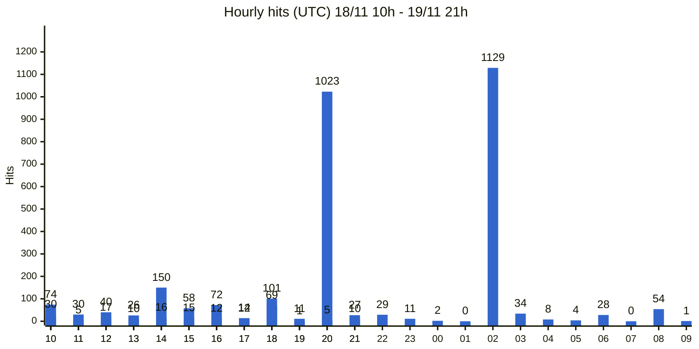
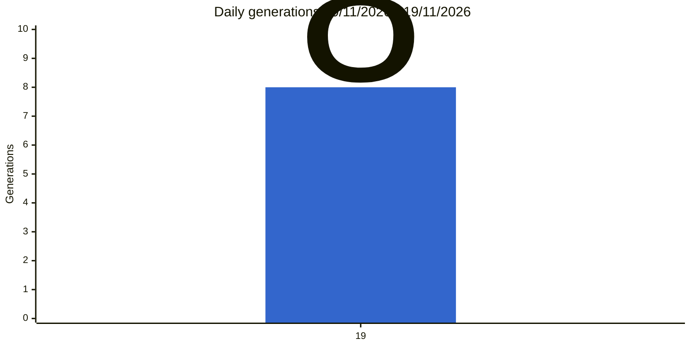
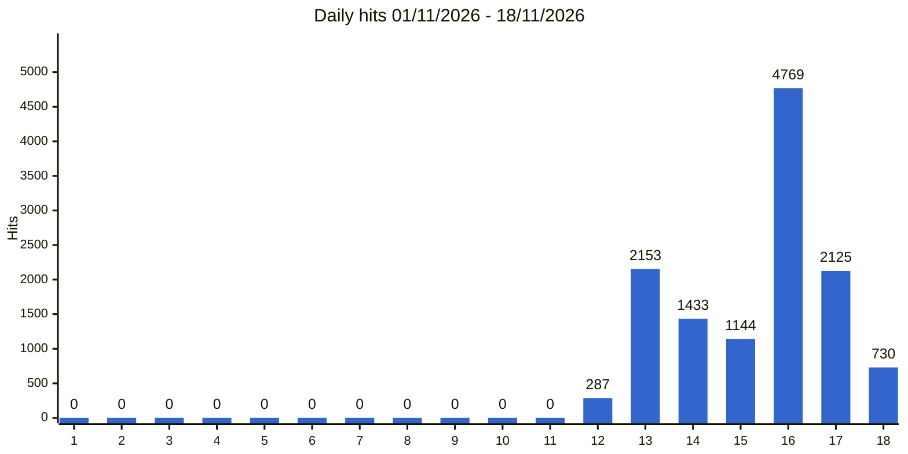
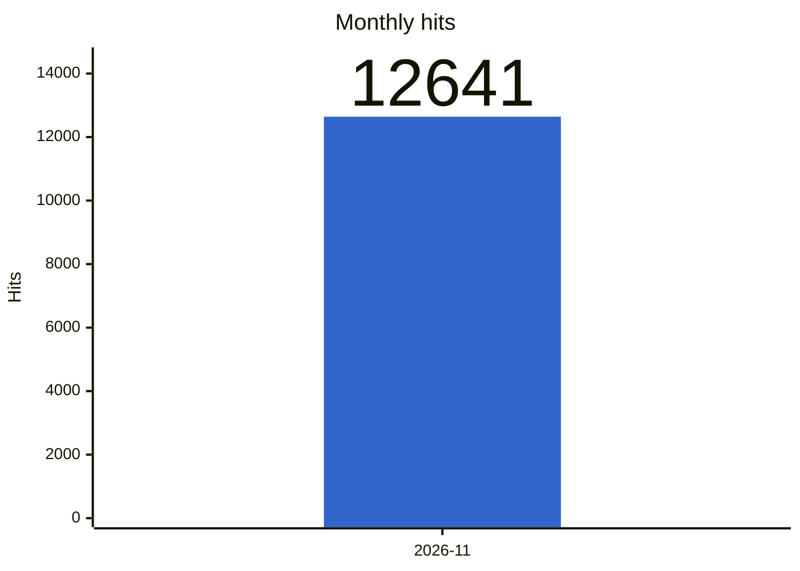

# Usage statistics / Statistiques d'utilisation

Wikipedia2Book on Toolforge, 2026-11-01 → 2026-11-18: **12641** hits.

Source: [Toolviews](https://toolviews.toolforge.org/), updated daily ([toolviews.csv](https://github.com/gmoulard/wikipedia2book/blob/main/docs/toolviews.csv)). Hits are HTTP requests, not people (page, static files, API calls).

Les hits sont des requêtes HTTP, pas des personnes. Mise à jour quotidienne.

## Hourly hits / Hits par heure (UTC, last 36 hours / 36 dernières heures)

Source: Toolforge webservice logs, read every day and just before each deployment, since they are erased at each restart. Every request seen by the application counts, static files included; an hour whose logs were lost before being read shows 0.

Source : journaux du webservice Toolforge, relevés chaque jour et juste avant chaque déploiement. Une heure dont les journaux ont été perdus avant d'être relevés vaut 0. À l'ouverture de la page, les heures plus récentes sont ajoutées en direct depuis l'application.

## Daily PDF generations / Générations de PDF par jour (1 days)

Since 2026-11-19: **8** generations, 8 finished, 0 with an error, 0 abandoned. A book in volumes counts one generation per volume.

Depuis le 19/11/2026 : **8** générations, 8 terminées, 0 en erreur, 0 abandonnées. Un livre en volumes compte une génération par volume. Source : journaux du webservice Toolforge, relevés comme les hits par heure.

## Daily hits / Hits par jour (18 days)

## Monthly hits / Hits par mois

