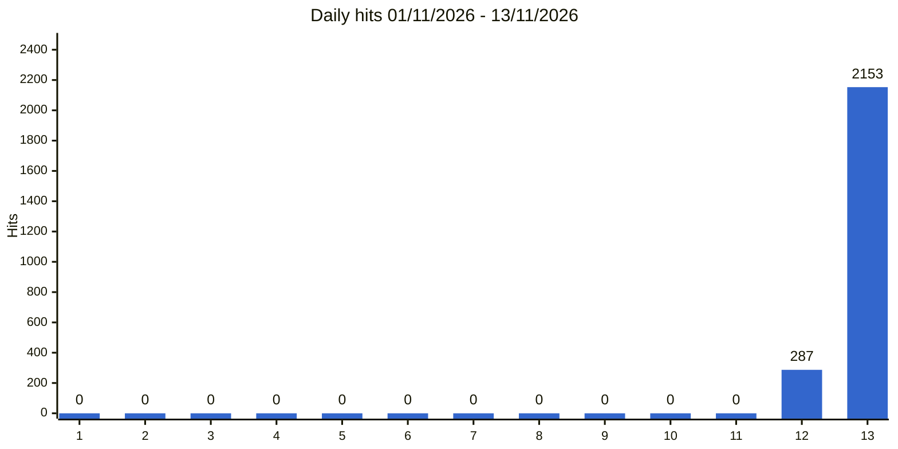
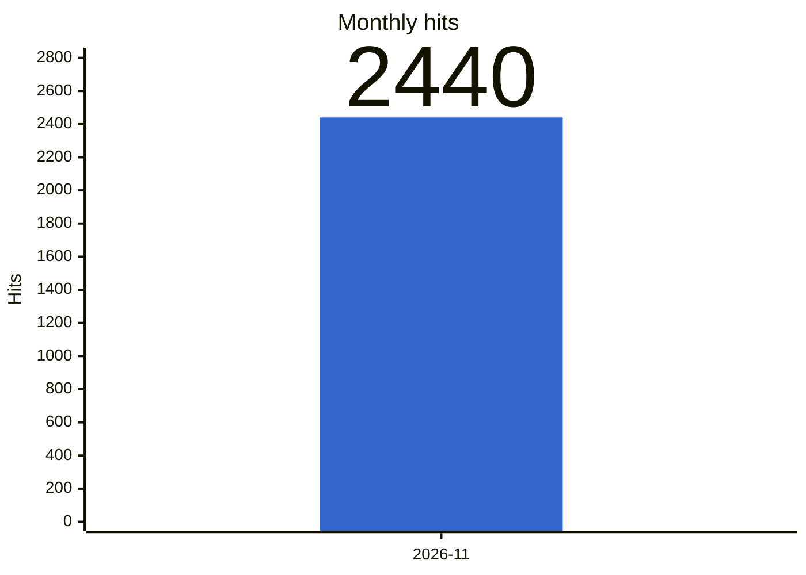

# Usage statistics / Statistiques d'utilisation

Wikipedia2Book on Toolforge, 2026-11-01 → 2026-11-13: **2440** hits.

Source: [Toolviews](https://toolviews.toolforge.org/), updated daily ([toolviews.csv](https://github.com/gmoulard/wikipedia2book/blob/main/docs/toolviews.csv)). Hits are HTTP requests, not people (page, static files, API calls).

Les hits sont des requêtes HTTP, pas des personnes. Mise à jour quotidienne.

## Daily hits / Hits par jour (13 days)

## Monthly hits / Hits par mois

